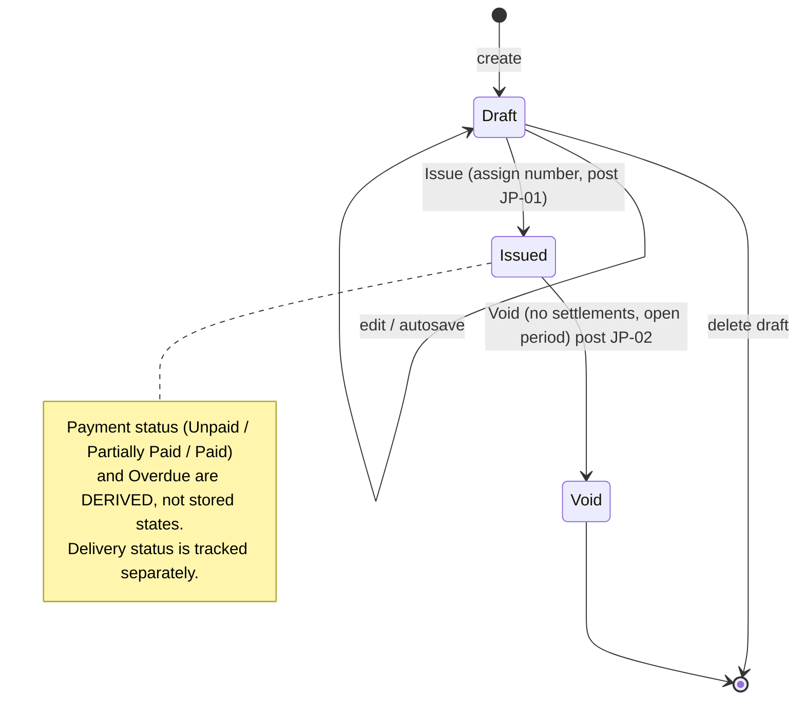

# Functional Workflows

> **STATUS: DRAFT v0.1 — NOT APPROVED.** This document translates `docs/01_PRD.md` (Draft v0.1) into implementation-ready workflows. It inherits every `TBD` and assumption of the PRD. Where this document goes beyond the PRD, the addition is labelled **[PROPOSED]** and listed in Section 18 for approval.

## 0. Document Information

| Field | Value |
|---|---|
| Document | `docs/02_Workflows.md` |
| Version / status | 0.1 — Draft, pending stakeholder review |
| Depends on | `docs/01_PRD.md` v0.1 (also draft) |
| Last updated | 2026-10-14 |
| Owner | *[TBD — Product Owner]* |
| Approval | **Not approved** |

### 0.1 Legend

| Tag | Meaning |
|---|---|
| **[PRD]** | Behavior stated or directly implied by the PRD. Still a draft, so not "confirmed" in the business sense. |
| **[PROPOSED]** | Behavior proposed by this document to make the workflow implementable. Needs approval. |
| **[TBD]** | Decision not yet made. No value has been invented. Linked to an open question `OQ-WF-nn` (Section 19) or a PRD question `Q#` (PRD §16). |
| **[VALIDATE-ACCT]** | Accounting, tax, or legal rule requiring validation by a qualified professional before implementation. |
| **MVP / P2 / FUT** | Release as classified in the PRD. Workflows for P2 items are outlined only where needed to keep MVP behavior consistent. |

### 0.2 Scope of This Document

- **In scope:** the 14 workflows requested, plus one additional workflow (WF-15, manual journals and reversals) because the PRD makes them MVP Must-Haves and several corrections depend on them.
- **Out of scope (by instruction):** database schema, API contracts, UI wireframes, code, architecture. "Database-level outcome" sections describe *what must be true after the operation*, conceptually.
- **Status of PRD scope.** The PRD MVP scope is itself unapproved. Workflows for items whose MVP status is `TBD` (credit notes, customer credit, MFA, subscription entitlements, cash-flow report) are included and marked, so the team can decide in or out without re-analysis.

### 0.3 Workflow Index

| ID | Workflow | PRD modules | Release |
|---|---|---|---|
| WF-01 | Business registration and organization setup | 7A, 7B | MVP |
| WF-02 | Login, logout, password recovery, session management | 7B | MVP |
| WF-03 | Organization switching and tenant-level access control | 7A, 7B | MVP |
| WF-04 | Inviting users; assigning roles and permissions | 7B | MVP |
| WF-05 | Customers (and vendors): create, edit, view, archive | 7C | MVP |
| WF-06 | Products and services (items) | 7D | MVP |
| WF-07 | Invoices: draft, issue, deliver | 7E | MVP |
| WF-08 | Customer payments: full and partial | 7F | MVP |
| WF-09 | Overdue handling, voids, credit notes, refunds, corrections | 7E, 7F, 7H | MVP / TBD / P2 |
| WF-10 | Expenses and vendor bills | 7G | MVP |
| WF-11 | Bill payments and allocation | 7G | MVP |
| WF-12 | Reports and financial summaries | 7I | MVP |
| WF-13 | Organization settings: profile, taxes, currency, fiscal periods, numbering, chart of accounts, lock date, opening balances | 7A, 7H, 7J | MVP |
| WF-14 | SaaS subscription and tenant lifecycle | 7K | MVP-lite / TBD |
| WF-15 | Manual journals and journal reversals (additional) | 7H | MVP |

---

## 1. Cross-Cutting Conventions

These rules apply to **every** workflow. Each workflow refers to them by ID instead of repeating them.

### 1.1 Actors and Role Abbreviations

| Abbrev. | Actor | Level |
|---|---|---|
| ANON | Unauthenticated visitor | — |
| OWN | Organization Owner | Organization |
| ADM | Organization Administrator | Organization |
| ACC | Accountant (including external accountants holding this role) | Organization |
| FIN | Finance Staff | Organization |
| EMP | Employee (claims are P2) | Organization |
| RO | Read-only User | Organization |
| PA | Platform Administrator | Platform |
| SYS | System (automated process) | — |

Permission requirements in each workflow reference the PRD matrix (PRD §11) and use indicative permission names such as `invoice.issue`. **Permission names are illustrative [PROPOSED]**; the authoritative mapping is PRD §11 once approved. Where the PRD matrix shows `◐ [TBD]`, the workflow says so.

### 1.2 Standard Pipeline for Mutating Operations (CP-1) **[PROPOSED]**

Every operation that creates, changes, or deletes tenant data passes through these steps, in order. Workflows state only the *deviations* or *specific checks* at each step.

| Step | Check | Failure category |
|---|---|---|
| 1 | **Authenticate**: valid, unexpired, non-revoked session. | `ERR-AUTHN` |
| 2 | **Resolve organization context** from the user's active membership (never from client-supplied identifiers alone). See TI rules, 1.3. | `ERR-NOTFOUND` / `ERR-FORBIDDEN` |
| 3 | **Check organization status** (active, trial, suspended, etc.; PRD FR-SUB-003). | `ERR-ORG-STATE` |
| 4 | **Authorize**: role holds the required permission for this action on this object. | `ERR-FORBIDDEN` |
| 5 | **Validate input**: shape, types, ranges, required fields, referenced objects exist *within this organization*. | `ERR-VALIDATION` |
| 6 | **Idempotency check** (financial and number-consuming operations): see 1.5. | replay result / `ERR-CONFLICT` |
| 7 | **Concurrency check**: the object version the user saw equals the current version. | `ERR-CONFLICT` |
| 8 | **State-transition check**: the operation is allowed from the object's current state. | `ERR-STATE` |
| 9 | **Period-lock check** (financial operations): effective accounting date is after the lock date. | `ERR-PERIOD-LOCKED` |
| 10 | **Begin atomic unit.** Apply business change, create journal(s), write audit record(s), record idempotency result. All or nothing (BR-TXN-1, FR-ACC-012, FR-NTF-013). | `ERR-SYSTEM` (rolled back) |
| 11 | **Commit.** | — |
| 12 | **Post-commit side effects** (email, PDF, notifications) run asynchronously; their failure never undoes step 10 (BR-TXN-6). | status shown on object |

Read-only operations use steps 1–4 and scope all queries to the active organization.

### 1.3 Tenant-Isolation Rules (TI) **[PRD NFR-TEN, BR-ORG-1/2]**

| ID | Rule |
|---|---|
| TI-1 | The organization for a request is derived from an **active membership** of the authenticated user. A client may *select* among its own memberships; it can never name an organization it has no active membership in. |
| TI-2 | Every object reference supplied by a client (customer, invoice, account, attachment, report, etc.) must be verified to belong to the resolved organization **before** use. |
| TI-3 | A reference to an object belonging to another organization is answered **exactly like a reference to a non-existent object** (`ERR-NOTFOUND`), so existence is not disclosed. **[PROPOSED]** |
| TI-4 | All list, search, report, export, dashboard, and notification queries are scoped to the resolved organization. |
| TI-5 | Cross-object operations (e.g., payment allocation, credit application) must reject any pair of objects from different organizations or different counterparties as defined by the workflow. |
| TI-6 | Files (attachments, PDFs, exports) are retrievable only after an authorization check against the owning organization on **every** download; links are non-guessable and preferably short-lived (BR-NTF-3). |
| TI-7 | Background jobs and asynchronous side effects carry the organization context captured at enqueue time and re-verify it at execution. |
| TI-8 | Caches, search indexes, logs, and analytics must not mix tenants (NFR-TEN-003). |
| TI-9 | Platform administrators have **no** default read or write access to tenant financial data (BR-SUB-1). |

### 1.4 Atomicity and Posting Rules

- **ATOM-1** A financial document change and its journal(s) and audit record(s) are committed together or not at all (BR-DE-6, BR-TXN-1).
- **ATOM-2** Before commit, the engine verifies each journal: ≥ 2 lines, Σ debits = Σ credits at stored precision, all accounts active, postable, and in the same organization, and the date is not in a locked period (BR-DE-1/3, FR-ACC-003).
- **ATOM-3** If the audit record cannot be written, the financial operation fails (BR-AUD-4, FR-NTF-013).
- **ATOM-4** Posted journals, issued/posted documents, and payments are never edited or deleted in place; correction is by reversal or an adjusting document (BR-REV-1).

### 1.5 Idempotency (IDEM) **[PRD BR-TXN-2, FR-INV-021, FR-PAY-014; mechanism PROPOSED]**

| ID | Rule |
|---|---|
| IDEM-1 | Operations that consume a number, post a journal, or move money (issue invoice, record payment, post bill, record bill payment, void, reverse, post journal, create credit note) require a **client-generated unique intent key**, created when the user opens the form or action and reused on any retry of that same intent. |
| IDEM-2 | Scope of a key: organization + user + operation type. |
| IDEM-3 | **Same key, same payload, already succeeded** → return the original result; create nothing new. |
| IDEM-4 | **Same key, different payload** → `ERR-CONFLICT` (reuse of a key for a different intent). |
| IDEM-5 | **Same key, first attempt still in progress** → the second request waits or receives "in progress, retry"; never executes twice. |
| IDEM-6 | A key is recorded **inside the atomic unit** of the operation so that "operation succeeded" and "key consumed" cannot diverge. |
| IDEM-7 | A failed (rolled-back) attempt does not consume the key; the user may retry with the same key. |
| IDEM-8 | The UI disables the submit control after the first click and shows progress. This is a convenience only; IDEM-1…7 are the control. |
| IDEM-9 | **Business-level duplicate detection** supplements keys (e.g., likely duplicate payment: same customer, amount, date, reference within a short window) and produces a *warning*, not a block. Window length is **TBD** (OQ-WF-12). |
| IDEM-10 | Key retention period **TBD** (must exceed the longest realistic retry/replay window). |

### 1.6 Concurrency Control (CONC) **[PROPOSED]**

| ID | Rule |
|---|---|
| CONC-1 | Each editable object carries a version indicator. Edits and state transitions must present the version the user loaded. |
| CONC-2 | A stale version is rejected with `ERR-CONFLICT` and a message explaining that the record changed; the user can reload and re-apply. |
| CONC-3 | Quantities that must not be over-consumed (invoice outstanding balance, bill outstanding balance, credit available, number sequences) are re-checked **inside** the atomic unit, with protection against simultaneous requests, regardless of what was displayed. |
| CONC-4 | Draft documents: simultaneous editing by two users is resolved by CONC-1/2 (last writer is told, not silently overwritten). Soft "being edited by" indicators are **TBD** (UX). |

### 1.7 Audit Event Standard (AUD) **[PRD BR-AUD-1…5, FR-NTF-005/006]**

Every audit record contains: **actor** (user, or SYS, or PA), **organization** (or "platform"), **timestamp**, **action**, **object type and ID**, **before/after values for key financial and security fields**, **source** (UI / API / system), **correlation or request ID**, and **reason** where the workflow requires one. Audit records are append-only (BR-AUD-2). Each workflow lists its event names in the form `domain.action` (e.g., `invoice.issued`). Event names are **indicative**.

### 1.8 Error Categories

| Category | Meaning | User-facing guidance (PRD §13.9) |
|---|---|---|
| `ERR-VALIDATION` | Input invalid or incomplete | Field-level, specific, actionable messages |
| `ERR-AUTHN` | Not signed in / session expired | Redirect to login; preserve unsaved work where feasible |
| `ERR-FORBIDDEN` | Signed in, role lacks permission | Explain, suggest contacting an Owner/Admin |
| `ERR-NOTFOUND` | Object absent **or in another organization** (TI-3) | Neutral "not found" |
| `ERR-ORG-STATE` | Organization suspended/deactivated or feature not in plan | Explain state and what is still allowed |
| `ERR-STATE` | Operation not allowed in the object's current state | Explain current state and the allowed alternative (e.g., "use a credit note") |
| `ERR-CONFLICT` | Stale version, duplicate request, key misuse, over-allocation race | Explain what changed; offer reload |
| `ERR-PERIOD-LOCKED` | Date falls in a locked period | Name the lock date; point to the permitted alternative |
| `ERR-RATE-LIMIT` | Too many attempts | Generic wait message |
| `ERR-DEPENDENCY` | Non-critical dependency (email, PDF) failed after commit | Show status on the object; offer retry |
| `ERR-SYSTEM` | Unexpected failure; nothing was committed | Support reference ID shown |

### 1.9 Derived Statuses and Balance Formulas **[PRD BR-INV-1, BR-PAY-7, BR-ALLOC-7]**

**Stored lifecycle state vs. derived indicators [PROPOSED].** The PRD lists *Draft, Sent, Partially Paid, Paid, Overdue, Void* together. To avoid contradictory states, this document separates three independent concepts:

| Concept | Values | Stored or derived |
|---|---|---|
| **Lifecycle state** | Draft, Issued, Void | Stored (changed only by workflows) |
| **Payment status** (Issued only) | Unpaid, Partially Paid, Paid | **Derived** from allocations and applied credits |
| **Overdue indicator** (Issued, outstanding > 0) | Overdue / not overdue | **Derived** from due date and today |
| **Delivery status** | Not sent, Queued, Sent, Failed, Bounced | Stored per delivery attempt; "Sent" is **not** a financial state |

*Presentation:* the UI shows one combined label (e.g., "Partially Paid · Overdue"). Approval of this separation is requested in OQ-WF-01.

**Formulas (all amounts in organization base currency, MVP):**

| Quantity | Definition |
|---|---|
| Invoice outstanding | `Total − Σ active payment allocations − Σ active credit applications` |
| Payment status | Unpaid if Σ settled = 0; Partially Paid if 0 < Σ settled < Total; Paid if Σ settled = Total. (Σ settled > Total is impossible, BR-ALLOC-2.) |
| Overdue | `lifecycle = Issued AND outstanding > 0 AND due date < today` where *today* is the date in the organization's time zone **[TBD boundary rule: OQ-WF-13]** |
| Days overdue | `today − due date` (calendar days) when Overdue |
| Customer receivable balance | `Σ outstanding of the customer's Issued invoices − unapplied customer credit` **[credit policy TBD]** |
| Bill outstanding / Payable status / Overdue | Mirror of invoice definitions using bill payments and (P2) vendor credits |
| AR control account balance | Must equal `Σ outstanding of all Issued invoices − unapplied customer credit` (FR-ACC-008). AR ageing total must equal it (REL-012). |

*Active* allocations/applications means those not reversed.

### 1.10 Document Calculation Pipeline **[PRD BR-TAXC-1; entire pipeline VALIDATE-ACCT]**

The server **always recomputes** totals; client-displayed totals are previews only. Sequence:

| Step | Calculation | Open decisions |
|---|---|---|
| C1 | Line amount = quantity × unit rate | Quantity and rate precision: TBD (BR-MON-2) |
| C2 | Line discount (percentage or fixed amount) applied to line amount | Discount type per line; cap = line amount |
| C3 | Document-level discount allocated across lines proportionally | Whether document-level discount is MVP: TBD (OQ-WF-14); allocation and remainder rule: VALIDATE-ACCT |
| C4 | Taxable amount per line = C1 − C2 − C3 allocation | For tax-inclusive pricing, back-calculate per BR-TAXC-2 |
| C5 | Tax per line (per rate; tax groups yield one amount per component) | Compound taxes: TBD. Tax on non-taxable charges: VALIDATE-ACCT |
| C6 | Rounding applied at the **policy rounding point** | **Per line vs. per tax rate vs. per document, and rounding mode: TBD, VALIDATE-ACCT (BR-MON-3)** |
| C7 | Document totals: subtotal, total discount, tax per rate, rounding adjustment (if any), grand total | Treatment of rounding residual: VALIDATE-ACCT (BR-MON-4) |

**Why the rounding point must be decided before build (illustration, not a rule).** Two lines of 0.05 each taxed at an illustrative 10 % give tax 0.005 per line. Rounding **per line** (half-up) gives 0.01 + 0.01 = **0.02**; rounding **per document** gives 0.10 × 10 % = 0.01 → **0.01**. A one-unit difference appears in totals, journals, and reports.

**Worked example with no rounding ambiguity (illustrative figures and rate, not tax guidance):** 2 × 500.00 = 1 000.00; line discount 10 % = 100.00; taxable 900.00; tax at an illustrative 10 % = 90.00; total 990.00. Journal: Dr AR 990.00; Cr Revenue 900.00; Cr Tax Payable 90.00. Debits 990.00 = Credits 990.00.

### 1.11 Journal Posting Catalog (JP) **[PROPOSED; account mapping to be validated: VALIDATE-ACCT]**

"System accounts" are protected accounts seeded per organization (FR-ACC-002). All journals reference their source document (FR-ACC-013).

| ID | Event | Debit | Credit | Notes |
|---|---|---|---|---|
| JP-01 | Invoice issued | Accounts Receivable (total) | Income account per line (net of discount); Tax Payable per rate; Rounding account if used | Discount shown net vs. gross-with-contra: VALIDATE-ACCT |
| JP-02 | Invoice voided | Mirror of JP-01 | Mirror of JP-01 | Dated per 1.12 |
| JP-03 | Customer payment recorded | Deposit account (bank/cash) for payment amount | Accounts Receivable for allocated portion; Customer Credit / Unapplied account for unallocated portion | Customer Credit account and policy: TBD (OQ-WF-07) |
| JP-04 | Customer payment reversed | Mirror of JP-03 | Mirror of JP-03 | |
| JP-05 | Credit note issued **[scope TBD]** | Income account (or Sales Returns, TBD) per line; Tax Payable per rate | Accounts Receivable for the portion applied to invoices; Customer Credit for the remainder | Treatment: VALIDATE-ACCT |
| JP-06 | Customer refund **(P2)** | Customer Credit (or AR) | Deposit account | |
| JP-07 | Vendor bill posted | Expense/Asset account per line; Input Tax per rate | Accounts Payable | Input-tax claimability: VALIDATE-ACCT |
| JP-08 | Vendor bill voided | Mirror of JP-07 | Mirror of JP-07 | |
| JP-09 | Bill payment recorded | Accounts Payable (allocated); Vendor Advance (unallocated, TBD) | Paid-from account (bank/cash/card) | |
| JP-10 | Bill payment reversed | Mirror of JP-09 | Mirror of JP-09 | |
| JP-11 | Direct expense recorded | Expense account; Input Tax | Paid-from account | |
| JP-12 | Manual journal | As entered | As entered | Restrictions in WF-15 |
| JP-13 | Journal reversal | Mirror | Mirror | |
| JP-14 | Opening balances | Per entered balances | Per entered balances; balancing line to an Opening Balance Equity account **[TBD, VALIDATE-ACCT]** | |
| JP-15 | Year-end close **(S, TBD)** | Out of detail in this version | | PRD FR-ACC-014 |

### 1.12 Correction Dating Rule **[PRD BR-REV-4; VALIDATE-ACCT]**

When a void or reversal posts a mirror journal:

- If the **original accounting date is in an open period** → the mirror is dated the original date by default (user may choose a later open date; reason recorded).
- If the original date is in a **locked period** → **the void/reversal is blocked** (`ERR-PERIOD-LOCKED`) **[PROPOSED]**. The user is directed to the permitted alternative: a credit note / adjusting entry dated in an open period, or a controlled unlock (WF-13 sub-flow 13G).

The PRD (BR-REV-4) allows "first open date" as an alternative; this document recommends blocking because shifting the mirror date silently separates the reversal from its original in period reports. Decision: OQ-WF-04.

### 1.13 Standard Notation in Workflow Tables

- **Steps** are numbered `n`; alternates `A-n`; failures `F-n`. Acceptance criteria use `AC-WFnn-m`.
- *CP-1* means the standard pipeline in 1.2 applies to that step.
- "Org" = organization (tenant).

---

# Part A — Identity, Tenancy, and Access

## 2. WF-01 — Business Registration and Organization Setup

| Item | Detail |
|---|---|
| **ID / Name** | WF-01 — Business registration and organization setup |
| **Purpose** | Let a new user create an account, verify their email, and create an organization (tenant) that is ready for day-to-day use. |
| **PRD refs** | FR-ORG-001/002/003/004/007/008, FR-AUTH-001/002, BR-ORG-1…5, PRD §8.1 |
| **Release** | MVP |
| **Actors / permissions** | ANON (sign-up); verified user (create organization). Becomes OWN of the new organization. No role permission needed to create one's own organization **[PROPOSED: limit on organizations per user TBD, OQ-WF-15]**. |
| **Preconditions** | Email address not already registered (for sign-up). Terms/privacy acceptance text exists **[TBD: legal]**. |
| **Trigger** | User submits the sign-up form (or, if already registered and verified, chooses "Create organization"). |

### 2.1 Happy Path

| # | Actor | Step | System behavior | Validation / rules |
|---|---|---|---|---|
| 1 | User | Opens sign-up; enters full name, email, password; accepts terms. | Validates inputs. Creates an **unverified** user account with no organization. Sends a verification email containing a single-use, time-limited token. Responds with a neutral message ("check your email") regardless of whether the email was already registered (no enumeration). | Email: valid format, normalized (trim, case-insensitive compare) **[PROPOSED]**. Password: policy **TBD** (minimum length, breached-password check: OQ-WF-16). Name required. Terms accepted. Rate-limited (NFR-SEC-006). |
| 2 | User | Opens the verification link. | Validates token (exists, unused, unexpired, matches account). Marks email verified; consumes token. Signs the user in (or prompts login). | Expired/used token → F-2. Token lifetime **TBD** (BR-AUTH-5). |
| 3 | User | Starts the organization setup wizard. | Shows the wizard only to verified users (FR-AUTH-002). | Unverified users cannot reach this step. |
| 4 | User | Enters: business name, country, base currency, time zone, fiscal-year start month, (optional) tax registration identifier(s), address. | Pre-fills currency and time zone from country where a default exists **[PROPOSED]**. Shows a **confirmation that base currency cannot be changed after the first posted transaction** (BR-ORG-3, BR-CUR-1). | Business name required, length limits **TBD**. Country from supported list **[TBD: Q1]**. Currency is a valid standard code (BR-CUR-4). Time zone valid. Fiscal-year start month 1–12. Tax identifier format validated **only where a rule is confirmed [VALIDATE-ACCT]**; otherwise stored as entered. |
| 5 | User | Submits the wizard. | **Atomic creation (CP-1 steps 10–11):** organization; Owner membership for this user; default chart of accounts incl. protected system accounts (AR, AP, Tax Payable, Input Tax, bank/cash placeholder, Opening Balance Equity **[TBD]**, retained earnings) per country/template **[TBD template, FR-ORG-002]**; default tax placeholders; default settings (date/number formats, default payment terms, invoice numbering defaults); lock date unset; subscription/trial record if applicable **[TBD: WF-14]**. Writes audit records. | If any part fails, nothing is created (F-4). Idempotency key per IDEM-1 prevents a double-submit creating two organizations. |
| 6 | System | Redirects to dashboard with a **setup checklist**. | Checklist items (PRD §13.7): add customers/items, invite team, enter opening balances, issue first invoice. | — |

### 2.2 Alternate Paths and Failure Scenarios

| ID | Scenario | Behavior |
|---|---|---|
| A-1 | User already has an account | Logs in (WF-02) and chooses "Create organization"; steps 4–6 apply. |
| A-2 | User arrived through an invitation | Follows WF-04 acceptance; organization setup is skipped. |
| A-3 | User abandons the wizard | The account exists, verified, with zero organizations. On next login, the user is offered "Create organization" or "Accept invitation" (WF-02A step 4). No half-created organization exists. |
| A-4 | Country has no default currency/time zone | User selects explicitly; no silent default. |
| F-1 | Email already registered | Neutral response (step 1). If the existing account is verified, a separate informational email ("someone tried to register with your address") may be sent **[TBD: OQ-WF-17]**. |
| F-2 | Verification link expired or used | Page offers "send a new link" (rate-limited). Old tokens invalidated when a new one is issued. |
| F-3 | Validation errors | Inline field messages; entered data preserved (except password). |
| F-4 | Creation fails partway | Whole unit rolled back; user sees `ERR-SYSTEM` with reference ID; retry with same idempotency key is safe. |
| F-5 | Double-click / retry | One organization (IDEM-3). |
| F-6 | Unsupported country/currency chosen | `ERR-VALIDATION`; link to contact/waitlist **[TBD]**. |

### 2.3 Expected Data-Level Outcome (conceptual)

- One user identity (verified), one organization, one active Owner membership linking them.
- A seeded chart of accounts containing the protected system accounts needed by later postings; no journals yet.
- Organization settings capturing base currency, time zone, locale/format preferences, fiscal-year start, numbering defaults.
- No transactions; lock date empty.
- Audit records for each created object.

### 2.4 Security and Tenant Isolation

- New organization is isolated from creation (TI-1…TI-9): only its Owner has membership.
- Verification and reset tokens are high-entropy, single-use, stored so they cannot be recovered from storage **[PROPOSED]**.
- Sign-up/verification endpoints are rate-limited; responses do not disclose whether an account exists.
- No organization data is accessible before email verification.

### 2.5 Audit Events

`user.registered`, `user.email_verified`, `org.created` (with base currency, country, fiscal-year start), `membership.created` (role = Owner), `coa.seeded` (template ID), `org.settings.initialized`.

### 2.6 Acceptance Criteria

| ID | Given / When / Then |
|---|---|
| AC-WF01-01 | **Given** an unregistered email, **when** the user submits sign-up with a valid password, **then** an unverified account exists, a verification email is sent, and the response does not reveal whether the email was previously registered. |
| AC-WF01-02 | **Given** an unverified account, **when** the user tries to reach organization setup or any organization data, **then** access is denied and verification is requested. |
| AC-WF01-03 | **Given** a verified user completes the wizard with valid data, **when** the form is submitted, **then** exactly one organization is created with the user as Owner, a default chart of accounts including all protected system accounts, and an audit record for each creation. |
| AC-WF01-04 | **Given** the wizard submission is sent twice with the same idempotency key, **when** both reach the server, **then** one organization exists. |
| AC-WF01-05 | **Given** a failure occurs while seeding the chart of accounts, **when** the operation aborts, **then** no organization, membership, or partial accounts remain. |
| AC-WF01-06 | **Given** a verification token that is expired or already used, **when** the link is opened, **then** the account stays unverified and the user is offered a new link. |
| AC-WF01-07 | **Given** a new organization, **when** its first transaction is posted and the Owner then tries to change base currency, **then** the change is blocked (see WF-13 sub-flow 13B). |

### 2.7 Dependencies and Open Questions

- Depends on: email provider (PRD §12 #1), default CoA templates (WF-13 sub-flow 13F), WF-14 (trial record).
- Open: Q1 (target country), OQ-WF-15 (organizations per user), OQ-WF-16 (password policy), OQ-WF-17 (informational email on duplicate registration), CoA template per market **[TBD]**, legal terms acceptance record.

---

## 3. WF-02 — Login, Logout, Password Recovery, Session Management

| Item | Detail |
|---|---|
| **ID / Name** | WF-02 — Authentication and sessions (sub-flows 02A Login, 02B Logout, 02C Password recovery, 02D Session management) |
| **Purpose** | Securely authenticate users, end sessions, recover access, and let users see and revoke sessions. |
| **PRD refs** | FR-AUTH-001…006, 010, 012, BR-AUTH-1/4/5, NFR-SEC-001/002/006 |
| **Release** | MVP (session listing S: MVP/P2; MFA S: MVP/P2 TBD) |
| **Actors / permissions** | ANON (login, recovery); any authenticated user (logout, own sessions). |
| **Preconditions** | Verified account (login). |
| **Trigger** | User submits credentials; clicks logout; requests reset; opens security settings. |

### 3.1 Sub-flow 02A — Login

| # | Actor | Step | System behavior | Validation / rules |
|---|---|---|---|---|
| 1 | User | Submits email and password. | Applies **rate limiting** by account identifier and by source (NFR-SEC-006). Looks up account and verifies password in a way that takes comparable time whether or not the account exists. | Failure message is **identical** for unknown email, wrong password, and unverified account (the last may additionally show "resend verification" only after correct password **[PROPOSED]**). |
| 2 | System | *(If MFA enabled for the user or enforced by the organization)* prompts for second factor. | Verifies factor; limited attempts. | MFA scope and enforcement **[TBD: OQ-WF-18; FR-AUTH-010 is S/TBD]**. |
| 3 | System | Creates a **session**. | Records creation time, last activity, client descriptor; sets idle and absolute expiry. Writes audit. | Lifetimes **TBD** (OQ-WF-19). |
| 4 | System | Determines organization context. | **0 memberships** → offer "Create organization" (WF-01) or show pending invitations. **1 membership** → enter it. **>1** → enter last-used active organization if still valid, else show chooser (WF-03). | Only **active** memberships of **non-deactivated** organizations are listed. |
| 5 | System | If the active organization is **suspended** | Applies the suspended-organization behavior (PRD FR-SUB-003) **[TBD: OQ-WF-09]**; recommended: read-only/export access (BR-SUB-3). | — |

**Failures:** F-1 wrong credentials (generic message, counter incremented); F-2 throttled (`ERR-RATE-LIMIT`, generic wait message, lockout/backoff thresholds **TBD**); F-3 MFA failure; F-4 account disabled by platform **[TBD]**; F-5 session creation failure (`ERR-SYSTEM`, no partial session).

### 3.2 Sub-flow 02B — Logout

| # | Step | System behavior |
|---|---|---|
| 1 | User chooses "Log out". | **Server-side invalidation** of the current session (not merely deleting client state). |
| 2 | *(Optional)* "Log out of all devices". | Invalidates all of the user's sessions. |
| 3 | System | Clears active organization context; redirects to login; writes audit. |

Alternate: logout of an already-expired session → treated as success. Failure: session store unavailable → user told logout may not be complete; client state cleared regardless; retried **[PROPOSED]**.

### 3.3 Sub-flow 02C — Password Recovery

| # | Actor | Step | System behavior | Validation / rules |
|---|---|---|---|---|
| 1 | User | Requests reset with email. | **Always** responds with the same neutral message. If an account exists, creates a single-use, time-limited reset token and emails a link. Rate-limited per email and source. | No account-existence disclosure (FR-AUTH-005). Token lifetime **TBD** (BR-AUTH-5). Issuing a new token invalidates prior tokens. |
| 2 | User | Opens link; enters new password twice. | Validates token (unused, unexpired). Validates password against policy **[TBD]**. | Weak/breached password → inline error. |
| 3 | System | On success. | Stores new password credential; **consumes** token; **revokes all existing sessions** **[PROPOSED]**; sends a "your password was changed" email; writes audit; routes to login (no auto-login **[PROPOSED]**). | Whether a successful reset also marks an unverified email as verified: **TBD** (OQ-WF-20). |

**Failures:** F-1 expired/used token → "request a new link"; F-2 same token used twice → second attempt fails; F-3 password reset requested for suspended-organization user → still allowed (identity is platform-level); F-4 reset email undeliverable → no user-visible difference; delivery failure logged.

### 3.4 Sub-flow 02D — Session Management

| # | Step | System behavior |
|---|---|---|
| 1 | User opens Security settings. | Lists own active sessions: client descriptor, created, last active, "current" marker. (Location/IP display subject to privacy decision **[TBD]**.) |
| 2 | User revokes a session. | Invalidates that session; its next request fails `ERR-AUTHN`; audit. |
| 3 | User changes password while signed in. | Requires current password; revokes **other** sessions; email notification; audit. |

**Continuous rules:**
- **Idle and absolute timeouts** end sessions server-side; the UI warns before expiry and preserves unsaved form data where feasible (PRD §13.5) **[TBD durations]**.
- **Permission/role change** takes effect on the user's **next request**, no re-login needed (BR-AUTH-4).
- **Membership removal** ends that user's access to the organization immediately; other organizations unaffected.
- **Sensitive-action re-authentication** (e.g., unlock period, change roles, export all data, transfer ownership) **[PROPOSED; TBD: OQ-WF-21]**.

### 3.5 Expected Data-Level Outcome (conceptual)

- Login creates a session record; logout/revocation marks it invalid; reset consumes a token and invalidates sessions; failed-attempt counters updated; no financial data touched.

### 3.6 Security and Tenant Isolation

- Passwords never stored recoverably or logged (NFR-SEC-002); tokens single-use.
- Authentication proves identity only; **organization authorization is evaluated per request** (BR-AUTH-1).
- Platform administrator sessions require MFA (FR-AUTH-015) and are separate from organization sessions.
- Timing and message uniformity to resist account enumeration.

### 3.7 Audit Events

`auth.login.success`, `auth.login.failure` (aggregated; no password data), `auth.mfa.enrolled/failed`, `auth.logout`, `auth.session.revoked`, `auth.password.reset_requested`, `auth.password.changed`, `auth.password.reset_completed`, `auth.sessions.revoked_all`. Failed-login audit volume and retention **TBD**.

### 3.8 Acceptance Criteria

| ID | Given / When / Then |
|---|---|
| AC-WF02-01 | **Given** wrong password, unknown email, or unverified account, **when** login is attempted, **then** the response text is identical in all three cases. |
| AC-WF02-02 | **Given** repeated failed logins beyond the approved threshold, **when** another attempt is made, **then** it is throttled regardless of whether the email exists. |
| AC-WF02-03 | **Given** a signed-in user logs out, **when** the old session credential is replayed, **then** the request is rejected as unauthenticated. |
| AC-WF02-04 | **Given** a reset link was used successfully, **when** it is opened again, **then** it is rejected and no password change occurs. |
| AC-WF02-05 | **Given** a successful password reset, **when** it completes, **then** all previous sessions are invalid and a notification email is sent. |
| AC-WF02-06 | **Given** a user with sessions on two devices, **when** one is revoked from the other, **then** the revoked session's next request fails and the current session continues. |
| AC-WF02-07 | **Given** a role downgrade from Accountant to Read-only, **when** the user's next request attempts a write, **then** it is rejected without requiring re-login. |
| AC-WF02-08 | **Given** a request for password reset for an unregistered email, **when** processed, **then** the user sees the same neutral message and no email is sent. |

### 3.9 Dependencies and Open Questions

- Email provider; MFA library/decision. Open: OQ-WF-16, 18, 19, 20, 21; PRD Q10 (security expectations).

---

## 4. WF-03 — Organization Switching and Tenant-Level Access Control

| Item | Detail |
|---|---|
| **ID / Name** | WF-03 — Organization switching and tenant access control |
| **Purpose** | Let users belonging to several organizations (e.g., external accountants) move between them safely, and define the access-evaluation procedure every request follows so no data crosses tenants. |
| **PRD refs** | FR-ORG-005/006, BR-ORG-1/2, BR-AUTH-1, NFR-TEN-001…006, REL-001, PRD §8.1–8.2 |
| **Release** | MVP (switching is S; tenant enforcement is M) |
| **Actors / permissions** | Any authenticated user with ≥ 1 active membership. |
| **Preconditions** | Authenticated session (WF-02). |
| **Trigger** | User opens the organization switcher; opens a deep link to an object; any request. |

### 4.1 Sub-flow 03A — Switching Organizations

| # | Actor | Step | System behavior | Validation / rules |
|---|---|---|---|---|
| 1 | User | Opens switcher. | Lists organizations where the user has an **active** membership: name, user's role, status badge (e.g., suspended). | Excludes removed memberships, pending invitations, deactivated orgs. |
| 2 | User | Selects an organization. | Re-verifies membership **now** (not from a cached list); verifies organization status; sets the active context; **clears all client-held organization data** (lists, drafts in memory, caches) and loads the dashboard or the equivalent page. | If membership revoked meanwhile → F-1. |
| 3 | System | Records preference. | Stores "last used organization" for next login. | — |

### 4.2 Sub-flow 03B — Deep Links and Emails

| # | Step | System behavior |
|---|---|---|
| 1 | User opens a link to an object (e.g., an invoice in an email notification). | Link carries the target organization. |
| 2 | System | If user is not a member → `ERR-NOTFOUND`-style neutral page. If member but active org differs → **prompt to switch** (never render the other organization's object inside the current context). If member and org matches → render subject to permission. |

### 4.3 Sub-flow 03C — Per-Request Tenant Access Evaluation (the "TAC procedure")

Every authenticated request, in addition to CP-1 for writes:

| Step | Rule |
|---|---|
| TAC-1 | Resolve organization per TI-1. |
| TAC-2 | Confirm membership is active and organization is in a state that allows the request (WF-14 states). |
| TAC-3 | Load the user's role in *that* organization (BR-AUTH-2: platform roles never confer organization privileges). |
| TAC-4 | Authorize action against role (PRD §11). **Deny by default** (NFR-SEC-004). |
| TAC-5 | Verify every referenced object belongs to the organization (TI-2/3). |
| TAC-6 | Scope all queries (TI-4); scope files (TI-6); scope jobs (TI-7). |

### 4.4 Alternate Paths and Failure Scenarios

| ID | Scenario | Behavior |
|---|---|---|
| A-1 | User has exactly one organization | Switcher shows it; no chooser at login. |
| A-2 | External accountant with many client organizations | Switcher supports search/filter when the list is long; ordering by last used **[PROPOSED]**; dedicated multi-client console is FUT. |
| A-3 | Two browser tabs on different organizations | **Design question:** whether organization context is held per session (last switch wins in all tabs) or per tab/request. **Recommendation [PROPOSED]:** per-request explicit organization selection verified server-side (TI-1) so a stale tab cannot act on the wrong organization. Decision: OQ-WF-22. |
| F-1 | Membership removed, org deactivated, or role changed while user is viewing | Next request re-evaluated; user sees an access message and is moved to another organization or the no-organization state. |
| F-2 | User crafts a request naming another organization's object IDs | `ERR-NOTFOUND` (TI-3). Security-relevant repeated attempts are logged. |
| F-3 | Switching to a **suspended** organization | Allowed per suspended-state behavior (OQ-WF-09); banner shown; write actions blocked. |
| F-4 | Unsaved draft when switching | User warned; drafts are not carried across organizations. |

### 4.5 Expected Data-Level Outcome (conceptual)

- No tenant data changes. The user's session/context and "last-used organization" preference are updated.

### 4.6 Security and Tenant Isolation

This workflow *is* the isolation control. Required test dimensions (NFR-TEN-004): every endpoint and resource type × {other-organization ID, no membership, removed membership, wrong role}. Exports, attachments, generated PDFs, report caches, and queued jobs are included. Platform administrators are denied tenant data by TAC-3/TI-9.

### 4.7 Audit Events

`org.switched` (low severity; retention/inclusion **TBD**), `access.denied` (cross-tenant or privilege attempts; aggregated), `membership.access_revoked_effective`.

### 4.8 Acceptance Criteria

| ID | Given / When / Then |
|---|---|
| AC-WF03-01 | **Given** user U belongs to Org A only, **when** U requests any record of Org B by ID through UI, direct URL, search, report, export, or attachment link, **then** the response is indistinguishable from a non-existent record and no Org B data is disclosed. |
| AC-WF03-02 | **Given** U belongs to Orgs A and B, **when** U switches from A to B, **then** no A data remains visible and subsequent requests operate on B with U's role in B. |
| AC-WF03-03 | **Given** U's membership in B is removed while U is signed in, **when** U's next request targets B, **then** it is rejected and U is directed to a valid context. |
| AC-WF03-04 | **Given** U is Accountant in A and Read-only in B, **when** U attempts to post a journal in B, **then** it is denied; the same action in A succeeds. |
| AC-WF03-05 | **Given** an emailed deep link to an Org B invoice and U's active org is A, **when** U opens it, **then** U is prompted to switch rather than seeing the invoice in A's context. |
| AC-WF03-06 | **Given** a Platform Administrator session, **when** it requests an organization's invoices outside the audited support-access flow, **then** the request is denied. |
| AC-WF03-07 | **Given** an asynchronous PDF job enqueued for Org A, **when** it runs, **then** it reads only Org A data and produces a file retrievable only by authorized Org A members. |

### 4.9 Dependencies and Open Questions

- Depends on WF-02, WF-04, WF-14. Open: OQ-WF-09, OQ-WF-22; PRD Q17 (support access).

---

## 5. WF-04 — Inviting Users; Assigning Roles and Permissions

| Item | Detail |
|---|---|
| **ID / Name** | WF-04 — Invitations, membership, and roles (sub-flows 04A Invite, 04B Accept, 04C Change role, 04D Remove member, 04E Manage invitations, 04F Transfer ownership) |
| **Purpose** | Let Owners/Admins add people to an organization with the right role, adjust or revoke access, and keep at least one Owner. |
| **PRD refs** | FR-AUTH-007/008/009/013/012, BR-AUTH-1/3/4, BR-ORG-5, PRD §8.2, §11 |
| **Release** | MVP (custom roles: P2; ownership transfer: no PRD requirement, **[PROPOSED]**) |
| **Actors / permissions** | Invite, change roles, remove: **OWN, ADM** (ADM may not grant or modify the Owner role, PRD §11.2). Accept: the invitee. |
| **Preconditions** | Inviter has an active membership with `users.manage`. Organization active (not suspended). Plan user limit not exceeded **[TBD: OQ-WF-23]**. |
| **Trigger** | Inviter submits invitation; invitee opens link; inviter edits/removes member. |

### 5.1 Sub-flow 04A — Send Invitation

| # | Actor | Step | System behavior | Validation / rules |
|---|---|---|---|---|
| 1 | OWN/ADM | Opens Users & Roles → Invite. Enters email, selects role (OWN, ADM, ACC, FIN, EMP*, RO). *EMP is P2. | Validates input. | Email format; **not already an active member**; **no duplicate pending invitation** for the same email (offer "resend" instead). Role assignable by this inviter: **ADM cannot invite as OWN**; roles above the inviter's own authority are not selectable **[PROPOSED]**. Plan limit check **[TBD]**. |
| 2 | System | Creates a pending invitation bound to the invited email, with role, inviter, creation time, expiry. | Token single-use, high-entropy, lifetime **TBD** (BR-AUTH-3). | — |
| 3 | System | Sends invitation email naming the organization and inviter. | Email failure recorded; inviter sees status; resend allowed. | Rate-limited per inviter/org (NFR-SEC-006). |
| 4 | System | Writes audit. | — | — |

### 5.2 Sub-flow 04B — Accept Invitation

| # | Actor | Step | System behavior | Validation / rules |
|---|---|---|---|---|
| 1 | Invitee | Opens link. | Validates token: exists, unused, unexpired, not revoked. | Else F-1. |
| 2 | Invitee | If no account: registers with the **invited email (locked)**; verifies email. If account exists: logs in. | The signed-in account's email must equal the invited email (BR-AUTH-3). | Different email → F-2. |
| 3 | Invitee | Confirms acceptance. | **Atomic:** membership becomes active with the invited role; invitation consumed; audit written; inviter notified **[PROPOSED]**. | A concurrent second acceptance fails (single-use). |
| 4 | System | Routes invitee into the organization (or adds it to the switcher). | — | External accountants keep memberships elsewhere (FR-AUTH-013). |

### 5.3 Sub-flow 04C — Change Role

| # | Step | System behavior | Validation / rules |
|---|---|---|---|
| 1 | OWN/ADM opens member, selects new role. | Validates target and new role. | **Cannot demote the last Owner** (BR-ORG-5). **ADM cannot modify an Owner** or grant Owner. A user cannot raise their own role. |
| 2 | Confirms. | Updates membership role (CP-1). Effective on the member's **next request** (BR-AUTH-4). Writes audit with before/after. Notifies member **[TBD]**. | Items the member created remain attributed to them. |

### 5.4 Sub-flow 04D — Remove Member

| # | Step | System behavior | Validation / rules |
|---|---|---|---|
| 1 | OWN/ADM selects "Remove". Confirmation explains consequences. | Ends membership; member's access to the organization ends immediately; other organizations unaffected. | **Cannot remove the last Owner.** ADM cannot remove an Owner. |
| 2 | System | Drafts and records authored by the member are **retained and attributed** (PRD §7B edge cases). Pending approvals reassigned **(P2)**. Active sessions lose access to this organization on next request. Writes audit. | A member may also **leave** voluntarily (same rules, except last Owner) **[PROPOSED]**. |

### 5.5 Sub-flow 04E — Manage Invitations

Resend (new token; old invalidated; rate-limited), revoke (token dead immediately), view pending list with status and expiry (FR-AUTH-008). Expired invitations show as expired and can be resent.

### 5.6 Sub-flow 04F — Transfer Ownership **[PROPOSED — no PRD requirement; gap G-05]**

OWN designates an existing active member as Owner (re-authentication required per OQ-WF-21). Result: two Owners; original Owner may then be demoted (last-Owner rule satisfied). Audit event `org.ownership.transferred`. Organization deletion by Owner is covered in WF-14 sub-flow 14E (**TBD**).

### 5.7 Alternate Paths and Failure Scenarios

| ID | Scenario | Behavior |
|---|---|---|
| A-1 | Invitee already has an account | Acceptance after login; no new registration. |
| A-2 | Invitee is an external accountant | Same flow with ACC (or RO) role; organization is added to their switcher; Owner can revoke at any time. |
| A-3 | Inviter resends before expiry | New token; previous one invalid. |
| F-1 | Link expired, revoked, or already used | Clear message; invitee asked to contact the inviter; inviter can resend. |
| F-2 | Signed-in email differs from invited email | Blocked; user told which account to use; no membership created. |
| F-3 | Inviter lacks permission or role escalation attempted | `ERR-FORBIDDEN` (server-side even if UI hides the option). |
| F-4 | User limit reached | `ERR-ORG-STATE`/limit message **[TBD]**. |
| F-5 | Email already an active member | Validation message; no invitation. |
| F-6 | Email delivery fails | Invitation remains pending with failed-delivery status; resend available. |
| F-7 | Organization suspended | Invitations and role changes blocked (write actions) unless the approved suspended behavior says otherwise (OQ-WF-09). |

### 5.8 Expected Data-Level Outcome (conceptual)

- Invitation record (pending → accepted / revoked / expired) with role and email binding; membership record (active with role; later changed or ended). No financial data affected. At least one active Owner invariant always holds.

### 5.9 Security and Tenant Isolation

- Invitation bound to email, single-use, expiring; cannot be redeemed into a different organization.
- Role assignment rules enforced server-side; privilege escalation prevented (ADM→OWN, self-promotion).
- Membership changes revoke access without requiring the removed user's cooperation.
- Invitation list visible only to OWN/ADM of that organization.

### 5.10 Audit Events

`invitation.created/resent/revoked/expired/accepted`, `membership.role_changed` (before/after), `membership.removed`, `membership.left`, `org.ownership.transferred`, `access.escalation_denied`.

### 5.11 Acceptance Criteria

| ID | Given / When / Then |
|---|---|
| AC-WF04-01 | **Given** an Admin, **when** the Admin tries to invite someone as Owner or modify an Owner (UI or direct request), **then** the request is rejected. |
| AC-WF04-02 | **Given** a pending invitation for x@example.com, **when** a user signed in as y@example.com opens it, **then** acceptance is refused and no membership is created. |
| AC-WF04-03 | **Given** an expired, revoked, or already-used invitation, **when** opened, **then** acceptance is impossible. |
| AC-WF04-04 | **Given** an organization with one Owner, **when** anyone attempts to demote or remove that Owner, **then** the action is rejected with an explanatory message. |
| AC-WF04-05 | **Given** a member's role is changed from Finance Staff to Read-only, **when** that member's next request attempts to issue an invoice, **then** it is denied. |
| AC-WF04-06 | **Given** a removed member authored draft invoices, **when** the member is removed, **then** the drafts remain, attributed to the former member, and the member can no longer access them. |
| AC-WF04-07 | **Given** two simultaneous acceptances of one invitation, **when** processed, **then** exactly one membership results. |
| AC-WF04-08 | **Given** any invitation, role change, or removal, **when** it completes, **then** an audit record with actor, target, role before/after, and timestamp exists. |
| AC-WF04-09 | **Given** an external accountant with an Accountant membership in Org A, **when** the Owner of Org A removes it, **then** Org A disappears from the accountant's switcher and its data is inaccessible while the accountant's other organizations remain. |

### 5.12 Dependencies and Open Questions

- Depends on: WF-02 (login), email provider, WF-14 (user limit). Open: OQ-WF-21, OQ-WF-23, whether Admin can issue/view statements (PRD matrix `◐ [TBD]` entries), notification to role-changed user, gap G-05 (ownership transfer).

---

# Part B — Master Data

## 6. WF-05 — Customers (and Vendors): Create, Edit, View, Archive

| Item | Detail |
|---|---|
| **ID / Name** | WF-05 — Contact management (sub-flows 05A Create, 05B Edit, 05C View, 05D Archive/Restore, 05E Delete) |
| **Purpose** | Maintain customers and vendors used on sales and purchase documents, and expose their balances and history. Vendors use the **same workflow**; vendor-specific differences are noted. |
| **PRD refs** | FR-CON-001…007, BR-CON-1…5, PRD §8.3 |
| **Release** | MVP (import, multiple contact persons, statements: P2) |
| **Actors / permissions** | Create/edit: **OWN, ADM, ACC, FIN**. Archive: **OWN, ADM, ACC**; FIN **[TBD]** (PRD §11.2). View: OWN, ADM, ACC, FIN, RO; EMP limited **[TBD]**. |
| **Preconditions** | Active organization; permission held; organization not suspended (writes). |
| **Trigger** | User chooses New Customer/Vendor, Edit, View, Archive/Restore; or creates inline from a document form. |

### 6.1 Contact Attributes Used by Workflows (conceptual, not a schema)

Display name (required); legal/business name; role flags (customer, vendor, or both: BR-CON-1); email; phone; billing address; shipping address; tax registration identifier(s); default payment terms; default tax treatment **[jurisdiction-dependent, TBD]**; notes; status (active/archived). Currency is the base currency in MVP (BR-CUR-2).

### 6.2 Happy Path — Create (05A)

| # | Actor | Step | System behavior | Validation / rules |
|---|---|---|---|---|
| 1 | User | Opens New Customer (or New Vendor; or "Add new" within a document form). | Shows form with organization defaults (payment terms). | — |
| 2 | User | Enters details; saves. | CP-1 steps 1–5, 10–11. Creates the contact as **active**. | Display name required; length limits **TBD**; email format if present; phone format lenient; tax identifier format checked **only where a rule is confirmed [VALIDATE-ACCT]**; address country from list. |
| 3 | System | **Duplicate check** before saving. | Compares normalized display name, email, and tax identifier against existing contacts in this org. Shows a **warning** listing matches with "Use existing" and "Create anyway" (FR-CON-007). | Warning, not a block (PRD §8.3 ALT-2). |
| 4 | System | Writes audit; returns the new contact (when inline, selects it in the originating form). | — | — |

### 6.3 Edit (05B), View (05C), Archive/Restore (05D), Delete (05E)

| Sub-flow | Steps and system behavior | Rules |
|---|---|---|
| **05B Edit** | User edits fields; saves. System applies CONC-1/2 version check, validation as above, duplicate warning if identifying fields changed, writes audit with before/after of changed fields. | Edits **never alter issued documents**: issued invoices/bills carry a snapshot of the billing details taken at issue (BR-CON-5, BR-ITM-2 analog). **Drafts** read current contact data until issue **[PROPOSED]** and are re-snapshotted at issue. Removing "customer" or "vendor" role flag while open documents of that role exist is **blocked** **[PROPOSED]**. |
| **05C View** | List: search, sort, filter (type, status, has-balance) with server-side pagination (FR-CON-004). Detail page: profile; **customers** show invoices, payments, credit notes (if in scope), outstanding and overdue balances (FR-CON-005); **vendors** show bills, payments, outstanding balance (FR-CON-006); activity history; attachments **[TBD whether contact-level attachments are MVP]**. | Balances computed by the formulas in 1.9 and must equal the sum shown in AR/AP ageing (AC-CON-4). Read access scoped by TI-4. |
| **05D Archive / Restore** | User chooses Archive; confirmation states effect. System sets status archived (CP-1). If the contact has **outstanding balances**, a warning is shown ("balance remains collectable/payable"); allowed (PRD §7C edge cases). Restore sets active. | Archived contacts are **excluded from selectors on new documents** (BR-CON-3) but remain in history, reports, and balances. Existing **drafts** referencing an archived contact cannot be **issued** until restored or replaced (see WF-07B F-4). Payments against existing open invoices of an archived customer **are allowed** so balances can be collected **[PROPOSED; confirm: OQ-WF-24]**. |
| **05E Delete** | Offered only if the contact is referenced by **no** document of any state (including drafts) and no journal. Hard delete with confirmation. | BR-CON-2: contacts with posted transactions are never deleted. If drafts reference it → blocked with list of drafts. Audit event retained even though the record is gone. |

### 6.4 Alternate Paths and Failure Scenarios

| ID | Scenario | Behavior |
|---|---|---|
| A-1 | Inline create from invoice/bill form | Minimal required fields; creates contact and returns to the form with it selected; unsaved document data preserved. |
| A-2 | User overrides duplicate warning | Allowed; override recorded in the audit event. |
| A-3 | Contact is both customer and vendor | One record; separate balances shown (receivable, payable). **Netting is not performed automatically** **[PROPOSED]**; netting is TBD/FUT. |
| F-1 | Invalid email / tax identifier format | Inline `ERR-VALIDATION`. |
| F-2 | Permission denied | Action hidden/disabled in UI; direct request rejected `ERR-FORBIDDEN`. |
| F-3 | Stale edit (another user saved first) | `ERR-CONFLICT`; reload and re-apply. |
| F-4 | Delete attempted with references | `ERR-STATE` listing why; suggests Archive. |
| F-5 | Field too long / invalid characters | `ERR-VALIDATION` (limits **TBD**). |
| F-6 | Request names a contact from another organization | `ERR-NOTFOUND` (TI-3). |

### 6.5 Expected Data-Level Outcome (conceptual)

- A contact record owned by exactly one organization, with status and version; changes recorded in audit history. No journal is ever created by contact operations. Issued documents keep their own snapshot and are unaffected by contact edits.

### 6.6 Security and Tenant Isolation

- Contact searches and duplicate checks are limited to the active organization (a duplicate warning must never reveal another tenant's contacts).
- Contact personal data (names, emails, phones) is personal data of third parties: subject to privacy requirements (NFR-PRV) and excluded from logs (NFR-PRV-005).
- Selectors on documents offer only active contacts of the active organization.

### 6.7 Audit Events

`contact.created`, `contact.updated` (changed fields before/after), `contact.archived`, `contact.restored`, `contact.deleted`, `contact.duplicate_override`.

### 6.8 Acceptance Criteria

| ID | Given / When / Then |
|---|---|
| AC-WF05-01 | **Given** an existing customer "Acme" with the same email, **when** a user saves a new customer with that email, **then** a duplicate warning appears and the user can proceed or select the existing one. |
| AC-WF05-02 | **Given** a customer with issued invoices, **when** a user attempts to delete the customer, **then** deletion is refused and Archive is offered. |
| AC-WF05-03 | **Given** an archived customer, **when** a user creates a new invoice, **then** the customer is not selectable; **and** the customer's historical invoices still appear in reports. |
| AC-WF05-04 | **Given** an issued invoice for customer C, **when** C's billing address is edited, **then** the issued invoice and its PDF still show the original address. |
| AC-WF05-05 | **Given** customer C with open invoices, **when** the customer detail page is opened, **then** the outstanding balance equals the sum of the open invoices' outstanding amounts less unapplied credits, and equals C's line in the AR ageing report. |
| AC-WF05-06 | **Given** a Read-only user, **when** they attempt to create or edit a contact by any route, **then** the request is rejected. |
| AC-WF05-07 | **Given** two users editing the same contact, **when** the second saves a stale version, **then** the save is rejected with a conflict message. |
| AC-WF05-08 | **Given** Org A and Org B each containing a contact with the same email, **when** a user in A creates a contact with that email, **then** the duplicate warning shows only A's contacts. |

### 6.9 Dependencies and Open Questions

- Depends on WF-07, WF-10 (consumers). Open: OQ-WF-24 (payments to archived customers; FIN archive permission), required address/tax-ID fields for issuing (jurisdiction-dependent, PRD Q1/Q3), contact attachments, netting.

---

## 7. WF-06 — Products and Services (Items)

| Item | Detail |
|---|---|
| **ID / Name** | WF-06 — Item catalog (sub-flows 06A Create, 06B Edit, 06C View/search, 06D Archive/Restore) |
| **Purpose** | Provide reusable sellable/purchasable items with default price, tax, and account mapping, so transaction lines are quick and consistent. |
| **PRD refs** | FR-ITM-001…006, BR-ITM-1…4, PRD §7D |
| **Release** | MVP, **non-inventory** (BR-ITM-4; inventory FUT) |
| **Actors / permissions** | Create/edit: **OWN, ADM, ACC, FIN**. Archive: **OWN, ADM, ACC** (FIN **[TBD]**). View: OWN, ADM, ACC, FIN, RO. |
| **Preconditions** | Chart of accounts exists; at least one income account (for sellable items) or expense account (for purchasable items). |
| **Trigger** | User opens New Item / Edit / Archive. |

### 7.1 Item Attributes Used by Workflows (conceptual)

Name; type (product or service); SKU/code (optional, unique within organization); description; unit; sales price; purchase price; default income account; default expense account; default tax rate/group; jurisdiction classification code (e.g., HSN/SAC if India, **[TBD, FR-ITM-006]**); status.

### 7.2 Happy Path — Create (06A)

| # | Actor | Step | System behavior | Validation / rules |
|---|---|---|---|---|
| 1 | User | Opens New Item; enters name, type, optional SKU, unit, prices, accounts, tax. | Pre-fills default income/expense accounts and default tax from organization settings **[TBD: defaults, OQ-WF-25]**. | — |
| 2 | User | Saves. | CP-1 (steps 1–5, 10–11). Creates item active. | Name required. **SKU unique within the organization** (case-insensitive), not across organizations (AC-ITM-2). Prices: numeric ≥ 0 at configured precision (BR-MON-2 **TBD**); negative blocked. Zero price allowed with a warning. **A sellable item must map to an active income-type account; a purchasable item to an active expense-type (or asset/COGS, TBD) account** (AC-ITM-3). Tax rate must be active in this org. |
| 3 | System | Writes audit. | — | — |

### 7.3 Edit, View, Archive/Restore

| Sub-flow | Behavior | Rules |
|---|---|---|
| **06B Edit** | CONC check; validation as above; audit with before/after. | Price, tax, and account changes apply to **new lines only**; existing documents keep snapshotted values (BR-ITM-2, FR-ITM-004). Changing item **type** after use **[PROPOSED: blocked]**. Account mapping must stay valid (account archived later → item flagged "needs attention" and cannot be added to new lines until fixed **[PROPOSED]**). |
| **06C View/search** | Searchable by name/SKU; filter by type/status; pagination; usage context ("used on N documents") optional. | Item pickers on documents show only **active** items of the active organization. |
| **06D Archive/Restore** | Archive removes the item from pickers; history intact. Restore reactivates. | Items on posted documents cannot be deleted (BR-ITM-3). Items referenced only by drafts can be archived; **those drafts cannot be issued while the line references an archived item** (consistent with PRD §8.4 FAIL-3) until the line is edited or the item restored. |

### 7.4 Free-Text Lines (interaction with WF-07)

PRD FR-INV-001 allows lines without a catalog item. Such a line needs an income account to post. **Proposed:** the organization has a **default sales (income) account** used for free-text lines, selectable per line by roles with accounting permission. Not specified by the PRD → OQ-WF-26.

### 7.5 Alternate Paths and Failure Scenarios

| ID | Scenario | Behavior |
|---|---|---|
| A-1 | Service item (no unit) | Unit optional for services. |
| A-2 | Item with tax-inclusive price | Price-inclusive flag **[TBD: whether per item or per document, FR-TAX-003]**. |
| F-1 | Duplicate SKU in the organization | `ERR-VALIDATION`/`ERR-CONFLICT` with link to existing item. |
| F-2 | No income account mapped for sellable item | Save blocked with message. |
| F-3 | Tax rate archived/inactive | Selector excludes it; saved items referencing a since-archived rate are flagged. |
| F-4 | Item from another organization referenced by ID | `ERR-NOTFOUND` (TI-3). |
| F-5 | Stale edit | `ERR-CONFLICT`. |

### 7.6 Expected Data-Level Outcome (conceptual)

- An item record owned by one organization with account/tax references; no journal. Price/tax/account changes affect only future document lines.

### 7.7 Security and Tenant Isolation

- Account and tax references must resolve within the same organization (TI-2/TI-5).
- SKU uniqueness checks are per organization and never reveal other tenants' SKUs.

### 7.8 Audit Events

`item.created`, `item.updated` (before/after price, tax, accounts), `item.archived`, `item.restored`.

### 7.9 Acceptance Criteria

| ID | Given / When / Then |
|---|---|
| AC-WF06-01 | **Given** an item priced 100 on an issued invoice, **when** the item's price is changed to 120, **then** the issued invoice total is unchanged and a new invoice line using the item defaults to 120. |
| AC-WF06-02 | **Given** SKU "A-1" exists in Org A, **when** a user in Org A creates another item with "A-1", **then** it is rejected; **and** a user in Org B may create "A-1". |
| AC-WF06-03 | **Given** a sellable item with no income account, **when** the user saves, **then** the save is rejected. |
| AC-WF06-04 | **Given** an archived item, **when** a user adds a line on a new invoice, **then** the item is not offered. |
| AC-WF06-05 | **Given** a draft invoice with a line using an item that is later archived, **when** the user tries to issue, **then** issuing is refused with a message naming the line. |
| AC-WF06-06 | **Given** a negative sales price, **when** saving, **then** it is rejected. |
| AC-WF06-07 | **Given** a Read-only user, **when** attempting to create an item, **then** the request is rejected. |

### 7.10 Dependencies and Open Questions

- Depends on WF-13 (tax rates, chart of accounts). Open: OQ-WF-25 (organization defaults), OQ-WF-26 (default sales account), purchase-side account types (expense vs. asset/COGS), classification code per jurisdiction, inventory timing (PRD Q2).

---

# Part C — Sales and Receivables

## 8. WF-07 — Invoices: Create, Save, Issue, Deliver

| Item | Detail |
|---|---|
| **ID / Name** | WF-07 — Sales invoice lifecycle (sub-flows 07A Draft, 07B Issue, 07C Deliver/Download, 07D List/View/Clone) |
| **Purpose** | Let users prepare invoices, issue them as immutable numbered financial documents that post to the ledger, and deliver them to customers. |
| **PRD refs** | FR-INV-001…010, 012…016, 021, BR-INV-1…7, BR-NUM-1…6, BR-TAXC, BR-MON, FR-TAX-001…006, FR-ACC-003/010, PRD §8.4 |
| **Release** | MVP (recurring, quotes, progress invoicing, online payment links: P2/FUT) |
| **Actors / permissions** | Draft create/edit: **OWN, ACC, FIN**; ADM `◐ [TBD]`. Issue: **OWN, ACC**; FIN `✔ [TBD, may require approval]`; ADM `◐ [TBD]`. Send: OWN, ACC, FIN; ADM `◐`. View: OWN, ADM, ACC, FIN, RO (PRD §11.2). Void/credit: see WF-09. |
| **Preconditions** | Active organization (not suspended). At least one active customer. System accounts (AR, Tax Payable) exist. For Issue: accounting date in an open period. |
| **Trigger** | User chooses New Invoice; edits a draft; clicks Issue / Issue & Send / Send / Download. |

### 8.1 Invoice States (summary; full table in Section 17)

### 8.2 Sub-flow 07A — Create and Save Draft

| # | Actor | Step | System behavior | Validation / rules |
|---|---|---|---|---|
| 1 | User | Chooses New Invoice (or Clone, 07D). | Opens editor with defaults: today's date as invoice date, organization default payment terms, no number shown ("assigned on issue", BR-NUM-2). | — |
| 2 | User | Selects customer (or creates inline, WF-05 A-1). | Loads customer defaults (payment terms, tax treatment **[TBD]**). Selector lists **active** customers only. | Customer must be active and in this org. |
| 3 | User | Sets invoice date; payment terms or manual due date. | Due date = invoice date + terms unless overridden (BR-INV-7). | Due date ≥ invoice date. Future-dated invoice date: **warning, allowed [TBD: OQ-WF-27]**. |
| 4 | User | Adds lines: item (from catalog) or free text; quantity; rate; discount; tax. | On item pick, defaults copy from item (WF-06); user may override within permission. Shows **live preview totals** using the pipeline in 1.10. | Quantity > 0; rate ≥ 0; line discount between 0 and the line amount; tax rate active; free-text lines need an income account (OQ-WF-26). Maximum lines **TBD** (PRD §7E edge). |
| 5 | User | *(If in MVP)* sets document-level discount. | Allocates across lines per C3. | **Document-level discount in MVP: TBD** (OQ-WF-14). |
| 6 | User | Adds notes, terms, (optional) attachments. | Attachments follow WF-10 sub-flow 10C rules (type/size limits **TBD**). | — |
| 7 | System | **Autosaves as Draft** at intervals **[TBD]**, and on explicit "Save draft". | CP-1 steps 1–5, 7. Drafts have **no accounting effect** (BR-INV-2). | Drafts use **lenient** validation (allowed to be incomplete); strict validation occurs at Issue. CONC-1/2 on each save. |
| 8 | User | Previews. | Preview shows watermark "DRAFT"; **no invoice number**. | — |

**Delete draft:** author (or OWN/ACC) deletes; allowed any time while Draft (FR-INV-002); confirmation; audit event retained; no journal exists. Drafts are not renumbered; no number was consumed.

### 8.3 Sub-flow 07B — Issue Invoice

| # | Actor | Step | System behavior | Validation / rules |
|---|---|---|---|---|
| 1 | User | Clicks **Issue** (or Issue & Send). | UI shows confirmation: "Issuing assigns a number and locks amounts. Corrections will require void or credit note." Generates the idempotency key (IDEM-1) when the editor opened. | Button disabled after first click (IDEM-8). |
| 2 | System | Authenticates, resolves org, checks org status, authorizes `invoice.issue` (CP-1 steps 1–4). | — | `ERR-FORBIDDEN` if lacking permission; **enforced even if the button is hidden**. |
| 3 | System | **Idempotency and version checks** (CP-1 steps 6–7). | Repeat of a succeeded key returns the original invoice (IDEM-3). Stale draft version → `ERR-CONFLICT`. | — |
| 4 | System | **Strict validation** of the draft. | See rule table 8.4. | Failure returns **all** problems at once, each pointing to its field/line. |
| 5 | System | **Period-lock check** (CP-1 step 9) for the invoice date. | — | `ERR-PERIOD-LOCKED` names the lock date and suggests changing the date to an open period. |
| 6 | System | **Recomputes totals server-side** with the current pipeline (1.10). | If the recomputed total differs from the total the user saw (e.g., a tax rate was edited elsewhere after the draft was opened), the issue is **stopped** and the user is shown the new totals to confirm. | Tax-rate change policy between draft and issue: **TBD** (OQ-WF-28); proposal: lines hold a **reference** to the rate and use the rate current at issue, with the mismatch prompt above. |
| 7 | System | **Begins atomic unit** (CP-1 step 10). Assigns the **next invoice number** from the organization's sequence (concurrency-safe, BR-NUM-3). | Number format from settings (prefix, padding, optional fiscal-year token **[TBD]**). | **A failed issue must not consume a number** **[PROPOSED]**; whether numbering must be gapless is **TBD, VALIDATE-ACCT** (BR-NUM-5, OQ-WF-29). |
| 8 | System | **Snapshots** customer billing details, organization details and tax identifiers, line descriptions, quantities, rates, discounts, tax rates and amounts, payment terms, notes. | Snapshot is what the PDF and all later views show (AC-INV-7). | — |
| 9 | System | **Posts journal JP-01.** Dr AR (total); Cr income per line (net of discount); Cr Tax Payable per rate; Cr/Dr rounding account if the policy produces a residual. | Verifies the journal balances (ATOM-2). Links journal ↔ invoice. | Unbalanced → whole unit aborted (`ERR-SYSTEM`; defect alert). |
| 10 | System | Sets lifecycle state **Issued**; due date fixed; outstanding = total; writes audit; records idempotency result; **commits**. | — | Audit failure aborts (ATOM-3). |
| 11 | System | **Post-commit:** queue PDF generation (or generate on first download, **TBD**); if "Issue & Send", queue delivery (07C). | Failure here never reverses the issue (BR-TXN-6); status shows on the invoice. | — |
| 12 | System | Returns the issued invoice view: number, status, outstanding, actions (Send, Download, Record payment, Void/Credit note by permission). | — | — |

### 8.4 Strict Validation Rules at Issue

| # | Rule | Source / status |
|---|---|---|
| V-1 | Customer present, **active**, same organization. | BR-CON-3 |
| V-2 | At least one line. | PRD |
| V-3 | Every line: quantity > 0, rate ≥ 0, discount ≤ line amount, tax rate active, item (if any) **active**. | FR-INV-001, WF-06 |
| V-4 | Every line resolves to an **active, postable income account** (via item or default). | FR-ACC-003, BR-DE-3 |
| V-5 | Invoice date valid; **not in a locked period**; not before an opening-balance conversion date if one exists **[TBD: OQ-WF-30]**. | FR-ACC-010 |
| V-6 | Due date ≥ invoice date. | BR-INV-7 |
| V-7 | Computed total ≥ 0. **Zero-total invoice: allowed or blocked: TBD** (OQ-WF-27). Negative totals are never allowed (use credit notes). | PRD §7E edge |
| V-8 | Totals reproducible by pipeline 1.10 (no client-supplied totals trusted). | BR-MON-5 |
| V-9 | Organization has the **tax registration details required to issue a compliant invoice** and the customer has the details required (e.g., address, tax ID). **Which fields are mandatory is jurisdiction-dependent: VALIDATE-ACCT.** | PRD Q1/Q3 |
| V-10 | Attachment limits respected; notes length limit **TBD**. | NFR-SEC-009 |
| V-11 | Organization not suspended; plan entitlement (e.g., invoice limits, **TBD**) not exceeded. | FR-SUB-004/006 |
| V-12 | Draft has not been issued already (state = Draft). | BR-INV-1 |

### 8.5 Sub-flow 07C — Deliver and Download

| # | Actor | Step | System behavior | Validation / rules |
|---|---|---|---|---|
| 1 | User | Clicks **Send** on an Issued invoice (or Issue & Send). | Opens send dialog: recipients (default: customer email), cc, subject, message from template, attach PDF toggle. | Invoice must be **Issued** (Draft cannot be sent; Void cannot be sent). Recipient emails valid; at least one recipient. Template variables limited to safe fields. Rate limit per org/user (NFR-SEC-006). |
| 2 | System | Creates a **delivery attempt** (status Queued) and enqueues the email; PDF generated **from the issued snapshot**. | Enqueued with organization context (TI-7). | Delivery attempts are recorded, not financial. |
| 3 | System | Sends via email provider; updates status to **Sent**, or **Failed/Bounced** where the provider reports it (FR-NTF-002). | Failure leaves invoice **Issued**; shows "delivery failed — retry". | Delivery status never alters accounting state. |
| 4 | User | **Resend** at any time. | Each send is a new attempt with audit. | — |
| 5 | User | **Download PDF** (Issued or Void). | Authorization check on every download (TI-6). Void invoices show a "VOID" marking **[PROPOSED]**. | PDF content equals the issued snapshot even if customer/item/tax data later changed. Drafts download a "DRAFT" preview only. |

### 8.6 Sub-flow 07D — List, View, Clone

| Function | Behavior |
|---|---|
| **List** (FR-INV-013) | Server-side pagination, search (number, customer, reference), filters (lifecycle, payment status, overdue, customer, date range, amount range), sorting. Combined status label (1.9). Export respects filters. |
| **View** | Header (number, dates, customer snapshot), lines, tax breakdown per rate, totals, **outstanding**, payments and credits applied, delivery history, journal link (accountant roles), activity history (FR-NTF-006), attachments. |
| **Clone** (FR-INV-014) | Creates a new **Draft** with current customer/item data and today's dates (not the old snapshot); never copies number, payments, or delivery history. Archived customer/items must be replaced. |

### 8.7 Alternate Paths and Failure Scenarios

| ID | Scenario | Behavior |
|---|---|---|
| A-1 | Save draft and return later | Draft persists; reopening applies a staleness check on contact/item data (informational notice if defaults changed). |
| A-2 | Issue without sending | Allowed; send later (07C). |
| A-3 | Issue & Send | Issue commits first; send queued after commit. If send fails, invoice remains Issued with a failed-delivery indicator. |
| A-4 | Tax-inclusive pricing | Totals back-calculated per BR-TAXC-2 **[VALIDATE-ACCT]**; display shows both inclusive amount and tax portion. |
| A-5 | Issued invoice contains an error | No edit. Use WF-09: void (if no settlements and period open) and re-create, or credit note **[scope TBD]**. Optional non-financial annotation (internal note) **[TBD: OQ-WF-31]**. |
| F-1 | Double-click / network retry / browser back-resubmit | One invoice, one number, one journal (IDEM-3, AC-INV-2). |
| F-2 | Two users issue the same draft simultaneously | One succeeds; the other receives `ERR-CONFLICT`/`ERR-STATE` ("already issued"). |
| F-3 | Two different drafts issued simultaneously | Different, unique, ordered numbers; no duplicates (BR-NUM-3, AC-INV-2). |
| F-4 | Customer or item archived since draft | Issue blocked; message lists the line/customer; user restores or replaces. |
| F-5 | Period locked | `ERR-PERIOD-LOCKED` with lock date. |
| F-6 | Journal posting or audit write fails | Entire unit rolled back; draft remains Draft; **no number consumed** [PROPOSED]; no partial journal (AC-ACC-7). |
| F-7 | Recomputed total differs from displayed total | Stop and ask user to confirm new totals (step 6). |
| F-8 | Email bounce / provider outage | Delivery status Failed/Bounced; retry; accounting unaffected. |
| F-9 | Rounding residual produced | Posted per approved policy (rounding account or distributed); **policy TBD** (BR-MON-3/4, OQ-WF-03). |
| F-10 | Organization suspended mid-edit | Issue refused with `ERR-ORG-STATE`; draft retained. |
| F-11 | PDF generation fails | Invoice stays Issued; "PDF unavailable — retry"; send blocked until PDF exists. |
| F-12 | Request references customer/item/account of another organization | `ERR-NOTFOUND` (TI-3). |

### 8.8 Expected Data-Level Outcome (conceptual)

**After Issue (success):**
- The invoice is in lifecycle **Issued** with a unique number within the organization, a frozen snapshot of customer, organization, lines, taxes and totals, due date, and outstanding = total.
- Exactly **one journal** (JP-01) exists, linked to the invoice, balanced, dated the invoice date, in an open period.
- Exactly one audit record for the issue event; one consumed idempotency key.
- AR control account and customer receivable balance increased by the total; AR ageing reflects the invoice.
- Delivery attempt records (if Send was requested) exist separately.

**After Issue (failure):** no change to number sequence, no journal, no state change, draft intact.

### 8.9 Security and Tenant Isolation

- Issue permission enforced server-side on every request (BR-SEC-1); Finance Staff issuance may require approval later (BR-SEC-2, P2).
- Customer, item, account, tax rate, and attachment references verified per TI-2/3.
- PDF and email content built only from the issued snapshot; template variables cannot read other tenants' data.
- Attachment downloads authorized per request (TI-6).
- Outgoing email limited per org to resist abuse of the platform as a spam relay.

### 8.10 Audit Events

`invoice.draft_created`, `invoice.draft_updated` (summary; not every autosave **[TBD retention]**), `invoice.draft_deleted`, `invoice.issued` (number, total, tax breakdown, journal ID, key), `invoice.delivery_queued/sent/failed/bounced`, `invoice.pdf_downloaded` **[TBD]**, `invoice.cloned`, `invoice.issue_rejected_period_locked` (aggregated).

### 8.11 Acceptance Criteria

| ID | Given / When / Then |
|---|---|
| AC-WF07-01 | **Given** a valid draft with total 990.00 (taxable 900.00, tax 90.00, illustrative), **when** it is issued, **then** exactly one balanced journal exists with Dr AR 990.00, Cr Income 900.00, Cr Tax Payable 90.00, and the invoice shows Issued with outstanding 990.00. |
| AC-WF07-02 | **Given** a draft, **when** the Issue request is submitted twice with the same idempotency key, **then** one invoice number is consumed, one journal exists, and both responses return the same invoice. |
| AC-WF07-03 | **Given** two different drafts issued at the same instant, **when** both succeed, **then** their numbers are distinct. |
| AC-WF07-04 | **Given** an Issued invoice, **when** any user attempts to edit customer, lines, amounts, taxes, or dates (UI or direct request), **then** the request is rejected with guidance to void or credit. |
| AC-WF07-05 | **Given** a lock date of 31-Mar (illustrative) and an invoice dated 15-Mar, **when** Issue is attempted, **then** it is rejected naming the lock date and no number is consumed. |
| AC-WF07-06 | **Given** an injected failure after the number was assigned but before commit, **when** the unit aborts, **then** the draft remains Draft with no journal and no consumed number. |
| AC-WF07-07 | **Given** an Issued invoice, **when** the customer's address and an item's price are later edited, **then** the invoice view and PDF are unchanged. |
| AC-WF07-08 | **Given** a Finance Staff user without issue permission (if so configured), **when** they request Issue directly, **then** it is rejected. |
| AC-WF07-09 | **Given** a Draft, **when** the user clicks Send, **then** it is refused (only Issued invoices can be sent). |
| AC-WF07-10 | **Given** the email provider is down, **when** an invoice is issued and sent, **then** the invoice remains Issued, delivery shows Failed, and Resend works later. |
| AC-WF07-11 | **Given** a draft whose customer was archived, **when** Issue is attempted, **then** it is rejected with a message identifying the customer. |
| AC-WF07-12 | **Given** a rounding-sensitive draft, **when** issued, **then** the displayed total, PDF total, journal AR debit, and report figure are identical (BR-MON-5). *(Expected values await the approved rounding policy.)* |
| AC-WF07-13 | **Given** a draft opened before a tax rate was edited, **when** Issue is attempted and the recomputed total differs, **then** the user must confirm the new total before the invoice is issued. |
| AC-WF07-14 | **Given** an Issued invoice in Org A, **when** a user from Org B requests its PDF by direct link, **then** access is denied as not found. |

### 8.12 Dependencies and Open Questions

- Depends on WF-05, WF-06, WF-13 (tax, numbering, lock date), WF-15/engine, email and PDF capabilities (PRD §12). Open: OQ-WF-03 (rounding), OQ-WF-14 (document discount), OQ-WF-27 (future date, zero total), OQ-WF-28 (tax rate change between draft and issue), OQ-WF-29 (gapless numbering), OQ-WF-30 (opening-balance date), OQ-WF-31 (annotation), jurisdiction-required invoice fields (V-9; PRD Q1/Q3).

---

## 9. WF-08 — Customer Payments: Full and Partial

| Item | Detail |
|---|---|
| **ID / Name** | WF-08 — Record, allocate, receipt, and reverse customer payments (sub-flows 08A Record, 08B Reverse, 08C Receipt, 08D View) |
| **Purpose** | Record money received from a customer, apply it to one or more invoices (fully or partly), keep outstanding balances correct, and allow safe reversal. |
| **PRD refs** | FR-PAY-001…008, 014; BR-PAY-1…7; BR-ALLOC-1…8; BR-DE; BR-TXN; PRD §8.5 |
| **Release** | MVP (refunds, gateway collection, reconciliation, reminders: P2) |
| **Actors / permissions** | Record: **OWN, ACC, FIN**; ADM `◐ [TBD]`. Reverse: **OWN, ACC**; FIN `◐ (approval)`. View: OWN, ADM, ACC, FIN, RO. |
| **Preconditions** | Customer exists; ≥ 1 **Issued** invoice with outstanding > 0 (unless recording an unallocated payment, see A-3); a receiving (bank/cash) account exists; payment date in an open period; org not suspended. |
| **Trigger** | "Record payment" from an invoice, a customer, or the Payments list. |

### 9.1 Sub-flow 08A — Record Payment

| # | Actor | Step | System behavior | Validation / rules |
|---|---|---|---|---|
| 1 | User | Opens Record Payment (from invoice: customer and invoice pre-selected). Idempotency key created (IDEM-1). | Loads customer's **open invoices** (Issued, outstanding > 0) oldest-due-first. | Only **active** customers selectable for new *unrelated* payments; payments for an archived customer's existing open invoices allowed per OQ-WF-24. |
| 2 | User | Enters amount, date, method, deposit account, reference, notes. | Method from an org-configurable list **[TBD values]**. Deposit account selector lists active **bank/cash-type** accounts. | Amount > 0 at currency precision. Payment date: valid; **not in a locked period**; not before the invoice date **[TBD: OQ-WF-32]**; future date **[TBD: warn/block]**. Deposit account active, correct type, same org. Reference length limit **TBD**. |
| 3 | System | Proposes an **allocation** across open invoices. | Default proposal: oldest due date first **[UX default, TBD: BR-ALLOC-5]**. User may edit, clear, or choose specific invoices. | Shows per-invoice outstanding and remaining-after. |
| 4 | User | Adjusts allocations; submits. | UI shows allocated total, unallocated remainder. | Each allocation > 0. |
| 5 | System | **CP-1** (steps 1–9). Verifies allocations against **current** (not displayed) state. | See rule table 9.2. | `ERR-CONFLICT` if an invoice's outstanding changed (CONC-3). |
| 6 | System | **Atomic unit:** creates the payment; creates allocation records; **posts JP-03**; recomputes derived statuses; writes audit; stores idempotency result; commits. | Journal: Dr deposit account (amount); Cr AR (allocated); Cr Customer Credit/Unapplied (remainder, if permitted). | Journal must balance (ATOM-2). |
| 7 | System | Shows confirmation with updated invoice balances/statuses; offers **Send receipt** (08C). | — | — |

### 9.2 Allocation and Payment Rules

| # | Rule | Source |
|---|---|---|
| P-1 | Payment belongs to **one customer** and one organization. | BR-PAY-1 |
| P-2 | Σ allocations ≤ payment amount. | BR-ALLOC-1 |
| P-3 | Each allocation ≤ that invoice's **current outstanding**, checked inside the atomic unit with protection against concurrent payments. | BR-ALLOC-2, CONC-3 |
| P-4 | Allocate only to **Issued** invoices of the **same customer**; never to Draft or Void. | BR-ALLOC-3/4 |
| P-5 | **Unallocated remainder:** either held as **customer credit**, or the payment is blocked unless fully allocated. **Policy TBD, VALIDATE-ACCT** (OQ-WF-07). Where credit is held, it can be applied later to invoices of the same customer (WF-09 sub-flow 09D). | BR-ALLOC-1, BR-PAY-4 |
| P-6 | Payment posting uses JP-03; payments are **immutable** once posted (BR-PAY-6). | BR-PAY-5/6 |
| P-7 | Payment date in a **locked period** is rejected. | AC-PAY-6 |
| P-8 | Invoice payment status is derived after allocation (1.9). | BR-PAY-7 |
| P-9 | **Duplicate protection:** idempotency key (IDEM-1…7) plus a *likely-duplicate warning* when same customer, amount, date, and reference exist within the **TBD** window (IDEM-9). The user may confirm and proceed. | FR-PAY-014 |
| P-10 | Multi-currency: not in MVP (BR-CUR-2). | PRD |

### 9.3 Sub-flow 08B — Reverse a Payment

| # | Actor | Step | System behavior | Validation / rules |
|---|---|---|---|---|
| 1 | OWN/ACC (FIN with approval, P2) | Opens payment; chooses **Reverse**; enters **reason** (required). | Shows the invoices affected and the resulting balances. Idempotency key. | Payment must be active (not already reversed). Date rule per 1.12: if the **original payment date is in a locked period → blocked** (`ERR-PERIOD-LOCKED`). |
| 2 | System | **Atomic unit:** marks payment reversed; marks **all** its allocations reversed; posts **JP-04** (mirror); recomputes invoice outstanding/statuses; audits with reason. | A payment cannot be partially reversed in MVP **[PROPOSED]**; to change amount or allocation, **reverse and re-record** (PRD §8.5 ALT-4). | Reversed payments cannot be reversed again (BR-REV-3). |
| 3 | System | Result shown. | Previously Paid invoices may become Partially Paid or Unpaid; Overdue indicator re-derived. | — |

*Convenience actions such as "re-allocate without reversing" are **P2** [PROPOSED].*

### 9.4 Sub-flow 08C — Receipt and 08D — View

| Function | Behavior |
|---|---|
| **Receipt** (FR-PAY-007, S) | Generates a receipt PDF from the payment snapshot; may be emailed (same delivery rules as 07C). Receipt numbering: **TBD** (gap G-07, OQ-WF-33). |
| **View/list** | Payments list with filters (customer, date, method, deposit account, status active/reversed); detail shows allocations, journal link, reversal link, activity history. |

### 9.5 Alternate Paths and Failure Scenarios

| ID | Scenario | Behavior |
|---|---|---|
| A-1 | **Partial payment** (amount < invoice outstanding) | Invoice becomes Partially Paid with outstanding = old outstanding − allocation (AC-PAY-1). |
| A-2 | **One payment across several invoices** | Multiple allocations; each ≤ its outstanding; Σ ≤ amount. |
| A-3 | **Payment with no allocation / overpayment** | Allowed only if the customer-credit policy permits (OQ-WF-07); otherwise `ERR-VALIDATION` ("allocate the full amount"). |
| A-4 | Payment recorded in error | 08B reversal, then re-record correctly. |
| A-5 | Pay an invoice that is also partly covered by a credit note | Outstanding already net of credit applications (1.9); allocation limited accordingly. |
| F-1 | Over-allocation | `ERR-VALIDATION`/`ERR-CONFLICT`; nothing saved. |
| F-2 | Locked period | `ERR-PERIOD-LOCKED`. |
| F-3 | Two payments racing for the same invoice balance | Both validated against current balance inside the atomic unit; the later one that would over-allocate gets `ERR-CONFLICT` with refreshed balances (AC-PAY-4). |
| F-4 | Duplicate submission | Original result returned (IDEM-3). |
| F-5 | Likely-duplicate warning | User confirms or cancels; confirmation recorded in audit. |
| F-6 | Invoice voided or credited fully between form open and submit | `ERR-STATE`/`ERR-CONFLICT`; form reloaded. |
| F-7 | Deposit account archived/inactive | Validation error. |
| F-8 | Journal/audit failure | Entire unit rolled back; no payment, no allocations (REL-007). |
| F-9 | Reversal of a payment on a voided invoice | Not possible: invoices with settlements cannot be voided (BR-INV-5) so this state cannot arise. |
| F-10 | Cross-customer or cross-organization allocation attempt | `ERR-VALIDATION` / `ERR-NOTFOUND`. |

### 9.6 Expected Data-Level Outcome (conceptual)

**After successful payment:** one payment record (customer, amount, date, method, deposit account, reference, creator); allocation records linking it to invoices with amounts; one balanced journal (JP-03); each affected invoice's outstanding reduced by its allocation and its derived payment status updated; bank/cash account and AR control balances changed accordingly; audit record; idempotency key consumed.

**After reversal:** payment and its allocations flagged reversed (not deleted); mirror journal (JP-04) linked to the original; invoice outstanding restored; audit with reason.

**After failure:** no change.

### 9.7 Security and Tenant Isolation

- All referenced objects (customer, invoices, deposit account) validated against the active organization (TI-2/5).
- Reverse requires elevated permission; FIN reversal gated (PRD §11.2).
- Over-allocation guard and idempotency are enforced server-side, independent of UI.
- Payment data (references, methods) excluded from logs where sensitive (NFR-PRV-005). **No card data is captured in MVP** (gateway is P2; PCI scope avoided).

### 9.8 Audit Events

`payment.recorded` (amount, allocations, deposit account, key), `payment.duplicate_warning_overridden`, `payment.reversed` (reason, journal IDs), `payment.receipt_sent`, `payment.rejected_period_locked` (aggregated).

### 9.9 Acceptance Criteria

| ID | Given / When / Then |
|---|---|
| AC-WF08-01 | **Given** an Issued invoice with total 1 000.00 (illustrative), **when** a payment of 400.00 is allocated to it, **then** the invoice is Partially Paid, outstanding is 600.00, AR ageing shows 600.00, and JP-03 is Dr Bank 400.00 / Cr AR 400.00. |
| AC-WF08-02 | **Given** outstanding 600.00, **when** an allocation of 600.01 is submitted, **then** it is rejected and no data changes. |
| AC-WF08-03 | **Given** two simultaneous payments of 400.00 against an invoice with outstanding 600.00, **when** both are processed, **then** at most one is accepted in full and the other is rejected with a refreshed balance, never leaving outstanding < 0. |
| AC-WF08-04 | **Given** the same payment request submitted twice with the same key, **when** processed, **then** one payment and one journal exist. |
| AC-WF08-05 | **Given** a payment allocated across invoices I1 and I2, **when** it is reversed, **then** both outstanding amounts are restored, a balanced mirror journal exists, and the original records remain visible as reversed. |
| AC-WF08-06 | **Given** a lock date after the payment date, **when** recording or reversing that payment, **then** the action is rejected. |
| AC-WF08-07 | **Given** a Draft or Void invoice, **when** an allocation targets it, **then** the request is rejected. |
| AC-WF08-08 | **Given** a Read-only user, **when** they attempt to record a payment directly, **then** it is rejected. |
| AC-WF08-09 | **Given** a failure injected after allocation records are written but before commit, **when** the unit aborts, **then** no payment, allocation, or journal persists. |
| AC-WF08-10 | **Given** invoices of customer C1, **when** a payment for customer C2 allocates to them, **then** it is rejected. |
| AC-WF08-11 | **Given** payment of 1 000.00 with allocations totalling 700.00 and the approved credit policy permitting customer credit, **when** recorded, **then** 300.00 appears as customer credit and JP-03 credits the Customer Credit account 300.00. *(Applicable only after OQ-WF-07 is decided.)* |
| AC-WF08-12 | **Given** a likely-duplicate payment exists, **when** a user records the same amount, date, reference, and customer, **then** a warning is shown and proceeding requires explicit confirmation. |

### 9.10 Dependencies and Open Questions

- Depends on WF-07, WF-13 (bank/cash accounts, lock date), engine. Open: OQ-WF-07 (overpayment/customer credit), OQ-WF-32 (payment date rules), OQ-WF-33 (receipt numbering), IDEM-9 window (OQ-WF-12), allocation default (UX), payment methods list.

---

## 10. WF-09 — Overdue Handling, Voids, Credit Notes, Refunds, and Corrections

| Item | Detail |
|---|---|
| **ID / Name** | WF-09 — Receivable exceptions (sub-flows 09A Overdue tracking, 09B Void invoice, 09C Credit note, 09D Apply customer credit, 09E Customer refund, 09F Corrections decision guide) |
| **Purpose** | Handle invoices that are late, wrong, or need adjustment, without ever editing posted records. |
| **PRD refs** | FR-PAY-008/009/010/011, FR-INV-010/011, BR-INV-4/5, BR-REV-1…5, BR-ALLOC, PRD §9.9, REL-003 |
| **Release** | 09A, 09B: **MVP**. 09C, 09D: **MVP or P2 — TBD** (FR-INV-011 and FR-PAY-009 are "Should", MVP/P2 [TBD]); workflow documented so the decision can be made. 09E: **P2** (outline only). Automated reminders: **P2**. |
| **Actors / permissions** | Overdue view: OWN, ADM, ACC, FIN, RO. Void: **OWN, ACC**; FIN `◐ approval`; ADM ✖. Credit note issue: **OWN, ACC**; FIN `◐ approval`. Apply credit: OWN, ACC, FIN **[TBD]**. |
| **Preconditions** | Varies by sub-flow (below). Organization not suspended for writes. |
| **Trigger** | User opens Overdue list; chooses Void / Create credit note / Apply credit / Refund on a document. |

### 10.1 Sub-flow 09A — Overdue Tracking (MVP)

Overdue is **derived** (1.9): there is **no scheduled job that changes invoice state**, hence nothing can drift out of sync.

| # | Actor | Step | System behavior | Rules |
|---|---|---|---|---|
| 1 | User | Opens Invoices → filter "Overdue", or dashboard "Overdue" widget, or AR ageing report. | Computes overdue at query time using *today* in the org time zone. Shows days overdue, outstanding, customer, and last delivery status. | Excludes Draft, Void, and fully settled invoices. |
| 2 | User | Drills into an invoice. | Normal invoice view. | — |
| 3 | User | *(Optional)* **Resend invoice email** to nudge the customer (07C). | Standard delivery rules. | A dedicated "payment reminder" email template is **not required by the PRD for MVP** (automated reminders are P2) → **TBD** (OQ-WF-34). |

| ID | Scenario | Behavior |
|---|---|---|
| A-1 | Partial payment on an overdue invoice | Remains Overdue with reduced outstanding. |
| A-2 | Due date boundary and time zones | An invoice is overdue starting the day **after** its due date in the org time zone **[PROPOSED; OQ-WF-13]**. |
| A-3 | Bad-debt write-off | **Not specified in PRD** (gap G-08). MVP workaround candidates: credit note (if in scope) or manual journal by an accountant. Decision: OQ-WF-35. |
| F-1 | Report totals vs. list totals disagree | Treated as a defect: AR ageing total must equal the AR control balance (AC-WF12-04). |

### 10.2 Sub-flow 09B — Void an Issued Invoice (MVP)

| # | Actor | Step | System behavior | Validation / rules |
|---|---|---|---|---|
| 1 | OWN/ACC (FIN with approval, P2) | Opens an Issued invoice; chooses **Void**. | Shows consequences: number retained as void, journal reversed, customer balance reduced. Requires a **reason**. Idempotency key. | State must be **Issued**. **No active payment allocations and no applied credits** (BR-INV-5): otherwise `ERR-STATE` — "reverse payments/credits first". |
| 2 | System | Period check per 1.12. | Original date in a locked period → blocked, offering a credit note (if in scope) or controlled unlock. | `ERR-PERIOD-LOCKED`. |
| 3 | System | **Atomic unit:** sets lifecycle **Void** (terminal); posts **JP-02** mirror journal linked to JP-01; outstanding becomes 0 for reporting; audit with reason, actor, time. | Void number is **never reused** (BR-NUM-4). | Void is terminal: no transition out (PRD §9.5). |
| 4 | System | Result: invoice shows "Void" with link to reversal journal; PDF shows void marking. | Delivery of a void invoice is blocked. | — |

Failures: F-1 invoice already void (`ERR-STATE`, idempotent replay returns original); F-2 concurrent payment recording vs. void (serialized; one wins; the payment or the void then fails `ERR-STATE`/`ERR-CONFLICT`); F-3 journal/audit failure (rollback).

### 10.3 Sub-flow 09C — Credit Note **[scope TBD: MVP/P2]**

| Item | Detail |
|---|---|
| **Purpose** | Reduce what a customer owes (returns, pricing errors, goodwill, post-lock corrections) without voiding the original invoice. |
| **Preconditions** | An Issued invoice exists. Credit note numbering series exists **[TBD: OQ-WF-33]**. |

| # | Actor | Step | System behavior | Validation / rules |
|---|---|---|---|---|
| 1 | OWN/ACC | Opens an Issued invoice → **Create credit note**. | Creates a **Draft** credit note linked to the invoice. Lines pre-filled from the original **snapshot**, quantities editable down to zero. Reason required. | Original must be Issued (not Void). |
| 2 | User | Adjusts lines/amounts. | Tax is computed **from the original invoice's snapshotted rates**, proportionally (never today's rates) **[PROPOSED; VALIDATE-ACCT]**. | **Total credited to this invoice across all credit notes ≤ original total** (no over-crediting). Credit date ≥ original invoice date. |
| 3 | User | **Issues** the credit note. | CP-1 incl. period check on the **credit note date** (open period). Assigns credit-note number (concurrency-safe). **Posts JP-05.** | Idempotency key. |
| 4 | System | **Applies** the credit: reduces the invoice's outstanding by `min(credit total, invoice outstanding)`. Any **remainder** becomes **customer credit** (e.g., invoice already paid) — **policy TBD** (OQ-WF-07). | Credit application recorded separately from payments; outstanding formula (1.9) includes it. | Credit application cannot make outstanding negative. |
| 5 | System | Audit; status shown on invoice ("Credited 200.00"). | — | — |

*Credit-note lifecycle:* Draft → Issued → (Void, only if no applications to other documents remain; mirror of invoice void). Credit-note accounting treatment (revenue vs. Sales Returns account, tax adjustment timing, impact on already-filed returns): **VALIDATE-ACCT**.

| ID | Scenario | Behavior |
|---|---|---|
| A-1 | Partial credit | Only selected lines/quantities credited. |
| A-2 | Credit against a fully paid invoice | Entire credit becomes customer credit; refund (09E, P2) or apply (09D). |
| A-3 | Invoice dated in a locked period | Credit note dated in an **open** period is the supported correction path (1.12). |
| F-1 | Over-crediting | `ERR-VALIDATION`. |
| F-2 | Original later voided | Not possible while credit applications exist (invoice void requires none, BR-INV-5). |
| F-3 | Credit note date in locked period | `ERR-PERIOD-LOCKED`. |

### 10.4 Customer Credit Tracking **[TBD]**

Where customer credit is permitted (OQ-WF-07), it is tracked per customer, posted to a Customer Credit account (JP-03/JP-05), shown on the customer detail and in AR ageing as a negative/unapplied line, and **must be included** in AR control reconciliation (FR-ACC-008).

### 10.5 Sub-flow 09D — Apply Customer Credit **[depends on OQ-WF-07]**

| # | Step | System behavior | Rules |
|---|---|---|---|
| 1 | User opens a customer with available credit or an open invoice; chooses **Apply credit**. | Lists available credits (credit notes remainders, unapplied payment amounts) and open invoices of the **same customer**. | Only same customer, same organization; Issued invoices only. |
| 2 | User allocates amounts. | CP-1; atomic: records application(s), reduces invoice outstanding, reduces customer credit balance. | Amount ≤ credit available **and** ≤ invoice outstanding (CONC-3). **No new journal is required** when moving from Customer Credit to AR within the same customer, **or** a reclassification journal (Dr Customer Credit, Cr AR) — treatment: **VALIDATE-ACCT**. |
| 3 | Reversal: applications can be un-applied via an explicit "Unapply" with reason (audit). | Restores both balances. | Locked-period rule per 1.12. |

### 10.6 Sub-flow 09E — Customer Refund **[P2 — outline only]**

Refund of customer credit or an overpayment to the customer: select customer credit; amount ≤ available; paying account; date (open period); post JP-06; reduce customer credit; audit. Refund via payment gateway and reconciliation are P2/FUT. Requirements for MVP consistency: **no workflow in MVP may assume refunds exist**; the MVP answer to "I overpaid a customer's credit" is manual (outside the system) until P2.

### 10.7 Sub-flow 09F — Corrections Decision Guide (for UI help and support)

| Situation | Permitted correction | Notes |
|---|---|---|
| Error on a **Draft** invoice | Edit freely or delete draft (07A). | No accounting effect. |
| Issued invoice wrong, **no payments**, period **open** | **Void** (09B) and create a corrected invoice (new number). | Original number retained as void. |
| Issued invoice wrong, **payments applied**, period open | Reverse payments (08B) → void; **or** issue a credit note (09C) if in scope. | Preferred path **TBD**: OQ-WF-36. |
| Issued invoice wrong, period **locked** | **Credit note dated in an open period** (09C), or an accountant **adjusting journal** (WF-15), or a **controlled unlock** (WF-13 sub-flow 13G). | Void blocked by 1.12. |
| Wrong payment amount/date/allocation | **Reverse and re-record** (08B → 08A). | No in-place edit. |
| Wrong **vendor bill** | Void bill (WF-10) if no payments; else reverse bill payments first. | |
| Wrong **expense** | Reverse expense (WF-10) **[PROPOSED; gap G-04]**. | |
| Wrong **manual journal** | **Reverse** (WF-15), then post corrected journal. | |
| Wrong **opening balance** | Per WF-13 sub-flow 13H rules. | |
| Wrong delivery email address | Resend to correct address (07C); no accounting change. | |
| Wrong contact data after issue | Edit contact; issued docs unchanged. If the **issued** document's customer details are wrong, void/credit-and-reissue. | Whether a non-financial "correct address on issued invoice" action exists is **TBD** (OQ-WF-31). |

### 10.8 Expected Data-Level Outcome (conceptual)

- **Void:** invoice lifecycle changed to Void (terminal) with reason; a mirror journal linked to the original; no deletion of any record.
- **Credit note:** a credit document (own number) with lines referencing the original snapshot; one balanced journal (JP-05); a credit application reducing the invoice outstanding; optional remaining customer credit.
- **Overdue:** no data changes (derived).
- In all cases original posted records remain intact and visible.

### 10.9 Security and Tenant Isolation

- Void/credit/unapply are high-risk actions: elevated permission, mandatory reason, audit, and (P2) approval segregation (BR-SEC-2).
- References between original and corrective documents must stay within the organization (TI-5).
- Reason text is user-entered content: stored and displayed escaped (NFR-SEC-003).

### 10.10 Audit Events

`invoice.voided` (reason, reversal journal, key), `creditnote.drafted/issued/voided` (original invoice, amounts, journal), `credit.applied/unapplied`, `refund.recorded` (P2), `invoice.void_rejected_*` (aggregated).

### 10.11 Acceptance Criteria

| ID | Given / When / Then |
|---|---|
| AC-WF09-01 | **Given** an Issued invoice due 10-Mar with outstanding > 0, **when** today (org time zone) is 11-Mar or later, **then** it appears as Overdue with the correct days overdue, and no stored state changed. |
| AC-WF09-02 | **Given** an Issued invoice with no settlements in an open period, **when** a permitted user voids it with a reason, **then** it becomes Void, a balanced mirror journal exists, the AR balance drops by the invoice total, and the number is not reused. |
| AC-WF09-03 | **Given** an invoice with an active payment allocation, **when** void is attempted, **then** it is rejected with guidance to reverse the payment first. |
| AC-WF09-04 | **Given** a Void invoice, **when** any action attempts to change its state, edit it, or allocate to it, **then** it is rejected. |
| AC-WF09-05 | **Given** an invoice in a locked period, **when** void is attempted, **then** it is rejected and the user is pointed to credit note or controlled unlock. |
| AC-WF09-06 | **Given** [credit notes in scope] an invoice of 1 000.00 and a credit note of 300.00, **when** the credit note is issued, **then** outstanding falls by 300.00 and JP-05 is balanced with tax adjusted from the original snapshot rates. |
| AC-WF09-07 | **Given** [credit notes in scope] cumulative credits of 900.00 on a 1 000.00 invoice, **when** a further 200.00 credit is entered, **then** it is rejected as over-crediting. |
| AC-WF09-08 | **Given** [credit notes in scope] a fully paid invoice, **when** a credit note is issued, **then** the credit becomes customer credit and the invoice outstanding remains 0 (policy per OQ-WF-07). |
| AC-WF09-09 | **Given** two users, one voiding and one recording a payment on the same invoice simultaneously, **when** both are processed, **then** exactly one succeeds and the invoice never ends both Void and with an active allocation. |
| AC-WF09-10 | **Given** any void or credit action, **when** complete, **then** the audit record contains actor, reason, before/after state, and linked journal. |
| AC-WF09-11 | **Given** a Finance Staff user without void permission, **when** they submit void directly, **then** it is rejected. |

### 10.12 Dependencies and Open Questions

- Depends on WF-07, WF-08, WF-13 (lock date), engine. Open: OQ-WF-04 (correction dating/blocking), OQ-WF-07 (customer credit), OQ-WF-13 (overdue boundary), OQ-WF-31, 33, 34, 35, 36; PRD Q14 (credit notes in MVP).

---

# Part D — Purchases and Expenses

## 11. WF-10 — Expenses and Vendor Bills

| Item | Detail |
|---|---|
| **ID / Name** | WF-10 — Expense and bill recording (sub-flows 10A Direct expense, 10B Vendor bill, 10C Attachments, 10D Void/reverse, 10E View/list) |
| **Purpose** | Record what the business spends (immediately paid) and what it owes vendors, with supporting documents, posting correctly to expense, tax, and payable accounts. |
| **PRD refs** | FR-EXP-001…009, BR-EXP-1…7, JP-07/08/11, NFR-SEC-009, PRD §8.6 |
| **Release** | MVP (approvals, employee claims, vendor credits, recurring: P2) |
| **Actors / permissions** | Create/post: **OWN, ACC, FIN**; ADM `◐`. Void/reverse: **OWN, ACC**; FIN `◐ approval`. View: OWN, ADM, ACC, FIN, RO. |
| **Preconditions** | Expense/payable accounts exist; for bills an active vendor; date in an open period; org not suspended. |
| **Trigger** | User chooses New Expense / New Bill / Void / Attach. |

### 11.1 Behavioral Decision — Draft vs. Direct Posting **[PROPOSED]**

| Document | MVP behavior |
|---|---|
| **Vendor bill** | Draft → **Open** (posted) → Partially Paid / Paid (derived) → Void. (FR-EXP-003/004, BR-EXP-2) |
| **Direct expense** | **Posts on save** (no draft). Corrections by **reversal**. PRD §8.6 describes posting at save; whether expenses can be drafted is **not specified** → OQ-WF-37. |

### 11.2 Sub-flow 10A — Record a Direct Expense

| # | Actor | Step | System behavior | Validation / rules |
|---|---|---|---|---|
| 1 | User | Opens New Expense. Idempotency key created. | Defaults: today's date, default paid-from account **[TBD]**. | — |
| 2 | User | Enters date, category (expense account), amount, tax rate, paid-from account, vendor (optional), reference, notes; attaches receipt (10C). | Computes tax per pipeline 1.10 (tax-inclusive or exclusive per input). | Amount > 0. Date valid, **not in a locked period**. Category: active expense-type account. Paid-from: active **bank, cash, or credit-card** account. Vendor (if any) active, same org. Tax rate active. Receipt **required or optional per policy [TBD: OQ-WF-38]**. |
| 3 | System | **Duplicate warning:** same vendor + date + amount (+ reference) already exists. | Warning, user may proceed (audited). | Window/criteria TBD. |
| 4 | System | CP-1; **atomic:** creates expense; **posts JP-11** (Dr Expense, Dr Input Tax, Cr paid-from); audit; commit. | Journal balanced (ATOM-2). Input-tax portion posted only where the tax treatment says it is recoverable **[VALIDATE-ACCT]**; otherwise included in expense cost. | — |
| 5 | System | Shows saved expense. | — | — |

### 11.3 Sub-flow 10B — Vendor Bill

| # | Actor | Step | System behavior | Validation / rules |
|---|---|---|---|---|
| 1 | User | Opens New Bill; selects vendor (inline create allowed, WF-05 A-1). | Vendor payment terms default the due date. | Vendor active. |
| 2 | User | Enters **bill number (vendor's own)**, bill date, due date, lines (category or item, quantity, rate, tax), attachments (the vendor's document). | Live totals via 1.10. | Bill number required **[TBD]**; length limit TBD. **Duplicate vendor bill number for the same vendor: warn; block by default [TBD: OQ-WF-39]** (BR-EXP-5). Lines to active expense/asset accounts. Due date ≥ bill date. |
| 3 | User | **Save as Draft** (no accounting effect) or **Post**. | Draft: lenient validation. | — |
| 4 | System | On **Post**: CP-1 steps 1–9; strict validation; recompute; period check on bill date. | — | `ERR-PERIOD-LOCKED` if locked. |
| 5 | System | **Atomic:** state → **Open**; fields become immutable (BR-EXP-3); **posts JP-07** (Dr Expense/Asset per line, Dr Input Tax per rate, Cr AP); audit; commit. | Outstanding = total. | — |
| 6 | System | Shows bill; offers **Record payment** (WF-11). | — | — |

*Approval workflow (P2):* a bill would pass through a pending-approval state before posting; approver ≠ submitter (BR-EXP-7). **Not in MVP**; state model leaves room (no assumption of immediate posting in downstream workflows beyond "Open").

### 11.4 Sub-flow 10D — Void a Bill / Reverse an Expense

| Action | Conditions | Behavior |
|---|---|---|
| **Void bill** (FR-EXP-007) | State Open; **no active bill-payment allocations**; original date **open** (1.12); reason required. | Atomic: bill → Void (terminal), **JP-08** mirror, audit. Bill number (vendor's) stays recorded. |
| **Reverse expense** **[PROPOSED; gap G-04]** | Expense active; original date open; reason required. | Atomic: expense flagged reversed; mirror journal; audit. A reversed expense cannot be reversed again. The PRD defines void only for bills (FR-EXP-007) — request to add an expense-reversal requirement. |
| **Draft bill delete** | Draft only. | Hard delete, audit retained. |

### 11.5 Sub-flow 10C — Attachments (applies to expenses, bills, journals; invoices per WF-07)

| # | Step | System behavior | Rules |
|---|---|---|---|
| 1 | User selects file(s). | Client-side pre-check of type/size for fast feedback (not trusted). | Allowed types and **maximum size/count: TBD** (FR-NTF-003, OQ-WF-40). |
| 2 | Upload. | Server validates type by **content** (not just extension), size, count; stores in organization-scoped storage; associates with the document; **malware scan [TBD]** (NFR-SEC-009); audit. | Reject spoofed types. Filename sanitized. |
| 3 | View/download. | Authorization check against owning organization and permission **each time**; short-lived links. | TI-6, AC-EXP-4. |
| 4 | Remove. | Allowed on Draft documents. On **posted** documents attachments can be **added** but **removal is not allowed or is soft-deleted with audit** **[PROPOSED; OQ-WF-41]** (evidence integrity). | — |

Failures: oversize/disallowed type → `ERR-VALIDATION` showing limits; storage outage → document can still be saved without attachment? **Proposed:** the document save is **not blocked** by attachment failure unless attachments are mandatory by policy; user sees which uploads failed.

### 11.6 Sub-flow 10E — View/List

Expense and bill lists with search, filters (vendor, category, status, date, overdue), pagination (FR-EXP-009). Bill detail: lines, tax, payments, attachments, journal link, activity. **Overdue bills** are derived like invoices (1.9).

### 11.7 Alternate Paths and Failure Scenarios

| ID | Scenario | Behavior |
|---|---|---|
| A-1 | Bill as draft, post later | Draft editable; date re-checked at post. |
| A-2 | Expense without vendor | Allowed (e.g., petty cash). |
| A-3 | Employee claim | **P2** (FR-EXP-011). |
| A-4 | Vendor refund / credit | **P2** (FR-EXP-012). MVP workaround: manual journal by an accountant, **TBD**. |
| F-1 | Duplicate bill number (same vendor) | Warning or block per OQ-WF-39. |
| F-2 | Locked period | `ERR-PERIOD-LOCKED`. |
| F-3 | Category/account inactive | Validation error. |
| F-4 | Double submit | One expense/bill/journal (IDEM-3). |
| F-5 | Void bill with payments | `ERR-STATE`: "reverse the bill payments first". |
| F-6 | Journal/audit failure | Rolled back; no partial state. |
| F-7 | Attachment rejected | Document saved; failed attachments reported. |
| F-8 | Vendor/account from another organization | `ERR-NOTFOUND` (TI-3). |
| F-9 | Input-tax treatment unknown for jurisdiction | Tax posted as configured; **recoverability rules VALIDATE-ACCT**; no automatic assumption of credit eligibility. |

### 11.8 Expected Data-Level Outcome (conceptual)

- **Expense:** one expense document, one balanced journal (JP-11), attachments linked; paid-from account decreased.
- **Bill (posted):** one bill document immutable in financial fields, one balanced journal (JP-07), AP control increased, vendor payable balance increased.
- **Void/reverse:** terminal state/flag, mirror journal, audit with reason.

### 11.9 Security and Tenant Isolation

- File handling per NFR-SEC-009 and TI-6; vendor documents may contain personal/financial data of third parties.
- Account, vendor, tax references validated per TI-2/5.
- Void/reverse restricted and audited.

### 11.10 Audit Events

`expense.recorded`, `expense.reversed`, `bill.draft_created/updated/deleted`, `bill.posted`, `bill.voided`, `attachment.added/removed/downloaded` **[download logging TBD]**, `bill.duplicate_warning_overridden`.

### 11.11 Acceptance Criteria

| ID | Given / When / Then |
|---|---|
| AC-WF10-01 | **Given** a bill with total 1 180.00 comprising net 1 000.00 and input tax 180.00 (illustrative), **when** posted, **then** one balanced journal exists (Dr Expense 1 000.00, Dr Input Tax 180.00, Cr AP 1 180.00) and the bill is Open with outstanding 1 180.00. |
| AC-WF10-02 | **Given** a posted bill, **when** a user edits amount, vendor, lines, or tax, **then** the request is rejected. |
| AC-WF10-03 | **Given** a posted bill with no payments, **when** a permitted user voids it with reason, **then** it becomes Void and a balanced mirror journal exists. |
| AC-WF10-04 | **Given** a bill with an active payment allocation, **when** void is attempted, **then** it is rejected. |
| AC-WF10-05 | **Given** a lock date after the expense date, **when** recording the expense, **then** it is rejected. |
| AC-WF10-06 | **Given** an existing bill number for vendor V, **when** another bill with the same number is saved for V, **then** a warning (or block per policy) is shown; for vendor W the same number is accepted. |
| AC-WF10-07 | **Given** an attachment of a disallowed type or over the size limit, **when** uploading, **then** it is rejected with the limits shown and the document is unaffected. |
| AC-WF10-08 | **Given** an attachment on an Org A bill, **when** a user outside Org A requests the file link, **then** access is denied. |
| AC-WF10-09 | **Given** a double submit of the same expense with the same key, **when** processed, **then** one expense and one journal exist. |
| AC-WF10-10 | **Given** a Read-only user, **when** attempting to create a bill or expense directly, **then** it is rejected. |
| AC-WF10-11 | **Given** a recorded expense, **when** a permitted user reverses it with a reason, **then** a mirror journal exists and the expense is flagged reversed, not deleted. *(Pending gap G-04 approval.)* |

### 11.12 Dependencies and Open Questions

- Depends on WF-05 (vendors), WF-13 (accounts, tax, lock date), storage and malware-scan decisions. Open: OQ-WF-37…41, input-tax recoverability (VALIDATE-ACCT), PRD Q11 (storage provider).

---

## 12. WF-11 — Bill Payments and Allocation

| Item | Detail |
|---|---|
| **ID / Name** | WF-11 — Record, allocate, and reverse vendor bill payments |
| **Purpose** | Record money paid to a vendor, apply it to one or more Open bills (fully or partly), and keep payables correct. |
| **PRD refs** | FR-EXP-005, BR-EXP-6, BR-ALLOC-8, JP-09/10, PRD §8.6 |
| **Release** | MVP (vendor credits, refunds, bank-feed matching: P2) |
| **Actors / permissions** | Record: **OWN, ACC, FIN**; ADM `◐`. Reverse: **OWN, ACC**; FIN `◐ approval`. |
| **Preconditions** | Vendor with ≥ 1 **Open** bill with outstanding > 0; paid-from account (bank/cash/card) exists; date in open period. |
| **Trigger** | "Record payment" from a bill, a vendor, or the Payments-made list. |

### 12.1 Happy Path — Record Bill Payment

| # | Actor | Step | System behavior | Validation / rules |
|---|---|---|---|---|
| 1 | User | Opens Record Payment (bill pre-selected when launched from a bill). Idempotency key created. | Loads vendor's Open bills (due-date order). | Vendor active (or existing open bills of an archived vendor, mirroring OQ-WF-24). |
| 2 | User | Enters amount, date, method, paid-from account, reference, notes. | — | Amount > 0; date valid, **open period**; paid-from account active, same org, correct type. |
| 3 | User | Allocates to bills (proposal: oldest due first, **UX default TBD**). | Shows outstanding and remaining per bill. | Same rules as customer payments mirrored: Σ allocations ≤ amount; each ≤ bill's **current** outstanding; only **Open** bills of the **same vendor** (BR-ALLOC-8). |
| 4 | System | CP-1; **atomic:** creates bill payment; allocations; **posts JP-09** (Dr AP allocated; Dr Vendor Advance for any unallocated remainder **[TBD]**; Cr paid-from); recomputes bill statuses; audit; commit. | Unallocated remainder (vendor advance/prepayment): **policy TBD, VALIDATE-ACCT** (OQ-WF-42); until decided, require full allocation. | Journal balanced. |

### 12.2 Reverse a Bill Payment

Same pattern as 08B: elevated permission, reason required, all allocations reversed atomically, **JP-10** mirror, bills' outstanding restored; blocked if the original payment date is in a locked period (1.12); cannot be reversed twice.

### 12.3 Alternate Paths and Failure Scenarios

| ID | Scenario | Behavior |
|---|---|---|
| A-1 | Partial payment of a bill | Bill Partially Paid; outstanding reduced; AP ageing agrees (AC-EXP-2). |
| A-2 | One payment across several bills | Multiple allocations. |
| A-3 | Payment before the bill date | Warn/block **[TBD: OQ-WF-32 mirrored]**. |
| A-4 | Payment made via bank directly (already happened) | Recorded after the fact; bank reconciliation is P2 (FR-ACC-016). |
| F-1 | Over-allocation | Rejected. |
| F-2 | Concurrent payments against one bill | At most the valid total accepted (CONC-3). |
| F-3 | Duplicate submission | Original result (IDEM-3); likely-duplicate warning per IDEM-9. |
| F-4 | Locked period | `ERR-PERIOD-LOCKED`. |
| F-5 | Bill voided during entry | `ERR-STATE`; form refreshed. |
| F-6 | Journal/audit failure | Rollback. |
| F-7 | Cross-vendor/organization allocation | Rejected (TI-5). |

### 12.4 Expected Data-Level Outcome (conceptual)

One bill-payment record, allocation records, one balanced journal (JP-09), updated bill outstanding/derived status, reduced paid-from account balance, reduced AP control; audit; idempotency key consumed. Reversal restores balances with a linked mirror journal.

### 12.5 Security and Tenant Isolation

As WF-08 §9.7: server-side over-allocation guard and idempotency; references validated within the organization; reversal permission-gated.

### 12.6 Audit Events

`billpayment.recorded` (amount, allocations, account, key), `billpayment.reversed` (reason), `billpayment.duplicate_warning_overridden`.

### 12.7 Acceptance Criteria

| ID | Given / When / Then |
|---|---|
| AC-WF11-01 | **Given** an Open bill with total 1 000.00 (illustrative), **when** 250.00 is paid and allocated to it, **then** it shows Partially Paid with outstanding 750.00 and AP ageing shows 750.00; JP-09 is Dr AP 250.00 / Cr Bank 250.00. |
| AC-WF11-02 | **Given** outstanding 750.00, **when** an allocation of 750.01 is submitted, **then** it is rejected. |
| AC-WF11-03 | **Given** two simultaneous payments that together exceed a bill's outstanding, **when** processed, **then** the bill outstanding never becomes negative. |
| AC-WF11-04 | **Given** a bill payment allocated to two bills, **when** reversed, **then** both bills' outstanding amounts are restored and a balanced mirror journal exists. |
| AC-WF11-05 | **Given** a lock date after the payment date, **when** recording or reversing it, **then** the request is rejected. |
| AC-WF11-06 | **Given** the same bill-payment request submitted twice with one key, **when** processed, **then** one payment exists. |
| AC-WF11-07 | **Given** a Void or Draft bill, **when** an allocation targets it, **then** it is rejected. |
| AC-WF11-08 | **Given** bills of vendor V1, **when** a payment for V2 allocates to them, **then** it is rejected. |
| AC-WF11-09 | **Given** a Read-only user, **when** they attempt to record a bill payment directly, **then** it is rejected. |

### 12.8 Dependencies and Open Questions

- Depends on WF-10, WF-13. Open: OQ-WF-42 (vendor advances), OQ-WF-32, IDEM-9 window (OQ-WF-12), payment methods list, approval segregation for payment (P2).

---

# Part E — Reporting, Settings, and Platform

## 13. WF-12 — Accounting Reports and Financial Summaries

| Item | Detail |
|---|---|
| **ID / Name** | WF-12 — Reports and dashboard summaries (sub-flows 12A Run report, 12B Drill-down, 12C Export, 12D Dashboard) |
| **Purpose** | Provide reproducible financial statements and operational summaries derived only from posted ledger data. |
| **PRD refs** | FR-RPT-001…015, BR-RPT-1…5, PRD §8.7, §13.2, REL-012 |
| **Release** | MVP core set; Cash Flow: MVP/P2 **TBD**; cash-basis and scheduled reports: P2/FUT |
| **Actors / permissions** | Financial statements (P&L, Balance Sheet, TB, GL): **OWN, ACC, RO**; ADM, FIN `◐ [TBD]`. AR/AP ageing: OWN, ADM, ACC, FIN, RO. Export: OWN, ADM, ACC; FIN, RO `◐` (PRD §11.2). EMP: none. |
| **Preconditions** | Active organization; permission for the report; (empty states handled). |
| **Trigger** | User opens Reports or the dashboard; changes parameters; exports. |

### 13.1 Sub-flow 12A — Run a Report

| # | Actor | Step | System behavior | Validation / rules |
|---|---|---|---|---|
| 1 | User | Opens Reports; selects a report. | Lists only reports the role may see. | `ERR-FORBIDDEN` on direct access. |
| 2 | User | Sets parameters: date range (P&L, GL) or **as-of** date (Balance Sheet, TB, ageing); filters (account, contact, status where relevant); comparison period (P&L). | **Defaults [PROPOSED]:** current fiscal year to date for ranges; today for as-of. Fiscal year derived from settings (WF-13 sub-flow 13C). | Start ≤ end; ranges spanning fiscal years allowed; maximum range/size **TBD** (OQ-WF-43). |
| 3 | System | Computes from **posted journal lines of this organization only** (BR-RPT-1, TI-4). Drafts excluded. Uses a **consistent snapshot** (concurrent postings during generation must not produce a half-updated report). | Basis: **accrual** (BR-RPT-3; cash basis P2). Base currency (BR-RPT-2). Dates are **accounting dates** in the org time zone. | Archived accounts with history still appear. |
| 4 | System | Displays report with header (organization, report name, parameters, **generated-at timestamp**, FR-RPT-015), totals, and empty-state message when no data. | Large results paginate or run asynchronously with progress **[TBD: OQ-WF-43]**. | — |

### 13.2 Report Definitions and Reconciliation Invariants

| Report | Composition | Invariants (testable) |
|---|---|---|
| **Profit & Loss** (FR-RPT-001) | Income minus expense accounts over the range; optional comparison period | Net income equals the net change in retained-earnings-bound balances in the Trial Balance for the same range (AC-RPT-2) |
| **Balance Sheet** (FR-RPT-002) | Asset, liability, equity balances as of date, **including current-period earnings** | Assets = Liabilities + Equity (AC-RPT-1) |
| **Trial Balance** (FR-RPT-003) | Debit/credit balance per account as of date/period | Total debits = total credits for any date |
| **General Ledger** (FR-RPT-004) | Per account: opening balance, journal lines, running balance | Closing balance equals Trial Balance line; each line drills to its source document |
| **AR ageing** (FR-RPT-005) | Outstanding of Issued invoices (net of applied credits and payments) grouped by age bucket, by customer and invoice; unapplied customer credit shown separately **[TBD]** | **Total = AR control account balance** on the same date (AC-WF12-04, REL-012) |
| **AP ageing** (FR-RPT-006) | Mirror for bills | Total = AP control account balance |
| **Cash Flow** (FR-RPT-007) | **Method (direct/indirect) TBD, VALIDATE-ACCT** | Net change = change in bank/cash balances |
| **Tax summary** (FR-RPT-012) | Tax collected vs. tax on purchases by rate and period | Totals equal balances posted to the tax accounts for the period (AC-TAX-3) |
| **Sales by customer/item; expenses by category/vendor** (FR-RPT-011, S) | Aggregations of posted documents | Sum equals corresponding P&L lines |

**Ageing buckets:** boundaries configurable (FR-RPT-005); **default boundaries TBD** (OQ-WF-44). Age measured from **due date** (proposed) vs. invoice date: **TBD**.

**Voids and reversals:** void/reversal pairs appear in the ledger and net to zero in statements; voided documents are excluded from ageing (outstanding 0).

### 13.3 Sub-flow 12B — Drill-Down

User clicks a report line → account ledger (GL) → journal → source document (invoice, bill, payment, expense, manual journal). Each hop re-checks authorization: a user who may see a report but lacks permission to see invoices sees the **journal-level** detail only **[PROPOSED]**.

### 13.4 Sub-flow 12C — Export

| # | Step | System behavior | Rules |
|---|---|---|---|
| 1 | User chooses CSV or PDF (XLSX is Should). | Export reflects **current parameters/filters**; figures equal on-screen figures (AC-RPT-5). Small exports synchronous; large exports asynchronous with notification **[TBD]**. | Format-specific number/date formatting must not alter values (e.g., CSV keeps full precision). |
| 2 | System | Generates an organization-scoped file; link is short-lived, authorized per download (TI-6); audit event `report.exported`. | Exports of **full organization data** are a separate, higher-privilege action (WF-13 sub-flow 13I). |

### 13.5 Sub-flow 12D — Dashboard (PRD §13.2)

| Widget | Definition | Links to |
|---|---|---|
| Total receivables | Σ outstanding of Issued invoices (− unapplied credit **[TBD]**), split current vs. overdue | AR ageing |
| Total payables | Σ outstanding of Open bills, split current vs. overdue | AP ageing |
| Income vs. expense | P&L totals for selected period | P&L |
| Top expenses | Largest expense accounts/categories for the period | Expenses by category |
| Cash position | **Ledger balance** of bank/cash accounts (not bank-reconciled; label accordingly) | Account ledger |
| Overdue invoices | Top N overdue by amount | Overdue list |
| Recent activity | Latest audit/activity items the user may see | Activity history |
| Setup checklist | New-organization tasks (WF-01) | Respective workflows |

All dashboard figures must **reconcile to the reports they link to** (PRD §13.2). Widgets honor role permissions (RO sees permitted widgets; EMP sees none **[TBD]**).

### 13.6 Alternate Paths and Failure Scenarios

| ID | Scenario | Behavior |
|---|---|---|
| A-1 | Compare with prior period | Side-by-side columns with variance. |
| A-2 | Date range spans a locked and an open period | Allowed; locks do not affect reading. |
| A-3 | Accountant cross-checks TB → GL → documents | Drill-down chain (12B). |
| F-1 | No data | Empty state with guidance; no misleading zeros during load (PRD §13.8). |
| F-2 | Very large report | Pagination or asynchronous run **[TBD]**. |
| F-3 | Permission lacking | Report hidden/denied. |
| F-4 | Concurrent posting during generation | Report reflects a single consistent point in time and states its generated-at timestamp. |
| F-5 | Report/ledger discrepancy detected | Treated as a **defect**; integrity checks alert (NFR-DAT-003). |
| F-6 | Export generation fails | User notified; retry; nothing partial delivered. |
| F-7 | Report requested for another organization's data | Impossible by TI-1/TI-4; direct URL for another org's generated export → `ERR-NOTFOUND`. |

### 13.7 Expected Data-Level Outcome (conceptual)

Reports are **read-only**; no business data changes. Generated export files and their audit records are the only persisted outputs; exported files are organization-scoped and expire per retention policy **[TBD]**.

### 13.8 Security and Tenant Isolation

- Every report query is scoped to the active organization at the data-access layer; report **caches** (if any) are keyed by organization (TI-8).
- Exports are sensitive financial data: authorization on each download, short-lived links, audited.
- Drill-down re-evaluates permissions at each level.
- Report parameters are validated (no injection through filters).

### 13.9 Audit Events

`report.exported` (report, parameters, format), `report.viewed` **[TBD: usually not logged; sensitive reports may be]**, `export.downloaded`.

### 13.10 Acceptance Criteria

| ID | Given / When / Then |
|---|---|
| AC-WF12-01 | **Given** a dataset with issued invoices, bills, payments, and manual journals, **when** the Trial Balance is run for any date, **then** total debits equal total credits. |
| AC-WF12-02 | **Given** the same dataset, **when** the Balance Sheet is run, **then** assets equal liabilities plus equity, including current-period earnings. |
| AC-WF12-03 | **Given** the same dataset, **when** the P&L is run for a fiscal year, **then** its net income equals the net movement implied by the Trial Balance. |
| AC-WF12-04 | **Given** open invoices, partial payments, and applied credits, **when** the AR ageing is run as of a date, **then** its total equals the AR control account balance on that date and each customer's line equals the customer detail balance. |
| AC-WF12-05 | **Given** a Draft invoice and a voided-and-reversed invoice, **when** reports run, **then** the draft is excluded and the void nets to zero. |
| AC-WF12-06 | **Given** any report on screen, **when** exported to CSV and PDF, **then** exported figures equal on-screen figures. |
| AC-WF12-07 | **Given** a user in Org A, **when** they request a report, export, or cached output belonging to Org B, **then** no data is returned. |
| AC-WF12-08 | **Given** a Read-only user, **when** they run permitted reports, **then** they succeed, and **when** they attempt any write via the report UI, **then** it is rejected. |
| AC-WF12-09 | **Given** a report whose range returns no data, **when** it runs, **then** an empty state explains the filters rather than showing zeros as results. |
| AC-WF12-10 | **Given** dashboard widgets, **when** compared with their linked reports for the same period, **then** values are identical. |
| AC-WF12-11 | **Given** a user who may view reports but not invoices, **when** they drill down to a source invoice, **then** they see journal-level detail only. |

### 13.11 Dependencies and Open Questions

- Depends on engine, WF-13 (fiscal year, time zone), export/PDF capability. Open: OQ-WF-43 (size limits/async), OQ-WF-44 (ageing buckets and basis date), cash-flow method (VALIDATE-ACCT), cash-basis (P2), Admin/Finance access to statements (PRD matrix `◐ [TBD]`).

---

## 14. WF-13 — Organization Settings, Taxes, Currencies, Fiscal Periods

| Item | Detail |
|---|---|
| **ID / Name** | WF-13 — Settings (sub-flows 13A Profile, 13B Currency & locale, 13C Fiscal year, 13D Taxes, 13E Invoice preferences & numbering, 13F Chart of accounts, 13G Lock date & period control, 13H Opening balances, 13I Other defaults, security, and data export) |
| **Purpose** | Let authorized users configure the organization safely, ensuring changes never alter historical financial records. |
| **PRD refs** | FR-ORG-003/004/007/008/009, FR-TAX-001…008, 013, FR-ACC-001/002/010/011/014, BR-ORG-3/4, BR-TAX-1…5, BR-NUM-6, PRD §8.8 |
| **Release** | MVP (year-end close: S TBD; multi-currency P2; branches P2) |
| **Actors / permissions** | See per-sub-flow table (PRD §11.2). |
| **Preconditions** | Active organization; permission; for many financial settings, no conflicting in-flight operations (checked). |
| **Trigger** | User opens Settings and edits a section. |

### 14.1 Common Settings Behavior

| # | Rule |
|---|---|
| S-1 | Settings changes pass CP-1 (steps 1–5, 7, 10–11) and are **audited with before/after values**. |
| S-2 | Unless stated otherwise, settings changes **apply to future transactions only**; issued/posted documents never change (snapshots). |
| S-3 | Restricted changes are blocked with an explanation (e.g., base currency after postings) rather than hidden. |
| S-4 | Destructive or irreversible settings require a confirmation describing consequences (PRD §13.5). |
| S-5 | Settings pages respect permissions: fields visible but read-only where the user may view but not edit. |

### 14.2 Permission and Scope Summary

| Sub-flow | Edit permission | Applies to |
|---|---|---|
| 13A Profile | OWN, ADM; ACC limited fields | Future documents' headers (issued unaffected) |
| 13B Currency & locale | OWN (base currency set at creation, restricted after); locale formats OWN, ADM | Future display; documents' stored values unaffected |
| 13C Fiscal year | OWN; ACC proposes/confirms **[TBD]** | Reports/period grouping |
| 13D Taxes | OWN, ACC; ADM `◐` | Future transactions |
| 13E Invoice preferences & numbering | OWN, ADM; ACC `◐` | Future documents |
| 13F Chart of accounts | OWN, ACC | Future postings; history intact |
| 13G Lock date | OWN, ACC (set); unlock: OWN, or ACC with Owner approval | Posting eligibility |
| 13H Opening balances | OWN, ACC | One-time conversion |
| 13I Defaults / security / export | OWN (ADM for defaults/security `◐`) | As stated |

### 14.3 Sub-flow 13A — Organization Profile

Edit name, address, contact details, logo, tax registration identifiers, invoice header defaults (FR-ORG-003). **Rules:** logo upload follows attachment rules (type/size TBD); tax identifier format validated only where a rule is confirmed (VALIDATE-ACCT); **changes affect only future documents** (S-2). Failure/edge: invalid logo → validation message. Audit: `org.profile.updated` (before/after).

### 14.4 Sub-flow 13B — Currency and Locale

| Setting | Behavior | Rules |
|---|---|---|
| **Base currency** | Chosen at creation (WF-01). Edit allowed **only while the organization has zero posted transactions**; afterwards **blocked** (BR-ORG-3, AC-ORG-4). A future migration procedure is out of scope **[TBD]**. | Valid standard code; per-currency decimal places (BR-CUR-4, BR-MON-2 **TBD**). |
| **Other currencies / FX** | **Not in MVP** (BR-CUR-2). Settings page shows "multi-currency available in a later release" with no input. | P2: rate source, realized/unrealized FX: VALIDATE-ACCT. |
| **Locale formats** (date, number, language) | Editable by OWN/ADM. Documents (PDF/email) use the **organization** format so output is consistent (PRD §13.12). | Display-only; stored values unaffected. |
| **Time zone** | Editable; affects "today", overdue boundary, and report date handling. **Changing after postings:** allowed with warning that overdue/aging displays shift; accounting dates already stored are **not** reinterpreted **[PROPOSED; OQ-WF-13]**. | Valid zone. |

### 14.5 Sub-flow 13C — Fiscal Year

Fiscal-year start month set at creation. **Edit after any posted transaction requires accountant confirmation and is restricted** (BR-ORG-4, VALIDATE-ACCT); **proposed:** blocked in MVP once postings exist, unless an approved procedure exists (OQ-WF-45). Fiscal-year definition drives: report defaults (12A), year-end close (FR-ACC-014, **TBD**), optional invoice-number year token (13E).

### 14.6 Sub-flow 13D — Taxes (generic engine; jurisdiction profiles TBD)

| # | Step | System behavior | Rules |
|---|---|---|---|
| 1 | OWN/ACC opens Taxes → New tax rate or tax group. | Form: name, percentage (or components for a group), applies-to (sales, purchases, both), linked tax accounts (Tax Payable / Input Tax; system defaults), active flag. | Percentage ≥ 0 and within sane bounds; precision per policy; name unique within org. Groups: component rates active; compounding **TBD** (BR-TAXC-3). |
| 2 | Save. | CP-1; audit. | — |
| 3 | **Edit a rate that has been used on posted documents.** | **Proposed:** the **percentage of a used rate is immutable**; to change a rate, **create a new rate and deactivate the old one** (keeps history clean; satisfies BR-TAX-1/2 "rate changes apply to new transactions only"). Name/active flag remain editable. | Alternative **effective-dated rates** is a design option: OQ-WF-46. |
| 4 | Deactivate/archive a rate. | Excluded from selectors; remains on history; items/contacts referencing it are flagged (WF-06 F-3). | Cannot deactivate the rate currently used as an **organization default** without choosing a replacement. |
| 5 | Mid-period configuration change. | Recorded in audit (FR-TAX-013) and highlighted to accountants **[PROPOSED]**. | — |

**Tax-exempt and zero-rated** treatments (FR-TAX-006) are expressed as rates/treatments with 0 % and distinct reporting meaning **[definition VALIDATE-ACCT]**.

**Jurisdiction profiles — flagged, not specified.** If **India** is confirmed (PRD Q1/Q3): GST components (CGST/SGST-UTGST/IGST/cess), place-of-supply determination, GSTIN capture and format validation, HSN/SAC on items, invoice-content rules, reverse charge, composition and unregistered parties, e-invoicing/e-way bill/return preparation. **None of these rules are defined here**; each is **VALIDATE-ACCT** and needs its own workflow addendum after the business confirms scope. Other jurisdictions likewise.

### 14.7 Sub-flow 13E — Invoice Preferences and Numbering

| Setting | Behavior | Rules |
|---|---|---|
| Number format | Prefix, padding length, optional fiscal-year token **[TBD]**, next number. | Changes **apply forward only** (BR-NUM-6). **Next number may be increased but never set to a value that would duplicate or fall below an issued number in the same series** (BR-NUM-1/4). |
| Series | Single invoice series in MVP; multiple series (e.g., per branch) **[TBD]**; credit-note, payment-receipt, bill-internal-reference, and journal numbering **not specified in PRD** (gap G-07, OQ-WF-33). | Numbers unique within org and series. |
| Defaults | Payment terms, notes, terms & conditions, template styling (logo, accent color, footer: FR-INV-016), default sales account for free-text lines (OQ-WF-26). | Applies to new drafts only. |
| Change during concurrent issuance | A numbering change takes effect atomically: in-flight issues use either the old or new configuration, never a mix, and never duplicate. | Sequence stays concurrency-safe. |

### 14.8 Sub-flow 13F — Chart of Accounts

| Action | Behavior | Rules |
|---|---|---|
| **Create account** (FR-ACC-001) | Code, name, type (Asset, Liability, Equity, Income, Expense), sub-type, description, active, postable. | Code unique per org; type valid; parent/hierarchy **[TBD]**. |
| **Edit** | Name, description, code allowed. | **Type change after the account has postings: blocked** [PROPOSED; VALIDATE-ACCT]. **System accounts are protected** (cannot be deleted, deactivated, or retyped; FR-ACC-002). |
| **Archive/Deactivate** | Excluded from new postings and selectors. | Allowed only when balance = 0 **and** the account is not referenced as a default by an active item/setting; otherwise the user must reassign first (PRD §7H edge cases). Archived accounts with history stay in reports. |
| **Delete** | Only accounts never used in any journal and not system accounts. | Otherwise archive. |

All changes audited (`account.created/updated/archived/deleted`).

### 14.9 Sub-flow 13G — Lock Date and Period Control

**Model [PRD FR-ACC-010]:** a single **"books closed through"** date. Posting, editing, voiding, or reversing with an effective date **on or before** the lock date is blocked for all roles unless unlocked by an authorized role (audited). Year-end closing (FR-ACC-014) is separate and **TBD**.

| # | Actor | Step | System behavior | Rules |
|---|---|---|---|---|
| 1 | OWN/ACC | Opens Lock date; chooses a new date. | Shows current lock date and **impact preview**: count of **Draft documents dated on/before the new date** (they can still be edited but cannot be issued until their date is changed), and any unposted items. | New date **> current lock date** = *locking*. Future-date locks (beyond today) **[TBD: OQ-WF-47]**. |
| 2 | OWN/ACC | Confirms. | CP-1; sets lock date; audit with before/after, actor, optional note. | — |
| 3 | **Unlock (moving the date earlier or clearing it)** | Requires **OWN**, or **ACC with Owner approval** (PRD §11.2) **[approval mechanism TBD: OQ-WF-48]**, **mandatory reason**, re-authentication **[OQ-WF-21]**. | Audited prominently; optional notification to all Owners/Accountants **[PROPOSED]**. | Unlock should be **narrow**: prefer unlocking only to the earliest date needed, then re-locking. |
| 4 | System | Enforcement. | Every financial operation in CP-1 step 9 consults the current lock date **inside the atomic unit** (a lock set during an operation wins). | Applies to API, UI, imports, background jobs, reversals, and system postings alike. |

Failure: concurrent lock change vs. posting → posting evaluated against the lock date visible at commit.

### 14.10 Sub-flow 13H — Opening Balances (conversion from another system or spreadsheet)

| # | Actor | Step | System behavior | Validation / rules |
|---|---|---|---|---|
| 1 | OWN/ACC | Opens Opening balances; selects **conversion date**. | Explains method options (FR-ORG-008): (a) **account balances** (trial-balance style), (b) **plus open documents**: unpaid customer invoices and vendor bills with original number, date, due date, outstanding amount, customer/vendor. | Conversion date is the last day before the first day of normal transactions. Transactions dated **before** it blocked afterward **[TBD: OQ-WF-30]**. |
| 2 | User | Enters balances (and open documents). | Running totals of debits and credits; shows difference. | Total debits = total credits **after** the balancing line to **Opening Balance Equity** **[TBD approach, VALIDATE-ACCT]**. **Σ open customer invoices must equal the AR opening balance; Σ open bills must equal the AP opening balance** (FR-ACC-008 invariant from day one). Accounts active/postable. |
| 3 | User | Confirms. | CP-1; atomic: creates opening journal(s) (JP-14), creates the opening open-documents (marked as opening/migrated, with their original numbers, **not consuming the org's invoice sequence**), audit. | Idempotency key. Opening invoices are **Issued-equivalent** for allocation, payment, and ageing, but **cannot be edited**; correction via reversal (see below). |
| 4 | Correction | Wrong opening data: **reverse the opening journal** (and its opening documents) and re-enter, **only while no payments are allocated to opening documents and no normal transaction depends on them** **[PROPOSED]**; otherwise corrections via adjusting journal. | Period lock rules apply. | — |

### 14.11 Sub-flow 13I — Other Defaults, Security Settings, and Data Export

- **Defaults:** default bank/cash account, default expense category, default payment terms, default income account (OQ-WF-25/26).
- **Security settings (OWN, ADM):** MFA enforcement for the organization **[TBD]**, session policy overrides **[TBD]**, trusted-domain restrictions for invitations **[FUT]**.
- **Organization data export (FR-NTF-011, S):** OWN requests; re-authentication; asynchronous generation of a complete, organization-scoped export in portable formats; audit; link authorized per download, expiring (TI-6). Includes attachments **[TBD]**. Treated as high-risk (PRD §11.2: `◐ [TBD]` for ADM/ACC).
- **Organization deletion/deactivation:** lifecycle **TBD** (FR-ORG-011, OQ-WF-49); see WF-14 sub-flow 14E.

### 14.12 Alternate Paths and Failure Scenarios (settings in general)

| ID | Scenario | Behavior |
|---|---|---|
| A-1 | Change tax rate going forward | Create new rate, deactivate old (13D). |
| A-2 | Change invoice number format mid-year | Forward-only; sequence continuity retained (13E). |
| A-3 | Accountant proposes fiscal-year change | Owner confirms; allowed only per OQ-WF-45. |
| F-1 | Restricted change (base currency, account type with postings, used rate percentage) | Blocked with explanation. |
| F-2 | Insufficient permission | Read-only display; direct request rejected `ERR-FORBIDDEN`. |
| F-3 | Lock date conflicts with in-flight drafts | Warning with counts; locking proceeds; drafts must be re-dated before issue. |
| F-4 | Opening balances do not balance or AR/AP mismatch | Cannot confirm; difference displayed. |
| F-5 | Stale settings edit | `ERR-CONFLICT`. |
| F-6 | Setting references account/tax from another organization | `ERR-NOTFOUND` (TI-3). |

### 14.13 Expected Data-Level Outcome (conceptual)

Settings are stored per organization with version and history in audit. Tax rates and accounts are never rewritten in a way that changes historical documents. The lock date is a single organization-level value consulted at commit. Opening balances produce balanced opening journal(s) and opening open-document records that reconcile to AR/AP control accounts. Numbering configuration advances a per-series counter that is unique and concurrency-safe.

### 14.14 Security and Tenant Isolation

- All settings are tenant-scoped; every referenced account/tax/template validated within the organization (TI-2/5).
- Lock/unlock, tax, numbering, role, and export changes are privileged and fully audited (BR-SEC-3, BR-AUD-3).
- Unlock and data export require re-authentication and elevated role **[PROPOSED]**.
- Platform administrators cannot change tenant settings (BR-SUB-1).

### 14.15 Audit Events

`org.profile.updated`, `org.locale.updated`, `org.fiscalyear.updated`, `tax.rate.created/updated/deactivated`, `tax.group.*`, `numbering.updated`, `account.created/updated/archived/deleted`, `period.locked`, `period.unlocked` (reason), `openingbalance.posted/reversed`, `org.export.requested/downloaded`, `org.security.updated`.

### 14.16 Acceptance Criteria

| ID | Given / When / Then |
|---|---|
| AC-WF13-01 | **Given** an organization with any posted transaction, **when** the Owner changes base currency, **then** the change is rejected. |
| AC-WF13-02 | **Given** an invoice issued at tax rate R, **when** R is deactivated and a new rate R2 created, **then** the issued invoice and PDF still show R's amounts and new invoices can use R2. |
| AC-WF13-03 | **Given** a lock date of 31-Mar (illustrative), **when** any role attempts to post, void, reverse, or edit a document dated 31-Mar or earlier, **then** it is rejected. |
| AC-WF13-04 | **Given** a lock date, **when** an Accountant attempts to unlock without the required approval or reason, **then** the unlock is rejected; **and when** an Owner unlocks with a reason, **then** an audit record with reason exists. |
| AC-WF13-05 | **Given** the invoice number format is changed, **when** new invoices are issued, **then** they use the new format, with a unique continuing sequence, and existing invoices keep their numbers. |
| AC-WF13-06 | **Given** a system account (e.g., AR), **when** a user tries to delete, deactivate, or change its type, **then** it is rejected. |
| AC-WF13-07 | **Given** an account with postings, **when** a user changes its type, **then** the change is rejected. |
| AC-WF13-08 | **Given** opening balances where debits and credits (after the balancing line) agree and open invoices sum to the AR opening balance, **when** confirmed, **then** balanced journals are posted and AR ageing equals the AR control balance. |
| AC-WF13-09 | **Given** opening open-invoices that do not sum to the AR opening balance, **when** the user tries to confirm, **then** confirmation is rejected and the difference is shown. |
| AC-WF13-10 | **Given** a Finance Staff user, **when** they attempt to change taxes, numbering, chart of accounts, or lock date directly, **then** the request is rejected. |
| AC-WF13-11 | **Given** a numbering "next number" lower than an already issued number, **when** saved, **then** it is rejected. |
| AC-WF13-12 | **Given** a settings change by any user, **when** saved, **then** an audit record with before/after values exists. |
| AC-WF13-13 | **Given** a draft dated within a newly locked period, **when** the user attempts to issue it, **then** it is rejected until the date is changed to an open period. |

### 14.17 Dependencies and Open Questions

- Depends on WF-01, WF-02 (re-authentication), engine. Open: OQ-WF-13, 21, 25, 26, 30, 33, 45, 46, 47, 48, 49; default CoA templates per market; **jurisdiction profiles (PRD Q1/Q3, VALIDATE-ACCT)**; year-end close (FR-ACC-014).

---

## 15. WF-14 — SaaS Subscription and Tenant Lifecycle

> **Scope warning.** The PRD (§7K) treats the business model as **unconfirmed (Q4)**. Only tenant administration basics (FR-SUB-001/002/003) are Must Have. Everything else here is a **candidate workflow** documented so that MVP behavior stays consistent whichever model is chosen. Nothing about pricing, plans, or billing is decided.

| Item | Detail |
|---|---|
| **ID / Name** | WF-14 — Tenant lifecycle and subscription (sub-flows 14A Trial start, 14B Trial expiry, 14C Suspend/reactivate, 14D Plan and entitlement change, 14E Owner cancellation/export/deactivation, 14F Platform support access) |
| **Purpose** | Let the platform operate tenants (view, suspend, reactivate), enforce plan entitlements, and give owners a defined lifecycle, without ever exposing or altering tenant financial data. |
| **PRD refs** | FR-SUB-001…010, BR-SUB-1…5, FR-AUTH-015, FR-ORG-009/011, PRD §7K, §11.1 |
| **Release** | 14C console + suspend/reactivate: **MVP (M)**. 14A/14B trials and 14D entitlements: **MVP-lite [TBD]**. Automated billing, dunning, usage limits: **P2 [TBD]**. 14E, 14F: **TBD**. |
| **Actors / permissions** | **PA** (console, suspend, reactivate, plan assignment; MFA mandatory). **OWN** (view own subscription; request cancellation/export `[TBD]`). SYS (trial timers). |
| **Preconditions** | PA authenticated on the platform surface with MFA. Organization exists. |
| **Trigger** | Organization created; trial end date reached; PA action; owner action. |

### 15.1 Proposed Tenant Lifecycle States **[PROPOSED]**

| State | Meaning | User access (proposal) |
|---|---|---|
| **Trial** | New org within trial period (if a trial exists, FR-SUB-005) | Full per trial entitlements |
| **Active** | Entitled (paid, or manually granted in MVP) | Full per plan |
| **Suspended** | Access restricted by PA (e.g., non-payment, abuse) | **Option A (recommended, BR-SUB-3): read-only plus export.** Option B: export only. Option C: fully blocked. **Decision: OQ-WF-09.** |
| **Deactivated** | Owner-cancelled or long-suspended; data retained for retention period | Export only **[TBD]** |
| **Deleted** | Data removed after retention | None |

Transitions: Trial→Active; Trial→Suspended (on expiry, if no plan); Active↔Suspended; Active/Suspended→Deactivated→Deleted. **No transition deletes data before retention ends (BR-SUB-2).** Retention period **TBD** (NFR-RET-002).

### 15.2 Sub-flow 14A / 14B — Trial Start and Expiry **[TBD whether trials exist]**

| # | Actor | Step | System behavior | Rules |
|---|---|---|---|---|
| 1 | SYS | At organization creation (WF-01 step 5), creates the subscription record in Trial with an end date. | Trial length **TBD** (Q4). | One trial per organization; abuse prevention across accounts **TBD** (PRD §7K edge). |
| 2 | SYS | Notifies Owner(s) before expiry and on expiry. | Email; in-app (P2). | Notification timing **TBD**. |
| 3 | SYS | At expiry without a plan: moves to the **expiry outcome** (Suspended per OQ-WF-09, or downgraded to a free tier if one exists). | Evaluated at request time **and** by a periodic job so state is correct even without logins. | **State must be derived from dates, not only from a job**, so a missed job cannot grant unlimited access **[PROPOSED]**. |

### 15.3 Sub-flow 14C — Suspend and Reactivate (MVP)

| # | Actor | Step | System behavior | Validation / rules |
|---|---|---|---|---|
| 1 | PA | Opens the platform console (FR-SUB-001): searchable list of organizations with status, plan, owner, created date. | Platform-level data only: **no tenant financial data is shown** (BR-SUB-1). | PA authenticated with MFA (FR-AUTH-015). |
| 2 | PA | Chooses **Suspend**, enters **reason**. | Confirmation shows the behavior users will experience (OQ-WF-09). | Reason mandatory. |
| 3 | System | **Atomic:** sets state Suspended; records reason, actor, time; audit (platform audit log). | Takes effect on users' **next request** (CP-1 step 3). Sessions are not destroyed; writes return `ERR-ORG-STATE`. | Idempotent: suspending a suspended org is a no-op. |
| 4 | System | Notifies Owners (email) with the reason category and how to resolve **[TBD content]**. | — | — |
| 5 | PA | **Reactivate**, with reason. | State → Active (or Trial if still within trial **[TBD]**). Access fully restored; **no data loss** (AC-SUB-2). | — |

**Behavior while Suspended (per approved option):** background jobs for that org (e.g., queued emails) are paused or allowed **[TBD]**; scheduled/derived overdue indicators continue to compute (read-only); invitations, role changes, and all writes are blocked; read and export remain per option.

### 15.4 Sub-flow 14D — Plan and Entitlement Change **[candidate]**

PA (or, after billing automation in P2, the Owner) changes the plan. Entitlements (feature flags and limits such as users, invoices per period; FR-SUB-004/006) are enforced **server-side** in CP-1 step 3/4 (BR-SUB-4). Downgrade below current usage: **grace or block [TBD]**; features removed while in use leave existing data **readable**. Plan structure, limits, proration, and dunning are **not defined** (Q4). MVP may use **manual plan assignment** by PA with no payment integration (assumption A-10).

### 15.5 Sub-flow 14E — Owner Cancellation, Export, Deactivation **[TBD]**

Owner requests cancellation → confirmation with consequences → state Deactivated → export window → deletion after retention. Organization data export is covered by WF-13 sub-flow 13I. Deletion procedure (including backups aging out: NFR-RET-004) and legal holds: **TBD**, requires legal review (OQ-WF-49).

### 15.6 Sub-flow 14F — Platform Support Access **[TBD]**

Default: **none** (BR-SUB-1, TI-9). If approved (FR-SUB-008, PRD Q17): support access is **explicitly requested, time-boxed, scoped, consented by an Owner where possible, read-only by default, and fully audited** in both the tenant's and platform's logs; it never permits editing posted data (BR-SEC-5). Decision: OQ-WF-10.

### 15.7 Alternate Paths and Failure Scenarios

| ID | Scenario | Behavior |
|---|---|---|
| A-1 | Reactivation after non-payment | Restores access; outstanding platform billing is outside tenant accounting. |
| A-2 | Owner reads own subscription status | Shows state, plan, trial end; read-only. |
| F-1 | PA lacks MFA/privilege | Platform surface denies. |
| F-2 | Suspension while a user is mid-transaction | In-flight atomic units already committed stay; next write is rejected. Nothing half-applied. |
| F-3 | Downgrade below usage | Per grace/block decision. |
| F-4 | PA tries to view or change tenant financial data | Denied (AC-SUB-3). |
| F-5 | Clock/timer failure | State derived from stored dates at request time (14B). |

### 15.8 Expected Data-Level Outcome (conceptual)

A per-organization subscription/status record (state, plan reference, trial/period dates, suspension reason), entitlement definitions, and platform-level audit records. No tenant ledger data is created, read, or changed by this workflow.

### 15.9 Security and Tenant Isolation

Platform and organization privileges are separate (BR-AUTH-2). The platform surface is distinct from tenant UI with stricter authentication; PA actions are audited and reviewable. PA identity cannot be used to assume an organization role.

### 15.10 Audit Events

`org.suspended` / `org.reactivated` (reason), `subscription.plan_changed`, `subscription.trial_started/expired`, `org.deactivated` / `org.deleted` **[TBD]**, `support.access.granted/used/expired` **[TBD]**.

### 15.11 Acceptance Criteria

| ID | Given / When / Then |
|---|---|
| AC-WF14-01 | **Given** a PA with MFA, **when** the console lists organizations, **then** only platform-level fields appear and no invoices, journals, or balances are shown. |
| AC-WF14-02 | **Given** an Active organization, **when** a PA suspends it with a reason, **then** state becomes Suspended, an audit record exists, and users' next write is rejected with an organization-state message. |
| AC-WF14-03 | **Given** a Suspended organization, **when** it is reactivated, **then** access is restored and no financial data differs from before. |
| AC-WF14-04 | **Given** suspension behavior Option A, **when** a user of a suspended organization views reports or exports data, **then** they succeed, and **when** they create an invoice, **then** it is rejected. |
| AC-WF14-05 | **Given** a PA session, **when** it requests an organization's invoices outside an approved support-access grant, **then** it is denied. |
| AC-WF14-06 | **Given** an expired trial with no plan, **when** a user makes a request after the end date even though no job has run, **then** the expiry outcome is applied. |
| AC-WF14-07 | **Given** plan entitlements, **when** a direct request exceeds a limit, **then** it is rejected even if the UI control is bypassed. *(Applies once plans are defined.)* |

### 15.12 Dependencies and Open Questions

Business model and pricing (PRD Q4); OQ-WF-06 (entitlements in MVP), OQ-WF-08 (manual vs. automated billing at MVP), OQ-WF-09, OQ-WF-10, OQ-WF-23, OQ-WF-49; legal review for retention and suspension terms.

---

## 16. WF-15 — Manual Journals and Journal Reversals (additional workflow)

| Item | Detail |
|---|---|
| **ID / Name** | WF-15 — Manual journals and reversals (sub-flows 15A Post manual journal, 15B Reverse journal, 15C View ledger/journals) |
| **Purpose** | Allow accountants to record adjustments that no business document produces, and to correct journals without editing them. |
| **PRD refs** | FR-ACC-004/005/006/007/013, BR-DE-1…6, BR-REV-1…5, JP-12/13 |
| **Release** | MVP |
| **Actors / permissions** | Post and reverse: **OWN, ACC** (PRD §11.2). All others ✖. View: OWN, ADM, ACC, FIN, RO as per ledger visibility. |
| **Preconditions** | Active org; accounts exist; date in open period. |
| **Trigger** | Accountant chooses New Journal or Reverse on a journal. |

### 16.1 Sub-flow 15A — Post a Manual Journal

| # | Actor | Step | System behavior | Validation / rules |
|---|---|---|---|---|
| 1 | ACC | Opens New Journal; idempotency key created. | — | — |
| 2 | ACC | Enters date, memo (required), lines (account, debit **or** credit, optional contact), optional attachments (WF-10 sub-flow 10C). | Shows running totals and difference. | ≥ 2 lines; each line debit **or** credit ≥ 0, not both; **total debits = total credits** (BR-DE-1/2; zero-amount lines policy TBD). Accounts active, postable, same org (BR-DE-3). Date in an **open period**. |
| 3 | System | **Restriction on control accounts [PROPOSED]:** posting directly to **AR or AP control accounts** is **blocked in MVP** (it would desynchronize the sub-ledger, FR-ACC-008); a contact-aware adjustment path may be added later. Decision: OQ-WF-50. | — | `ERR-VALIDATION` naming the account. |
| 4 | ACC | Posts. | CP-1; **atomic:** journal created as **posted and immutable**; source type = manual; audit. | Manual journals are **posted directly** (no draft) in MVP **[PROPOSED; drafts TBD: OQ-WF-51]**. |

### 16.2 Sub-flow 15B — Reverse a Journal

| # | Step | System behavior | Rules |
|---|---|---|---|
| 1 | ACC opens a **manual** journal → **Reverse**; chooses reversal date (default per 1.12) and reason. | Idempotency key. | Journal must be **active** (not already reversed, not itself a reversal; BR-REV-3). Original date in an open period (1.12). |
| 2 | System | **Atomic:** posts mirror journal (JP-13) linked both ways; marks original "reversed"; audit with reason. | Neither journal is edited or deleted. |

**Journals generated by business documents (invoices, payments, bills, expenses)** cannot be reversed directly here; they are corrected through their document workflows (WF-07…WF-11) so document state and ledger never diverge **[PROPOSED]**.

### 16.3 Sub-flow 15C — View Ledger and Journals

Journal list (filters by date, account, source, contact, status), journal detail (lines, source document link, reversal link, attachments, audit), General Ledger per account (FR-ACC-007).

### 16.4 Alternate Paths and Failure Scenarios

| ID | Scenario | Behavior |
|---|---|---|
| A-1 | Recurring journals | **P2** (FR-ACC-017). |
| A-2 | Correct a wrong manual journal | Reverse (15B), then post the correct one. |
| F-1 | Unbalanced journal | Rejected in every channel (AC-ACC-1). |
| F-2 | Locked period | `ERR-PERIOD-LOCKED`. |
| F-3 | Inactive/non-postable/other-org account | Validation error / `ERR-NOTFOUND`. |
| F-4 | Double submit | One journal (IDEM-3). |
| F-5 | Reverse an already reversed journal or a reversal | `ERR-STATE`. |
| F-6 | Reverse a document-generated journal | `ERR-STATE`: "use the document's void/reverse action". |
| F-7 | Audit/posting failure | Rolled back. |

### 16.5 Expected Data-Level Outcome (conceptual)

One immutable posted journal with ≥ 2 lines, balanced, dated, source type manual, creator, memo, optional attachments; on reversal, a second journal mirroring the first with bidirectional links; ledger and trial balance consistent.

### 16.6 Security and Tenant Isolation

Restricted to OWN/ACC server-side; accounts and contacts validated within org (TI-2/5); reasons and memos escaped on output; attachments follow TI-6.

### 16.7 Audit Events

`journal.posted` (lines, totals, memo, key), `journal.reversed` (reason, links), `journal.rejected_unbalanced` (aggregated defect signal).

### 16.8 Acceptance Criteria

| ID | Given / When / Then |
|---|---|
| AC-WF15-01 | **Given** a journal with debits 500.00 and credits 499.99, **when** posted by any channel, **then** it is rejected and nothing persists. |
| AC-WF15-02 | **Given** a balanced journal, **when** posted, **then** it is immutable and appears in the GL and trial balance. |
| AC-WF15-03 | **Given** a posted manual journal, **when** reversed with a reason, **then** a balanced mirror exists, both are linked, and the original is marked reversed. |
| AC-WF15-04 | **Given** a reversal, **when** reversal of it is attempted, **then** it is rejected. |
| AC-WF15-05 | **Given** a journal generated by an invoice, **when** direct reversal is attempted, **then** it is rejected with a pointer to void. |
| AC-WF15-06 | **Given** a date at or before the lock date, **when** posting or reversing, **then** it is rejected. |
| AC-WF15-07 | **Given** Finance Staff or Read-only users, **when** they attempt to post a journal directly, **then** it is rejected. |
| AC-WF15-08 | **Given** a line targeting an AR or AP control account (MVP rule), **when** posted, **then** it is rejected. *(Subject to OQ-WF-50.)* |

### 16.9 Dependencies and Open Questions

Engine (PRD §7H); WF-13 (CoA, lock date). Open: OQ-WF-50 (control-account postings), OQ-WF-51 (journal drafts), zero-amount lines.

---

# Part F — Consolidation

## 17. Consolidated State Models

| Object | Stored lifecycle states | Derived indicators | Terminal | Allowed transitions (summary) |
|---|---|---|---|---|
| **Invoice** | Draft, Issued, Void | Payment status (Unpaid/Partially Paid/Paid), Overdue | Void | Draft→Issued (07B); Draft→deleted (07A); Issued→Void (09B, no settlements, open period). Delivery status is separate. |
| **Credit note** *(scope TBD)* | Draft, Issued, Void | Applied/Unapplied remainder | Void | Draft→Issued; Issued→Void (no remaining applications) |
| **Customer payment** | Active, Reversed | — | Reversed | Active→Reversed (08B) |
| **Vendor bill** | Draft, Open, Void | Payment status, Overdue | Void | Draft→Open (10B); Draft→deleted; Open→Void (no payments, open period) |
| **Direct expense** | Active, Reversed *(gap G-04)* | — | Reversed | Active→Reversed |
| **Bill payment** | Active, Reversed | — | Reversed | Active→Reversed |
| **Manual journal** | Posted, Reversed | — | Reversed | Posted→Reversed (15B) |
| **Invitation** | Pending, Accepted, Revoked, Expired | — | Accepted/Revoked/Expired | Pending→any terminal |
| **Membership** | Active, Removed | — | Removed | Active→Removed |
| **Organization** | Trial, Active, Suspended, Deactivated, Deleted *(proposed)* | — | Deleted | Section 15.1 |
| **Session** | Active, Ended (logout/expiry/revoked) | — | Ended | — |

**Global invariants (testable at any time):**
1. Every posted journal balances. 2. AR control = Σ open invoice outstanding − unapplied customer credit; AP control = Σ open bill outstanding − unapplied vendor advances. 3. Σ allocations of a payment ≤ its amount; each invoice/bill outstanding ≥ 0. 4. No posted record has been modified or deleted; only mirrors exist. 5. Nothing is posted with an accounting date on or before the lock date, unless an audited unlock occurred. 6. Invoice numbers are unique per organization and series; none reused. 7. No query or file ever crosses an organization boundary.

---

## 18. Consistency Verification and Gaps

### 18.1 Consistency Check Against the PRD

| Check | Result |
|---|---|
| Every MVP **Must Have** functional requirement in PRD §7 maps to at least one workflow. | **Yes**, see 18.2. |
| Workflow permissions match PRD §11 matrix. | **Yes**; `◐ [TBD]` cells are carried as TBD, not resolved. |
| Invoice/bill transitions match PRD §9.5 and BR-INV-1…7. | **Yes**, with one clarification: PRD lists "Sent" among states; this document treats delivery as a separate attribute (G-01). |
| Void/payment/period-lock rules match BR-INV-5, BR-PAY, FR-ACC-010, BR-REV. | **Yes**, except the **dating of corrections** where the PRD (BR-REV-4) offers "first open date" and this document recommends **blocking** (OQ-WF-04). |
| Idempotency, atomicity, audit-failure-aborts match BR-TXN-1/2, BR-AUD-4, FR-NTF-013. | **Yes**. |
| No jurisdiction-specific tax rules were invented. | **Yes**; GST and other rules are flagged VALIDATE-ACCT (13D). Worked examples use illustrative rates and are labelled so. |
| MVP scope respected (no inventory, multi-currency, reconciliation, recurring invoices, approvals, online payments in MVP flows). | **Yes**; P2 items appear only as outlines or extension points. |
| No schema, API, or code defined. | **Yes**; "data-level outcome" sections are conceptual. |

### 18.2 Coverage of PRD Functional Requirements

| PRD module | Covered by | Not covered (reason) |
|---|---|---|
| 7A Organization | WF-01, WF-03, WF-13 | FR-ORG-009/010/011 (P2: deletion, branches) — outlined in WF-13 13I / WF-14 14E |
| 7B Auth & Access | WF-01, WF-02, WF-03, WF-04 | FR-AUTH-011, 014 (custom roles, SSO: P2/FUT) |
| 7C Contacts | WF-05 | FR-CON-008…011 (P2) |
| 7D Items | WF-06 | FR-ITM-007…009 (P2/FUT) |
| 7E Invoicing | WF-07, WF-09 | FR-INV-017…020 (P2/FUT) |
| 7F Payments | WF-08, WF-09 | FR-PAY-010…013 (P2) — refund outlined |
| 7G Purchases | WF-10, WF-11 | FR-EXP-010…015 (P2/FUT) |
| 7H Accounting engine | WF-13 (13F–13H), WF-15, cross-cutting §1 | FR-ACC-014…019 (year-end close TBD; others P2/FUT) |
| 7I Reports | WF-12 | FR-RPT-013/014 (P2/FUT); cash flow TBD |
| 7J Tax | WF-13 13D, §1.10 | FR-TAX-009…012: jurisdiction profile pending (flagged only) |
| 7K SaaS admin | WF-14 | FR-SUB-006/007/009/010 (P2/FUT) |
| 7L Notifications, docs, audit | WF-07 07C, WF-10 10C, audit sections of every workflow | FR-NTF-008…012 (P2) |

### 18.3 Missing or Ambiguous Requirements Discovered (gaps)

| ID | Gap | Proposed handling | Question |
|---|---|---|---|
| G-01 | PRD lists "Sent" as an invoice state; delivery is not a financial state. | Separate lifecycle, derived payment status, derived overdue, and delivery status (1.9). | OQ-WF-01 |
| G-02 | PRD leaves open whether a failed issue consumes an invoice number. | Must not consume; gapless need TBD. | OQ-WF-29 |
| G-03 | Free-text invoice lines have no defined posting account. | Organization default sales account. | OQ-WF-26 |
| G-04 | Only bills have a void action (FR-EXP-007); direct expenses have no correction path. | Add "reverse expense" requirement. | OQ-WF-37 |
| G-05 | Ownership transfer appears in the permission matrix with no requirement. | Add workflow 04F. | OQ-WF-21 |
| G-06 | Organization deletion/deactivation lifecycle and data export have no MVP requirement but are legally sensitive. | Outline in WF-13/WF-14; decide scope. | OQ-WF-49 |
| G-07 | Numbering for credit notes, receipts, bills (internal reference), journals not specified. | Propose sequences for all posted documents. | OQ-WF-33 |
| G-08 | Bad-debt write-off not specified. | Credit note or manual journal workaround, or add requirement. | OQ-WF-35 |
| G-09 | Re-authentication for sensitive actions not specified. | Proposed for unlock, role change, export, ownership transfer. | OQ-WF-21 |
| G-10 | Migration of **open** invoices/bills at conversion is only hinted (FR-ORG-008). | Opening open-documents design in 13H. | OQ-WF-30 |
| G-11 | Behavior toward archived customers/vendors with open balances (payments, credit notes). | Allow settlement; block new documents. | OQ-WF-24 |
| G-12 | System accounts for Customer Credit, Vendor Advance, Rounding, Opening Balance Equity are not in the PRD's seeded set. | Add to CoA seed once policies are decided. | OQ-WF-07, 03, 42 |
| G-13 | Manual journal posting to AR/AP control accounts breaks sub-ledger reconciliation. | Block in MVP. | OQ-WF-50 |
| G-14 | Time-zone basis for "today", overdue, and report dates not defined. | Organization time zone. | OQ-WF-13 |

---

## 19. Open Questions for the Project Manager (Workflow Level)

**Priority:** **P0** blocks architecture or database design; **P1** needed before detailed workflow/UI design; **P2** before launch. Questions already in PRD §16 are cross-referenced as Q#.

| ID | Pri | Question | Why it matters / depends |
|---|---|---|---|
| OQ-WF-01 | P1 | Approve the separation of lifecycle state, derived payment status, derived overdue, and delivery status? | Affects data model, filters, reports (1.9) |
| OQ-WF-02 | P1 | May Finance Staff issue invoices directly in MVP, or only create drafts for issue by Owner/Accountant? | Permission matrix; segregation of duties |
| OQ-WF-03 | **P0** | Rounding method and rounding point (per line, per tax rate, per document); handling of residuals. (VALIDATE-ACCT) | Money calculation module, journals, PDFs, reports |
| OQ-WF-04 | **P0** | Corrections in locked periods: block (recommended) or post on first open date (PRD BR-REV-4)? (VALIDATE-ACCT) | Void/reversal logic, period reports |
| OQ-WF-05 | P1 | May Admin and Finance Staff view full financial statements and issue/record in MVP (matrix `◐` cells)? | Permissions |
| OQ-WF-06 | P1 | Are plan entitlements and limits enforced in MVP? | WF-14, entitlement checks (Q4) |
| OQ-WF-07 | **P0** | Customer credit/overpayment policy: allowed and tracked, or blocked? Same for vendor advances (OQ-WF-42). (VALIDATE-ACCT) | Payments, credit notes, system accounts, AR reconciliation |
| OQ-WF-08 | P1 | Subscription billing manual at MVP or automated? | Integrations, WF-14 (Q4) |
| OQ-WF-09 | **P0** | Behavior of suspended organizations (read-only+export, export-only, blocked)? | Authorization pipeline, WF-02/03/14 (Q16) |
| OQ-WF-10 | P1 | Will platform support ever access tenant data (consent, time limit)? | Privacy posture, audit design (Q17) |
| OQ-WF-11 | **P0** | Are credit notes (and credit application) in MVP? | Scope of WF-09 (Q14) |
| OQ-WF-12 | P2 | Time window and criteria for likely-duplicate payment warnings; idempotency key retention. | Idempotency design |
| OQ-WF-13 | P1 | Time-zone basis for "today" and overdue boundary; behavior when time zone changes. | Overdue, reports |
| OQ-WF-14 | P1 | Is a document-level discount in MVP? Allocation and remainder rule. | Calculation engine |
| OQ-WF-15 | P2 | Limit on organizations a user may create? | Abuse prevention |
| OQ-WF-16 | P1 | Password policy (length, breached-password checks). | WF-01/02 (Q10) |
| OQ-WF-17 | P2 | Send an informational email on duplicate registration? | Enumeration vs. usability |
| OQ-WF-18 | P1 | MFA in MVP? Org-enforceable? | WF-02 (Q10) |
| OQ-WF-19 | P1 | Session idle and absolute lifetimes. | WF-02 |
| OQ-WF-20 | P2 | Does a successful password reset verify an unverified email? | WF-02 |
| OQ-WF-21 | P1 | Re-authentication for sensitive actions; ownership-transfer requirement. | WF-04, 13 |
| OQ-WF-22 | P1 | Organization context per session vs. per request/tab. | WF-03; API/session design |
| OQ-WF-23 | P2 | Plan user limit behavior for invitations. | WF-04/14 |
| OQ-WF-24 | P1 | Payments and credits against archived customers/vendors; Finance Staff archive permission. | WF-05/08/11 |
| OQ-WF-25 | P2 | Organization default accounts/tax for new items and documents. | WF-06/13 |
| OQ-WF-26 | P1 | Default sales account for free-text invoice lines. | Posting |
| OQ-WF-27 | P2 | Future-dated invoices and zero-total invoices: allow, warn, or block? | Validation |
| OQ-WF-28 | P1 | Tax rate change between draft and issue: recompute-with-confirmation (proposed) vs. snapshot. (VALIDATE-ACCT) | Issue logic |
| OQ-WF-29 | **P0** | Must invoice numbers be gapless/per-fiscal-year? (VALIDATE-ACCT) | Number-sequence design, concurrency cost |
| OQ-WF-30 | P1 | Opening-balance conversion date: block earlier transactions? Handling of open documents. | WF-13 13H |
| OQ-WF-31 | P2 | Non-financial annotation or address correction on issued invoices? | WF-07/09 |
| OQ-WF-32 | P1 | Payment date rules (before invoice date, future dates). | WF-08/11 |
| OQ-WF-33 | P1 | Numbering for credit notes, receipts, bills, payments, journals. | Numbering design |
| OQ-WF-34 | P2 | Payment-reminder email template in MVP? | WF-09 |
| OQ-WF-35 | P1 | Bad-debt write-off in MVP? | WF-09 |
| OQ-WF-36 | P1 | Preferred correction path for paid invoices: reverse-and-void vs. credit note. | WF-09 |
| OQ-WF-37 | P1 | Add expense reversal; can expenses be drafted? | WF-10 |
| OQ-WF-38 | P2 | Is a receipt mandatory on expenses? | WF-10 |
| OQ-WF-39 | P2 | Duplicate vendor bill numbers: warn or block? | WF-10 |
| OQ-WF-40 | P1 | Attachment types, sizes, counts; malware scanning. | WF-10, storage (Q11) |
| OQ-WF-41 | P2 | May attachments be removed from posted documents? | Evidence integrity |
| OQ-WF-42 | P1 | Vendor advances/prepayments allowed? (VALIDATE-ACCT) | WF-11 |
| OQ-WF-43 | P1 | Report size limits and asynchronous thresholds. | Performance (NFR-PERF) |
| OQ-WF-44 | P2 | Ageing bucket defaults and age basis (due date vs. invoice date). | Reports |
| OQ-WF-45 | P1 | May fiscal-year start change after postings? (VALIDATE-ACCT) | WF-13 |
| OQ-WF-46 | P1 | New-rate-on-change vs. effective-dated tax rates. | Tax design |
| OQ-WF-47 | P2 | May the lock date be set in the future? | WF-13 |
| OQ-WF-48 | P1 | Mechanism for "Accountant unlock with Owner approval". | WF-13 |
| OQ-WF-49 | P1 | Organization deactivation/deletion and retention. (Legal) | WF-14 (NFR-RET) |
| OQ-WF-50 | P1 | Allow manual journals to AR/AP control accounts? | WF-15 |
| OQ-WF-51 | P2 | Should manual journals have a draft state? | WF-15 |

---

## 20. Summary

### 20.1 Workflows Documented

WF-01 Registration and organization setup · WF-02 Authentication and sessions · WF-03 Organization switching and tenant access control · WF-04 Invitations, roles, membership · WF-05 Customers/vendors · WF-06 Items · WF-07 Invoices (draft, issue, deliver) · WF-08 Customer payments · WF-09 Overdue, voids, credit notes, refunds, corrections · WF-10 Expenses and bills · WF-11 Bill payments · WF-12 Reports and dashboard · WF-13 Settings, taxes, currency, fiscal periods, numbering, chart of accounts, lock date, opening balances · WF-14 Subscription and tenant lifecycle · WF-15 Manual journals and reversals. Each carries acceptance criteria in Given/When/Then form (`AC-WFnn-m`).

### 20.2 Key Decisions Requiring Manager Approval (top 10)

1. Rounding policy and points (OQ-WF-03). 2. Corrections in locked periods: block or shift date (OQ-WF-04). 3. Customer credit / overpayment and vendor advance policy (OQ-WF-07, 42). 4. Behavior of suspended organizations (OQ-WF-09). 5. Credit notes in MVP (OQ-WF-11; PRD Q14). 6. Gapless invoice numbering and numbering for other documents (OQ-WF-29, 33). 7. Separation of lifecycle, payment, overdue, and delivery statuses (OQ-WF-01). 8. Who may issue, void, reverse, and unlock (OQ-WF-02, 05, 48). 9. Tax-rate change handling and jurisdiction profile (OQ-WF-28, 46; PRD Q1/Q3). 10. Opening-balance approach and conversion date (OQ-WF-30).

### 20.3 Items Requiring Accountant or Compliance Validation

Rounding and residuals; tax order and tax-inclusive pricing; input-tax recoverability; credit-note accounting and tax adjustment; correction dating; customer credit/vendor advance accounting; opening balance equity treatment; year-end close; numbering rules; mandatory invoice content per jurisdiction; fiscal-year changes after postings; retention periods.

### 20.4 Recommended Next Document

`docs/03_Architecture.md` (modular monolith, tenancy, ledger design, security, operations), followed by database design.

---

*End of document — DRAFT v0.1, not approved.*
