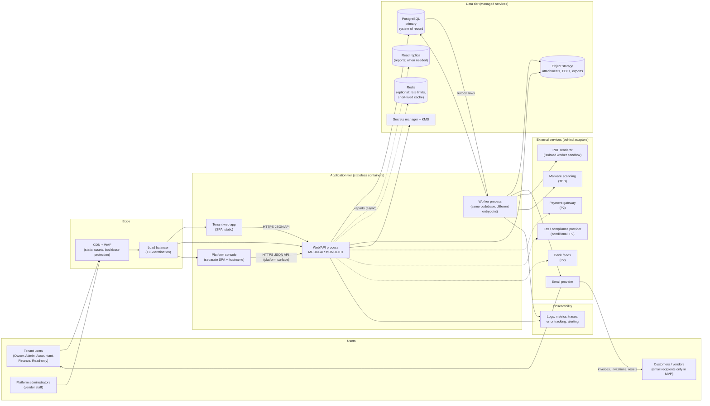
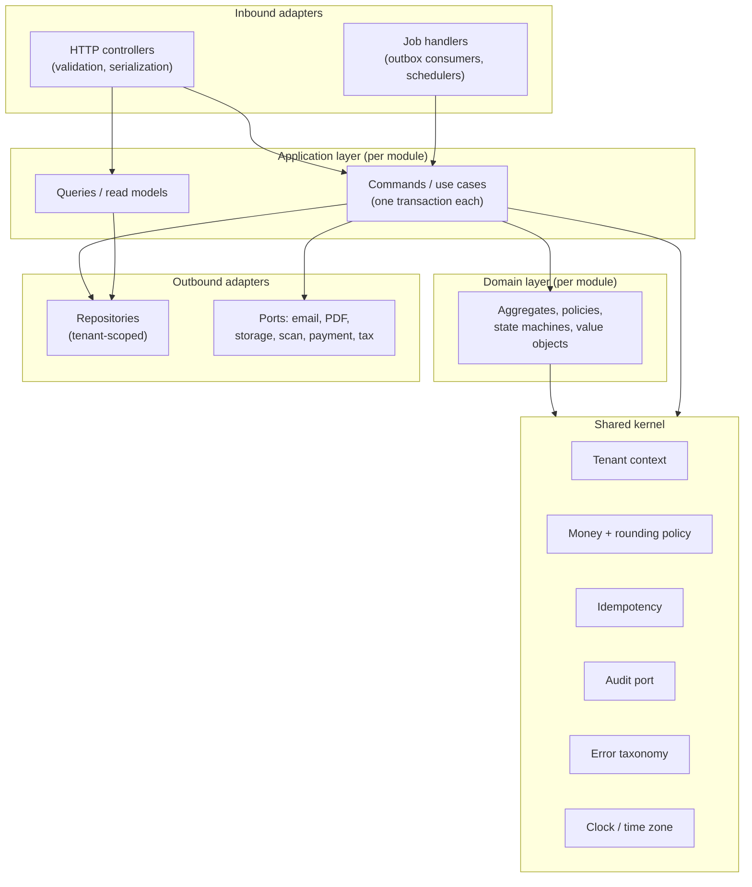
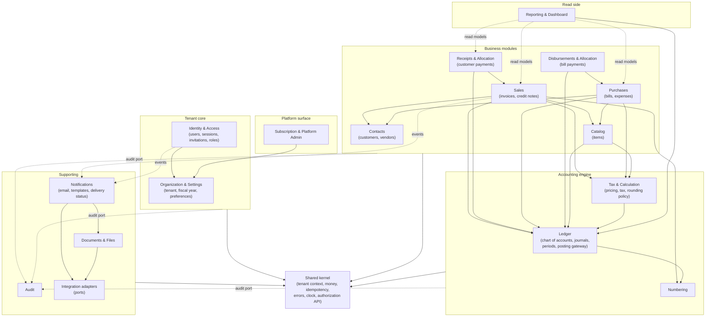
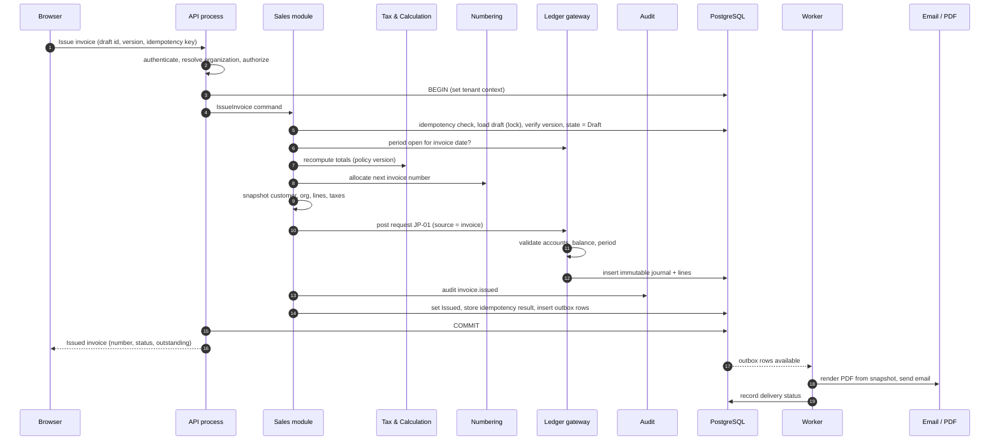

# Architecture Document

> **STATUS: DRAFT v0.1 — NOT APPROVED.** This document proposes an architecture for the SaaS accounting platform described in `docs/01_PRD.md` and `docs/02_Workflows.md` (both Draft v0.1). It does **not** state confirmed business requirements. Technology recommendations are conditional on decisions that are still open (stack, hosting, team, timeline, jurisdiction). Every unresolved decision is marked `TBD` and collected in Section 15.

## 0. Document Information

| Field | Value |
|---|---|
| Document | `docs/03_Architecture.md` |
| Version / status | 0.1 — Draft, pending architecture review and stakeholder approval |
| Inputs | `docs/01_PRD.md`, `docs/02_Workflows.md`; repository inspection (no repository or code found; greenfield assumed) |
| Last updated | 2026-10-15 |
| Owner | *[TBD — Engineering Lead / Architect]* |
| Approval | **Not approved** |

### 0.1 Legend

| Tag | Meaning |
|---|---|
| **[PRD]** / **[WF]** | Constraint taken from the PRD or Workflows documents (themselves drafts). |
| **[REC]** | Architect recommendation, not yet approved. |
| **[ASSUMPTION]** | Working assumption that must be confirmed or replaced. |
| **[TBD]** | Open decision; no value invented. Linked to Section 15 (`OQ-A-nn`) or earlier questions (`Q#`, `OQ-WF-nn`). |
| **[VALIDATE-ACCT]** | Accounting or tax rule needing professional validation. The architecture must keep such rules **configurable and centralized**, never scattered. |
| **ADR-nn** | Architecture Decision Record in Section 14. |

### 0.2 Scope and Non-Scope

- **In scope:** logical architecture, module boundaries, cross-cutting mechanisms, recommended stack, deployment and operations approach, risks, decisions.
- **Out of scope (by instruction):** application code, database tables or columns, API endpoint definitions or payloads, UI design. Where this document mentions "an organization identifier on every tenant-owned record" or "an append-only audit store" it describes a **principle**, not a schema. Detailed data design is the next document (Section 16).

### 0.3 Repository Inspection

No existing repository, source code, infrastructure definitions, or documentation other than `docs/01_PRD.md` and `docs/02_Workflows.md` was found. This architecture therefore assumes a **greenfield** build [ASSUMPTION A-1 in PRD §15.2]. If an existing codebase appears, Sections 4, 5, and 14 must be revisited.

---

## 1. Architecture Goals and Constraints

### 1.1 Architecture Goals (ordered by priority) **[REC]**

| # | Goal | Why (source) | How the architecture serves it |
|---|---|---|---|
| G1 | **Financial correctness** — the ledger is always balanced and reproducible | PRD vision, BR-DE, REL-002/012 | Single posting gateway, immutable journals, balance enforced in code **and** database, centralized money/rounding, reconciliation jobs (Section 9) |
| G2 | **Tenant isolation** — no cross-organization access, ever | PRD BO-2, NFR-TEN, REL-001, WF TI-1…9 | Defense in depth: request context, repository scoping, database row-level security, composite references, automated cross-tenant tests (Section 7) |
| G3 | **Auditability** — who changed what, when, and why | BR-AUD, FR-NTF-005, WF-ATOM-3 | Audit record written in the same transaction as the change; append-only; separate from application logs (Section 9.8) |
| G4 | **Security** | NFR-SEC, PRD §10.1 | Server-side sessions, central authorization, secrets management, hardened file handling, least privilege (Section 8) |
| G5 | **Operability by a small team** | PRD Q7 (team size TBD) | Modular monolith, managed services, few moving parts, strong observability (Sections 5, 10, 11) |
| G6 | **Evolvability** — jurisdiction rules, new modules, scale-out without rewrite | PRD A-7, §18 roadmap, WF §1.10 | Strict module boundaries, configuration-driven tax/numbering, ports-and-adapters for integrations, extraction criteria (Section 5.4) |
| G7 | **Reasonable cost and delivery speed** for MVP | PRD Q8 (timeline/budget TBD) | Avoid premature distribution; managed Postgres/storage; defer P2 infrastructure (Redis, replicas, search) until justified |
| G8 | **Testability** | NFR-TST, PRD §14 | Deterministic domain core, pure calculation modules, seeded golden datasets, property-based ledger tests (Section 13) |

### 1.2 Constraints

**From the PRD and Workflows [PRD][WF]:**

| ID | Constraint |
|---|---|
| C1 | Multi-tenant **web application**; no native mobile apps in MVP (responsive web). |
| C2 | Double-entry accounting; **posted records are immutable**; corrections by reversal/adjusting documents (BR-REV-1). |
| C3 | Every financial operation is **atomic** with its journal(s) and audit record; audit failure aborts the operation (WF ATOM-1…3). |
| C4 | **Idempotent** mutating financial operations (WF IDEM-1…10). |
| C5 | Concurrency-safe numbering, allocation, and balances (WF CONC-3, BR-NUM-3). |
| C6 | Period lock enforced inside the atomic unit (WF 13G, FR-ACC-010). |
| C7 | Platform administrators have **no default access** to tenant financial data (BR-SUB-1, TI-9). |
| C8 | Exact decimal money arithmetic; no binary floating point (BR-MON-1). |
| C9 | MVP: single base currency per organization, accrual basis, non-inventory items (PRD A-3, A-4). |
| C10 | Jurisdiction-specific rules (tax, numbering, retention) are **configurable and unvalidated** (PRD §9, A-7). |
| C11 | Side effects (email, PDF) never block or roll back committed financial state (BR-TXN-6). |
| C12 | Files and exports are authorized on **every** access (TI-6). |

**Project constraints still unknown [TBD]:** technology stack mandate (Q6), hosting/cloud/region and data residency (Q9), team size and skills (Q7), delivery timeline and budget (Q8), security/compliance expectations (Q10), existing integrations (Q11), availability and recovery targets (NFR-AVL/BCK).

### 1.3 Architectural Assumptions

| ID | Assumption | If wrong |
|---|---|---|
| AA-1 | The MVP serves **small businesses**; data volumes per organization are modest (invoices per year in the thousands to low hundreds of thousands) — **no numbers are approved** (OQ-A-06). | Reporting/partitioning strategy (Section 12) may need to be brought forward. |
| AA-2 | A **single region** deployment is acceptable for MVP; multi-region active/active is not required. | Changes data tier and session design materially. |
| AA-3 | One **logical database** shared by all tenants (Section 7). | Enterprise customers requiring physical isolation would need the "silo" option (ADR-003). |
| AA-4 | Standard office-hours support and business-hours maintenance windows are acceptable pre-GA. | Zero-downtime deploy and HA investment increases. |
| AA-5 | Email delivery, PDF rendering, and object storage are consumed as services, not built. | — |
| AA-6 | A relational database with strong transactional guarantees is available in the chosen cloud (true of all major providers). | — |
| AA-7 | The team can operate **containers** and managed databases; Kubernetes expertise is **not** assumed. | Platform choice (ADR-015) changes. |
| AA-8 | India may be the first market (PRD Q1/Q3 unresolved). The architecture is **jurisdiction-neutral** and does not hard-code GST. | If confirmed, add a compliance-integration gateway (Section 3.7). |

### 1.4 Non-Goals for the MVP **[REC]**

Microservices; event sourcing as the system of record; multi-region active/active; GraphQL federation; a custom workflow engine; real-time collaborative editing; native mobile apps; bank-feed ingestion pipelines; machine-learning services. These can be revisited when the PRD's P2/FUT items are approved.

---

## 2. Traceability: Requirements to Architectural Mechanisms

This table keeps the architecture honest: every cross-cutting rule in the Workflows document must have an owner mechanism.

| Requirement source | Rule | Architectural mechanism | Section |
|---|---|---|---|
| WF §1.2 (CP-1) | Standard pipeline for every mutating operation | **Request pipeline** (middleware chain) + **Unit of Work** application service template | 3.3, 9.5 |
| WF TI-1…9 | Tenant isolation rules | Tenant context, repository scoping, row-level security, composite references, file/job scoping, cross-tenant test suite | 7 |
| WF ATOM-1…4 | Atomic document + journal + audit | Single database transaction per command; Ledger posting gateway; audit written in-transaction | 9 |
| WF IDEM-1…10 | Idempotency | Idempotency store written inside the command transaction; client-generated intent keys | 9.6, ADR-008 |
| WF CONC-1…4 | Optimistic versioning; locked critical sections | Version tokens on aggregates; row locks (ordered) for allocation, numbering | 9.7 |
| WF §1.9 | Derived statuses (payment status, overdue) | Computed from source-of-truth (allocations, dates); never stored as flags; projections only as rebuildable caches | 9.4, ADR-016 |
| WF §1.10, BR-MON, BR-TAXC | Calculation pipeline, rounding policy | **Pricing & Tax Calculation module** (pure, deterministic, versioned policy) | 6, 9.3 |
| WF §1.11 (JP-01…15) | Journal posting catalog | **Posting rules** owned by each business module, executed through the Ledger gateway | 9.2 |
| WF §1.12 | Correction dating / period lock | Period-lock check inside posting gateway transaction | 9.5 |
| BR-NUM-1…6 | Numbering | **Numbering service** (transactional, per organization and series) | 9.9, ADR-018 |
| BR-AUD-1…5 | Audit trail | **Audit module** with append-only store and restricted database privileges | 9.8, ADR-010 |
| BR-TXN-6, C11 | Side effects non-blocking | **Transactional outbox** + background workers | 3.5, ADR-009 |
| NFR-SEC-001…011 | Security controls | Section 8 controls matrix | 8 |
| NFR-OBS-001…005 | Observability | OpenTelemetry-based logs, metrics, traces | 10 |
| NFR-BCK/AVL/RET | Backup, DR, retention | Managed PITR, restore drills, retention jobs; targets `TBD` | 11 |
| WF-14 | Platform vs tenant privileges; suspension | **Platform surface** separated from tenant surface; entitlement checks in pipeline | 6, 8.4 |
| PRD §12 | Integrations not yet selected | **Ports-and-adapters** (interfaces owned by the domain; vendors behind adapters) | 3.7 |

---

## 3. High-Level System Architecture

### 3.1 System Context and Containers

*Solid arrows: MVP. Dotted arrows: optional or P2/conditional.*

### 3.2 Logical Layering (inside the monolith)

### 3.3 Request Pipeline (implements CP-1) **[REC]**

Every HTTP request flows through ordered stages. Stage names mirror the Workflows document so QA can trace failures:

| Order | Stage | Responsibility | Fails with |
|---|---|---|---|
| 1 | Transport and edge | TLS, WAF, request size limit, rate limiting (per account, per IP, per organization) | `ERR-RATE-LIMIT` |
| 2 | Correlation | Assign request/correlation ID; start trace | — |
| 3 | Authentication | Resolve session; reject expired/revoked | `ERR-AUTHN` |
| 4 | **Tenant resolution** | Derive organization from active membership (TI-1); establish tenant context for the rest of the request, including the database session | `ERR-NOTFOUND`/`ERR-FORBIDDEN` |
| 5 | Organization state | Active/trial/suspended/deactivated; entitlements (WF-14) | `ERR-ORG-STATE` |
| 6 | **Authorization** | Central policy check: (user role in this org, action, object) — deny by default | `ERR-FORBIDDEN` |
| 7 | Input validation | Structural/shape validation at the boundary | `ERR-VALIDATION` |
| 8 | **Command execution** | Application service in **one database transaction**: idempotency, version check, state check, period lock, domain logic, journal via Ledger gateway, audit, outbox, commit | `ERR-CONFLICT`, `ERR-STATE`, `ERR-PERIOD-LOCKED`, `ERR-SYSTEM` |
| 9 | Response mapping | Map domain errors to the error taxonomy (Section 10.1); never leak internals | — |
| — | Post-commit | Outbox rows picked up by workers (email, PDF, notifications) | `ERR-DEPENDENCY` (displayed on object) |

Read requests use stages 1–7 and execute tenant-scoped queries.

### 3.4 Frontend Architecture **[REC]**

| Aspect | Design |
|---|---|
| **Form** | Browser **single-page application** for the authenticated tenant app, served as static assets from CDN/object storage. A public marketing site, if any, is a separate concern and out of scope. |
| **Platform console** | A **separate application and hostname** for platform administrators (stricter auth, network restrictions `TBD`), so tenant and platform privileges never share a UI surface (BR-AUTH-2). |
| **State and data fetching** | Server state via a query/cache library; local form state in forms; **no authoritative financial computation on the client** — client totals are previews only (WF §1.10); the server recomputes. |
| **Forms** | Schema-driven validation mirroring (not replacing) server validation; unsaved-change guards; idempotency key generated when the form opens (WF IDEM-1) and reused on retry; submit controls disabled after first click (IDEM-8). |
| **Org context** | Active organization shown persistently; every request carries an explicit organization selector verified server-side (supports multi-tab safety, WF-03 A-3 / OQ-WF-22 `TBD`). Org switch clears client caches. |
| **Accessibility and i18n** | Accessible component foundation (keyboard, ARIA, contrast), locale-aware formatting through the organization's settings, translation-ready strings (initial languages `TBD`). WCAG level `TBD` (NFR-ACC-001). |
| **Responsive** | Single responsive layout for phone/tablet/desktop (PRD §13.10). |
| **Security** | Strict Content Security Policy, no inline scripts, output encoding of all user-generated text (memos, reasons, names), no tokens in local storage (session cookie is HttpOnly). |
| **Error UX** | Maps error categories (`ERR-*`) to consistent messages, shows support reference ID for `ERR-SYSTEM` (PRD §13.9). |

### 3.5 Backend Architecture **[REC]**

- **One deployable application** composed of **modules** (Section 6) with enforced boundaries; **two process types** from one codebase: *web/API* and *worker*.
- **Application services** implement use cases ("Issue Invoice", "Record Payment"); each runs in a single transaction and follows the template in Section 9.5.
- **Domain layer** holds state machines (invoice, bill, payment lifecycles from WF §17), validation policies, and pure calculation logic.
- **Background work**: a **transactional outbox** (rows committed with the business change) is consumed by workers to send email, render PDFs, scan uploads, and run scheduled jobs. Workers re-establish tenant context from the job's stored organization (TI-7).
- **Scheduled jobs**: integrity checks (Section 9.10), trial/subscription timers (derived state remains authoritative, WF-14 §15.2), token/session cleanup, retention enforcement, export generation.
- **API style:** resource-oriented HTTP/JSON API with explicit versioning and an OpenAPI-style contract produced in a later document; **no endpoint design here** (ADR-012).

### 3.6 Data, Cache, Files

| Concern | Choice | Notes |
|---|---|---|
| **System of record** | **PostgreSQL** (managed) — ADR-002 | ACID transactions, exact numeric type, row-level security, partial/unique indexes, row locks, mature tooling. |
| **Read scaling** | Read replica for reports and exports **when needed** (not at day one) | Replica lag must be visible; reports show "as of" time (FR-RPT-015). Strong-consistency screens (e.g., balances after posting) read the primary. |
| **Cache** | **Optional Redis** for rate-limit counters and short-lived caches (e.g., entitlement lookups). **Never** a source of truth for financial data or sessions of record. | Sessions: database-backed in MVP (ADR-006); Redis acceleration later. |
| **Object storage** | S3-compatible object store | Attachments, generated PDFs, exports. Private buckets; access only via short-lived signed URLs after an application authorization check (TI-6). Tenant-prefixed keys plus per-object metadata for defense in depth. |
| **Search** | None in MVP (database indexes and filters suffice for list search). Dedicated search engine is a Future consideration. | — |

### 3.7 External Integrations (ports and adapters) **[REC]**

No vendor is selected (PRD §12). Each capability is a **port** (interface owned by the domain) with an **adapter** per vendor, so vendor change is local.

| Capability | MVP? | Port responsibility | Isolation notes |
|---|---|---|---|
| **Transactional email** | Required | Send message with attachments; report delivery status; accept bounce/complaint webhooks | Webhooks authenticated, idempotent; per-organization rate limits; sender-domain authentication (SPF/DKIM/DMARC) is an operational prerequisite. |
| **PDF rendering** | Required | Render HTML template (from the **issued snapshot**) to PDF | Runs in a **sandboxed worker** with no network access to internal services and strict resource limits (untrusted content risk). ADR-019. |
| **Object storage** | Required | Put/get/delete, signed URLs | Tenant-prefixed keys; lifecycle policies. |
| **Malware scanning** | `TBD` (OQ-WF-40) | Scan uploads asynchronously; quarantine until clean | Upload accepted into a quarantine location; released after scan. |
| **Monitoring / error tracking** | Required (capability) | Receive telemetry | PII-scrubbing at source. |
| **Payment gateway** | P2 | Collect invoice payments; webhook reconciliation | PCI scope avoided by hosted payment pages; **no card data enters this platform**. |
| **Subscription billing** | `TBD` (Q4) | Charge tenants | Platform-level, separate from tenant ledgers. |
| **Tax / compliance gateway** | Conditional (India: e-invoicing, e-way bill, return filing) | Submit/receive statutory documents via a provider | Distinct **compliance gateway module** with its own audit trail; requires accountant validation; out of MVP unless scope is confirmed (Q3). |
| **Bank feeds / statement import** | P2 | Import statements/feeds | CSV import first. |
| **Identity provider (SSO)** | FUT | Federated login | Identity module designed with a seam (ADR-006). |

---

## 4. Recommended Technology Stack

> **The stack is not mandated (PRD Q6).** The recommendations below are conditional defaults chosen against explicit criteria. **If the organization already has a mandated language, framework, or cloud, adopt it and keep the architectural principles unchanged** — the design in this document is stack-neutral. Final selection is OQ-A-01.

### 4.1 Selection Criteria for the Backend Language and Framework **[REC]**

| # | Criterion | Why it matters here |
|---|---|---|
| K1 | Exact decimal arithmetic in the standard library or a mature library | C8 / BR-MON-1 |
| K2 | Mature, explicit **transaction management** and database access with fine control (row locks, isolation levels, constraints) | Atomic posting, concurrency (C3, C5) |
| K3 | Strong static typing or equivalent safeguards for money, IDs, and tenant context | Reduces whole classes of accounting and isolation defects |
| K4 | Ecosystem for PDF, email, auth hardening, observability | Fewer custom components |
| K5 | Hiring pool and team familiarity (**unknown**, Q7) | Delivery speed, maintainability |
| K6 | Ability to enforce **module boundaries** mechanically | Modular monolith discipline (Section 5) |
| K7 | Operational maturity (startup time, memory, deployment story) | Cost and reliability |

### 4.2 Backend Options

| Option | Strengths | Weaknesses | Fit |
|---|---|---|---|
| **A. Java or Kotlin + Spring Boot** (with a module-boundary library such as Spring Modulith) | Native exact decimals (`BigDecimal`), very mature transactions/ORM/locking, strong typing, mechanical module verification, large enterprise hiring pool, rich PDF/email/auth libraries | More verbose; heavier runtime; slower initial iteration | **Strong on K1, K2, K3, K4, K6** |
| **B. TypeScript + NestJS** (Node.js) | One language across frontend and backend, fast iteration, good tooling, large talent pool | No native decimal type (requires disciplined use of a decimal library everywhere — a correctness risk, C8); transaction/ORM maturity varies; module boundaries enforced by convention/tools, not the compiler | Strong on K5 if team is JS-centric; **needs explicit money-safety guardrails** |
| **C. C# + .NET** | Native `decimal`, mature EF/Dapper and transaction support, strong typing, excellent tooling | Smaller pool in some regions; licensing/hosting familiarity varies | **Strong on K1, K2, K3** |
| **D. Python + Django** | Fast development, strong admin, `Decimal` in standard library, mature ORM | Weaker static guarantees; concurrency and large-codebase boundary enforcement need discipline | Reasonable for small teams; weaker on K3, K6 |

**Default recommendation [REC, conditional]:** **Option A (Kotlin or Java on Spring Boot)** if the team has JVM skills or no strong preference, because accounting software is dominated by correctness and transactional behavior (K1–K3, K6). **If the team is predominantly TypeScript, Option B is acceptable only with the money-safety guardrails** listed in 9.3 (no numeric primitives for money; a single Money type; lint rules banning arithmetic on raw numbers in money contexts). **Decision: OQ-A-01 (ADR-014).**

### 4.3 Frontend

| Component | Recommendation | Reasoning | Alternatives |
|---|---|---|---|
| Language/framework | **TypeScript + React** | Large ecosystem and hiring pool; fine for a login-gated SPA (no SEO need) | Angular (more opinionated, strong for large teams), Vue |
| Build/runtime | Vite-style bundler; static hosting on CDN | Simple deployment; fast builds | Next.js (SSR unnecessary for authenticated app; adds a server runtime) |
| Data fetching | A server-state/caching library | Reduces boilerplate, handles retries and invalidation | Hand-rolled fetch layers |
| Forms/validation | Schema-based form library | Consistent validation messaging (PRD §13.5) | — |
| UI components | An **accessible headless/unstyled component foundation** plus an original design system | PRD requires an original consistent UI, not a copy of Zoho (PRD §13) and accessibility (NFR-ACC) | Off-the-shelf styled kit (faster, less original) |
| Charts | A lightweight charting library | Dashboard widgets | — |
| i18n | Message-catalog based internationalization | Locale-ready (PRD §13.12) | — |

### 4.4 Data and Infrastructure

| Concern | Recommendation | Reasoning | Alternatives / trade-offs |
|---|---|---|---|
| **Primary database** | **PostgreSQL**, managed service (ADR-002) | Exact numerics, row-level security (isolation defense in depth), partial unique indexes (numbering, SKU uniqueness), advisory/row locks, PITR backups, wide hosting availability | MySQL/MariaDB (no native RLS; weaker constraint features); SQL Server (strong but licensing/hosting choices); NoSQL **rejected** for the ledger (weak multi-record transactional integrity) |
| **Cache / rate limiting** | **Redis** (managed), introduced when needed | Fast counters for throttling; short-lived caches | Database-backed counters for MVP (fewer components); in-process caches are unsafe across instances |
| **Job processing** | **Transactional outbox in PostgreSQL** consumed by worker processes (ADR-009) | One fewer system; outbox rows commit atomically with the business change (C11); adequate for expected MVP volumes | Dedicated broker/queue (more throughput, extra infrastructure and failure modes; introduce when outbox contention or latency demands it) |
| **Object storage** | Cloud object storage (S3-compatible) | Durable, cheap, signed URLs, lifecycle rules | Self-hosted object store (operational burden) |
| **PDF generation** | HTML templates rendered through a **headless browser** in a sandboxed worker (ADR-019) | Highest layout fidelity, easy template reuse, complex scripts/fonts if multilingual | Template-to-PDF libraries (lighter, less layout fidelity, simpler sandboxing); external PDF API (data leaves the platform — privacy review needed) |
| **Email** | Managed transactional email provider behind a port | Deliverability, bounce handling | Self-hosted SMTP (reputation burden) |
| **Secrets / keys** | Cloud secrets manager + KMS | Rotation, access control, audit | Environment files (**rejected**) |
| **Containers & runtime** | Containers on a **managed container service** (ADR-015) | Simple, portable, small-team friendly | Managed Kubernetes (flexibility, more operational cost), PaaS (fastest, less control), VMs (manual) |
| **Infrastructure as code** | Declarative IaC for every environment | Reproducible environments, review of infra changes | Console-managed infra (**rejected**: drift, no audit) |
| **Observability** | **OpenTelemetry** instrumentation with a vendor-neutral backend choice (ADR-017) | Avoid lock-in; traces/metrics/logs correlated | Single-vendor APM agents |
| **CI/CD** | Hosted CI with pipeline-as-code | See Section 11.3 | — |

### 4.5 Technology Decisions Still Open

Backend language/framework (OQ-A-01); cloud provider and region (OQ-A-02, Q9); managed vs. self-hosted components; PDF approach; email vendor; observability vendor; malware scanning; whether Redis is needed at MVP (OQ-A-12).

---

## 5. Modular Monolith vs. Microservices

### 5.1 Decision **[REC — ADR-001]**

**Build the MVP as a modular monolith**: one deployable codebase, strong internal module boundaries, **one transactional database**, two process types (web and worker). **Do not** start with microservices.

### 5.2 Evidence from This Project

| Factor | Observation | Implication |
|---|---|---|
| **Transactional coupling** | Issuing an invoice must atomically: change the invoice, consume a number, post a balanced journal, write audit, record an idempotency result (WF-07B, ATOM-1…3). Payments must atomically update allocations and invoice balances (WF-08). | Spanning these across service boundaries would require distributed transactions or sagas with compensation — **high correctness risk** for the system's most critical operations. |
| **Consistency requirements** | Reports must reconcile to control accounts exactly (REL-012). | A single database makes reconciliation checks trivial and strong; distributed data makes them eventually consistent. |
| **Team size** | Unknown (Q7), assumed small. | Microservices multiply operational overhead (deployment, observability, contracts, on-call). |
| **Requirement stability** | PRD is a draft; MVP scope and jurisdiction unresolved. | Boundaries drawn now by guess are expensive to change if they are network boundaries; cheap if they are in-process module boundaries. |
| **Scale** | Small-business tenants; no approved load numbers. | No evidence that any component needs independent scaling at MVP. |
| **Isolation of risky components** | PDF rendering (untrusted content, heavy CPU) and email sending are different in nature. | Handled by **separate worker processes** and sandboxing, not by separate services with their own databases. |

### 5.3 Comparison

| Dimension | Modular monolith | Microservices |
|---|---|---|
| Atomic financial operations | Native (one transaction) | Sagas/compensation; complex |
| Reconciliation and reporting | Simple joins on consistent data | Data duplication, eventual consistency |
| Team overhead | Low | High (per-service CI/CD, observability, contracts) |
| Speed of MVP delivery | Faster | Slower |
| Independent scaling | Coarse (scale whole app), mitigated by separate worker/process types | Fine-grained |
| Fault isolation | Weaker (shared process) — mitigated by worker separation, resource limits | Stronger |
| Future flexibility | Good **if boundaries are enforced** | Already distributed |
| Risk | **Boundary erosion** ("big ball of mud") | Distributed-systems failures, data inconsistency |

### 5.4 Keeping the Monolith Modular **[REC]**

| Control | Mechanism |
|---|---|
| Explicit module API | Each module exposes a small public interface; everything else is internal. Other modules call interfaces or consume domain events, **never** another module's tables or internals. |
| Mechanical enforcement | Automated architecture tests / dependency rules in CI fail the build on forbidden imports (Section 13). |
| Data ownership | Each module owns its data; cross-module reads go through query interfaces or read models. |
| Ledger as sole writer of journals | Only the Ledger module may create journal data (Section 9.2). |
| Events | In-process domain events inside a transaction; **outbox events** for asynchronous side effects. |
| No shared mutable "utils" | A deliberately small **shared kernel** (Section 6.3) only. |

### 5.5 Extraction Triggers (when to consider services) **[REC]**

A module is extracted **only** when evidence appears, and only if it does not require splitting an atomic financial operation:

| Candidate | Trigger | Why it extracts cleanly |
|---|---|---|
| **PDF/document rendering** | CPU contention, security isolation, or scaling independent of the API | Already isolated behind a port and worker; consumes a snapshot, returns bytes |
| **Notifications/email** | Volume or provider-specific complexity | Asynchronous by design |
| **Reporting read side** | Heavy analytical load affecting OLTP | Reads only; can move to replica/warehouse |
| **Compliance gateway (e.g., e-invoicing)** | Regulatory/vendor lifecycle differs from core | Asynchronous submission with its own audit |
| **Bank-feed ingestion (P2)** | Third-party polling, retries | Asynchronous |

**Not candidates for extraction:** Ledger, Sales, Payments, Purchases, Numbering, Audit — they share atomic transactions.

---

## 6. Module Boundaries and Responsibilities

### 6.1 Module Map

*Solid arrows: synchronous in-process dependency (caller depends on callee's public interface). Dotted: events, read models, or ports. Arrows never point from Ledger to business modules (the Ledger knows nothing about invoices).*

### 6.2 Module Responsibilities

| Module | Owns (conceptual) | Responsibilities | Workflows / PRD | Depends on | Must **not** |
|---|---|---|---|---|---|
| **Identity & Access** | Users, credentials, sessions, MFA, invitations, memberships, roles/permissions mapping | Registration, login/logout, recovery, session lifecycle, invitations, role changes, **authorization policy evaluation API** | WF-01(part), 02, 03, 04; PRD 7B | Organization, Shared kernel | Know any business-document rules |
| **Organization & Settings** | Organizations, profile, fiscal year, locale, defaults, settings versions | Setup wizard orchestration, settings, lock date setting (value only; enforcement in Ledger), data export request | WF-01, 13 | Shared kernel | Hold ledger or tax logic |
| **Subscription & Platform Admin** | Subscription state, plans/entitlements, platform audit | Tenant list, suspend/reactivate, trials, entitlement checks | WF-14; PRD 7K | Organization | Read tenant financial data |
| **Contacts** | Customers and vendors | CRUD, archive, duplicate detection, balances via query interfaces | WF-05 | — | Compute balances itself from foreign tables |
| **Catalog** | Items | CRUD, account/tax mapping validation | WF-06 | Ledger (account validity), Tax | — |
| **Tax & Calculation** | Tax rates/groups, calculation policy (versioned) | Pure **pricing and tax calculation** per WF §1.10, rounding policy (`TBD` OQ-WF-03), jurisdiction profile hooks | WF-07/10/13D; PRD 7J | Shared kernel | Persist documents |
| **Numbering** | Sequences and formats | Concurrency-safe number allocation per organization and series (ADR-018) | WF-07, 09, 13E | Shared kernel | Know document semantics |
| **Ledger** (Accounting engine) | Chart of accounts, journals/lines, period lock, reversals links | **Sole writer of journals**; posting gateway; balance enforcement; period checks; trial balance/GL queries; reversal; opening balances; integrity checks | WF-13F/G/H, 15; PRD 7H | Numbering, Shared kernel | Know invoices, bills, or payments |
| **Sales** | Invoices, credit notes, delivery requests | Draft/issue/void lifecycle, snapshot, posting rules JP-01/02/05, derived payment status | WF-07, 09 | Contacts, Catalog, Tax, Numbering, Ledger | Write journals directly |
| **Receipts & Allocation** | Customer payments, allocations, customer credit (policy `TBD`) | Record/reverse, allocation rules, JP-03/04 | WF-08, 09D | Sales, Ledger | Edit invoices (only via Sales interface) |
| **Purchases** | Bills, expenses | Lifecycle, JP-07/08/11 | WF-10 | Contacts, Catalog, Tax, Ledger | — |
| **Disbursements & Allocation** | Bill payments, allocations | JP-09/10 | WF-11 | Purchases, Ledger | — |
| **Reporting & Dashboard** | Report definitions; (optional rebuildable projections) | Financial statements, ageing, dashboard | WF-12 | Ledger, read models of business modules | Mutate anything |
| **Documents & Files** | File metadata, storage references, generated PDFs/exports | Upload validation, scanning workflow, authorized download, PDF generation requests | WF-07C, 10C, 12C | Integration ports | Serve files without authorization |
| **Notifications** | Templates, delivery attempts/status | Email dispatch from outbox events; delivery status recording | WF-07C, 04, 02 | Documents, Integration ports | Affect financial state |
| **Audit** | Append-only audit records | Write API (in-transaction), query/export for authorized roles | All workflows; PRD 7L | Shared kernel | Allow update/delete |
| **Integration adapters** | Vendor clients and webhook receivers | Implementations of ports (email, PDF, storage, scanning, later payments/tax/bank) | PRD §12 | — | Contain business rules |

### 6.3 Shared Kernel (deliberately small)

Tenant context; Money and rounding primitives; identifiers; clock and organization-time-zone helper; idempotency service; error taxonomy (`ERR-*`); authorization API (the *evaluation interface*, not policies); audit port; pagination/filter primitives; domain event base types. **Anything business-specific does not belong here.**

### 6.4 Dependency Rules **[REC]**

1. Dependencies flow **downward**: business modules → engine modules → shared kernel. No cycles (CI-enforced).
2. **Ledger and Numbering never depend on business modules.** Business modules supply posting requests (Section 9.2) rather than being called by the Ledger.
3. **Reporting** reads through query interfaces or read models; it never writes.
4. **Receipts/Disbursements** modify invoice/bill balances *only* through the Sales/Purchases public interface (or by deriving balances from allocations, ADR-016), preserving single ownership of document state.
5. **Notifications and Documents** are triggered by events/outbox; failures never propagate to the originating transaction.
6. **Platform (Subscription) code paths** never receive a tenant data-access context (enforces C7 at the code level).

---

## 7. Multi-Tenant Architecture and Organization-Level Data Isolation

### 7.1 Tenancy Model Options

| Model | Isolation | Cost / ops | Migrations | Noisy neighbor | Fit |
|---|---|---|---|---|---|
| **Shared database, shared schema** (organization identifier on every tenant-owned record) | Logical; must be enforced in software **and** database | Lowest; one schema to migrate and monitor | One migration for all tenants | Needs mitigation | **Recommended for MVP** (small tenants, many of them) |
| **Shared database, schema per tenant** | Stronger logical separation | Moderate; thousands of schemas strain tooling and migrations | Per-schema migration orchestration | Partial | Only if hard requirement appears |
| **Database per tenant** | Strongest | Highest; connection and cost overhead; orchestration complexity | Per-database | Eliminated | "Silo" tier for enterprise customers **if** ever required (OQ-A-07) |

### 7.2 Decision **[REC — ADR-003]**

**Shared database, shared schema**, with **defense in depth** so that one defect cannot expose another tenant's data. A **silo option** (dedicated database for a specific large tenant) remains possible later because every access path is already organization-scoped.

### 7.3 Isolation Layers (all required)

| Layer | Control | Prevents | Verified by |
|---|---|---|---|
| **L1 — Identity binding** | Organization is derived **only** from the user's active membership; clients may select among their own memberships but never name an unauthorized organization (TI-1). Platform roles carry no organization access (TI-9). | Forged organization identifiers | Authorization tests (per endpoint × role × org) |
| **L2 — Application scoping** | A mandatory **tenant context** object is required by every repository/data-access function; queries cannot be built without it. Object references from clients are verified to belong to the organization (TI-2/3); mismatches look like "not found". | Missed `WHERE` clauses, IDOR (insecure direct object reference) | Static rules + automated cross-tenant tests over the registry of resources |
| **L3 — Database row-level security (RLS)** | Every tenant-owned table has a policy that restricts rows to the organization stored in a **transaction-local** database setting established at the start of each request/job transaction. The application connects with a **non-owner, non-superuser role** (so RLS cannot be bypassed), and **default-deny** applies if the setting is absent. | Application bugs that omit scoping; ad-hoc queries; SQL-injection blast radius | RLS tests that deliberately issue unscoped queries and expect zero rows |
| **L4 — Referential integrity across tenants** | References between tenant-owned records include the organization identifier (composite references), so a record **cannot point to another organization's record** even by mistake (TI-5). | Cross-tenant links (e.g., payment allocated to another tenant's invoice) | Constraint tests; data-integrity jobs |
| **L5 — File and job scoping** | Object keys are tenant-prefixed; downloads require an application authorization check and short-lived signed URLs (TI-6); background jobs store and re-assert organization context (TI-7). | Guessable URLs; cross-tenant job processing | File-access and job tests (AC-WF03-07) |
| **L6 — Operational controls** | No shared admin accounts with data access; production access is time-bound and audited; support tooling goes through the audited support-access flow (WF-14 §15.6, OQ-WF-10); migrations run under a separate privileged role used only by the deployment pipeline. | Insider access, tooling bypasses | Access reviews; audit |
| **L7 — Cache/log/analytics hygiene** | Cache keys include the organization; logs carry the organization as a tag but exclude financial payloads; analytics exclude content (TI-8). | Cross-tenant cache poisoning, data leaks into telemetry | Code review checklist; log sampling tests |

### 7.4 Implementation Notes and Pitfalls (conceptual)

| Topic | Guidance |
|---|---|
| **Connection pooling** | RLS context must be **transaction-local** (set at transaction start, cleared at end) so pooled connections never leak context between requests. Pool modes that share sessions require explicit care; this is a **DB design and platform decision to validate early** (risk AR-A1). |
| **Background jobs** | The job payload carries the organization; the worker sets context before any data access, exactly like a request. |
| **Reports and exports** | Run in a tenant-scoped transaction/connection; read replicas inherit the same RLS policies. |
| **Platform data** | Platform-level tables (subscriptions, platform audit) live in a separate **platform scope** accessed through a different role/context that has **no grant on tenant financial tables**. |
| **Uniqueness** | Natural uniqueness (SKU, invoice number, bill number per vendor) is scoped to the organization (WF-06, BR-NUM-1). |
| **Migrations** | Backward-compatible (expand/contract); RLS policy changes are reviewed as security changes. |
| **Tenant lifecycle** | Suspension, export, deactivation, and deletion operate on a single organization's rows without affecting others (NFR-TEN-006). Per-organization logical export is also a DR building block (Section 11.5). |
| **Noisy-neighbor controls** | Per-organization rate limits, statement timeouts, asynchronous heavy reports/exports, and fair-use queues (NFR-TEN-005; targets `TBD`). |

### 7.5 Cross-Tenant Test Strategy (summary; detail in Section 13)

A **resource registry** enumerates every tenant-owned resource type and every access route (list, read, write, search, export, attachment, report, job). A generated suite attempts each route as: no membership, other organization's ID, removed member, wrong role, platform admin. A single failing case blocks release (REL-001, AC-WF03-01…07).

---

## 8. Authentication, Authorization, Session Management, and Secrets

### 8.1 Authentication **[REC — ADR-006]**

| Topic | Design |
|---|---|
| **Credentials** | Email + password in MVP (FR-AUTH-001). Passwords hashed with a modern adaptive, memory-hard algorithm; parameters tuned and reviewed; never logged. Policy (length, breached-password check) `TBD` (OQ-WF-16). |
| **MFA** | TOTP-based MFA capability designed in (FR-AUTH-010 `MVP/P2 TBD`, OQ-WF-18). **Mandatory for platform administrators** (FR-AUTH-015). MFA secrets encrypted with a managed key. |
| **Verification, reset, invitation tokens** | High-entropy, single-use, time-limited; only a **non-reversible digest** is stored; lifetimes `TBD` (BR-AUTH-3/5). |
| **Abuse protection** | Rate limits per account identifier and source; uniform responses (WF-02A); progressive delays; alerts on credential-stuffing patterns. |
| **Enumeration resistance** | Uniform messages and comparable timing for login, reset, registration (WF-01, WF-02). |
| **Identity seam** | The Identity module exposes an interface for "authenticate → user"; a future external IdP/SSO (FUT) plugs in without touching other modules. A **managed IdP now** is an alternative (see ADR-006) if the team prefers to outsource credential handling — trade-offs: vendor cost/lock-in and residency vs. reduced security burden. |

### 8.2 Session Management **[REC — ADR-006]**

| Decision | Rationale (traced to workflows) |
|---|---|
| **Opaque, server-side sessions** referenced by a random identifier in a `Secure`, `HttpOnly`, `SameSite` cookie | WF-02B/D require **immediate server-side invalidation**, session listing, revoke-all, and revocation on password change; stateless self-contained tokens cannot be revoked instantly without a server-side denylist (which reintroduces state). |
| **Session store**: database-backed in MVP; Redis acceleration later | Simplicity and durability; session state is security-relevant |
| **Idle and absolute timeouts** enforced server-side | Lifetimes `TBD` (OQ-WF-19) |
| **CSRF protection** for cookie-authenticated mutating requests (token or double-submit plus SameSite) | Cookie auth requires it |
| **Per-request organization selector** verified against membership | Multi-tab safety (OQ-WF-22) |
| **Permission changes effective on next request** | BR-AUTH-4: authorization evaluated per request from current membership, **not cached in the session** (or cache with short TTL and explicit invalidation) |
| **Re-authentication (step-up)** for sensitive actions (unlock period, change roles, export, ownership transfer) | Proposed (OQ-WF-21) |
| **Separate session realm for the platform console** | Different cookie scope/hostname; stricter lifetime; MFA |

### 8.3 Authorization **[REC — ADR-007]**

| Topic | Design |
|---|---|
| **Model** | Role-based access control with **permissions as the unit of checking**; roles map to permission sets per PRD §11. Checks use permission names (e.g., "invoice.issue") evaluated by a **central policy component** — controllers and domain code never test role names directly. |
| **Data-driven roles** | Role→permission mapping stored as data to allow **custom roles (P2, FR-AUTH-011)** without code changes; MVP ships predefined roles. |
| **Deny by default** | Any endpoint/use case without an explicit permission declaration fails closed; a CI check verifies every use case declares its permission. |
| **Object-level checks** | Beyond role: organization ownership of every referenced object (TI-2), state-based rules (e.g., only Draft editable), segregation rules (P2: approver ≠ creator, BR-SEC-2). |
| **Server-side only** | The UI hides actions for usability; enforcement never relies on it (BR-AUTH-1). |
| **Separation of surfaces** | Platform permissions live in a different namespace and cannot be granted inside an organization (BR-AUTH-2). |
| **Auditing** | Denials of privileged actions aggregated and alerted (WF `access.denied`). |

**Open:** matrix `◐ [TBD]` cells (OQ-WF-02, OQ-WF-05) must be resolved before the permission catalog is final.

### 8.4 Platform Administration Security **[REC]**

Separate hostname and application, MFA mandatory, network restrictions such as allow-listed access or private networking `TBD` (OQ-A-09), no tenant data grants (C7), every action in the platform audit log, support access only via the time-boxed, consented, audited flow if approved (OQ-WF-10).

### 8.5 Secrets and Key Management **[REC]**

| Topic | Practice |
|---|---|
| **Storage** | Secrets (database credentials, provider API keys, signing keys) live in a managed secrets store; **never in source control, images, or logs**. |
| **Access** | Workload identity / least-privilege roles per service and environment; no human reads production secrets routinely; break-glass access audited. |
| **Rotation** | Documented rotation for database credentials, provider keys, webhook secrets, and key-encryption keys; rotation exercised in staging. |
| **Encryption** | TLS everywhere in transit; encryption at rest for database, backups, and object storage (NFR-SEC-001); **application-level (envelope) encryption** with managed keys for especially sensitive fields (MFA secrets, third-party credentials, any stored bank details if later introduced). |
| **Per-environment isolation** | Separate secrets, keys, and accounts for development, staging, production; no production data in lower environments without anonymization (NFR-PRV-005). |
| **Supply chain** | Pinned dependencies, automated vulnerability scanning, SBOM, image scanning, signed artifacts `TBD` (NFR-SEC-007). |

### 8.6 Application Security Controls Matrix

| Threat (NFR-SEC-003) | Control |
|---|---|
| Injection | Parameterized data access only; no string-built queries; input validation at boundaries |
| XSS | Output encoding everywhere; strict CSP; user-generated text never rendered as HTML; PDF templates escape data |
| CSRF | Per Section 8.2 |
| Broken access control / IDOR | Sections 7 and 8.3; cross-tenant tests |
| SSRF | PDF renderer and any URL-fetching feature run without access to internal networks; allow-lists for outbound calls |
| File upload abuse | Content-type verification by content, size/count limits, quarantine + scanning `TBD`, storage on a separate origin/domain, `Content-Disposition` hardening, signed URLs (WF-10C) |
| Abuse of email sending | Per-organization and per-user quotas; recipient validation; suppression lists; monitoring of bounces |
| Brute force | Rate limits, uniform responses, alerting |
| Sensitive data exposure | Redaction in logs and error responses; support reference IDs instead of details |
| Dependency vulnerabilities | Scanning in CI, patch SLAs `TBD` |
| Insider risk | Least privilege, audit, no standing production data access |
| Clickjacking, header hardening | Standard security headers |

---

## 9. Accounting Engine Design

> The engine realizes goals G1 and G3. It is **jurisdiction-neutral**; rounding, tax order, numbering, and period-close behaviors are configurable policies awaiting validation (**VALIDATE-ACCT**).

### 9.1 Design Principles

| # | Principle | Source |
|---|---|---|
| E1 | The **journal** is the single source of truth for financial position. Balances, statements, and ageing are **derived** from it (or from documents reconcilable to it). | BR-DE-5 |
| E2 | **Posted records are immutable.** Corrections are new records (reversal, credit note, adjusting journal). | BR-REV-1 |
| E3 | **Every journal balances**, enforced in the domain, the posting gateway, **and** the database. | BR-DE-1/4 |
| E4 | **One writer:** only the Ledger module creates journals, through a single posting gateway. | ADR-004 |
| E5 | **Atomicity:** document change + journal + audit + idempotency record + outbox events commit together or not at all. | ATOM-1…3 |
| E6 | **Exact decimal money**, single rounding policy, no floating point. | BR-MON-1 |
| E7 | **Time is explicit:** each journal has an accounting date (organization time zone semantics) separate from its creation timestamp. | WF §1.9 |
| E8 | **Derived over stored:** payment status, overdue, outstanding are derived; any stored projection is rebuildable and reconciled. | ADR-016 |
| E9 | **Policy as configuration:** rounding, tax order, numbering rules are versioned policies, not scattered conditionals. | PRD C10 |
| E10 | **Self-checking:** automated integrity jobs verify invariants continuously. | NFR-DAT-003 |

### 9.2 Posting Gateway (the only way to write the ledger)

Business modules do not write journals. They build a **posting request** and submit it to the Ledger within their own transaction:

| Element of a posting request | Purpose |
|---|---|
| Organization (from tenant context) | Isolation |
| **Source reference** (type + ID of the invoice, payment, bill, etc.) | Traceability (FR-ACC-013); lets the Ledger refuse direct reversal of document-generated journals (WF-15 F-6) |
| **Accounting date** | Period-lock check |
| **Lines** (account, debit or credit amount, optional contact/tax tags) | Content, built from the posting catalog JP-01…15 (WF §1.11) owned by each business module |
| Idempotency scope | Duplicate prevention |
| Reason (for reversals) | Audit |

**The gateway enforces, in order:** tenant match for every account and contact (TI-5) → accounts active and postable → **period-lock check at commit time inside the transaction** → ≥ 2 lines → each line debit-or-credit, non-negative → **Σ debits = Σ credits at stored precision** → persist immutable journal and lines → link to source → emit audit and outbox events. Any failure aborts the **caller's** transaction (no partial state).

**Why a gateway and not a shared "journal table":** it makes the invariants testable in one place and prevents modules from drifting into ad-hoc posting logic.

### 9.3 Money, Calculation, and Rounding

| Topic | Design |
|---|---|
| **Money value object** | An immutable type with amount and currency; the only allowed carrier of money in domain code. Language-level guardrails (lint rules/code review) forbid raw numeric arithmetic on money (critical if the stack lacks a native decimal, Section 4.2). |
| **Storage** | Exact fixed-point decimal with explicit scale; scale per currency and intermediate precision `TBD` (BR-MON-2). |
| **Calculation module** | **Tax & Calculation** implements WF §1.10 (C1–C7) as **pure functions**: input = lines, discounts, tax configuration, policy version; output = line results, totals, per-rate tax breakdown, rounding adjustments. Used by invoices, bills, credit notes, previews, PDFs, and reports so **one implementation** yields identical figures everywhere (BR-MON-5, AC-WF07-12). |
| **Policy versioning** | Rounding point (line/rate/document), rounding mode, residual treatment, tax-inclusive handling are fields of a **versioned calculation policy** chosen per organization (or jurisdiction profile). The version used is **recorded on each issued document** so history stays reproducible if policy evolves. **Values are TBD** (OQ-WF-03, VALIDATE-ACCT). |
| **Golden vectors** | Accountant-approved test vectors run in CI (Section 13). |
| **Multi-currency (P2)** | Money already carries currency; posting adds transaction currency, rate, base amount, FX accounts (BR-CUR-3) — designed-for, not built in MVP. |

### 9.4 Derived Values vs. Stored Projections **[ADR-016]**

| Value | MVP approach |
|---|---|
| Invoice/bill outstanding, payment status, overdue | **Derived** from allocations/credit applications and dates (WF §1.9). Efficient reads via indexes and, if needed, a **transactionally maintained settled-amount rollup** (rebuildable, reconciled by integrity job). |
| Account balances, trial balance, statements | Computed from journal lines. For performance at scale, add **period-balance rollups** maintained inside the posting transaction or rebuilt asynchronously — **only when measurements justify** (Section 12). Rollups are caches: the journal wins on any mismatch. |
| Customer/vendor balances | Derived from open documents and credits |
| Stored flags for "overdue" | **Not used** (time passes without events) |

### 9.5 Command Template (Unit of Work) — How a Financial Operation Runs

All financial use cases follow one template (CP-1 steps 6–12):

1. Open **one database transaction** with tenant context set.
2. **Idempotency check** (same key + same payload → return original result; different payload → conflict; in-progress → wait/retry).
3. **Load aggregates with locks where needed** (Section 9.7) and verify the **version** the user saw.
4. **State-transition check** (domain state machine).
5. **Period-lock check** for the accounting date.
6. **Compute** via the Calculation module (server-side; client figures never trusted).
7. **Allocate numbers** if the operation consumes one (Section 9.9).
8. **Apply domain change** (snapshot on issue; allocations on payment, etc.).
9. **Post journal** via the gateway (balance verified).
10. **Write audit record(s)** in the same transaction (failure aborts).
11. **Record idempotency result** and **enqueue outbox events** (email/PDF/notifications).
12. **Commit.** Any exception → full rollback; return mapped `ERR-*` error.

*Any failure between BEGIN and COMMIT rolls everything back: no number consumed, no journal, no state change (AC-WF07-06).*

### 9.6 Idempotency Design **[ADR-008]**

| Topic | Design |
|---|---|
| **Key origin** | Generated by the client when the intent begins (form open / action start), reused on retries (WF IDEM-1). |
| **Scope** | Organization + user + operation type (IDEM-2). |
| **Store** | An idempotency record holds the key, a fingerprint of the payload, status (in-progress/succeeded), and the result reference; it is written **inside the command transaction** (IDEM-6), so "committed" and "key consumed" cannot diverge. |
| **Concurrency** | A uniqueness guarantee on (scope, key) makes the second concurrent attempt wait or fail fast; never executes twice (IDEM-5). |
| **Retention** | `TBD` (OQ-WF-12); must exceed realistic retry windows. |
| **Complement** | Business-level duplicate **warnings** (likely duplicate payments/bills) are separate UX-level safeguards (IDEM-9). |

### 9.7 Concurrency and Locking Strategy **[REC; detailed in DB design]**

| Need | Mechanism |
|---|---|
| Stale edits (CONC-1/2) | **Optimistic version** on aggregates; stale version → `ERR-CONFLICT`. |
| No over-allocation (CONC-3, AC-WF08-03) | In the payment transaction, **lock the target invoices/bills** (consistently ordered by identifier to avoid deadlocks), re-read outstanding from authoritative data, then validate allocations. |
| Void vs. payment race (AC-WF09-09) | Both operations lock the same invoice row; the second re-checks state after acquiring the lock. |
| Number uniqueness (BR-NUM-3) | Numbering service increments a **per-organization-per-series counter under a row lock inside the transaction** (Section 9.9). |
| Lock-date changes vs. posting | Posting reads the lock date **inside the transaction**; the lock-date update takes a conflicting lock so "lock wins" (WF 13G). |
| Isolation level | Default **read committed** with explicit locks for the specific critical sections above, backed by **database constraints** as the last line of defense. Whether to use stricter isolation for specific commands is a DB-design decision (OQ-A-11). |
| Deadlock handling | Consistent lock ordering; bounded automatic retry of the **whole command** on deadlock/serialization failure, safe thanks to idempotency. |

### 9.8 Auditability **[ADR-010]**

| Topic | Design |
|---|---|
| **What is audited** | All events listed per workflow (BR-AUD-3): financial postings/voids/reversals, payments, manual journals, lock/unlock, settings (tax, numbering, currency, fiscal year), role/membership changes, authentication and security events, exports, platform-admin actions. |
| **Record content** | Actor, organization (or platform), timestamp, action, object type/ID, before/after of key fields, reason, source (UI/API/system), correlation ID (WF §1.7). |
| **In-transaction** | Written by the same transaction as the change; **if the audit write fails, the operation fails** (ATOM-3, FR-NTF-013). |
| **Append-only** | The application database role has **insert (and read) only** on audit storage — no update/delete grants; retention purges run under a separate controlled role per retention policy (`TBD`). |
| **Tamper evidence (optional)** | Hash chaining per organization or periodic signed checkpoints to an external store — **optional enhancement `TBD`** (OQ-A-13), valuable for external audits. |
| **Separation from logs** | Audit = business evidence (durable, queryable by authorized roles). Application logs = operational telemetry (may be sampled/expire). |
| **Privacy** | Audit records avoid unnecessary personal data; before/after values limited to relevant fields; access to the audit log is permissioned (PRD §11.2). |
| **Reading** | Dedicated query interface with filters by user/date/object/action (FR-NTF-007). |

### 9.9 Document Numbering **[ADR-018]**

| Topic | Design |
|---|---|
| **Service** | Numbering module owns sequences per **organization × series** (invoice series in MVP; credit notes, receipts, journals, bills `TBD`, OQ-WF-33). |
| **Allocation** | Inside the issuing transaction, increment the counter under lock and format per the organization's format configuration (prefix, padding, optional fiscal-year token). **Rollback rolls the counter back** → a failed issue consumes no number (proposed, WF G-02). |
| **Trade-off** | A transactional counter serializes issuance **per organization-series** (acceptable for small tenants; contention is bounded because each tenant has its own counter). Database-native sequences are faster but **leave gaps on rollback** — usable **only if gapless numbering is not required** (**OQ-WF-29, VALIDATE-ACCT**). |
| **Uniqueness** | A uniqueness constraint on (organization, series, number) is the final guard (BR-NUM-1/3); numbers are never reused, including after void (BR-NUM-4). |
| **Format changes** | Forward-only (BR-NUM-6); "next number" cannot fall at or below an issued number (AC-WF13-11). |

### 9.10 Integrity Checks and Reconciliation **[REC — NFR-DAT-003]**

Scheduled jobs (per organization, tenant-scoped, low priority) verify and **alert** on any violation (a violation is a **defect incident**, never silently corrected):

| Check | Invariant |
|---|---|
| Journal balance | Every journal's debits = credits |
| Trial balance | Σ debits = Σ credits for any date |
| AR control | AR control balance = Σ open invoice outstanding − unapplied customer credit |
| AP control | AP control balance = Σ open bill outstanding − unapplied vendor advances |
| Allocation bounds | Σ allocations ≤ payment amount; outstanding ≥ 0 |
| Immutability | No posted record changed since creation (detect via version/checksum comparison, audit cross-check) |
| Numbering | No duplicates; gap report if gapless required |
| Period lock | No journal dated on/before the lock date created after the lock except audited unlock windows |
| Rollups | Projections equal recomputation from the journal |
| Tenant integrity | No cross-organization references |

### 9.11 Periods, Reversals, Opening Balances

| Topic | Design |
|---|---|
| **Period model** | Single "books closed through" lock date (FR-ACC-010); fiscal year drives reporting defaults; **year-end close** (FR-ACC-014) is `TBD`. Enforcement is inside the Ledger transaction (Section 9.7). |
| **Reversal** | A mirror journal linked to the original; original marked reversed; neither is edited or deleted. Dating rule per WF §1.12 (**block in locked periods**, OQ-WF-04). Journals created by documents are reversed only through document workflows (Section 9.2). |
| **Opening balances** | Posted as journal(s) JP-14 plus "opening" open-document records reconciling to AR/AP (WF-13H); balancing line to an Opening Balance Equity account `TBD`. |
| **Customer credit / vendor advances** | Accounts and policy `TBD` (OQ-WF-07/42); the Ledger already supports them as ordinary accounts. |
| **Snapshots** | Issued documents carry an immutable snapshot (customer, organization identifiers, lines, tax, policy version) used for PDFs and views (ADR-011). |

---

## 10. Error Handling, Logging, Observability, and Monitoring

### 10.1 Error Handling Architecture **[REC]**

| Topic | Design |
|---|---|
| **Taxonomy** | The error categories from WF §1.8 (`ERR-VALIDATION`, `ERR-AUTHN`, `ERR-FORBIDDEN`, `ERR-NOTFOUND`, `ERR-ORG-STATE`, `ERR-STATE`, `ERR-CONFLICT`, `ERR-PERIOD-LOCKED`, `ERR-RATE-LIMIT`, `ERR-DEPENDENCY`, `ERR-SYSTEM`) are the **only** externally visible categories. Domain code throws typed domain errors; one boundary component maps them. |
| **Response contract** | A consistent, machine-readable error structure carrying category, stable error code, human message, field/line pointers for validation, and a **support reference ID** for `ERR-SYSTEM`. Exact format defined in the API design document. |
| **Cross-tenant references** | Always `ERR-NOTFOUND` (TI-3); internal logs record the real reason. |
| **No leakage** | No stack traces, SQL, or identifiers of other tenants in responses. |
| **Validation** | All problems returned **together** (WF-07B step 4), pointing at fields/lines. |
| **Transactional safety** | Any unexpected exception inside a command rolls back the entire unit; the client receives `ERR-SYSTEM` and may retry with the same idempotency key (IDEM-7). |
| **Retries** | Deadlock/serialization failures → bounded automatic retry of the whole command. External calls (email, PDF, storage) → exponential backoff with jitter, **in workers only**, never inside a financial transaction. |
| **Dead-letter handling** | Jobs exceeding retry limits move to a dead-letter state with alerting and an operator replay tool (audited); document status shows `ERR-DEPENDENCY` outcomes ("delivery failed — retry"). |
| **Graceful degradation** | Email/PDF/storage outages never block posting (C11). Reports may degrade to asynchronous mode. Read-only fallback during database maintenance is `TBD`. |
| **Defect signals** | Rejected unbalanced journals, integrity-check failures, and RLS-denied queries are treated as **defects**, logged at high severity, and alerted. |

### 10.2 Logging **[REC]**

| Topic | Design |
|---|---|
| **Format** | Structured JSON with timestamp, level, service/process, environment, version, correlation ID, trace ID, **organization ID**, user ID, route/use case, outcome. |
| **Never logged** | Passwords, tokens, session identifiers, full email bodies, attachment contents, card data (none held), full financial payloads; personal data of customers/vendors is masked or omitted (NFR-PRV-005). |
| **Levels and sampling** | Info for request summaries; warn for rejected-by-rule cases; error for unexpected failures; debug off in production. Sampling for high-volume success logs. |
| **Security events** | Separate stream for authentication anomalies, privilege denials, cross-tenant attempts, platform-admin actions; feeds alerting. |
| **Retention** | Operational logs: short (`TBD`); **audit records are not logs** and follow business retention (Section 9.8, NFR-RET). |
| **Access** | Log access restricted and audited; production logs are not browsable by default for developers beyond need. |

### 10.3 Observability

| Pillar | Content |
|---|---|
| **Metrics** | Request rate/errors/latency per use case (RED), database connection pool and query latency, lock waits/deadlocks, outbox depth and age, job success/failure/retry, email delivery outcomes, PDF render time/failures, report durations, session and login anomalies, per-organization usage (for noisy-neighbor insight). |
| **Tracing** | Distributed traces across API → database → worker → external provider via OpenTelemetry (ADR-017), with the correlation ID surfaced to support reference IDs. |
| **Dashboards** | Service health, financial-operation health (issue/pay success rates, idempotent-replay rate, conflict rate), queue health, integrity checks, security overview. |
| **Business integrity telemetry** | Integrity-check results (Section 9.10) published as metrics; any failure pages on-call. |
| **Synthetic checks** | Scheduled end-to-end probes of login, a read, and a non-financial write in a dedicated probe organization; uptime from the outside. |
| **SLIs/SLOs** | Candidate SLIs defined (availability, latency of key use cases, job freshness); **numeric SLO targets are `TBD`** (OQ-A-05, NFR-AVL) — none are asserted here. |

### 10.4 Alerting and On-Call **[REC]**

| Severity | Examples | Response |
|---|---|---|
| **Critical (page)** | Integrity-check failure; unbalanced-journal rejection spike; cross-tenant denial spike or any RLS violation; database unavailable; backup failure; authentication outage; error-rate breach | Immediate on-call; incident process |
| **High** | Outbox lag beyond threshold; email provider failures; PDF renderer failures; elevated lock waits/deadlocks; replica lag | Same business day |
| **Medium/Low** | Elevated 4xx patterns, slow queries, dependency vulnerabilities | Ticketed |

Thresholds `TBD`. On-call rota and incident process are operational prerequisites for GA (PRD §17.5). A postmortem practice is recommended.

---

## 11. Deployment, CI/CD, Backups, and Disaster Recovery

### 11.1 Environments **[REC]**

| Environment | Purpose | Data | Notes |
|---|---|---|---|
| **Local** | Developer machines using containers for dependencies | Synthetic seed data | One-command setup |
| **CI (ephemeral)** | Automated test runs with real PostgreSQL | Generated per run | Includes RLS and cross-tenant suites |
| **Development/Preview** | Shared integration, optional per-branch previews | Synthetic | Low cost |
| **Staging** | Production-like; release rehearsals, UAT, load/restore drills | **Synthetic or anonymized** (never raw production) | Same infrastructure definitions as production |
| **Production** | Live tenants | Real | Strict access, audited changes |

Count and cost of environments depend on budget (Q8, OQ-A-08). **All environments are created from the same infrastructure-as-code**, differing only in size and configuration.

### 11.2 Deployment Topology (MVP) **[REC — ADR-015]**

- **Containers** on a managed container service in **one region** (AA-2), **two or more instances** of the web/API process across availability zones behind a load balancer; separate **worker** deployment (scaled independently; can be started minimal).
- **Managed PostgreSQL** with high-availability standby (same region, multi-zone) `TBD`; private networking; no public access.
- **Object storage** private; static assets via CDN.
- **Secrets manager/KMS**; network segmentation (public edge, private application and data subnets); egress controls (the PDF renderer has restricted egress).
- **Platform console** on a separate hostname with additional network restrictions `TBD`.
- **No Kubernetes initially**; revisit if the number of deployable units or scheduling needs grows.

### 11.3 CI/CD Pipeline **[REC]**

| Stage | Contents | Gate |
|---|---|---|
| 1. Static checks | Formatting, linting, type checks, **architecture-boundary tests** (module dependencies, ledger single-writer rule), secret scanning | Blocking |
| 2. Unit tests | Domain, calculation, state machines, authorization policy | Blocking |
| 3. Integration tests | Real PostgreSQL; transactions, constraints, **RLS**, concurrency and idempotency tests, outbox/worker flows | Blocking |
| 4. Tenant-isolation suite | Generated cross-tenant matrix over all resources (Section 7.5) | **Blocking, never skipped** |
| 5. Accounting correctness suite | Golden vectors, property-based ledger tests, reconciliation invariants | Blocking |
| 6. Security scans | Dependency, static analysis, container image scanning, IaC scanning | Blocking for critical/high (thresholds `TBD`) |
| 7. Build | Reproducible container image, SBOM, version stamp | — |
| 8. Migration check | Apply migrations to a copy of the previous schema; verify backward compatibility (expand/contract) and RLS policy presence on every tenant-owned table | Blocking |
| 9. Deploy to staging | Automated | — |
| 10. End-to-end and accessibility tests | Critical journeys (PRD §8), automated a11y | Blocking for release candidates |
| 11. Approval | Human approval for production (change record) | Required |
| 12. Production deploy | Rolling or blue/green; automatic health-based rollback | — |
| 13. Post-deploy verification | Synthetic probes, error-rate watch | Auto-rollback on breach |

**Database migrations:** expand/contract pattern so application versions N and N+1 run against the same schema during rollout; destructive changes only after the previous version is retired; migrations run by the pipeline under a privileged role distinct from the runtime role (Section 7.3 L3/L6). Long-running data migrations execute as background jobs.

**Feature flags** gate incomplete or `TBD` features (e.g., credit notes, MFA enforcement, jurisdiction profiles) so scope decisions do not require branching.

### 11.4 Backups **[REC — NFR-BCK]**

| Item | Approach | Target |
|---|---|---|
| **Database** | Continuous archiving with **point-in-time recovery** plus periodic snapshots; encrypted; retention window | RPO/RTO **TBD** (NFR-BCK-003, OQ-A-05) |
| **Object storage** | Versioning and replication/backup of attachments, PDFs, exports; lifecycle rules aligned with retention | Retention **TBD** (NFR-RET) |
| **Configuration/secrets/IaC** | Version-controlled; secrets recoverable from the secrets manager's own backup | — |
| **Cross-region/copy** | Encrypted off-region copy for disaster scenarios | `TBD` (cost vs. risk, OQ-A-04) |
| **Verification** | **Automated restore tests on a schedule** into an isolated environment followed by integrity checks (Section 9.10) — "an untested backup is not a backup" (NFR-BCK-002) | Mandatory before GA |
| **Backups and deletion** | Backups age out on a documented schedule consistent with deletion commitments (NFR-RET-004) | `TBD` (legal) |

### 11.5 Disaster Recovery **[REC]**

| Scenario | Approach |
|---|---|
| Instance/zone failure | Multi-instance and multi-zone deployment with automatic replacement; database standby failover |
| Region loss | Restore from off-region backups into a standby region using IaC (**RTO per `TBD`**); active/active is a non-goal for MVP |
| Data corruption/bad deploy | Point-in-time recovery to a new instance; compare and reconcile; roll forward with corrective migrations |
| Single-tenant restore (e.g., customer error) | Not trivially supported by whole-database restore; design a **per-organization logical export/import** (also serves WF-13I export and WF-14E) — `TBD`, OQ-A-04 |
| Compromised credentials | Rotation runbooks, session revocation at scale, audit review |
| Provider outage (email/PDF) | Queue and retry; manual resend (WF-07C); status visible |
| Runbooks | Written, owned, rehearsed periodically (game days) |

---

## 12. Scalability and Performance Considerations

> No load, latency, or availability numbers are approved (PRD §10, OQ-A-05). This section describes **how the design scales and where to look first**; it asserts no figures.

### 12.1 Scaling Strategy by Tier

| Tier | MVP | Scale-up path |
|---|---|---|
| **Web/API** | Stateless; horizontal scaling behind a load balancer | Autoscaling on utilization; isolate heavy endpoints |
| **Workers** | Separate deployment; scale on queue depth | Split by job class (email, PDF, exports, integrity checks) with separate concurrency limits |
| **Database** | Single primary, vertical scaling, well-chosen indexes, connection pooling | Read replica for reports/exports; table partitioning for journal and audit data (by time and/or organization hash); archiving of old audit data per retention |
| **Cache** | None or minimal | Redis for rate limits, entitlements, session acceleration |
| **Object storage** | Inherently scalable | Lifecycle tiering |
| **Reports** | Computed from the journal with indexes; asynchronous for large ranges | Period-balance rollups; replica routing; (much later) analytical store |

### 12.2 Known Hotspots and Mitigations

| Hotspot | Concern | Mitigation |
|---|---|---|
| **Journal/ledger growth** | Largest table; reports scan it | Index design for (organization, account, date); rollups for opening/period balances; partitioning later; report range limits (OQ-WF-43) |
| **Per-organization numbering counter** | Serializes issuance within an organization-series | Small tenants make this acceptable; keep the locked section short (allocate number last, just before posting) |
| **Invoice/bill lists and ageing** | Many open documents | Derived outstanding via maintained settled-amount rollups, index on due date/state |
| **Allocation locking** | Many payments to few invoices | Lock only affected rows, ordered; short transactions |
| **Reports under load** | Heavy queries affect OLTP | Statement timeouts, async execution, replica, concurrency caps per organization |
| **PDF rendering** | CPU/memory heavy | Dedicated worker pool, concurrency limits, timeouts, caching of unchanged PDFs (immutable snapshots allow it) |
| **Email bursts** | Provider limits, reputation | Queue with rate shaping, per-organization quotas |
| **Large attachments/exports** | Memory and bandwidth | Direct-to-storage uploads via signed URLs with size limits; streaming exports |
| **Connection exhaustion** | App instances × pool size | Connection pooler; per-process pool caps (check compatibility with transaction-local tenant context, Section 7.4) |
| **Noisy neighbor** | One tenant's import/report | Per-organization rate and concurrency limits; fair-share job scheduling |

### 12.3 Performance Practices

Server-side pagination and filtering everywhere (NFR-PERF-003); no N+1 data access (tested via query-count assertions); idempotent, short transactions; avoid holding locks during external calls (never call email/PDF inside a transaction); capacity model built from approved volume assumptions (OQ-A-06); load tests on staging with realistic ledger sizes before GA (NFR-TST-005).

### 12.4 When Scale Forces Change

Triggers and responses are listed in Section 5.5 (extraction) and in the table above (replica, rollups, partitioning). **Sharding by organization** is a feasible late-stage option precisely because every query is organization-scoped (Section 7).

---

## 13. Testing Strategy and Architecture-Level Risks

### 13.1 Testing Strategy

| Layer | Scope | Notes |
|---|---|---|
| **Unit** | Domain state machines (invoice, bill, payment lifecycles), calculation module, authorization policy, numbering formats | Fast, deterministic; pure functions make this thorough |
| **Accounting correctness** | **Golden vectors** approved by the accountant (rounding, tax-inclusive/exclusive, discounts, credits, partial payments, reversals, ageing); **property-based tests** that generate random valid operation sequences (issue, pay, partially pay, void, reverse, credit) and assert the global invariants of WF §17 after every step | Highest-value test class; tied to REL-002…013 |
| **Integration (real PostgreSQL)** | Transactions, constraints (balance, uniqueness, composite references), RLS, outbox, migrations, idempotency, locking | No mock database for these |
| **Concurrency** | Parallel issue (distinct unique numbers), parallel payments to one invoice (no over-allocation), void vs. payment races, lock-date changes vs. posting, double-submit with same key | Repeated runs to surface races (AC-WF07-02/03, AC-WF08-03/04, AC-WF09-09) |
| **Failure injection** | Fault after each step of the command template; provider outages; database errors; worker crashes mid-job | Asserts atomicity and idempotent recovery (AC-WF07-06, AC-WF08-09) |
| **Tenant isolation** | Generated cross-tenant matrix (Section 7.5) incl. RLS tests with deliberately unscoped queries, file access, jobs, exports, caches | Blocks release |
| **Security** | Static analysis, dependency/image scanning, dynamic scanning, authorization fuzzing, upload abuse tests, external penetration test before GA (NFR-SEC-008) | |
| **Contract** | Port/adapter contract tests with provider sandboxes or stubs; webhook authentication/idempotency tests | |
| **End-to-end** | PRD §8 journeys on staging (register → invite → customer → invoice → payment → expense/bill → reports → settings) | Keep few, stable |
| **Performance/load** | Representative ledger sizes, report ranges, concurrent issuance, worker throughput; targets from approved NFRs | `TBD` thresholds |
| **Accessibility** | Automated checks in CI + manual assistive-technology review for primary flows | Level `TBD` |
| **Operational** | Backup **restore drills**, migration rehearsals, failover tests, runbook game days | Before GA |
| **Architecture fitness** | Module dependency rules; "only Ledger writes journals"; "every use case declares a permission"; "every tenant-owned table has RLS and an organization reference"; "no raw numeric arithmetic on money" | Automated in CI |
| **UAT** | Representative owners and accountants on staging with anonymized data | PRD §17.4 |

**Test data:** deterministic generators producing multi-organization datasets (including adversarial near-duplicates: same names, SKUs, emails across tenants) to expose leakage.

### 13.2 Architecture-Level Risks

| ID | Risk | Likelihood | Impact | Mitigation |
|---|---|---|---|---|
| AR-A1 | **RLS context leaks** through connection pooling or missed job context | Medium | **Critical** | Transaction-local context only; default-deny policies; pooled-connection tests; early spike to validate pooler + RLS; alert on denied/unscoped queries |
| AR-A2 | **Ledger bypass** — a module writes journal data directly or an ad-hoc script edits posted data | Medium | **Critical** | Single posting gateway; restricted database roles (runtime role cannot update/delete journals); architecture tests; audited operational procedures (BR-SEC-4) |
| AR-A3 | **Unbalanced or corrupted ledger** due to a defect | Low–Medium | **Critical** | Three-layer balance enforcement; integrity jobs; property-based tests; incident process |
| AR-A4 | **Rounding/tax policy changes late** (decisions pending) | High | High | Calculation module with versioned policy; policy on each document; golden vectors; defer hard-coding |
| AR-A5 | **Gapless numbering requirement discovered late** | Medium | High | Transactional counter design supports gapless; decision early (OQ-WF-29) |
| AR-A6 | **Boundary erosion** in the monolith | High (over time) | Medium | CI-enforced module rules; code ownership; periodic architecture reviews |
| AR-A7 | **Report performance** degrades with ledger growth | Medium | Medium | Rollups when justified; async reports; replica; range limits |
| AR-A8 | **PDF rendering abuse/resource exhaustion** (untrusted content, SSRF) | Medium | High | Sandbox, no internal network access, timeouts, concurrency caps, template escaping |
| AR-A9 | **Outbox/worker failure** silently stalls emails or PDFs | Medium | Medium | Lag alerts, dead-letter handling, visible delivery status, manual resend |
| AR-A10 | **Stack not chosen / skills mismatch** | Medium | High | Decide early (OQ-A-01); keep principles stack-neutral; enforce money-safety guardrails if TypeScript |
| AR-A11 | **Vendor lock-in** (cloud, email, observability) | Medium | Medium | Ports/adapters, OpenTelemetry, IaC, portable containers |
| AR-A12 | **Migration locks/downtime** on large tables | Medium | Medium | Expand/contract; online migration practices; rehearsal on staging with realistic volume |
| AR-A13 | **Time-zone and date semantics** cause inconsistent overdue/report dates | Medium | Medium | Organization time zone as explicit input; accounting date vs. timestamp; tests across zones (OQ-WF-13) |
| AR-A14 | **Support/ops tooling undermines isolation** | Medium | High | No standing production data access; support-access flow; tooling goes through the same authorization layer |
| AR-A15 | **Telemetry leaks personal/financial data** | Medium | High | Redaction at source, allow-listed log fields, review in CI |
| AR-A16 | **Untested DR** | Medium | **Critical** | Scheduled restore drills; documented RTO/RPO once approved |
| AR-A17 | **Scope growth** (GST e-invoicing, inventory, multi-currency) forces structural change | High | High | Designed-for seams: policy versions, currency-aware money, compliance gateway module, extraction triggers; scope gated by PM approval |
| AR-A18 | **Single database as a scaling ceiling** | Low (MVP) | Medium | Replica, rollups, partitioning, sharding-by-organization path (Section 12.4) |

---

## 14. Architecture Decision Records (ADRs)

All ADRs are **Proposed** (not approved). Format: Context → Decision → Alternatives considered → Consequences → Revisit when.

---

### ADR-001 — Modular Monolith for the MVP

| | |
|---|---|
| **Status** | Proposed |
| **Context** | Core operations (issue invoice, record payment, post bill) require atomic multi-record consistency (WF ATOM-1…3). Team size and timeline are unknown (Q7/Q8); requirements are draft; no scale evidence exists. |
| **Decision** | One deployable codebase with enforced module boundaries (Section 6), one transactional database, two process types (web/API, worker). |
| **Alternatives** | Microservices (distributed transactions/sagas for core financial flows, higher operational load); serverless functions per use case (cold starts, transaction/connection limits, fragmented boundaries). |
| **Consequences** | (+) Atomicity and reconciliation are simple; fast delivery; low ops cost. (−) Shared-process failure domain; boundary erosion risk — mitigated by CI-enforced rules (5.4). |
| **Revisit when** | Extraction triggers in 5.5 are met with evidence (never for Ledger, Sales, Payments, Purchases, Numbering, Audit). |

### ADR-002 — PostgreSQL as the System of Record

| | |
|---|---|
| **Status** | Proposed (conditional on hosting choice, OQ-A-02) |
| **Context** | Needs ACID transactions, exact decimals, row locks, unique/partial indexes, constraint-based invariants, row-level security, PITR backups. |
| **Decision** | Managed PostgreSQL as the single system of record for financial and tenant data. |
| **Alternatives** | MySQL/MariaDB (no native RLS; fewer constraint capabilities); SQL Server (capable; licensing/hosting trade-offs); document/NoSQL stores (weak multi-record integrity — rejected for the ledger). |
| **Consequences** | (+) Strong integrity and isolation tooling. (−) Vertical-first scaling; replica lag for reports; RLS requires disciplined pooling (AR-A1). |
| **Revisit when** | A hard organizational mandate exists for another RDBMS; the DB-design spike (Section 16) reveals pooling/RLS incompatibility. |

### ADR-003 — Shared Schema Multi-Tenancy with Defense-in-Depth Isolation

| | |
|---|---|
| **Status** | Proposed |
| **Context** | Many small tenants; isolation is the top security goal (G2); cost and migration simplicity matter. |
| **Decision** | Shared database and schema, organization identifier on every tenant-owned record, enforced by identity binding, mandatory application scoping, **row-level security with transaction-local context**, composite cross-references, file/job scoping, and automated cross-tenant tests (Section 7.3). |
| **Alternatives** | Schema-per-tenant (migration/orchestration burden at scale); database-per-tenant (cost, connection overhead; reserved as a premium "silo" option). |
| **Consequences** | (+) Cheapest to operate; single migration path. (−) A defect can in principle affect all tenants — hence multiple independent layers; noisy-neighbor controls needed. |
| **Revisit when** | An enterprise customer contractually requires physical isolation (OQ-A-07); regulatory data residency per tenant. |

### ADR-004 — Ledger as the Sole Writer of Journals (Posting Gateway) with Immutable Records

| | |
|---|---|
| **Status** | Proposed |
| **Context** | Correctness (G1), auditability (G3), immutability (BR-REV-1); multiple modules generate journals. |
| **Decision** | Only the Ledger module creates journal data via a posting gateway that enforces tenant match, active accounts, period lock, balance, and links to a source reference. Posted journals are never updated or deleted (database privileges enforce this). Corrections are mirror journals. |
| **Alternatives** | Each module writes its own journals (inconsistent enforcement); event-sourced ledger (higher complexity, reconstruction overhead, not required by PRD). |
| **Consequences** | (+) One enforcement point; testable invariants. (−) Business modules must express posting as requests; slight indirection. |
| **Revisit when** | Event sourcing becomes a business need (e.g., full temporal queries); not expected for MVP. |

### ADR-005 — Exact Decimal Money and a Centralized, Versioned Calculation Policy

| | |
|---|---|
| **Status** | Proposed (rounding policy values `TBD`, VALIDATE-ACCT) |
| **Context** | BR-MON-1/3/4, WF §1.10; rounding decisions pending and jurisdiction-dependent. |
| **Decision** | A Money value object backed by exact decimals; a pure **Tax & Calculation** module as the only implementation of pricing/tax/rounding; calculation **policy version** recorded on every issued document. |
| **Alternatives** | Integer minor units everywhere (precise but awkward for intermediate precision and tax math; may still be used internally); calculation logic in UI/PDF/reports separately (**rejected**: inconsistent totals). |
| **Consequences** | (+) Identical figures across UI preview, journal, PDF, reports; policy can evolve without rewriting history. (−) Policy decisions must be made before hard-coding examples. |
| **Revisit when** | Multi-currency (P2) introduces FX conversions; accountant requires different precision handling. |

### ADR-006 — Server-Side Opaque Sessions with an Identity Seam

| | |
|---|---|
| **Status** | Proposed (conditional on OQ-A-10) |
| **Context** | WF-02 requires immediate invalidation, session listing/revocation, revoke-all on password change, and instant effect of membership/role changes. |
| **Decision** | Opaque session identifiers in secure, HttpOnly cookies backed by a server-side session store; CSRF protection; MFA-capable; Identity module exposes a seam for future external IdP/SSO. |
| **Alternatives** | Stateless JWT access tokens (hard to revoke instantly without server-side state; token theft window); managed identity provider now (less credential-handling burden; cost, residency, and invitation-flow integration to evaluate). |
| **Consequences** | (+) Revocation and per-request authorization are straightforward. (−) Session store is a dependency and needs careful scaling (database first, Redis later). |
| **Revisit when** | SSO/enterprise requirements, or a decision to outsource authentication. |

### ADR-007 — Central Policy-Based RBAC, Deny by Default, Data-Driven Roles

| | |
|---|---|
| **Status** | Proposed (matrix `◐ [TBD]` cells open: OQ-WF-02/05) |
| **Context** | PRD §11 matrix; custom roles planned (P2); BR-AUTH-1 requires server-side enforcement. |
| **Decision** | Permissions are the unit of enforcement, evaluated by a central policy component; roles map to permissions as data; every use case declares its permission or fails closed; object-level and state-based checks supplement role checks. |
| **Alternatives** | Role checks scattered in code (brittle); attribute-based policy engine (flexible, premature for MVP). |
| **Consequences** | (+) One place to audit and test; custom roles without code changes later. (−) Requires a maintained permission catalog. |
| **Revisit when** | Fine-grained ABAC needs appear (e.g., per-account or per-contact restrictions). |

### ADR-008 — Idempotency Keys Stored Transactionally

| | |
|---|---|
| **Status** | Proposed |
| **Context** | Duplicate-request prevention is a stated requirement (BR-TXN-2, WF IDEM). |
| **Decision** | Client-generated intent keys; an idempotency record written inside the command transaction with a payload fingerprint and result reference; uniqueness on (scope, key). |
| **Alternatives** | UI-only double-click prevention (insufficient); cache-based keys (can diverge from commit state); natural-key deduplication only (cannot capture intent). |
| **Consequences** | (+) Safe retries, whole-command deadlock retries. (−) Storage and retention policy to manage; API contract must include keys. |
| **Revisit when** | Never removed; retention parameters tuned (OQ-WF-12). |

### ADR-009 — Transactional Outbox with Background Workers (Redis Optional)

| | |
|---|---|
| **Status** | Proposed |
| **Context** | Side effects (email, PDF, notifications) must never block or roll back financial commits (BR-TXN-6) and must not be lost. |
| **Decision** | Write outbox rows in the business transaction; worker processes consume them with at-least-once delivery and idempotent handlers; scheduled jobs use the same worker infrastructure. Redis is not required for jobs in MVP. |
| **Alternatives** | Publish to a broker inside the request (dual-write inconsistency); dedicated message broker from day one (extra infrastructure). |
| **Consequences** | (+) No lost or phantom side effects; fewer components. (−) Database-polling load and throughput ceilings; monitored via outbox lag. |
| **Revisit when** | Outbox contention or latency becomes measurable; adopt a broker behind the same interface. |

### ADR-010 — Append-Only Audit Records Written in the Command Transaction

| | |
|---|---|
| **Status** | Proposed |
| **Context** | BR-AUD-1…5; audit failure must abort (ATOM-3). |
| **Decision** | Audit module writes in-transaction; runtime database role has insert/read only; retention purge by a separate controlled process; optional tamper-evidence (hash chain/checkpoints) `TBD`. |
| **Alternatives** | Audit via asynchronous event stream (can be lost or lag, violates ATOM-3); application logs as audit (not durable/queryable). |
| **Consequences** | (+) Complete, consistent evidence. (−) Audit write adds latency/volume; storage growth (partition/archive). |
| **Revisit when** | Audit volume requires partitioning/archival or external audit demands tamper-evidence. |

### ADR-011 — Immutable Document Snapshots at Issue

| | |
|---|---|
| **Status** | Proposed |
| **Context** | BR-CON-5, BR-ITM-2, AC-INV-7, AC-WF07-07: later edits to contacts/items/tax must not change issued documents. |
| **Decision** | On issue/post, store an immutable snapshot of counterparty details, organization identifiers, lines, rates, tax breakdown, and calculation policy version; PDFs and views render from the snapshot. |
| **Alternatives** | Join to live master data (history changes silently); versioned master data only (complex, still needs per-document pointer). |
| **Consequences** | (+) Reproducible documents and cacheable PDFs. (−) Duplication of data; snapshot format must be versioned. |
| **Revisit when** | Never reversed; snapshot schema evolves with versioning. |

### ADR-012 — Browser SPA and a Resource-Oriented, Versioned HTTP/JSON API

| | |
|---|---|
| **Status** | Proposed |
| **Context** | Authenticated, form-heavy application; no SEO need; future public API (P2) and possible additional clients. |
| **Decision** | React/TypeScript SPA consuming a resource-oriented HTTP/JSON API with explicit versioning and a machine-readable contract (defined in the API design document). The same API serves the platform console (separate surface/permissions). |
| **Alternatives** | Server-rendered pages (limited interactivity for invoice editing); GraphQL (flexibility, more complexity in authorization/caching for a modest benefit now). |
| **Consequences** | (+) Clear contract, testable, reusable by public API later. (−) Client/server validation duplication (mitigated by shared schemas where the stack allows). |
| **Revisit when** | Mobile apps or partner integrations drive different data-fetching needs. |

### ADR-013 — Object Storage with Signed URLs, Authorization on Every Access, Quarantine Scanning

| | |
|---|---|
| **Status** | Proposed (scanning `TBD`) |
| **Context** | TI-6, BR-NTF-3, NFR-SEC-009. |
| **Decision** | Private object storage; uploads direct-to-storage via signed URLs into a quarantine location, scanned, then released; downloads via application authorization then short-lived signed URL; served from a separate origin; tenant-prefixed keys and metadata. |
| **Alternatives** | Files in the database (bloat, backup size); public buckets with obscure URLs (**rejected**). |
| **Consequences** | (+) Scalable, secure. (−) Scanning adds asynchronous states to attachments (UI must show "processing"). |
| **Revisit when** | Compliance requires specific storage controls or residency. |

### ADR-014 — Backend Language and Framework (Conditional Recommendation)

| | |
|---|---|
| **Status** | **Proposed — requires decision (OQ-A-01)** |
| **Context** | No stack mandated (Q6); correctness and transactions dominate (criteria K1–K7). |
| **Decision** | Default to **Kotlin/Java with Spring Boot** unless the organization mandates or strongly prefers another stack; **TypeScript/NestJS** acceptable with money-safety guardrails; .NET equally acceptable. Architecture principles are stack-neutral. |
| **Alternatives** | See Section 4.2. |
| **Consequences** | Affects hiring, module-boundary tooling, libraries for PDF/auth/observability. |
| **Revisit when** | A mandated stack or team composition is confirmed. |

### ADR-015 — Containers on a Managed Container Service; No Kubernetes Initially

| | |
|---|---|
| **Status** | Proposed (conditional on OQ-A-02/03) |
| **Context** | Small team, few deployables (API, worker, static assets), need for reproducibility and zero-downtime deploys. |
| **Decision** | Containerized workloads on a managed container platform in one region, infrastructure as code, managed database/storage/secrets. |
| **Alternatives** | Kubernetes (flexibility, steeper operations); PaaS (fastest start, less control over networking/security); VMs (manual, drift-prone). |
| **Consequences** | (+) Simpler operations. (−) Less portability than Kubernetes manifests; limited scheduling features. |
| **Revisit when** | Number of services/jobs grows, or multi-cloud/on-prem becomes a requirement. |

### ADR-016 — Derive Statuses and Balances; Projections Are Rebuildable Caches

| | |
|---|---|
| **Status** | Proposed |
| **Context** | WF §1.9: payment status and overdue are derived; time-based states cannot be maintained reliably by events. |
| **Decision** | Compute from authoritative data (allocations, dates, journal lines). Where performance requires projections (settled-amount rollups, period balances), maintain them in-transaction or rebuild asynchronously and reconcile continuously; the source of truth wins on mismatch. |
| **Alternatives** | Stored status flags updated by jobs (drift, missed updates); denormalized balances as primary truth (violates E1). |
| **Consequences** | (+) No drift; simpler domain. (−) Read-path cost; projection maintenance when needed. |
| **Revisit when** | Measured query cost exceeds targets (targets `TBD`). |

### ADR-017 — OpenTelemetry-Based Observability

| | |
|---|---|
| **Status** | Proposed (backend vendor `TBD`) |
| **Context** | NFR-OBS; avoid lock-in; correlate request→DB→worker. |
| **Decision** | Instrument with OpenTelemetry for traces/metrics/logs; choose storage/analysis vendor later; correlation ID shown as the support reference. |
| **Alternatives** | Vendor agent only (lock-in). |
| **Consequences** | (+) Portability. (−) Initial instrumentation effort. |
| **Revisit when** | Vendor selection or cost issues. |

### ADR-018 — Transactional Per-Organization, Per-Series Numbering

| | |
|---|---|
| **Status** | Proposed (gapless requirement `TBD`, OQ-WF-29) |
| **Context** | BR-NUM-1…6, WF G-02: failed issue must not consume a number; concurrency-safe uniqueness. |
| **Decision** | Counter row per organization × series incremented under lock inside the issuing transaction; uniqueness constraint as backstop; format configuration is forward-only. |
| **Alternatives** | Database-native sequences (gaps on rollback; cheaper); application-level locks (fragile); random/UUID-based numbers (not acceptable for invoices). |
| **Consequences** | (+) Gapless-capable, simple reasoning. (−) Serialized issuance per tenant series. |
| **Revisit when** | Gapless not required **and** contention measured. |

### ADR-019 — Isolated Headless-Rendering Worker for PDFs

| | |
|---|---|
| **Status** | Proposed (approach `TBD`, OQ-A-14) |
| **Context** | Invoice/receipt/report PDFs must match the issued snapshot; fonts and scripts may matter (language scope `TBD`); rendering untrusted-ish content is a security risk. |
| **Decision** | HTML templates rendered to PDF by a headless browser running in a sandboxed worker with no internal network access, CPU/memory/time limits, and escaped data; PDFs stored in object storage and cached by snapshot version. |
| **Alternatives** | Lightweight template-to-PDF library (simpler/safer, less layout fidelity); third-party PDF API (data leaves the platform). |
| **Consequences** | (+) Fidelity and template reuse. (−) Heavier runtime; security hardening needed. |
| **Revisit when** | Fidelity needs are met by a lighter approach, or volume demands a different design. |

---

## 15. Open Questions Requiring Project-Manager Approval

**Priority:** **P0** blocks database/API design or core build; **P1** needed before detailed design/launch preparation; **P2** can be decided later. Questions from the PRD (Q#) and Workflows (OQ-WF-nn) are referenced where architecture depends on them.

### 15.1 Architecture-Specific Questions

| ID | Pri | Question | Why it matters / what depends on it |
|---|---|---|---|
| OQ-A-01 | **P0** | Is there a mandated or preferred backend language/framework? If not, approve the default recommendation (Kotlin/Java + Spring Boot) or choose another. (Q6) | Libraries, module enforcement tooling, hiring, ADR-014 |
| OQ-A-02 | **P0** | Which cloud provider/region will host the platform, and are there **data-residency** requirements (e.g., India-hosted data)? (Q9; PRD NFR-PRV-004) | Managed-service choices, latency, compliance, ADR-002/015 |
| OQ-A-03 | **P0** | Team size, skills, and operational capacity (on-call, DevOps)? (Q7) | Complexity budget; Kubernetes vs. managed containers; environments |
| OQ-A-04 | P1 | Disaster-recovery scope: target RPO/RTO, off-region copies, and is **single-organization restore** required? | Backup design, per-organization export/import capability |
| OQ-A-05 | P1 | Approved service-level objectives: availability, latency for key use cases, support hours, maintenance windows. | HA design, capacity, alerting thresholds |
| OQ-A-06 | P1 | Expected volumes: organizations, users, invoices/bills/payments per organization per year, report date ranges, attachment sizes. | Capacity model, rollups/partitioning timing, load tests |
| OQ-A-07 | P1 | Will any customer require **physical isolation** (dedicated database) or customer-managed encryption keys? | ADR-003 silo option, key management |
| OQ-A-08 | P1 | Number of environments and budget (staging fidelity, preview environments). (Q8) | Cost, release process |
| OQ-A-09 | P1 | Platform-console access model: VPN/IP allow-list/private network; who may be a platform administrator; support-access policy. (Q17, OQ-WF-10) | §8.4 controls |
| OQ-A-10 | P1 | Build authentication in-house (with vetted libraries) or adopt a managed identity provider? Is MFA mandatory for tenants? Is SSO expected soon? (Q10, OQ-WF-18) | ADR-006, vendor contracts, cost |
| OQ-A-11 | P2 | *(Technical; resolved in database design)* Isolation level and locking strategy per command; RLS + connection-pool compatibility spike. | Concurrency correctness, AR-A1 |
| OQ-A-12 | P2 | Is Redis needed for MVP (rate limiting, caching), or can database-backed mechanisms suffice initially? | Component count and cost |
| OQ-A-13 | P2 | Is cryptographic tamper-evidence of the audit log required (e.g., for external audits)? | ADR-010 enhancement |
| OQ-A-14 | P1 | PDF approach and **language/script coverage** (e.g., Indian-language invoices, right-to-left): which locales and fonts at launch? (Q18) | ADR-019, fonts, template design |
| OQ-A-15 | P1 | Email provider selection and sending-domain ownership; expected email volume and per-organization limits. (Q11) | Deliverability, quotas, abuse controls |
| OQ-A-16 | P1 | Malware scanning for uploads: required at MVP? Allowed file types and size limits. (OQ-WF-40) | ADR-013 workflow states, cost |
| OQ-A-17 | P1 | Compliance expectations (e.g., SOC 2 or ISO 27001 aspiration, customer security reviews, penetration-test scope/timing). (Q10) | Control evidence, logging, access reviews |
| OQ-A-18 | P2 | When is a **public API/webhooks** expected (P2)? | API versioning, rate-limit model, key management |
| OQ-A-19 | P0 | Is **India** confirmed as target and will tax-compliance integrations (e-invoicing, e-way bill, return filing) be in scope — and if so, when? (Q1/Q3) | Compliance gateway module, provider selection, accountant validation workload |
| OQ-A-20 | P2 | Are replica-based (slightly stale) reports acceptable, with "as of" timestamps? | Reporting architecture |

### 15.2 Inherited Blocking Decisions (from the Workflows document)

These **P0** workflow questions directly shape the architecture and must be answered before database design: **OQ-WF-03** rounding policy; **OQ-WF-04** correction dating in locked periods; **OQ-WF-07** customer credit/overpayment (and **OQ-WF-42** vendor advances); **OQ-WF-09** suspended-organization behavior; **OQ-WF-11** credit notes in MVP; **OQ-WF-29** gapless invoice numbering; plus PRD **Q1** (market), **Q3** (GST scope), **Q4** (pricing/subscription), **Q6** (stack).

---

## 16. Consistency Verification

| Check | Result |
|---|---|
| Modular monolith preferred for MVP unless evidence says otherwise | **Yes** — evidence supports it (5.2); extraction triggers defined |
| Every CP-1 step, TI rule, ATOM, IDEM, CONC rule from Workflows has an owning mechanism | **Yes** (Section 2) |
| No business requirements invented | **Yes** — all new items tagged **[REC]/[ASSUMPTION]/[TBD]**; numeric targets avoided |
| No jurisdiction rules hard-coded | **Yes** — calculation, numbering, and compliance are configurable/versioned or isolated behind a gateway |
| No application code, tables, or endpoint implementations | **Yes** — principles and interfaces only |
| MVP scope respected (no multi-currency, inventory, reconciliation, online payments built) | **Yes** — designed-for seams only |
| Platform vs. tenant privilege separation (C7) | **Yes** — separate surface, no tenant grants, audited support access (8.4, 7.4) |
| Open decisions listed | **Yes** — Section 15 |

---

## 17. Recommended Next Step: Database Design

**Create `docs/04_Database_Design.md` next**, once the P0 questions in Section 15 are answered (at minimum OQ-A-01/02, OQ-A-19, and the inherited rounding, numbering, customer-credit, correction-dating, and credit-note decisions).

**Suggested scope of the database design document:**

1. **Entity inventory per module** (Section 6.2 ownership), classifying each as tenant-owned or platform-level.
2. **Ledger model:** chart of accounts, journals and lines, source references, reversal links, periods/lock date, opening-balance records, rollups (if any), with the **database-level invariants** (balance, immutability grants, uniqueness, composite tenant references).
3. **Document models and state machines:** invoices, credit notes, payments/allocations, bills, expenses, bill payments, snapshots, derived-status queries.
4. **Tenant isolation design:** the organization reference on every tenant-owned record, row-level security policies, roles and grants (runtime vs. migration vs. audit-purge roles), and the **pooling + RLS spike** (AR-A1).
5. **Numbering, idempotency, outbox, audit** storage designs and their transactional interplay.
6. **Concurrency design:** lock ordering, isolation level per command, deadlock handling (OQ-A-11).
7. **Indexing and query plans** for lists, ageing, ledger, trial balance, and reports; partitioning and archival strategy.
8. **Migration strategy** (expand/contract), seed data (default chart of accounts per market `TBD`, system accounts), data retention and deletion mechanics.
9. **Integrity-check queries** corresponding to Section 9.10.

**Then proceed:** API design (contracts, error format, idempotency headers, pagination) → test plan → infrastructure/security baseline → implementation planning.

---

*End of document — DRAFT v0.1, not approved.*
