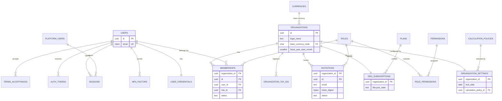
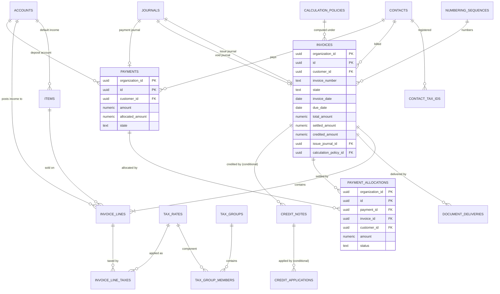
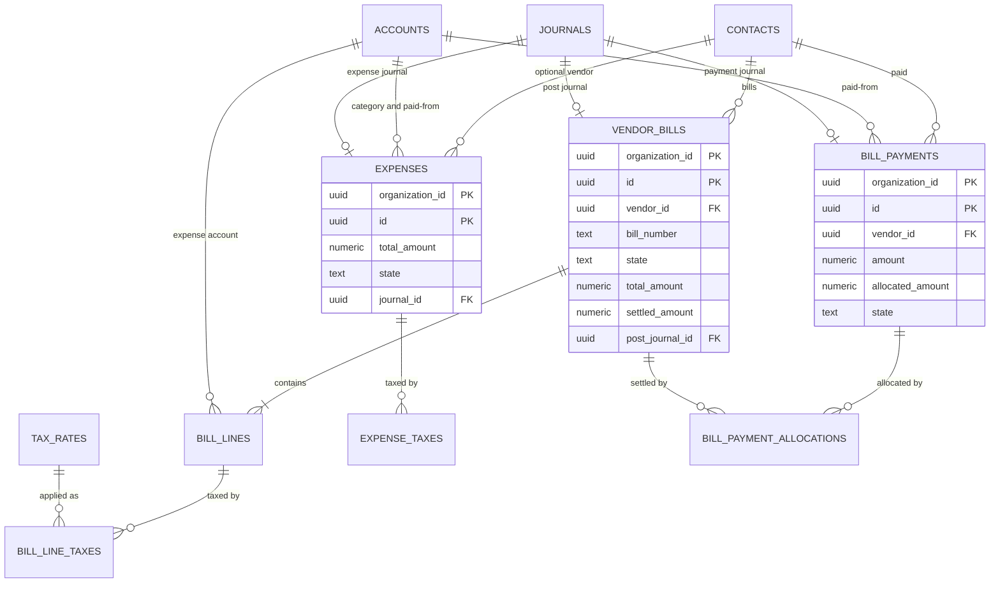
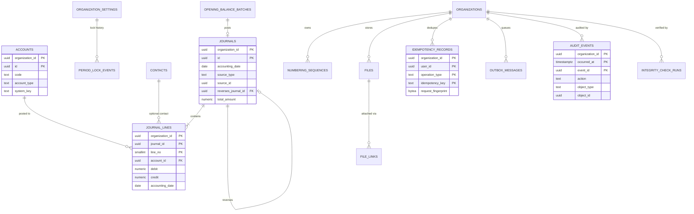

# Database Design

> **STATUS: DRAFT v0.1 — NOT APPROVED.** This document proposes a logical and physical PostgreSQL design for the SaaS accounting platform described in `docs/01_PRD.md`, `docs/02_Workflows.md`, and `docs/03_Architecture.md` (all Draft v0.1). **Nothing here is an approved decision.** Where a source requirement is still `TBD`, the design either supports every candidate answer or marks the affected element `TBD`. **No migration has been written and no database has been created.**

## 0. Document Information

| Field | Value |
|---|---|
| Document | `docs/04_Database_Design.md` |
| Version / status | 0.1 — Draft, pending review by database, backend, QA, security, and accounting stakeholders |
| Inputs | PRD v0.1, Workflows v0.1, Architecture v0.1; repository inspection (no repository, code, or schema found — greenfield) |
| Last updated | 2026-10-15 |
| Owner | *[TBD — Engineering Lead / Database Architect]* |
| Approval | **Not approved** |

### 0.1 Legend

| Tag | Meaning |
|---|---|
| **[PRD] / [WF] / [ARCH]** | Taken from the PRD, Workflows, or Architecture documents (themselves drafts). |
| **[PROPOSED]** | Design proposed here; requires approval. |
| **[TBD]** | Unresolved; no value invented. Linked to `OQ-DB-nn` (Section 20) or upstream IDs (`Q#`, `OQ-WF-nn`, `OQ-A-nn`). |
| **[VALIDATE-ACCT]** | Accounting/tax rule needing professional validation. The schema must not hard-code it. |
| **[CONDITIONAL]** | Table or column set that exists only if an unresolved scope decision is approved. |
| **DP-n / DD-n / DA-n** | Design principle / design decision / design assumption (Sections 1–2). |
| **DB-INV-nn** | Database-level invariant, tested in Section 19. |

### 0.2 Scope and Conventions of This Document

- **In scope:** entities, columns, types, keys, constraints, indexes, tenancy, row-level security, transaction/locking design, money precision, migration/retention/backup design, query strategy, integrity tests, and a **row-level-security validation spike plan**.
- **Out of scope:** migration scripts, executable DDL, API contracts, application code, UI.
- **Specification notation:** tables are specified in Markdown, not DDL. The few **SQL fragments** in Section 13 are *illustrative only — not executed, not validated, not migrations*. They show intent and must be written, reviewed, and tested during the spike.
- **Type placeholders:** numeric precision/scale values are **provisional** (Section 15) pending BR-MON-2 / OQ-WF-03. Domain names (`d_money`, etc.) isolate that decision.

### 0.3 Repository Inspection

No repository, code, schema, infrastructure definition, or documentation other than `docs/01_PRD.md`, `docs/02_Workflows.md`, and `docs/03_Architecture.md` was found. Greenfield is assumed (PRD A-1).

---

## 1. Database Design Goals and Constraints

### 1.1 Goals (ordered) **[PROPOSED]**

| # | Goal | Source | How this design serves it |
|---|---|---|---|
| DG1 | **Make accounting invariants impossible to violate, even by application defects** | PRD BR-DE, REL-002/003; ARCH G1, E3 | Balance, immutability, state, allocation-bound, and uniqueness rules enforced by constraints, triggers, and privileges — not only code |
| DG2 | **Cross-tenant access is impossible by construction** | PRD BO-2; WF TI-1…9; ARCH G2, 7.3 | Organization key leads every tenant primary key and index; composite foreign keys; forced row-level security; least-privilege roles |
| DG3 | **Complete, tamper-resistant audit** | PRD BR-AUD; WF ATOM-3; ARCH 9.8 | Append-only audit store written in the command transaction; no update/delete privileges |
| DG4 | **Safe under concurrency** | WF CONC-1…4, IDEM-1…10; ARCH 9.7 | Defined lock order, optimistic versions, transactional counters, rollups guarded by CHECK |
| DG5 | **Reproducible history** | PRD BR-CON-5, AC-INV-7; ARCH ADR-011 | Immutable snapshots, policy version on each document, soft archival instead of deletion |
| DG6 | **Evolvable without rewrite** | PRD A-7, §18 | Additive P2 seams (currency, FX, credit notes, approvals); expand/contract migrations |
| DG7 | **Adequate performance for MVP without premature complexity** | ARCH 12; OQ-A-06 | Indexes keyed on organization; derived values; rollups/partitioning only when measured |
| DG8 | **Operability** | ARCH G5 | Few schemas, standard types, no exotic extensions, testable integrity checks |

### 1.2 Design Principles

| ID | Principle |
|---|---|
| DP-1 | **The database enforces invariants; the application implements workflows and policy.** Invariants = shape, uniqueness, balance, immutability, legal state values, tenant scope, bounds. Policies (rounding values, approval rules, jurisdiction rules) live in the application/configuration. |
| DP-2 | Every tenant-owned table carries `organization_id`, which is the **first column of its primary key and of every index**. |
| DP-3 | Relationships between tenant-owned rows use **composite foreign keys including `organization_id`**, so a row cannot reference another organization's row (TI-5). |
| DP-4 | **Immutable by default.** Posted/issued tables grant the runtime role no `UPDATE`/`DELETE`; where limited mutation is required (state transition, settlement rollup), a whitelist trigger rejects every other column change. |
| DP-5 | **Derived over stored.** Statuses (payment status, overdue) are never stored. Rollups (settled amounts) exist only with a CHECK bound, a trigger/transaction owner, and a reconciliation test (ADR-016). |
| DP-6 | Prefer **declarative constraints**; use triggers only where constraints cannot express the rule (balance across rows, immutability, transitions, rollups). |
| DP-7 | `text` + `CHECK` instead of PostgreSQL enum types (easier additive evolution). |
| DP-8 | **Fail closed.** Missing tenant context returns no rows and rejects writes; unknown states are rejected by CHECK. |
| DP-9 | Explicit nullability; no sentinel values; `NULL` means "not applicable/unknown", never "zero". |
| DP-10 | MVP minimalism: no table exists "just in case". P2/FUT features arrive through additive migrations (Section 16). |

### 1.3 Constraints Inherited from the Source Documents

| ID | Constraint | Source |
|---|---|---|
| C-DB1 | Exact decimal money; no floating point | PRD BR-MON-1; ARCH C8 |
| C-DB2 | Every posted journal balances; ≥ 2 lines | PRD BR-DE-1/4; WF ATOM-2 |
| C-DB3 | Posted records never edited/deleted; corrections by reversal | PRD BR-REV-1; WF ATOM-4 |
| C-DB4 | Document + journal + audit + idempotency record commit atomically | WF ATOM-1…3; ARCH 9.5 |
| C-DB5 | Concurrency-safe numbering, allocation; no over-allocation | WF CONC-3; PRD BR-ALLOC-1/2, BR-NUM-3 |
| C-DB6 | Duplicate operations prevented (idempotency keys written inside the transaction) | WF IDEM-1…10; ARCH ADR-008 |
| C-DB7 | Period lock enforced inside the posting transaction | PRD FR-ACC-010; WF 13G |
| C-DB8 | Derived statuses; no stored overdue/payment-status flags | WF §1.9; ARCH ADR-016 |
| C-DB9 | Platform roles have no default access to tenant financial data | PRD BR-SUB-1; WF TI-9 |
| C-DB10 | MVP: one base currency per organization; accrual basis; non-inventory items | PRD A-3, A-4 |
| C-DB11 | Rounding/tax/numbering/retention rules are configurable and **unvalidated** | PRD §9, C10 |
| C-DB12 | Invoice numbering must **not** be assumed gapless until approved | OQ-WF-29; task instruction |
| C-DB13 | Files, jobs, caches, and logs are tenant-scoped | WF TI-6/7/8; ARCH 7.3 L5/L7 |

**Project constraints still unknown [TBD]:** PostgreSQL version and hosting provider (OQ-A-02), connection pooler (OQ-DB-04), data volumes (OQ-A-06), retention periods (NFR-RET), jurisdiction (Q1/Q3).

### 1.4 Non-Goals for the MVP

Event-sourced ledger; schema- or database-per-tenant; sharding; table partitioning on day one (designed-for only); ledger balance rollups on day one (designed-for only); multi-currency/FX columns (additive P2); bank reconciliation tables; approval-workflow tables; inventory tables; full-text search engine.

---

## 2. Confirmed Decisions, Assumptions, and Unresolved Questions

> **Terminology note.** *No decision in documents 01–03 is formally approved.* "Inherited" means "proposed upstream and relied on here." Treat all rows as pending approval.

### 2.1 Inherited Decisions (from documents 01–03)

| ID | Decision | Source |
|---|---|---|
| DI-1 | PostgreSQL is the system of record | ARCH ADR-002 |
| DI-2 | Shared database/schema with `organization_id` on every tenant-owned record, enforced by row-level security with transaction-local context, composite references | ARCH ADR-003, 7.3 |
| DI-3 | Only the Ledger writes journals; posted journals immutable | ARCH ADR-004 |
| DI-4 | Exact decimals; centralized, versioned calculation policy recorded on each issued document | ARCH ADR-005 |
| DI-5 | Idempotency record written inside the command transaction | ARCH ADR-008 |
| DI-6 | Transactional outbox | ARCH ADR-009 |
| DI-7 | Append-only audit written in the command transaction | ARCH ADR-010 |
| DI-8 | Immutable document snapshots at issue | ARCH ADR-011 |
| DI-9 | Derived statuses; projections are rebuildable caches | ARCH ADR-016 |
| DI-10 | Transactional per-organization/series number counter | ARCH ADR-018 |
| DI-11 | Server-side opaque sessions | ARCH ADR-006 |
| DI-12 | Lifecycle states: invoice Draft/Issued/Void; bill Draft/Open/Void; payments Active/Reversed; payment status, overdue, and delivery status are separate | WF §1.9, §17 (pending OQ-WF-01) |
| DI-13 | Single "books closed through" lock date | PRD FR-ACC-010; WF 13G |
| DI-14 | Default isolation read committed with explicit locks; isolation per command resolved in database design | ARCH 9.7, OQ-A-11 |

### 2.2 Design Decisions Proposed by This Document

| ID | Decision | Section | Status |
|---|---|---|---|
| DD-1 | Four schemas: `app` (tenant-owned), `identity` (global identity data), `platform` (platform-owned reference and subscription data), `audit` (append-only audit) | 6.2 | Proposed |
| DD-2 | Tenant-owned PK = `(organization_id, id)`; `id` is a UUID; child FKs reference `(organization_id, id)` | 6.1 | Proposed |
| DD-3 | Database roles split by duty: migrator (owner), runtime, identity, dispatcher, audit-purge, platform admin; **no runtime BYPASSRLS, no SECURITY DEFINER** by default | 6.2, 13 | Proposed |
| DD-4 | Tenant context via two **transaction-local** settings (`app.current_org_id`, `app.current_user_id`); policies fail closed when unset | 13 | Proposed, **unvalidated until the spike** |
| DD-5 | Journals and journal lines are insert-only; "reversed" status is **derived** from the reversal link (no update to the original) | 9 | Proposed (clarifies WF-15 "marked reversed"; OQ-DB-05) |
| DD-6 | Balance enforced by a deferred constraint trigger; additional same-transaction rule for line inserts | 9.4 | Proposed |
| DD-7 | Settlement rollups on invoices/bills/payments maintained by trigger from allocation rows, bounded by CHECK constraints | 8.6, 14 | Proposed |
| DD-8 | Idempotency rows exist **only for succeeded operations** (inserted in the same transaction) | 11.2 | Proposed |
| DD-9 | Outbox payload carries identifiers only; a dispatcher role claims jobs, handlers run under tenant context | 12.3 | Proposed |
| DD-10 | Lock date model only; **no accounting-period rows** in MVP; lock history table for audit/integrity | 9.5 | Proposed (OQ-DB-24) |
| DD-11 | MVP enforces single currency by a composite FK to the organization's base currency | 15.3 | Proposed |
| DD-12 | `text` + CHECK for states and codes; no PostgreSQL enum types | 6.1 | Proposed |
| DD-13 | Addresses stored as validated JSON in MVP; jurisdiction-significant keys promoted to columns after Q1/Q3 | 8.2 | Proposed (OQ-DB-12) |
| DD-14 | READ COMMITTED with a fixed lock hierarchy (Section 14.2); SERIALIZABLE compared in the spike but not assumed | 14 | Proposed |
| DD-15 | Credit-note, customer-credit, and opening-document structures are **conditional** on OQ-WF-11, OQ-WF-07, OQ-WF-30 | 8.8, 9.7 | Conditional |

### 2.3 Design Assumptions

| ID | Assumption | If wrong |
|---|---|---|
| DA-1 | PostgreSQL major version is 15 or newer on a managed service | Some features (security-invoker views, `NULLS NOT DISTINCT`) need alternatives (OQ-DB-03) |
| DA-2 | Application-generated UUIDs (time-ordered, e.g., version 7) are acceptable | Choose database-side generation (OQ-DB-01) |
| DA-3 | Money scale of 4 and quantity/rate scales provisional (Section 15) | Domains change; migration via domain-aware plan |
| DA-4 | Single region, single primary | Replication/DR design changes |
| DA-5 | Tenants are small; per-organization row counts are modest (no numbers approved, OQ-A-06) | Partitioning/rollups arrive earlier |
| DA-6 | All timestamps stored UTC (`timestamptz`); accounting dates are `date` interpreted in the organization's time zone | — |
| DA-7 | Users are never hard-deleted; erasure is by anonymization (policy `TBD`, OQ-DB-18) | Foreign-key design for attribution changes |
| DA-8 | One database login per process type (web, worker, identity) mapped to the roles in 6.2 | Role mapping differs by platform |

### 2.4 Conflicts and Tensions Between Source Documents (not silently resolved)

| # | Tension | Handling in this design |
|---|---|---|
| X-1 | PRD BR-REV-4 ("first open date" for reversal) vs. WF §1.12 / OQ-WF-04 ("block in locked periods") | **Not resolved.** The database neutrally enforces the period lock on the journal's `accounting_date`; either policy is implementable by the application choosing the reversal date. |
| X-2 | WF-15 says the original journal is "marked reversed"; PRD/ARCH require posted journals to be immutable | Reversed state is **derived** from the reversal link; no update to the original (DD-5). Needs confirmation (OQ-DB-05). |
| X-3 | PRD lists "Sent" as an invoice state; WF separates delivery status (OQ-WF-01) | Database stores lifecycle `draft/issued/void` only; delivery in its own table. If OQ-WF-01 is rejected, the state CHECK and views change. |
| X-4 | PRD FR-INV-006 allows non-financial annotation on issued invoices `[TBD]`; PRD/ARCH require immutability | Whitelist excludes notes after issue. If annotation is approved, add a separate annotations table (OQ-WF-31). |
| X-5 | WF-15 OQ-WF-50 (AR/AP manual postings) vs. FR-ACC-008 reconciliation | Design provides a trigger hook, **disabled-by-policy decision pending** (OQ-DB-23). |
| X-6 | WF-13H says opening invoices don't "consume the org's invoice sequence"; uniqueness of legacy numbers undefined | Separate uniqueness path for opening documents (8.5); flagged (OQ-DB-11). |
| X-7 | ARCH 9.8 states audit rows record "before/after values"; privacy (NFR-PRV) discourages excess personal data | Before/after limited to allow-listed fields (11.1); list is `TBD`. |

### 2.5 Unresolved Decisions Affecting This Design (summary)

Full list in Section 20. Blocking: **OQ-WF-03** (rounding), **OQ-WF-04** (correction dating), **OQ-WF-07** (customer credit), **OQ-WF-09** (suspension), **OQ-WF-11** (credit notes), **OQ-WF-29** (gapless numbering), **OQ-A-02** (hosting/version), and the **RLS spike** (OQ-DB-04).

---

## 3. Database Technology and Justification

### 3.1 Platform **[ARCH ADR-002; PROPOSED details]**

| Topic | Proposal |
|---|---|
| **Engine** | PostgreSQL, managed service, single primary with a high-availability standby; read replica added when reporting demands (ARCH 3.6). |
| **Version floor** | **15 or newer [DA-1, TBD per provider]**. Rationale: security-invoker views, `NULLS NOT DISTINCT` unique indexes, mature declarative partitioning, `MERGE`. Time-ordered UUID generation is built in only in newer versions; the application generates it otherwise (DA-2). |
| **Extensions (minimal)** | `citext` (case-insensitive email). Optional later: `pg_trgm` (name search, OQ-DB-20), `pg_stat_statements` (operations). **Avoid** extensions unavailable on common managed services. |
| **Time zone** | Database and sessions use UTC; accounting dates are `date` values with organization-time-zone semantics (ARCH E7). |
| **Encoding / collation** | UTF-8; deterministic default collation for keys; case-insensitive comparisons use normalized columns or `citext`, never ad-hoc `lower()` in code paths without matching indexes. |
| **Role-level defaults** | Statement, lock, and idle-in-transaction timeouts set per role (**values TBD**, OQ-A-05); `row_security` on; default isolation read committed (DD-14). |

### 3.2 Features Relied On

| PostgreSQL feature | Purpose | Requirement |
|---|---|---|
| Transactional DDL and ACID | Atomic financial operations | C-DB4 |
| `numeric` exact type | Money | C-DB1 |
| Row-level security with `FORCE` | Tenant isolation | DG2 |
| Column- and table-level `GRANT`/`REVOKE` | Immutability, platform separation | DP-4, C-DB9 |
| Composite foreign keys; partial/unique indexes | Tenant-safe references; numbering and SKU uniqueness | DP-3, BR-NUM-1 |
| CHECK constraints; deferred constraint triggers | Row-level rules; journal balance | DG1 |
| Row locks (`FOR UPDATE`, `FOR SHARE`, `SKIP LOCKED`) | Allocation, numbering, job claiming | DG4 |
| `set_config(..., is_local => true)` | Transaction-local tenant context | DD-4 |
| Declarative partitioning (later) | Audit/journal growth | ARCH 12 |
| Point-in-time recovery (provider feature) | Backups | NFR-BCK |

### 3.3 Why Not the Alternatives (summary)

Relational integrity features above are the reason for PostgreSQL; document stores lack multi-row transactional guarantees for the ledger (ARCH ADR-002). MySQL/MariaDB lack native row-level security. SQL Server is capable but is a hosting/licensing decision outside the documented constraints.

---

## 4. Entity Inventory

**Mutability classes:** **IMM** = insert-only, never updated or deleted by the runtime role · **POST** = mutable only through a whitelist (state transition, rollup) after posting; draft rows freely mutable · **MUT** = ordinary mutable · **REF** = reference/configuration data changed by migrations or platform tooling · **APP** = append-only log · **EPH** = ephemeral, purged by retention jobs.

**Tenant-owned** = carries `organization_id`, protected by row-level security (Section 13).

| ID | Entity (table) | Schema | Owning module | Tenant-owned | Class | Purpose | Release |
|---|---|---|---|---|---|---|---|
| E-01 | `users` | identity | Identity | No (global) | MUT | Person identity usable across organizations | MVP |
| E-02 | `user_credentials` | identity | Identity | No | MUT | Password hash, security counters (restricted privileges) | MVP |
| E-03 | `mfa_factors` | identity | Identity | No | MUT | TOTP factors, encrypted secrets | MVP/P2 `TBD` |
| E-04 | `auth_tokens` | identity | Identity | No | EPH | Email-verification and password-reset tokens (digests only) | MVP |
| E-05 | `sessions` | identity | Identity | No | EPH | Server-side sessions (tenant and platform realms) | MVP |
| E-06 | `platform_users` | identity | Subscription/Platform | No | MUT | Vendor-staff identities | MVP |
| E-07 | `terms_acceptances` | identity | Identity | No | IMM | Record of legal-terms acceptance `[TBD legal]` | MVP `TBD` |
| E-08 | `permissions` | identity | Identity | No | REF | Permission catalog | MVP |
| E-09 | `roles` | identity | Identity | No | REF | Predefined roles (custom roles P2) | MVP |
| E-10 | `role_permissions` | identity | Identity | No | REF | Role → permission mapping | MVP |
| E-11 | `organizations` | app | Organization | Yes (root: `id` is the tenant key) | MUT | Tenant root and profile | MVP |
| E-12 | `organization_settings` | app | Organization | Yes | MUT | Lock date, defaults, policy selection, preferences | MVP |
| E-13 | `organization_tax_ids` | app | Organization | Yes | MUT | Tax registration identifiers | MVP |
| E-14 | `memberships` | app | Identity | Yes | MUT | User ↔ organization ↔ role | MVP |
| E-15 | `invitations` | app | Identity | Yes | MUT | Pending/closed invitations (token digests) | MVP |
| E-16 | `plans` | platform | Subscription | No | REF | Plan and entitlement definitions `[TBD, Q4]` | MVP-lite `TBD` |
| E-17 | `org_subscriptions` | platform | Subscription | Keyed by org (tenant-readable) | MUT | Tenant lifecycle state, trial, suspension | MVP |
| E-18 | `platform_audit_events` | audit | Audit | No (platform) | APP | Platform-admin action log | MVP |
| E-19 | `currencies` | platform | Shared kernel | No | REF | ISO 4217 currency codes and minor units | MVP |
| E-20 | `calculation_policies` | platform | Tax & Calculation | No | REF | Versioned rounding/calculation policies | MVP (rows `TBD`) |
| E-21 | `accounts` | app | Ledger | Yes | MUT | Chart of accounts | MVP |
| E-22 | `journals` | app | Ledger | Yes | **IMM** | Journal headers | MVP |
| E-23 | `journal_lines` | app | Ledger | Yes | **IMM** | Journal lines (debit/credit) | MVP |
| E-24 | `period_lock_events` | app | Ledger | Yes | APP | History of lock/unlock actions | MVP |
| E-25 | `opening_balance_batches` | app | Ledger | Yes | POST | Conversion-date opening balance postings | MVP |
| E-26 | `numbering_sequences` | app | Numbering | Yes | MUT | Per-organization series counters | MVP |
| E-27 | `tax_rates` | app | Tax | Yes | POST | Tax rates | MVP |
| E-28 | `tax_groups`, `tax_group_members` | app | Tax | Yes | MUT | Combined taxes | MVP |
| E-29 | `contacts`, `contact_tax_ids` | app | Contacts | Yes | MUT | Customers and vendors | MVP |
| E-30 | `items` | app | Catalog | Yes | MUT | Products and services | MVP |
| E-31 | `invoices` | app | Sales | Yes | POST | Sales invoices | MVP |
| E-32 | `invoice_lines`, `invoice_line_taxes` | app | Sales | Yes | POST | Invoice lines and per-line tax components | MVP |
| E-33 | `credit_notes`, `credit_note_lines`, `credit_note_line_taxes`, `credit_applications` | app | Sales | Yes | POST | Credit notes and applications | **CONDITIONAL** (OQ-WF-11) |
| E-34 | `payments` | app | Receipts | Yes | POST | Customer payments | MVP |
| E-35 | `payment_allocations` | app | Receipts | Yes | POST | Payment ↔ invoice allocations | MVP |
| E-36 | `vendor_bills`, `bill_lines`, `bill_line_taxes` | app | Purchases | Yes | POST | Vendor bills | MVP |
| E-37 | `expenses`, `expense_taxes` | app | Purchases | Yes | POST | Direct expenses | MVP |
| E-38 | `bill_payments`, `bill_payment_allocations` | app | Disbursements | Yes | POST | Bill payments and allocations | MVP |
| E-39 | `document_deliveries` | app | Notifications | Yes | MUT | Email delivery attempts for documents | MVP |
| E-40 | `files` | app | Documents | Yes | POST | File metadata (bytes live in object storage) | MVP |
| E-41 | `file_links` | app | Documents | Yes | MUT | Attachment links to documents | MVP |
| E-42 | `idempotency_records` | app | Shared kernel | Yes | EPH | Succeeded-operation records | MVP |
| E-43 | `outbox_messages` | app | Shared kernel | Yes | EPH | Transactional outbox / job queue | MVP |
| E-44 | `integrity_check_runs` | app | Ledger/Ops | Yes | APP | Results of scheduled integrity checks | MVP |
| E-45 | `audit_events` | audit | Audit | Yes | **APP** | Tenant audit log | MVP |

*P2/FUT entities (not designed in MVP):* quotes, recurring templates, bank accounts/statements/reconciliation, vendor credits, approvals, FX rates, inventory, projects. They arrive through additive migrations (Section 16).

---

## 5. Entity Relationship Diagrams

Diagrams show **keys and principal attributes only**; full columns are in Sections 6–12. Every relationship between tenant-owned tables is a **composite reference on `(organization_id, id)`** (DP-3) even when the diagram shows a single line. Notation: `||--o{` one-to-many.

### 5.1 Identity, Tenancy, and Subscription



### 5.2 Contacts, Catalog, Tax, Sales, and Receipts



### 5.3 Purchases and Disbursements



### 5.4 Ledger and Cross-Cutting Structures



*`file_links` uses an exclusive-arc pattern (exactly one target column non-null) rather than a polymorphic reference, so each link is a real composite foreign key (Section 12.1). `JOURNALS.source_id` is a polymorphic pointer by design (Section 9.3); referential integrity for it is provided by the reverse foreign keys on each source document and by integrity checks.*

---

## 6. Table Specifications — Conventions and Shared Engine Tables

Domain-specific tables are specified in Sections 7–12. This section defines the **conventions** every table follows, the **schemas and database roles**, and the **shared engine tables** (currencies, calculation policies, tax, numbering).

### 6.1 Conventions **[PROPOSED]**

| Topic | Convention |
|---|---|
| **Naming** | `snake_case`; plural table names; singular column names; foreign-key columns `<entity>_id`; booleans `is_…`/`has_…`; timestamps `…_at`; dates `…_date`. |
| **Identifiers** | `id uuid`, time-ordered (DA-2, OQ-DB-01). **Tenant-owned tables use the composite primary key `(organization_id, id)`** (DD-2): the tenant key is first in the key and in every index (DP-2), supports tenant-safe references, and keeps a future sharding/partitioning path open. Global tables use `id` alone. |
| **References** | Between tenant-owned tables: `FOREIGN KEY (organization_id, parent_id) REFERENCES parent (organization_id, id)` (DP-3). Default action `RESTRICT`; cascades are used **only** for pure child rows of mutable parents (e.g., draft lines) and never on posted data. |
| **Money & numbers** | Domains `d_money`, `d_qty`, `d_rate`, `d_pct` (Section 15). Never `float`/`real`/`money`. |
| **Text** | `text` with length CHECKs where a limit is approved (limits `TBD`; shown as "≤ n TBD"). Emails use `citext` or a normalized column. User-entered text is stored raw and **escaped on output**; no HTML. |
| **Timestamps** | `timestamptz`, stored UTC. Accounting date = `date` (organization time-zone semantics). |
| **States and codes** | `text` + `CHECK (col IN (…))` (DP-7). State columns are `NOT NULL`. |
| **Archival** | Soft archival via `status` + `archived_at/by` for master data; **posted documents and ledger rows are never archived away by the application** (retention is a separate, policy-driven process, Section 17). |
| **JSON** | `jsonb` only for (a) immutable document snapshots, (b) address blocks (DD-13), (c) audit before/after values, (d) outbox payload (identifiers only), (e) plan entitlements. Never for data that must be joined, constrained, or summed. |
| **Constraint names** | `pk_<table>`, `fk_<table>__<ref>`, `uq_<table>__<cols>`, `ck_<table>__<rule>`, `ix_<table>__<cols>`, `tg_<table>__<rule>` — stable names are required for tests and migrations. |
| **Provenance** | Column `created_by` references `identity.users` (never cascades). Users are never hard-deleted (DA-7). |

**Standard column sets** (referenced as `Std: T, A, V` in table specs):

| Set | Columns |
|---|---|
| **T** (tenant key) | `organization_id uuid NOT NULL`; `id uuid NOT NULL`; `PRIMARY KEY (organization_id, id)` |
| **A** (stamps) | `created_at timestamptz NOT NULL DEFAULT now()`; `created_by uuid NULL` (FK `identity.users`); `updated_at timestamptz NOT NULL DEFAULT now()`; `updated_by uuid NULL` |
| **V** (optimistic version) | `version integer NOT NULL DEFAULT 1 CHECK (version > 0)`; a `BEFORE UPDATE` trigger sets `version = OLD.version + 1` and `updated_at = now()` (CONC-1). The application updates with `WHERE … AND version = :seen`. |

Insert-only tables (IMM/APP) use sets **T** and `created_at/created_by` only.

### 6.2 Schemas, Database Roles, and Grants **[PROPOSED — DD-1, DD-3]**

| Schema | Contents | Notes |
|---|---|---|
| `app` | All tenant-owned tables, tenant context helper functions | Row-level security **enabled and forced** on every table |
| `identity` | Global identity data (users, credentials, sessions, tokens, MFA, platform users, roles/permissions catalogs) | Credential tables not readable by the business runtime role |
| `platform` | Plans, subscriptions, currencies, calculation policies | Reference/platform-owned |
| `audit` | `audit_events`, `platform_audit_events` | Append-only privileges |

| Database role (group) | Used by | Privileges (summary) | Explicitly **not** granted |
|---|---|---|---|
| `app_migrator` | Deployment pipeline only | Owns all objects; DDL; runs migrations | Never used at runtime; not used by humans routinely; `FORCE ROW LEVEL SECURITY` still applies to the owner |
| `app_runtime` | Web/API and worker **handlers** (business transactions) | `SELECT/INSERT/UPDATE/DELETE` on mutable `app` tables as listed per table; **`SELECT/INSERT` only** on IMM tables; `SELECT/INSERT` on APP tables; limited `SELECT` on `identity.users`, `identity.roles/permissions` | `BYPASSRLS`; ownership; DDL; `UPDATE/DELETE` on journals, journal lines, audit; any grant on credentials; `TRUNCATE`; `SECURITY DEFINER` execution rights beyond approved helpers |
| `app_identity` | Authentication code (login, tokens, sessions, MFA) | Full DML on `identity.*` credential/session/token tables | Any grant on `app.*` financial tables |
| `app_dispatcher` | Outbox claim loop and scheduler | Column-limited `SELECT/UPDATE` on `app.outbox_messages` (claim/status columns); `SELECT (id)` and status from organizations/subscriptions to enumerate tenants | Payload-bearing business tables; any business-data write |
| `app_audit_purge` | Retention job only | `DELETE` on expired audit partitions/rows; run recorded in platform audit | Anything else |
| `platform_admin` | Platform console | Column-limited `SELECT` on `app.organizations` (platform-level fields); `SELECT/UPDATE` on `platform.org_subscriptions`; `INSERT/SELECT` on `audit.platform_audit_events` | **No grant on any tenant financial table** (C-DB9). Absence of `GRANT` is the primary barrier; row-level policies are the second. |
| `app_readonly` (optional, replica) | Reporting queries | `SELECT` on `app` tables; same row-level policies | Writes; context-less access |
| *Break-glass DBA* | Humans, time-boxed | Granted per incident, audited, expiring | Standing access |

**Role hygiene rules:** no shared superuser in application paths; `app_runtime` is neither owner nor superuser nor `BYPASSRLS` (otherwise RLS is silently void); `CREATE` on schema `public` revoked; login roles inherit group roles; credentials live in the secrets manager (ARCH 8.5).

### 6.3 Table Specification Format

Each table lists: purpose and **tenant ownership**; **columns** (type, nullability, default/notes); **keys** (PK/FK/unique); **CHECK constraints**; **indexes**; **mutability and archival policy**; and the **invariants (DB-INV-nn)** the table participates in. "Std" refers to 6.1.

### 6.4 Shared Engine Tables

#### 6.4.1 `platform.currencies` — REF, not tenant-owned

| Column | Type | Null | Default / notes |
|---|---|---|---|
| `code` | `char(3)` | NOT NULL | **PK**; `CHECK (code ~ '^[A-Z]{3}$')` |
| `name` | `text` | NOT NULL | |
| `minor_unit` | `smallint` | NOT NULL | Decimal places of the currency; `CHECK (minor_unit BETWEEN 0 AND 4)` (range provisional) |
| `is_active` | `boolean` | NOT NULL | `true` |

Seeded from the ISO 4217 list by migration; changed only by migration. Runtime: `SELECT` only.

#### 6.4.2 `platform.calculation_policies` — REF, versioned **[VALIDATE-ACCT; every value TBD, OQ-WF-03]**

| Column | Type | Null | Default / notes |
|---|---|---|---|
| `id` | `uuid` | NOT NULL | **PK** |
| `code` | `text` | NOT NULL | Stable policy family code |
| `version` | `integer` | NOT NULL | `CHECK (version > 0)` |
| `status` | `text` | NOT NULL | `CHECK (status IN ('draft','approved','retired'))` |
| `rounding_point` | `text` | NOT NULL | `CHECK (rounding_point IN ('line','tax_rate','document'))` — WF §1.10 candidates |
| `rounding_mode` | `text` | NOT NULL | Provisional list: `half_up`, `half_even`, `half_down`, `away_from_zero`, `toward_zero` — **allowed values TBD** |
| `residual_treatment` | `text` | NOT NULL | e.g., `rounding_account`, `distribute_to_lines`, `none` — **TBD** |
| `tax_inclusive_method` | `text` | NULL | Method for back-calculating tax; **TBD** |
| `description` | `text` | NULL | |
| `approved_by` | `text` | NULL | Name/role of approving accountant |
| `approved_at` | `timestamptz` | NULL | |
| `created_at` | `timestamptz` | NOT NULL | `now()` |

- **Unique:** `(code, version)`.
- **Check:** `status <> 'approved' OR (approved_by IS NOT NULL AND approved_at IS NOT NULL)`.
- **Immutability (DB-INV-30):** once `approved`, no column may change except `status approved → retired`; enforced by trigger. Documents reference policy rows forever, so rows are **never deleted**.
- **Seeding:** **no approved row is created until an accountant approves values.** Development may use clearly marked `draft` rows. Production issuance requires an approved policy (OQ-WF-03).
- **Runtime:** `SELECT` only.

#### 6.4.3 `app.tax_rates` — POST (Std: T, A, V)

| Column | Type | Null | Default / notes |
|---|---|---|---|
| `name` | `text` | NOT NULL | |
| `rate_percent` | `d_pct` | NOT NULL | `CHECK (rate_percent >= 0)`; upper bound `TBD` (BR… "sane bounds") |
| `applies_to` | `text` | NOT NULL | `CHECK (applies_to IN ('sales','purchases','both'))` |
| `treatment` | `text` | NOT NULL | `'standard'`; `CHECK (treatment IN ('standard','zero_rated','exempt'))` — **meanings VALIDATE-ACCT** |
| `sales_tax_account_id` | `uuid` | NULL | FK `(organization_id, sales_tax_account_id) → accounts`; `NULL` = organization's system Tax Payable account |
| `purchase_tax_account_id` | `uuid` | NULL | FK → accounts; `NULL` = system Input Tax account |
| `jurisdiction_code` | `text` | NULL | Free label for future jurisdiction profiles `[TBD]` |
| `status` | `text` | NOT NULL | `'active'`; `CHECK (status IN ('active','archived'))` |
| `archived_at` | `timestamptz` | NULL | |
| `first_used_at` | `timestamptz` | NULL | Set in the transaction that first references the rate on an issued/posted document |

- **Unique:** partial `(organization_id, lower(name)) WHERE status = 'active'`.
- **Checks:** `treatment IN ('zero_rated','exempt') → rate_percent = 0` **[PROPOSED]**; `status='archived' → archived_at IS NOT NULL`.
- **Trigger `tg_tax_rates__immutable_when_used` (DB-INV-31):** `rate_percent` and `treatment` cannot change when `first_used_at IS NOT NULL`; to change a rate, create a new rate and archive the old (WF 13D; **OQ-WF-46** decides this vs. effective-dated rates).
- **Indexes:** `(organization_id, status, applies_to)`.
- **Archival:** never deleted if referenced (FKs `RESTRICT`).

#### 6.4.4 `app.tax_groups` and `app.tax_group_members` — MUT

`tax_groups` (Std: T, A, V): `name text NOT NULL`; `status text NOT NULL DEFAULT 'active' CHECK (status IN ('active','archived'))`; `archived_at timestamptz NULL`. **Unique:** partial `(organization_id, lower(name)) WHERE status='active'`.

`tax_group_members`: `organization_id`, `tax_group_id`, `position smallint`, `tax_rate_id`. **PK** `(organization_id, tax_group_id, position)`; **FKs** composite to `tax_groups` and `tax_rates` (`RESTRICT`); **Unique** `(organization_id, tax_group_id, tax_rate_id)`.
*No compounding column exists in MVP (BR-TAXC-3 `TBD`); adding one is an additive migration.* A group's membership is **frozen once the group has been used** on an issued document (trigger, DB-INV-31 family); changes require a new group.

#### 6.4.5 `app.numbering_sequences` — MUT (Std: T, A, V) **[ARCH ADR-018; OQ-WF-29, OQ-WF-33]**

| Column | Type | Null | Default / notes |
|---|---|---|---|
| `series_code` | `text` | NOT NULL | Provisional codes: `invoice` (MVP-certain); `credit_note`, `payment_receipt`, `bill_reference`, `bill_payment`, `journal`, `expense` **only if approved (OQ-WF-33)** |
| `name` | `text` | NOT NULL | Display name |
| `prefix` | `text` | NOT NULL | `''` |
| `padding` | `smallint` | NOT NULL | `CHECK (padding BETWEEN 0 AND 12)` (range provisional) |
| `include_fiscal_year_token` | `boolean` | NOT NULL | `false` — whether formatted numbers include a fiscal-year token **[TBD]** |
| `reset_policy` | `text` | NOT NULL | `'never'`; `CHECK (reset_policy IN ('never','fiscal_year'))` — **TBD (OQ-WF-29)** |
| `scope_key` | `text` | NOT NULL | `''` — counter scope (e.g., a fiscal-year label when `reset_policy='fiscal_year'`); empty for a continuous series |
| `next_value` | `bigint` | NOT NULL | `1`; `CHECK (next_value >= 1)` |
| `last_issued_at` | `timestamptz` | NULL | |

- **Unique:** `(organization_id, series_code, scope_key)`.
- **Allocation (conceptual):** inside the issuing transaction, a single-row `UPDATE … SET next_value = next_value + 1 … RETURNING` under the row lock (Section 14.4). A rollback restores the counter, so **a failed issue consumes no number** — this *supports* gaplessness but **does not assume it is required** (C-DB12). If gaplessness is declared unnecessary, a native sequence is a cheaper alternative with documented gaps (OQ-WF-29).
- **Rule (DB-INV-27):** `next_value` can only increase; a trigger rejects a decrease or a value ≤ the highest `number_value` already issued in the series (AC-WF13-11).
- **Archival:** none; never deleted while referenced.

---

## 7. Organization, Membership, User, Role, and Permission Design

### 7.1 Relationship Summary **[PRD 7A/7B; WF-01…04]**

| Relationship | Cardinality | Enforcement |
|---|---|---|
| **User ↔ Organization** | Many-to-many through `memberships` | One **active** membership per (organization, user) — partial unique index; removed memberships are retained for attribution |
| **Membership → Role** | Each membership has exactly one role | `role_id` NOT NULL; role catalog is global reference data (custom roles P2) |
| **Role ↔ Permission** | Many-to-many through `role_permissions` | Data-driven (ARCH ADR-007); contents `TBD` pending matrix `◐` cells (OQ-WF-02, OQ-WF-05) |
| **Organization → Settings / Tax IDs / Subscription** | 1:1 / 1:N / 1:1 | Keyed on the organization |
| **Organization → at least one Owner** | Invariant | Deferred constraint trigger (DB-INV-33) |
| **Invitation → Role / Organization** | N:1 each | Token digest unique; one pending invitation per (organization, email) |
| **Platform user ↔ tenant data** | None | No grants (C-DB9) |

**Authorization lookup (conceptual, evaluated per request, not cached in the session — BR-AUTH-4):** *active membership of (current user, current organization) → role → permission set → requested permission present?* The path uses the partial unique membership index and the `role_permissions` primary key.

### 7.2 Identity Tables (schema `identity`, global)

#### `identity.users` — E-01

| Column | Type | Null | Default / notes |
|---|---|---|---|
| `id` | `uuid` | NOT NULL | **PK** |
| `email` | `citext` | NOT NULL | **Unique** (global; a person has one login across organizations) |
| `display_name` | `text` | NOT NULL | ≤ n `TBD` |
| `status` | `text` | NOT NULL | `'active'`; `CHECK (status IN ('active','disabled','anonymized'))` |
| `email_verified_at` | `timestamptz` | NULL | Required before organization access (FR-AUTH-002) |
| `last_login_at` | `timestamptz` | NULL | |
| `created_at` / `updated_at` | `timestamptz` | NOT NULL | `now()` |
| `version` | `integer` | NOT NULL | `1` |

- **Runtime visibility:** `app_runtime` has column-limited `SELECT (id, display_name, status)` and a policy exposing only (a) the current user and (b) users with an active membership in the current organization. **Email addresses of other tenants' users are never visible.**
- **Erasure:** never deleted; anonymization replaces `email`/`display_name` with tombstones and sets `status='anonymized'` (DA-7, OQ-DB-18, OQ-WF-49).
- **Indexes:** unique on `email`.

#### `identity.user_credentials` — E-02 (not readable by `app_runtime`)

`user_id uuid PK/FK → users`; `password_hash text NOT NULL`; `password_algorithm text NOT NULL` (parameters recorded to allow re-hash on login); `password_changed_at timestamptz NOT NULL`; `failed_attempt_count integer NOT NULL DEFAULT 0 CHECK (>= 0)`; `locked_until timestamptz NULL` (thresholds `TBD`, OQ-WF-16/ARCH 8.1). Password policy values `TBD`.

#### `identity.mfa_factors` — E-03 (`MVP/P2 TBD`, OQ-WF-18)

`id uuid PK`; `user_id uuid FK`; `factor_type text CHECK (factor_type IN ('totp'))`; `secret_encrypted bytea NOT NULL` (application-level envelope encryption, ARCH 8.5); `confirmed_at timestamptz NULL`; `last_used_at timestamptz NULL`; `revoked_at timestamptz NULL`; `created_at`. **Index:** `(user_id) WHERE revoked_at IS NULL`.

#### `identity.auth_tokens` — E-04 (EPH)

`id uuid PK`; `user_id uuid FK`; `purpose text CHECK (purpose IN ('email_verification','password_reset'))`; `token_digest bytea NOT NULL UNIQUE` (**digest only; the token itself is never stored**); `expires_at timestamptz NOT NULL`; `consumed_at timestamptz NULL`; `created_at`. **Rules:** single use (`consumed_at` set in the consuming transaction); issuing a new token for a purpose invalidates earlier ones (application sets `consumed_at`); lifetimes `TBD` (BR-AUTH-5). **Purge:** expired/consumed rows after a `TBD` period.

#### `identity.sessions` — E-05 (EPH)

| Column | Type | Null | Default / notes |
|---|---|---|---|
| `id` | `uuid` | NOT NULL | **PK** |
| `session_digest` | `bytea` | NOT NULL | **Unique**; digest of the opaque cookie value (ARCH ADR-006) |
| `realm` | `text` | NOT NULL | `CHECK (realm IN ('tenant','platform'))` |
| `user_id` | `uuid` | NULL | FK `users` |
| `platform_user_id` | `uuid` | NULL | FK `platform_users` |
| `created_at`, `last_seen_at` | `timestamptz` | NOT NULL | `now()` |
| `idle_expires_at`, `absolute_expires_at` | `timestamptz` | NOT NULL | Durations `TBD` (OQ-WF-19) |
| `revoked_at` | `timestamptz` | NULL | |
| `revoked_reason` | `text` | NULL | e.g., `logout`, `password_change`, `admin` |
| `client_descriptor` | `text` | NULL | For the session list (WF-02D) |
| `client_ip` | `inet` | NULL | **Collection `TBD` (privacy, OQ-DB-17)** |

- **Check:** `(realm='tenant' AND user_id IS NOT NULL AND platform_user_id IS NULL) OR (realm='platform' AND platform_user_id IS NOT NULL AND user_id IS NULL)`.
- **Indexes:** unique `session_digest`; `(user_id) WHERE revoked_at IS NULL`; `(absolute_expires_at)` for purge.
- The **active organization is not stored in the session**; it is selected per request and verified against membership (ARCH 8.2, OQ-WF-22).

#### `identity.platform_users` — E-06

`id uuid PK`; `email citext UNIQUE NOT NULL`; `display_name text NOT NULL`; `password_hash text NOT NULL`; `mfa_enrolled_at timestamptz NULL`; `status text CHECK (status IN ('active','disabled'))`; `created_at`. **Check:** `status='active' → mfa_enrolled_at IS NOT NULL` (FR-AUTH-015). Platform users are **separate identities** from tenant users.

#### `identity.terms_acceptances` — E-07 (IMM) `[legal text TBD]`

`id uuid PK`; `user_id uuid FK`; `document_code text NOT NULL`; `document_version text NOT NULL`; `accepted_at timestamptz NOT NULL DEFAULT now()`; `client_ip inet NULL` (TBD). **Unique** `(user_id, document_code, document_version)`.

#### Authorization catalog — E-08/09/10 (REF)

| Table | Columns | Keys / notes |
|---|---|---|
| `identity.permissions` | `code text`, `description text NOT NULL`, `category text NOT NULL` | **PK** `code`; seeded from the permission catalog derived from PRD §11 (**contents TBD**, OQ-WF-02/05) |
| `identity.roles` | `id uuid`, `code text NOT NULL`, `name text NOT NULL`, `is_employee_scope boolean NOT NULL DEFAULT false` | **PK** `id`; **unique** `code`; seeded: `owner`, `admin`, `accountant`, `finance_staff`, `employee` (P2), `read_only`. **Custom (organization-specific) roles are P2:** adding `organization_id NULL` is an additive migration (FR-AUTH-011). |
| `identity.role_permissions` | `role_id uuid`, `permission_code text` | **PK** `(role_id, permission_code)`; FKs `RESTRICT` |

Changed by **migration only**; runtime has `SELECT`. Platform permissions live in a **separate namespace** (`platform.*` codes) and are never granted to an organization role (BR-AUTH-2).

### 7.3 Tenant Root and Settings (schema `app`)

#### `app.organizations` — E-11 (tenant root)

| Column | Type | Null | Default / notes |
|---|---|---|---|
| `id` | `uuid` | NOT NULL | **PK**. **This is the tenant key** referenced by every `organization_id` |
| `legal_name` | `text` | NOT NULL | |
| `display_name` | `text` | NOT NULL | |
| `country_code` | `char(2)` | NOT NULL | `CHECK (country_code ~ '^[A-Z]{2}$')`; supported-country list `TBD` (Q1) |
| `base_currency_code` | `char(3)` | NOT NULL | FK `platform.currencies`; **immutable once the ledger has any journal (DB-INV-32)** (BR-ORG-3) |
| `time_zone` | `text` | NOT NULL | IANA name; validated by the application against the time-zone catalog |
| `fiscal_year_start_month` | `smallint` | NOT NULL | `CHECK (BETWEEN 1 AND 12)`; post-posting changes restricted (BR-ORG-4, OQ-WF-45) |
| `address` | `jsonb` | NULL | `CHECK (address IS NULL OR jsonb_typeof(address) = 'object')` (DD-13) |
| `contact_email` | `citext` | NULL | |
| `phone` | `text` | NULL | |
| `logo_file_id` | `uuid` | NULL | FK `(id, logo_file_id) → files (organization_id, id)`, `DEFERRABLE` |
| `created_by` | `uuid` | NOT NULL | FK `identity.users` |
| `creation_key` | `text` | NULL | Idempotency key for organization creation (**the org does not exist yet, so the generic idempotency table cannot be keyed by it**, WF-01 step 5) |
| `created_at`, `updated_at`, `updated_by` | | | Std A |
| `version` | `integer` | NOT NULL | Std V |

- **Unique:** `(id, base_currency_code)` (target of the single-currency FK, DD-11); partial `(created_by, creation_key) WHERE creation_key IS NOT NULL`.
- **Triggers:** `tg_organizations__freeze_after_ledger_start` (base currency, fiscal-year start); version bump.
- **Platform visibility:** `platform_admin` receives column-limited `SELECT (id, display_name, country_code, base_currency_code, created_by, created_at)` — **no address, tax IDs, or financial data**.
- **Deletion:** never by the runtime role. Deactivation/deletion procedure `TBD` (WF-14 14E, OQ-WF-49).

#### `app.organization_settings` — E-12 (1:1; PK `organization_id`, FK `organizations(id)`)

| Column | Type | Null | Default / notes |
|---|---|---|---|
| `lock_date` | `date` | NULL | "Books closed through" (FR-ACC-010). `NULL` = nothing locked. Future-dated locks `TBD` (OQ-WF-47) |
| `books_start_date` | `date` | NULL | Opening-balance conversion date (WF 13H, OQ-WF-30) |
| `calculation_policy_id` | `uuid` | NULL | FK `platform.calculation_policies`; must reference an `approved` policy before any document is issued (DB-INV-29) |
| `default_payment_terms_days` | `smallint` | NULL | `CHECK (>= 0)` |
| `default_sales_account_id` | `uuid` | NULL | FK accounts (composite) — free-text invoice lines (OQ-WF-26) |
| `default_expense_account_id`, `default_deposit_account_id` | `uuid` | NULL | FK accounts (composite) |
| `date_format`, `number_format`, `language_code` | `text` | NULL | Display preferences; allowed values `TBD` |
| `invoice_footer_text` | `text` | NULL | |
| `invoice_accent_color` | `text` | NULL | `CHECK (invoice_accent_color ~ '^#[0-9A-Fa-f]{6}$')` |
| `ageing_bucket_days` | `integer[]` | NULL | Bucket boundaries (OQ-WF-44) |
| `mfa_required` | `boolean` | NOT NULL | `false` (OQ-WF-18) |
| Std A, V | | | |

- **Lock-change integrity (DB-INV-24):** any change to `lock_date` requires a matching `period_lock_events` row inserted in the **same transaction** (deferred constraint trigger comparing the event's `transaction_id`).
- **Locking role:** this row is the `FOR SHARE` anchor for posting and the `FOR UPDATE` target for lock changes (Section 14.2), so "the lock wins" races (WF 13G).

#### `app.organization_tax_ids` — E-13 (Std: T, A, V)

`scheme text NOT NULL` (a label such as a registration scheme; **codes are data, not hard-coded**); `identifier text NOT NULL`; `identifier_normalized text NOT NULL` (generated: trimmed, upper-cased, spaces removed); `region_code text NULL`; `label text NULL`; `is_primary boolean NOT NULL DEFAULT false`; `valid_from date NULL`; `valid_to date NULL` (`CHECK (valid_to IS NULL OR valid_from IS NULL OR valid_to >= valid_from)`). **Unique:** `(organization_id, scheme, identifier_normalized, coalesce(region_code,''))`; partial unique `(organization_id) WHERE is_primary`. **Format validation is not done in the database** (**VALIDATE-ACCT**); only normalization.

### 7.4 Membership and Invitation Tables

#### `app.memberships` — E-14 (Std: T, A, V)

| Column | Type | Null | Default / notes |
|---|---|---|---|
| `user_id` | `uuid` | NOT NULL | FK `identity.users` |
| `role_id` | `uuid` | NOT NULL | FK `identity.roles` |
| `status` | `text` | NOT NULL | `'active'`; `CHECK (status IN ('active','removed'))` |
| `invited_by` | `uuid` | NULL | FK users |
| `joined_at` | `timestamptz` | NOT NULL | `now()` |
| `removed_at`, `removed_by` | | NULL | |
| `removal_reason` | `text` | NULL | |

- **Unique:** partial `(organization_id, user_id) WHERE status = 'active'` (DB-INV-34).
- **Check:** `status = 'removed' → removed_at IS NOT NULL`.
- **Indexes:** `(organization_id, status)`; `(user_id, status)` — **documented exception to DP-2**: the organization switcher runs in *user mode* with no organization context (Section 13.4).
- **Last-Owner invariant (DB-INV-33):** a deferred constraint trigger verifies, at commit, that every organization not in lifecycle state `deleted` has ≥ 1 active membership whose role is `owner` (BR-ORG-5, AC-WF04-04). It is evaluated at commit so the organization-creation transaction (organization → settings → owner membership) passes.
- **Archival:** rows are **never deleted** (attribution of authored records, audit); removal = status change.

#### `app.invitations` — E-15 (Std: T, A, V)

| Column | Type | Null | Default / notes |
|---|---|---|---|
| `email` | `citext` | NOT NULL | Invitee email; acceptance must come from the same email (BR-AUTH-3) |
| `role_id` | `uuid` | NOT NULL | FK `identity.roles` |
| `token_digest` | `bytea` | NOT NULL | **Unique (global)**; only the digest is stored |
| `status` | `text` | NOT NULL | `'pending'`; `CHECK (status IN ('pending','accepted','revoked'))` — **"expired" is derived** (`pending AND expires_at <= now()`), not stored (DP-5) |
| `expires_at` | `timestamptz` | NOT NULL | Lifetime `TBD` |
| `invited_by` | `uuid` | NOT NULL | FK users |
| `accepted_by` | `uuid` | NULL | FK users |
| `accepted_at`, `revoked_at` | `timestamptz` | NULL | |
| `revoked_by` | `uuid` | NULL | |
| `last_sent_at` | `timestamptz` | NULL | |
| `send_count` | `integer` | NOT NULL | `0` |

- **Unique:** partial `(organization_id, email) WHERE status = 'pending'`; `token_digest`.
- **Checks:** `status = 'accepted' → accepted_by IS NOT NULL AND accepted_at IS NOT NULL`; `status = 'revoked' → revoked_at IS NOT NULL`.
- **Single-use enforcement:** acceptance performs `UPDATE … SET status='accepted' … WHERE status='pending' AND expires_at > now()` and checks the row count; concurrent acceptances cannot both succeed (AC-WF04-07).
- **Special access path:** the invitee has no membership yet, so lookup by token uses a **capability context** (Section 13.4) — a narrow, test-covered exception flagged for the spike.

### 7.5 Subscription and Platform Tables **[CANDIDATE — business model unconfirmed, Q4]**

| Table | Columns (summary) | Notes |
|---|---|---|
| `platform.plans` (E-16) | `id uuid PK`; `code text UNIQUE NOT NULL`; `name text NOT NULL`; `entitlements jsonb NOT NULL DEFAULT '{}'` (feature flags and limits, enforced server-side); `is_active boolean NOT NULL DEFAULT true` | **Contents TBD** (OQ-WF-06, OQ-WF-08). May be empty in MVP-lite. |
| `platform.org_subscriptions` (E-17) | `organization_id uuid PK` (FK `app.organizations(id)`); `plan_id uuid NULL`; `lifecycle_state text NOT NULL CHECK (lifecycle_state IN ('trial','active','suspended','deactivated','deleted'))`; `trial_started_at`, `trial_ends_at timestamptz NULL`; `suspended_at timestamptz NULL`; `suspension_reason_code text NULL`; `suspension_note text NULL`; `reactivated_at timestamptz NULL`; `deactivated_at timestamptz NULL`; `deletion_scheduled_for date NULL`; `updated_at timestamptz`, `updated_by_platform_user uuid NULL`; `version integer` | States per WF-14 §15.1. **Effective state is derived from dates at request time** (a view `platform.org_effective_state`), not solely by a job (WF-14 14B, AC-WF14-06). Runtime role: `SELECT` own row (policy by `organization_id`); `platform_admin`: `SELECT/UPDATE`. **Suspension behavior (read-only/export/blocked) is application policy pending OQ-WF-09.** |

---

## 8. Customers, Vendors, Items, Invoices, Payments, and Allocations

### 8.1 Relationship Summary **[WF-05…09]**

| Relationship | Cardinality | Database enforcement |
|---|---|---|
| Contact (customer role) → Invoice | 1:N | Composite FK; trigger verifies the contact has the customer role and is **active** when a draft is created or an invoice is issued (DB-INV-35/36) |
| Invoice → Invoice lines → Line taxes | 1:N → 1:N | Composite FKs; lines frozen once the invoice leaves `draft` |
| Item → Invoice line | 1:N (optional) | Composite FK `RESTRICT`; line stores its own description/price snapshot (BR-ITM-2) |
| Account → Invoice line (income) | 1:N | Composite FK `RESTRICT`; required at issue |
| Invoice → Issue/Void journal | 1:1 each (optional) | Composite FK to `journals`; set at issue/void |
| Payment → Allocations ← Invoice | N:M through `payment_allocations` | **Allocation carries `customer_id`; composite FKs to both parents include it, so the payment and invoice must belong to the same customer** (BR-ALLOC-3) |
| Payment → Journal | 1:1 (+ optional reversal journal) | Composite FK |
| Invoice → Deliveries | 1:N | `document_deliveries` (delivery is **not** a financial state, WF §1.9) |
| Invoice → Credit notes → Applications | 1:N → 1:N | **Conditional** (Section 8.8) |

### 8.2 `app.contacts` and `app.contact_tax_ids` — E-29 (MUT; Std: T, A, V)

| Column | Type | Null | Default / notes |
|---|---|---|---|
| `display_name` | `text` | NOT NULL | ≤ n `TBD` |
| `legal_name` | `text` | NULL | |
| `is_customer` | `boolean` | NOT NULL | `CHECK (is_customer OR is_vendor)` (BR-CON-1) |
| `is_vendor` | `boolean` | NOT NULL | |
| `email` | `citext` | NULL | |
| `phone` | `text` | NULL | |
| `billing_address` | `jsonb` | NULL | `CHECK (… IS NULL OR jsonb_typeof(…) = 'object')`; keys validated by the application; **jurisdiction-significant keys (e.g., region for tax determination) are promoted to columns only after Q1/Q3** (DD-13, OQ-DB-12) |
| `shipping_address` | `jsonb` | NULL | Same |
| `default_payment_terms_days` | `smallint` | NULL | `CHECK (>= 0)` |
| `default_tax_rate_id` / `default_tax_group_id` | `uuid` | NULL | Composite FKs; `CHECK (num_nonnulls(default_tax_rate_id, default_tax_group_id) <= 1)` |
| `notes` | `text` | NULL | |
| `status` | `text` | NOT NULL | `'active'`; `CHECK (status IN ('active','archived'))` |
| `archived_at`, `archived_by` | | NULL | `status='archived' → archived_at IS NOT NULL` |
| `name_normalized` | `text` | NOT NULL | Generated: `lower(btrim(display_name))` — duplicate detection (FR-CON-007) |

- **Indexes:** `(organization_id, status, is_customer)`; `(organization_id, status, is_vendor)`; `(organization_id, name_normalized)`; `(organization_id, email) WHERE email IS NOT NULL`; optional trigram index for search (OQ-DB-20).
- **No uniqueness** on name/email/tax ID: duplicates produce a **warning**, not a block (PRD §8.3 ALT-2).
- **Triggers:** role-flag removal blocked while open documents of that role exist (DB-INV-35); hard delete blocked unless nothing references the contact (FKs `RESTRICT` provide this); version bump.
- **Archival:** `status='archived'`; **hard delete only if never referenced** (BR-CON-2). Archived contacts remain valid FK targets for history and for settling existing open documents (OQ-WF-24).

`app.contact_tax_ids` (Std: T, A): `contact_id` (composite FK, `CASCADE` for deleting a never-referenced contact only); `scheme text NOT NULL`; `identifier text NOT NULL`; `identifier_normalized text NOT NULL` (generated); `region_code text NULL`. **Unique** `(organization_id, contact_id, scheme, identifier_normalized)`; **non-unique index** `(organization_id, identifier_normalized)` for duplicate detection. Format validation is **not** done here (**VALIDATE-ACCT**).

### 8.3 `app.items` — E-30 (MUT; Std: T, A, V)

| Column | Type | Null | Default / notes |
|---|---|---|---|
| `name` | `text` | NOT NULL | |
| `item_type` | `text` | NOT NULL | `CHECK (item_type IN ('product','service'))` |
| `sku` | `text` | NULL | |
| `sku_normalized` | `text` | NULL | Generated: `lower(btrim(sku))` |
| `description` | `text` | NULL | |
| `unit` | `text` | NULL | |
| `is_sellable` / `is_purchasable` | `boolean` | NOT NULL | `CHECK (is_sellable OR is_purchasable)` |
| `sales_price` / `purchase_price` | `d_rate` | NULL | `CHECK (… IS NULL OR … >= 0)` (BR: negative blocked) |
| `income_account_id` | `uuid` | NULL | Composite FK accounts; `CHECK (NOT is_sellable OR income_account_id IS NOT NULL)` (AC-ITM-3) |
| `expense_account_id` | `uuid` | NULL | Composite FK accounts; `CHECK (NOT is_purchasable OR expense_account_id IS NOT NULL)` |
| `default_tax_rate_id` / `default_tax_group_id` | `uuid` | NULL | Composite FKs; at most one |
| `classification_code` | `text` | NULL | Jurisdiction product/service code (e.g., HSN/SAC if India) — stored as free text, **no validation** (FR-ITM-006, **TBD**) |
| `status` | `text` | NOT NULL | `'active'`; `CHECK (status IN ('active','archived'))` |
| `archived_at` | `timestamptz` | NULL | |

- **Unique:** `(organization_id, sku_normalized) WHERE sku IS NOT NULL` — across all statuses (AC-WF06-02); the same SKU in another organization is allowed.
- **Triggers:** account-type compatibility (income account must have type `income`; expense mapping must be `expense`, or another account type if the open question on purchase-side account types — expense vs. asset/COGS, WF-06 §7.10 — is decided that way) — validated at write time and re-validated by the Ledger gateway at posting; `item_type` change blocked once referenced by a posted document.
- **Indexes:** `(organization_id, status, name)`; `(organization_id, sku_normalized)` (the unique index).
- **Archival:** status-based; never deleted when referenced. **No inventory columns** (BR-ITM-4).

### 8.4 Document Column Patterns **[PROPOSED]**

All financial documents (invoices, credit notes, vendor bills, expenses) share these patterns so that DB rules are written once:

| Pattern | Columns / rule |
|---|---|
| **Lifecycle** | `state text NOT NULL` with a document-specific CHECK; transitions guarded by trigger (DB-INV-11) |
| **Totals** | `gross_amount`, `discount_amount`, `net_amount`, `tax_amount`, `rounding_adjustment_amount`, `total_amount` — all `d_money NOT NULL DEFAULT 0`. **Policy-independent identity enforced by CHECK:** `total_amount = net_amount + tax_amount + rounding_adjustment_amount`. The *computation* of each figure is application policy (rounding values `TBD`, OQ-WF-03); the database verifies only identities that hold under any approved policy. Further identities (e.g., `net = gross − discount` for tax-exclusive pricing) are **not** hard-coded until OQ-WF-03/OQ-WF-14 are decided. |
| **Currency** | `currency_code char(3) NOT NULL`; composite FK `(organization_id, currency_code) → organizations (id, base_currency_code)` — enforces the MVP single-currency rule structurally (DD-11, C-DB10); relaxed by an additive P2 migration. |
| **Snapshot** | `snapshot jsonb NULL`, `snapshot_version smallint NULL`; **required once the document leaves draft**; frozen (ADR-011). Contents: counterparty details, organization name/address/tax identifiers, line text, rates, tax breakdown, payment terms, notes, **calculation policy identifier and version**. |
| **Policy version** | `calculation_policy_id uuid NULL` (FK `platform.calculation_policies`), **required at issue/post** and must reference an `approved` policy (DB-INV-29). |
| **Journal links** | `issue_journal_id` / `post_journal_id`, `void_journal_id` (composite FKs to `journals`). |
| **Immutability** | After issue/post, a whitelist trigger rejects any change except: state transition to `void`, void fields, settlement rollups, and `version`/`updated_*` (DB-INV-10). |
| **Number** | `number_sequence_id`, `number_value bigint`, `<doc>_number text` (invoices, credit notes) — see 8.5. |
| **Void** | `voided_at`, `voided_by`, `void_reason NOT NULL when void`, `void_journal_id NOT NULL when void`. |

### 8.5 `app.invoices`, `app.invoice_lines`, `app.invoice_line_taxes` — E-31/32 (POST)

#### `app.invoices` (Std: T, A, V)

| Column | Type | Null | Default / notes |
|---|---|---|---|
| `customer_id` | `uuid` | NOT NULL | Composite FK `(organization_id, customer_id) → contacts` |
| `state` | `text` | NOT NULL | `'draft'`; `CHECK (state IN ('draft','issued','void'))` (DI-12) |
| `invoice_number` | `text` | NULL | Assigned at issue (BR-NUM-2); never reused (BR-NUM-4) |
| `number_sequence_id` | `uuid` | NULL | Composite FK `numbering_sequences` |
| `number_value` | `bigint` | NULL | Numeric counter value (integrity cross-check, DB-INV-26) |
| `is_opening` | `boolean` | NOT NULL | `false` — opening/migrated document (WF 13H) **[CONDITIONAL, OQ-WF-30]** |
| `opening_batch_id` | `uuid` | NULL | Composite FK `opening_balance_batches` |
| `invoice_date` | `date` | NOT NULL | Accounting date; period-lock checked at issue |
| `due_date` | `date` | NOT NULL | `CHECK (due_date >= invoice_date)` (BR-INV-7) |
| `payment_terms_days` | `smallint` | NULL | |
| `currency_code` | `char(3)` | NOT NULL | Single-currency FK (8.4) |
| `reference` | `text` | NULL | Customer PO/reference `[not in PRD — TBD]` |
| `notes`, `terms` | `text` | NULL | Frozen at issue (OQ-WF-31 may add a separate annotation table) |
| `price_mode` | `text` | NOT NULL | `'tax_exclusive'`; `CHECK (price_mode IN ('tax_exclusive','tax_inclusive'))` — **VALIDATE-ACCT** (BR-TAXC-2) |
| `gross_amount`, `discount_amount`, `net_amount`, `tax_amount`, `rounding_adjustment_amount`, `total_amount` | `d_money` | NOT NULL | `0`; patterns per 8.4 |
| `settled_amount` | `d_money` | NOT NULL | `0` — **rollup** of active payment allocations (DD-7) |
| `credited_amount` | `d_money` | NOT NULL | `0` — rollup of active credit applications **[CONDITIONAL]** |
| `calculation_policy_id` | `uuid` | NULL | FK; required at issue (non-opening) |
| `snapshot`, `snapshot_version` | `jsonb`, `smallint` | NULL | Required when not draft |
| `issued_at`, `issued_by` | | NULL | |
| `issue_journal_id` | `uuid` | NULL | Composite FK `journals` |
| `voided_at`, `voided_by`, `void_reason`, `void_journal_id` | | NULL | |

**Keys and uniqueness**
- **PK** `(organization_id, id)`; **Unique** `(organization_id, id, customer_id)` (target of allocation FKs).
- **Unique** partial `(organization_id, number_sequence_id, number_value) WHERE number_sequence_id IS NOT NULL` — the **numbering guarantee** (BR-NUM-1/3).
- **Unique** partial `(organization_id, invoice_number) WHERE invoice_number IS NOT NULL` — no two documents share a number within an organization. *(Whether numbers must also be unique per series when multiple series exist, and collisions between legacy opening numbers and new formats, are open: OQ-WF-33, OQ-DB-11.)*

**CHECK constraints**
- `ck_invoices__total_identity`: `total_amount = net_amount + tax_amount + rounding_adjustment_amount`.
- `ck_invoices__nonneg`: `total_amount >= 0 AND settled_amount >= 0 AND credited_amount >= 0` (negative totals are never allowed; WF V-7).
- **`ck_invoices__settlement_bound`: `settled_amount + credited_amount <= total_amount`** — the database-level guard against over-allocation (DB-INV-14).
- `ck_invoices__draft_shape`: `state <> 'draft' OR (invoice_number IS NULL AND issue_journal_id IS NULL AND snapshot IS NULL AND settled_amount = 0 AND credited_amount = 0)`.
- `ck_invoices__issued_shape`: `state = 'draft' OR (issued_at IS NOT NULL AND issued_by IS NOT NULL AND issue_journal_id IS NOT NULL AND invoice_number IS NOT NULL AND snapshot IS NOT NULL AND (is_opening OR (calculation_policy_id IS NOT NULL AND number_sequence_id IS NOT NULL AND number_value IS NOT NULL)))`.
- `ck_invoices__void_shape`: `state <> 'void' OR (voided_at IS NOT NULL AND void_reason IS NOT NULL AND void_journal_id IS NOT NULL AND settled_amount = 0 AND credited_amount = 0)` (BR-INV-5, DB-INV-12).
- `ck_invoices__opening_shape`: `(is_opening AND opening_batch_id IS NOT NULL AND number_sequence_id IS NULL) OR (NOT is_opening AND opening_batch_id IS NULL)`.

**Triggers**
- `tg_invoices__transition` — allowed transitions only: `draft → issued`, `issued → void` (DB-INV-11).
- `tg_invoices__immutable_after_issue` — whitelist (DB-INV-10).
- `tg_invoices__no_delete_unless_draft` — only drafts may be deleted (WF 07A) (DB-INV-10).
- `tg_invoices__counterparty` — customer has the customer role and is active at draft creation and at the `draft → issued` transition (DB-INV-35/36).
- `tg_invoices__issue_completeness` *(deferred constraint trigger, fires when a row becomes `issued`)* — for non-opening invoices: ≥ 1 line; every line has an income account; Σ line amounts reconcile to header totals under the policy-independent identities; **the referenced issue journal's source reference points back to this invoice and its total debits equal `total_amount`** (DB-INV-13). Opening invoices are exempt from line rules; their total is the outstanding amount at the conversion date (**accountant review**, G-10).
- `tg_invoices__mark_tax_rates_used` — sets `first_used_at` on referenced tax rates at issue (supports DB-INV-31).
- Version bump (Std V).

**Indexes**
| Index | Purpose |
|---|---|
| `(organization_id, customer_id, state)` | Customer detail, balances |
| **partial** `(organization_id, customer_id, due_date, id) WHERE state = 'issued' AND total_amount > settled_amount + credited_amount` | **Open invoices** for payment allocation and AR ageing |
| `(organization_id, state, invoice_date DESC, id DESC)` | Invoice list and keyset pagination |
| `(organization_id, invoice_number text_pattern_ops)` | Number search (prefix) |
| `(organization_id, issue_journal_id)`, `(organization_id, void_journal_id)` | FK support, journal-to-document lookup |

**Archival:** none; **drafts** may be hard-deleted (audit event retained, no accounting trace); **issued/void invoices are never deleted** by the application. Retention minimums `TBD` ([VALIDATE-ACCT], NFR-RET-001).

#### `app.invoice_lines` (Std: T; `created_at`)

| Column | Type | Null | Default / notes |
|---|---|---|---|
| `invoice_id` | `uuid` | NOT NULL | Composite FK → invoices; `ON DELETE CASCADE` (only reachable for drafts, because the parent delete trigger rejects non-drafts first) |
| `line_no` | `smallint` | NOT NULL | `CHECK (line_no > 0)`; **Unique** `(organization_id, invoice_id, line_no)` |
| `item_id` | `uuid` | NULL | Composite FK items (`RESTRICT`) |
| `description` | `text` | NOT NULL | Snapshot of what is sold |
| `quantity` | `d_qty` | NOT NULL | `CHECK (quantity > 0)` |
| `unit` | `text` | NULL | |
| `unit_price` | `d_rate` | NOT NULL | `CHECK (unit_price >= 0)` |
| `discount_type` / `discount_value` | `text` / `d_rate` | NULL | Both null or both set; `discount_type IN ('percent','amount')`; `discount_value >= 0` |
| `line_amount` | `d_money` | NOT NULL | After rounding per the policy point |
| `discount_amount` | `d_money` | NOT NULL | `0`; `CHECK (discount_amount >= 0 AND discount_amount <= line_amount)` |
| `taxable_amount`, `tax_amount`, `line_total` | `d_money` | NOT NULL | `CHECK (line_total = taxable_amount + tax_amount)` (holds for exclusive and inclusive pricing) |
| `tax_rate_id` / `tax_group_id` | `uuid` | NULL | Composite FKs; at most one |
| `income_account_id` | `uuid` | NULL | Composite FK accounts; **required by the issue-completeness trigger** |

- **Frozen** when the parent invoice is not `draft` (trigger, DB-INV-10).
- **Index:** `(organization_id, invoice_id, line_no)` (unique); `(organization_id, item_id)`; `(organization_id, income_account_id)` (FK support).

#### `app.invoice_line_taxes` (per-line tax components; PK `(organization_id, invoice_line_id, position)`)

`invoice_line_id` (composite FK → lines, cascade for drafts); `position smallint`; `tax_rate_id` (composite FK `RESTRICT`); **snapshots:** `tax_name text`, `rate_percent d_pct`; `taxable_amount d_money`; `tax_amount d_money`; `tax_account_id uuid NOT NULL` (composite FK accounts — the liability account credited at issue). **Rule (DB-INV-17):** for each line, Σ component `tax_amount` = line `tax_amount` (deferred trigger). A tax group on a line expands into one row per component. Frozen with the parent.

*The same line-tax shape is used by `bill_line_taxes` (purchase side, input-tax account) and `expense_taxes`.*

### 8.6 `app.payments` and `app.payment_allocations` — E-34/35 (POST)

#### `app.payments` (Std: T, A, V)

| Column | Type | Null | Default / notes |
|---|---|---|---|
| `customer_id` | `uuid` | NOT NULL | Composite FK → contacts; trigger checks customer role |
| `payment_number` | `text` | NULL | Receipt numbering **TBD** (OQ-WF-33); with `number_sequence_id`/`number_value` if approved |
| `payment_date` | `date` | NOT NULL | Accounting date; period-lock checked; date rules (before invoice date, future) are **application policy** (OQ-WF-32) |
| `amount` | `d_money` | NOT NULL | `CHECK (amount > 0)` |
| `currency_code` | `char(3)` | NOT NULL | Single-currency FK (8.4) |
| `method` | `text` | NOT NULL | Value list is organization configuration `TBD`; validated by the application |
| `deposit_account_id` | `uuid` | NOT NULL | Composite FK accounts; trigger requires an active bank/cash-type account |
| `reference`, `notes` | `text` | NULL | |
| `state` | `text` | NOT NULL | `'active'`; `CHECK (state IN ('active','reversed'))` |
| `allocated_amount` | `d_money` | NOT NULL | `0` — **rollup** of active allocations (trigger-maintained) |
| `unallocated_amount` | `d_money` | NOT NULL | **Generated:** `amount − allocated_amount` |
| `journal_id` | `uuid` | NOT NULL | Composite FK → journals (JP-03) |
| `reversal_journal_id` | `uuid` | NULL | Composite FK → journals (JP-04) |
| `reversed_at`, `reversed_by`, `reversal_reason` | | NULL | |

- **Keys:** PK `(organization_id, id)`; **Unique** `(organization_id, id, customer_id)`.
- **CHECKs:** `allocated_amount >= 0 AND allocated_amount <= amount` (**DB-INV-15**: a payment cannot allocate more than it received); `state = 'active' → reversal_journal_id IS NULL AND reversed_at IS NULL`; `state = 'reversed' → reversal_journal_id IS NOT NULL AND reversed_at IS NOT NULL AND reversal_reason IS NOT NULL AND allocated_amount = 0` (all allocations reversed with the payment, WF 08B).
- **Overpayment/customer credit (OQ-WF-07):** the database permits `unallocated_amount > 0`. **Whether that is allowed is application/organization policy**; if the answer is "blocked unless fully allocated," a CHECK (`allocated_amount = amount`) or deferred trigger is added then. No customer-credit table exists in MVP; unallocated amounts are derived (`amount − allocated_amount`) and posted to a Customer Credit system account (JP-03) **if approved**.
- **Immutability (DB-INV-10):** whitelist = `state active → reversed`, reversal fields, `allocated_amount`, `version`/`updated_*`. Never deleted.
- **Indexes:** `(organization_id, customer_id, payment_date DESC, id DESC)`; `(organization_id, deposit_account_id, payment_date)`; **likely-duplicate lookup** `(organization_id, customer_id, amount, payment_date)` (non-unique — IDEM-9 warning, OQ-WF-12); `(organization_id, journal_id)`.

#### `app.payment_allocations` (Std: T; `created_at/by`)

| Column | Type | Null | Default / notes |
|---|---|---|---|
| `payment_id` | `uuid` | NOT NULL | |
| `invoice_id` | `uuid` | NOT NULL | |
| `customer_id` | `uuid` | NOT NULL | Present **so both FKs can include it** |
| `amount` | `d_money` | NOT NULL | `CHECK (amount > 0)` |
| `status` | `text` | NOT NULL | `'active'`; `CHECK (status IN ('active','reversed'))` |
| `allocated_at` | `timestamptz` | NOT NULL | `now()` |
| `reversed_at`, `reversed_by` | | NULL | `status='reversed' → reversed_at IS NOT NULL` |

- **FKs (`RESTRICT`):** `(organization_id, payment_id, customer_id) → payments (organization_id, id, customer_id)` and `(organization_id, invoice_id, customer_id) → invoices (organization_id, id, customer_id)` — **same organization and same customer are enforced by the schema** (BR-ALLOC-3, TI-5, DB-INV-16).
- **Unique:** partial `(organization_id, payment_id, invoice_id) WHERE status = 'active'` (no duplicate active allocation of the same pair).
- **Rollup trigger `tg_payment_allocations__apply` (DB-INV-14/15):**
  - On `INSERT` with `status='active'`: `UPDATE invoices SET settled_amount = settled_amount + :amount WHERE (org, id) = … AND state = 'issued'`; **zero rows updated ⇒ exception** (blocks allocation to draft/void invoices, BR-ALLOC-4); `UPDATE payments SET allocated_amount = allocated_amount + :amount WHERE … AND state = 'active'`.
  - On `UPDATE` of `status` from `active` to `reversed`: subtract in the same way.
  - Any other `UPDATE`, and every `DELETE`, is rejected.
  - Because each rollup `UPDATE` takes the parent row lock and computes from the latest committed value, **two concurrent allocations to one invoice serialize; the second then fails the `settlement_bound` CHECK** instead of over-allocating (AC-WF08-03; Section 14.3).
- **Indexes:** `(organization_id, invoice_id) WHERE status = 'active'`; `(organization_id, payment_id)`; `(organization_id, customer_id)` (FK support).
- **Invoice settled/outstanding after reversal:** restored by the same trigger; the invoice remains `issued`.

#### Derived status (no stored flags) — conceptual view definitions **[DP-5, WF §1.9]**

| Derived value | Definition (security-invoker view; **not** stored) |
|---|---|
| `outstanding_amount` | `total_amount − settled_amount − credited_amount` (issued invoices) |
| `payment_status` | `Unpaid` if `settled + credited = 0`; `Partially Paid` if `0 < settled + credited < total`; `Paid` if `= total` |
| `is_overdue` | `state = 'issued' AND outstanding_amount > 0 AND due_date < (now() AT TIME ZONE organization.time_zone)::date` — boundary rule `TBD` (OQ-WF-13) |
| `days_overdue` | `(today in organization time zone) − due_date` when overdue |

Views are created `WITH (security_invoker = true)` (PostgreSQL 15+, DA-1) so **row-level security applies to the querying role**, never to the view owner. Materialized views of tenant data are **not used** (they do not support row-level security) (Section 13.6).

### 8.7 `app.document_deliveries` — E-39 (MUT; Std: T, A)

| Column | Type | Null | Default / notes |
|---|---|---|---|
| `invoice_id` | `uuid` | NULL | Composite FK invoices |
| `credit_note_id` | `uuid` | NULL | Composite FK credit notes **[CONDITIONAL]** |
| `payment_id` | `uuid` | NULL | Composite FK payments (receipts, S) |
| `recipients` | `text[]` | NOT NULL | Email addresses (personal data; anonymizable after retention, `TBD`) |
| `subject` | `text` | NOT NULL | |
| `status` | `text` | NOT NULL | `'queued'`; `CHECK (status IN ('queued','sent','failed','bounced'))` |
| `attempt_count` | `smallint` | NOT NULL | `0` |
| `provider_message_id` | `text` | NULL | |
| `last_error_code` | `text` | NULL | Sanitized code, not raw provider text |
| `queued_at` | `timestamptz` | NOT NULL | `now()` |
| `sent_at` | `timestamptz` | NULL | |
| `outbox_message_id` | `uuid` | NULL | Composite FK `outbox_messages` |
| `requested_by` | `uuid` | NULL | FK users |

- **Exclusive arc:** `CHECK (num_nonnulls(invoice_id, credit_note_id, payment_id) = 1)`.
- **Indexes:** `(organization_id, invoice_id, queued_at DESC) WHERE invoice_id IS NOT NULL` (and analogues).
- **Rule:** delivery rows **never change financial state** (WF §1.9); an invoice in `draft` or `void` cannot receive a delivery (trigger, DB-INV-11 family).

### 8.8 Credit Notes, Credit Applications, and Customer Credit **[CONDITIONAL — OQ-WF-11, OQ-WF-07]**

*Created only if credit notes are approved for MVP (otherwise P2). Specified now so the invoice design does not block them. Accounting treatment is **VALIDATE-ACCT** (JP-05).*

| Table | Key columns | Rules |
|---|---|---|
| `app.credit_notes` (Std: T, A, V) | `invoice_id` (composite FK → invoices, `RESTRICT`); `customer_id` (composite with invoice for same-customer guarantee); `state CHECK ('draft','issued','void')`; `credit_note_number`, `number_sequence_id`, `number_value`; `credit_date date`; `reason text NOT NULL`; totals per 8.4; `applied_amount d_money DEFAULT 0` (rollup); `calculation_policy_id`; `snapshot`; `issue_journal_id`, `void_journal_id`; void fields | Same shape/immutability/transition rules as invoices; **tax computed from the original invoice's snapshotted rates** (WF 09C). `CHECK (applied_amount >= 0 AND applied_amount <= total_amount)`. |
| `app.credit_note_lines`, `app.credit_note_line_taxes` | Mirror of invoice lines/taxes plus `invoice_line_id` (optional composite FK) | Frozen after issue |
| `app.credit_applications` (Std: T) | `credit_note_id`, `invoice_id`, `customer_id`, `amount > 0`, `status CHECK ('active','reversed')`, `applied_at`, `reversed_*` | Composite FKs include `customer_id`; rollup trigger updates `credit_notes.applied_amount` and `invoices.credited_amount` (bounded by the same CHECKs). |
| Column added to `invoices` | `credit_noted_amount d_money NOT NULL DEFAULT 0` with `CHECK (credit_noted_amount <= total_amount)` — **prevents over-crediting** across all credit notes for the invoice (AC-WF09-07) | Maintained by trigger on credit-note issue/void |

**Customer credit (OQ-WF-07):** a credit remainder is *derived* — `credit_notes.total_amount − applied_amount` and `payments.unallocated_amount` — so no separate balance table is created. If a Customer Credit account is approved, it is an ordinary ledger account (system key `customer_credit`) and the AR-reconciliation invariant (DB-INV-21) includes it.

---

## 9. Chart of Accounts, Journals, Periods, and Ledger Design

### 9.1 Relationship Summary **[WF-13F/G/H, WF-15; ARCH 9]**

| Relationship | Cardinality | Database enforcement |
|---|---|---|
| Organization → Accounts | 1:N | Composite key; unique `code` per organization; protected system accounts |
| Journal → Journal lines | 1:N (≥ 2) | Composite FK including `accounting_date`; **deferred balance check at commit** |
| Journal line → Account | N:1 | Composite FK `RESTRICT`; trigger requires an **active, postable** account |
| Journal line → Contact (optional) | N:1 | Composite FK; used for sub-ledger tagging |
| Journal → Source document | N:1 polymorphic (by `source_type` + `source_id`) | **No FK possible**; integrity provided by (a) the reverse FK on each document to its journal, (b) the issue/post completeness triggers, (c) integrity check IC-06 (Section 19) |
| Journal → Reversed journal | 1:0..1 (a journal is reversed at most once) | Self composite FK + unique partial index; trigger forbids reversing a reversal |
| Organization → Lock date → Journals | 1:1 → N | Trigger on journal insert compares `accounting_date` with the lock date |
| Opening balance batch → Journal | 1:1 | Composite FK |

### 9.2 `app.accounts` — E-21 (MUT; Std: T, A, V)

| Column | Type | Null | Default / notes |
|---|---|---|---|
| `code` | `text` | NOT NULL | Account code; ≤ n `TBD` |
| `name` | `text` | NOT NULL | |
| `description` | `text` | NULL | |
| `account_type` | `text` | NOT NULL | `CHECK (account_type IN ('asset','liability','equity','income','expense'))` (FR-ACC-001) |
| `sub_type` | `text` | NULL | Sub-type list `TBD` (default CoA template per market, FR-ORG-002) |
| `normal_balance` | `text` | NOT NULL | **Generated** from type: debit for asset/expense, credit for liability/equity/income |
| `is_system` | `boolean` | NOT NULL | `false` |
| `system_key` | `text` | NULL | Stable key for protected accounts (below) |
| `is_postable` | `boolean` | NOT NULL | `true` (header accounts are non-postable) |
| `bank_kind` | `text` | NULL | `CHECK (bank_kind IN ('bank','cash','credit_card'))`; identifies accounts selectable as deposit/paid-from (WF-08/10). **Bank reconciliation structures are P2.** |
| `status` | `text` | NOT NULL | `'active'`; `CHECK (status IN ('active','archived'))` |
| `archived_at`, `archived_by` | | NULL | `status='archived' → archived_at IS NOT NULL` |

- **Unique:** `(organization_id, code)`; partial `(organization_id, system_key) WHERE system_key IS NOT NULL`.
- **Checks:** `is_system = (system_key IS NOT NULL)`; `bank_kind IS NULL OR account_type IN ('asset','liability')`; `is_system → is_postable` (system accounts are postable).
- **Triggers (DB-INV-22):** system accounts cannot be deleted, archived, retyped, or re-keyed; **`account_type` cannot change once any journal line references the account** (VALIDATE-ACCT, WF 13F); archival requires a zero ledger balance for the account and is rejected while the account is referenced as an organization default (WF 13F); hard delete only for accounts never referenced (FKs provide this).
- **Indexes:** `(organization_id, account_type, status)`; `(organization_id, status, code)`.
- **No parent/hierarchy column in MVP** (hierarchy `TBD`); adding `parent_account_id` is an additive migration.
- **Archival:** status-based; archived accounts keep their history in reports (WF 13F).

**System accounts seeded per organization at creation** (rows created by the organization-setup transaction from the CoA template, template contents `TBD` per market):

| `system_key` | Used by | Status |
|---|---|---|
| `accounts_receivable` | JP-01…05 | Required (MVP) |
| `accounts_payable` | JP-07…10 | Required (MVP) |
| `tax_payable` | JP-01, JP-05 (default sales-tax account) | Required (MVP) |
| `input_tax` | JP-07, JP-11 (default purchase-tax account); **recoverability VALIDATE-ACCT** | Required (MVP) |
| `retained_earnings` | Year-end close (FR-ACC-014, TBD); Balance Sheet current earnings | Required |
| `opening_balance_equity` | JP-14 balancing line | **TBD** (VALIDATE-ACCT, WF G-12) |
| `customer_credit` | JP-03/JP-05 unallocated amounts | **TBD** (OQ-WF-07) |
| `vendor_advance` | JP-09 unallocated amounts | **TBD** (OQ-WF-42) |
| `rounding` | Rounding residual per policy | **TBD** (OQ-WF-03) |

### 9.3 `app.journals` — E-22 (**IMM**)

Std: T, plus `created_at`, `created_by`. **No `version`, no `updated_*`.**

| Column | Type | Null | Default / notes |
|---|---|---|---|
| `journal_number` | `text` | NULL | **TBD** (OQ-WF-33 numbering for journals); with `number_sequence_id`, `number_value` if approved |
| `accounting_date` | `date` | NOT NULL | Organization-time-zone semantics; **period-lock checked** (DB-INV-23) |
| `memo` | `text` | NULL | **Required for manual journals** |
| `source_type` | `text` | NOT NULL | `CHECK (source_type IN ('manual','invoice','invoice_void','credit_note','credit_note_void','payment','payment_reversal','bill','bill_void','bill_payment','bill_payment_reversal','expense','expense_reversal','opening_balance','journal_reversal'))` — matches JP-01…14; `year_end_close` is **not** permitted until FR-ACC-014 is approved; `refund` is P2 |
| `source_id` | `uuid` | NULL | Pointer to the source document (polymorphic); `CHECK (source_type = 'manual' OR source_id IS NOT NULL)` |
| `currency_code` | `char(3)` | NOT NULL | Single-currency FK (8.4) |
| `total_amount` | `d_money` | NOT NULL | Sum of debits; `CHECK (total_amount > 0)` |
| `reverses_journal_id` | `uuid` | NULL | Self composite FK `RESTRICT`; `CHECK (reverses_journal_id IS NULL OR reverses_journal_id <> id)` |
| `reason` | `text` | NULL | `CHECK (reverses_journal_id IS NULL OR reason IS NOT NULL)` (BR-AUD-1; WF 15B) |
| `created_by` | `uuid` | NOT NULL | FK users (system postings carry the initiating user) |
| `created_at` | `timestamptz` | NOT NULL | `now()` |
| `created_txid` | `bigint` | NOT NULL | `txid_current()` — used by the same-transaction rule (below) |
| `correlation_id` | `uuid` | NULL | Request/correlation ID (ARCH 10) |

- **Keys:** PK `(organization_id, id)`; **Unique** `(organization_id, id, accounting_date)` (target of the line FK).
- **Reversal guarantees:** **Unique** partial `(organization_id, reverses_journal_id) WHERE reverses_journal_id IS NOT NULL` ⇒ a journal can be reversed **at most once** (DB-INV-19); trigger: the target must itself have `reverses_journal_id IS NULL` ⇒ **a reversal cannot be reversed** (BR-REV-3, DB-INV-20).
- **Reversed state is derived (DD-5):** "journal X is reversed" ⇔ a journal exists with `reverses_journal_id = X`. **The original row is never updated** (resolves the tension X-2; confirm in OQ-DB-05). Document-level `void`/`reversed` states are separate mutable fields on the *documents* (not on journals).
- **Triggers:** `tg_journals__period_lock` (DB-INV-23, Section 9.5); `tg_journals__immutable` (any `UPDATE`/`DELETE`/`TRUNCATE` raises; DB-INV-01); `tg_journals__balanced` (deferred; Section 9.4).
- **Privileges:** runtime has `SELECT`, `INSERT` only. **No UPDATE/DELETE/TRUNCATE grant** (DP-4).
- **Indexes:** `(organization_id, accounting_date, id)`; `(organization_id, source_type, source_id)` (find the journal of a document); the unique reversal index above.
- **Archival/retention:** never deleted by the application; retention horizon `TBD` (**VALIDATE-ACCT / legal**, NFR-RET-001). Partitioning is *designed-for* (Section 18.5), not applied.

### 9.4 `app.journal_lines` — E-23 (**IMM**)

PK `(organization_id, journal_id, line_no)`. Std: T-like (no separate `id`), `created_at`.

| Column | Type | Null | Default / notes |
|---|---|---|---|
| `journal_id` | `uuid` | NOT NULL | |
| `line_no` | `smallint` | NOT NULL | `CHECK (line_no > 0)` |
| `account_id` | `uuid` | NOT NULL | Composite FK accounts `RESTRICT` |
| `debit` | `d_money` | NOT NULL | `0` |
| `credit` | `d_money` | NOT NULL | `0` |
| `accounting_date` | `date` | NOT NULL | Copy of the header date (immutable, so safe) — enables ledger/trial-balance scans without a join |
| `contact_id` | `uuid` | NULL | Composite FK contacts (customer/vendor tagging for sub-ledger views) |
| `tax_rate_id` | `uuid` | NULL | Optional tax tag for tax reconciliation (`TBD`, PRD AC-TAX-3) |
| `description` | `text` | NULL | |

- **FKs:** `(organization_id, journal_id, accounting_date) → journals (organization_id, id, accounting_date)` — **a line cannot disagree with its header's date**; `(organization_id, account_id) → accounts`; `(organization_id, contact_id) → contacts`.
- **CHECKs:** `debit >= 0 AND credit >= 0`; `debit = 0 OR credit = 0` (a line is a debit **or** a credit, BR-DE-2); `debit + credit > 0` (zero-amount lines are **rejected** — a conservative reading; policy in OQ-DB-15 / WF zero-amount-lines question).

**Balance enforcement — layered, independent controls (DB-INV-02/03/04):**

| Layer | Mechanism | Catches |
|---|---|---|
| 1. Domain | Posting gateway validates before insert (ARCH 9.2) | Normal defects, early user feedback |
| 2. **Database, per journal at commit** | **Deferred constraint trigger** `tg_journals__balanced` (`DEFERRABLE INITIALLY DEFERRED`, one firing per journal) verifies: line count ≥ 2; `SUM(debit) = SUM(credit)`; both equal `journals.total_amount` | **Any** insertion path, including ad-hoc SQL by an authorized role |
| 3. **Same-transaction rule** | `BEFORE INSERT` trigger on lines requires `journals.created_txid = txid_current()` | Appending lines to an already-committed journal (which would unbalance history) (DB-INV-02) |
| 4. Detection | Scheduled integrity check IC-01 recomputes every journal (ARCH 9.10) | Anything that slipped through (treated as a **defect incident**) |

- **Other triggers:** `tg_journal_lines__account_postable` (account active and postable at insert, DB-INV-05); `tg_journal_lines__immutable` (no update/delete/truncate, DB-INV-01); `tg_journal_lines__control_accounts` — rejects lines to `accounts_receivable`/`accounts_payable` when the header is `source_type='manual'` **[hook present, enabled only if OQ-WF-50 / OQ-DB-23 is approved]** to protect sub-ledger reconciliation (FR-ACC-008).
- **Indexes:** `(organization_id, account_id, accounting_date, journal_id, line_no) INCLUDE (debit, credit)` — ledger and trial-balance scans (Section 18); `(organization_id, contact_id, account_id, accounting_date) WHERE contact_id IS NOT NULL` — contact balances. The primary key covers journal-to-lines lookup.
- **Privileges:** `SELECT`, `INSERT` only.

### 9.5 Accounting Periods and the Lock Date **[DD-10; PRD FR-ACC-010; WF 13G]**

**Model.** MVP uses a single **"books closed through" lock date** on `organization_settings`; **there are no accounting-period rows** (a monthly period table adds states to keep consistent with no requirement in PRD/WF). Fiscal years are *derived*: a function `app.fiscal_year_of(organization, date)` computes the year bounds from `fiscal_year_start_month`. A `fiscal_years` table is added **only if** year-end closing (FR-ACC-014, `TBD`) or fiscal-year-scoped numbering (OQ-WF-29) is approved (OQ-DB-24).

| Concern | Design |
|---|---|
| **Enforcement point** | `tg_journals__period_lock` (`BEFORE INSERT`): reads `organization_settings.lock_date` with `FOR SHARE` and **rejects** a journal whose `accounting_date <= lock_date` (DB-INV-23). Because **every** financial effect — issue, void, payment, reversal, manual journal, opening balance — creates a journal, the lock cannot be bypassed by a code path that forgets the check. |
| **Race: lock change vs. posting** | Posting holds the settings row in `SHARE` mode until commit; changing the lock date needs an `UPDATE` (exclusive), so it waits for in-flight postings, and later postings observe the new date ("the lock wins", WF 13G; Section 14.2). |
| **Unlock** | Moving the lock date earlier (or clearing it) is the only way to post into a locked range. It requires the elevated permission checked by the application and is recorded in `period_lock_events` with a mandatory reason; the unlock should be **narrow**, followed by re-locking (WF 13G). |
| **History** | `app.period_lock_events` (APP, insert-only). A change to `lock_date` without a matching event in the same transaction **fails at commit** (DB-INV-24). |
| **Non-journal edits** | Draft documents are not financial and are not blocked by the lock; they cannot be **issued** into a locked date because issuing posts a journal. |
| **Correction dating** | The database enforces only the date check. Whether a reversal in a locked period is blocked or re-dated is policy (OQ-WF-04, tension X-1); both are implementable by the application choosing the reversal journal's date. |

#### `app.period_lock_events` — E-24 (**APP**; Std: T, `created_at`)

| Column | Type | Null | Notes |
|---|---|---|---|
| `action` | `text` | NOT NULL | `CHECK (action IN ('lock','unlock'))` |
| `previous_lock_date`, `new_lock_date` | `date` | NULL | `CHECK (previous_lock_date IS DISTINCT FROM new_lock_date)` |
| `reason` | `text` | NULL | `CHECK (action = 'lock' OR reason IS NOT NULL)` — unlock requires a reason |
| `performed_by` | `uuid` | NOT NULL | FK users |
| `approved_by` | `uuid` | NULL | FK users — for "Accountant unlock with Owner approval" (mechanism `TBD`, OQ-WF-48) |
| `transaction_id` | `bigint` | NOT NULL | `txid_current()` — ties the event to the settings change (DB-INV-24) |

**Index:** `(organization_id, created_at DESC)`. **Retention:** with the audit policy.

### 9.6 Ledger Queries Supported (summary; detail in Section 18)

General ledger by account/date; trial balance as-of a date; profit and loss over a range; AR/AP control reconciliation; contact balances. All are aggregations over `journal_lines` using the covering index above; balances are **never stored as authoritative values** (ARCH E1). Period-balance rollups are *designed-for, not built* (Section 18.5).

### 9.7 `app.opening_balance_batches` — E-25 (POST) **[MVP per FR-ORG-008 (Must); document-level parts CONDITIONAL on OQ-WF-30]**

Std: T, A, V.

| Column | Type | Null | Notes |
|---|---|---|---|
| `conversion_date` | `date` | NOT NULL | Last day before normal transactions begin (WF 13H); equals `organization_settings.books_start_date` |
| `method` | `text` | NOT NULL | `CHECK (method IN ('account_balances','account_balances_and_open_documents'))` |
| `status` | `text` | NOT NULL | `'posted'`; `CHECK (status IN ('posted','reversed'))` |
| `journal_id` | `uuid` | NOT NULL | Composite FK journals (JP-14) |
| `reversal_journal_id` | `uuid` | NULL | |
| `reversed_at`, `reversed_by`, `reversal_reason` | | NULL | `status='reversed' → …NOT NULL` |

- **Unique:** partial `(organization_id) WHERE status = 'posted'` — at most one active opening batch **[PROPOSED]**.
- **Sub-ledger match (DB-INV-28):** a deferred trigger verifies that, for batches with open documents, `Σ outstanding of opening invoices = the batch journal's AR line` and `Σ opening bills = its AP line` (WF 13H; FR-ACC-008 from day one).
- **Opening documents** are ordinary `invoices`/`vendor_bills` with `is_opening = true` linked to the batch; they carry the **outstanding amount at conversion as their total**, no lines, no calculation policy, and do **not** consume the invoice number sequence (**accountant review**, WF G-10, OQ-DB-11).
- **Correction rule:** reversible only while no payment is allocated to its opening documents (trigger, DB-INV-28); otherwise adjusting journals.
- **Balancing line** to `opening_balance_equity` is **TBD** (VALIDATE-ACCT).

---

## 10. Expense and Vendor-Bill Design

### 10.1 Relationship Summary **[WF-10, WF-11]**

| Relationship | Cardinality | Enforcement |
|---|---|---|
| Contact (vendor role) → Vendor bill | 1:N | Composite FK; trigger checks vendor role and active status at draft creation and posting |
| Vendor bill → Bill lines → Line taxes | 1:N → 1:N | Composite FKs; frozen once posted |
| Account (expense/asset) → Bill line / Expense category | 1:N | Composite FK `RESTRICT`; type compatibility trigger |
| Expense → Paid-from account (bank/cash/credit-card) | N:1 | Composite FK; `bank_kind` required by trigger |
| Bill payment → Allocations ← Vendor bill | N:M | **Allocation carries `vendor_id`; both composite FKs include it** (BR-ALLOC-8) |
| Bill / Expense / Bill payment → Journals | 1:1 (+ reversal) | Composite FKs |
| Bill / Expense → Attachments | 1:N | `file_links` (Section 12.1) |

### 10.2 `app.vendor_bills`, `app.bill_lines`, `app.bill_line_taxes` — E-36 (POST)

`vendor_bills` follows the **same patterns as invoices** (8.4–8.5): states, totals identity, single-currency FK, snapshot, policy version, immutability whitelist, settlement rollup with CHECK bound. Differences:

| Aspect | Specification |
|---|---|
| **State** | `CHECK (state IN ('draft','open','void'))`; transitions `draft → open`, `open → void` only (DB-INV-11). *(An approval state is P2; adding it is an additive CHECK change.)* |
| **Counterparty** | `vendor_id uuid NOT NULL` (composite FK contacts); **Unique** `(organization_id, id, vendor_id)` |
| **Bill number** | `bill_number text NULL` in draft, **required to post** (`TBD`, WF 10B step 2). Vendor-supplied; **not** from `numbering_sequences`. Optional internal reference/numbering `TBD` (OQ-WF-33). |
| **Duplicate detection** | **Non-unique** index `(organization_id, vendor_id, lower(bill_number)) WHERE state <> 'void'` supports the *warning* (BR-EXP-5). **If "block" is approved (OQ-WF-39)**, the same index becomes `UNIQUE`. |
| **Dates** | `bill_date`, `due_date` with `CHECK (due_date >= bill_date)` |
| **Settlement** | `settled_amount` rollup; `CHECK (settled_amount >= 0 AND settled_amount <= total_amount)` (DB-INV-14, purchase side); void requires `settled_amount = 0` |
| **Journal** | `post_journal_id` (JP-07), `void_journal_id` (JP-08) |
| **Snapshot** | Vendor details snapshot stored at post **[PROPOSED]** (WF 10B); content `TBD` |
| **Opening bills** | `is_opening`, `opening_batch_id` as for invoices **[CONDITIONAL]** |
| **Frozen fields** | After posting: vendor, dates, lines, amounts, taxes, bill number; whitelist = `open → void`, void fields, `settled_amount`, version |
| **Open-bill index** | partial `(organization_id, vendor_id, due_date, id) WHERE state = 'open' AND total_amount > settled_amount` |
| **Draft deletion** | Allowed only for drafts (hard delete; audit retained) |

`bill_lines` mirrors `invoice_lines` (`description`, `quantity > 0`, `unit_price >= 0`, optional discount, `line_amount`, `discount_amount`, `taxable_amount`, `tax_amount`, `line_total = taxable_amount + tax_amount`, optional `item_id`, `tax_rate_id`/`tax_group_id`) with **`expense_account_id`** (expense, or asset/COGS if approved) required at posting. `bill_line_taxes` mirrors `invoice_line_taxes` with `tax_account_id` = the **input-tax** account (**recoverability and treatment VALIDATE-ACCT**); same per-line sum rule (DB-INV-17).

### 10.3 `app.expenses` and `app.expense_taxes` — E-37 (POST; Std: T, A, V)

*Direct expenses post on save (no draft) in MVP [PROPOSED — OQ-WF-37].*

| Column | Type | Null | Default / notes |
|---|---|---|---|
| `expense_date` | `date` | NOT NULL | Accounting date; period-lock enforced through the journal |
| `vendor_id` | `uuid` | NULL | Optional (e.g., petty cash); composite FK; trigger checks vendor role if present |
| `category_account_id` | `uuid` | NOT NULL | Composite FK accounts; type `expense` (trigger) |
| `paid_from_account_id` | `uuid` | NOT NULL | Composite FK accounts; `bank_kind IN ('bank','cash','credit_card')` (trigger) |
| `price_mode` | `text` | NOT NULL | As invoices |
| `net_amount`, `tax_amount`, `rounding_adjustment_amount`, `total_amount` | `d_money` | NOT NULL | `CHECK (total_amount > 0 AND total_amount = net_amount + tax_amount + rounding_adjustment_amount)` |
| `tax_rate_id` / `tax_group_id` | `uuid` | NULL | At most one |
| `reference`, `notes` | `text` | NULL | |
| `calculation_policy_id` | `uuid` | NOT NULL | FK; must reference an approved policy (DB-INV-29) |
| `state` | `text` | NOT NULL | `'active'`; `CHECK (state IN ('active','reversed'))` |
| `journal_id` | `uuid` | NOT NULL | Composite FK journals (JP-11) |
| `reversal_journal_id`, `reversed_at`, `reversed_by`, `reversal_reason` | | NULL | `state='reversed' → all NOT NULL` — **reversal action is a proposed requirement (WF G-04, OQ-WF-37)** |

- **Immutability:** whitelist = `active → reversed` + reversal fields + version (DB-INV-10).
- **Indexes:** `(organization_id, expense_date DESC, id DESC)`; `(organization_id, category_account_id, expense_date)`; duplicate-warning index `(organization_id, vendor_id, expense_date, total_amount)` (non-unique).
- `expense_taxes`: PK `(organization_id, expense_id, position)`; `tax_rate_id`, snapshots (`tax_name`, `rate_percent`), `taxable_amount`, `tax_amount`, `tax_account_id`; Σ `tax_amount` = `expenses.tax_amount` (DB-INV-17).

### 10.4 `app.bill_payments` and `app.bill_payment_allocations` — E-38 (POST)

Exact mirrors of `payments` and `payment_allocations` (8.6), substituting:

| Customer-side | Vendor-side |
|---|---|
| `customer_id` | `vendor_id` (composite FK contacts; unique `(organization_id, id, vendor_id)` on payment and bill) |
| `deposit_account_id` | `paid_from_account_id` (bank/cash/credit-card account) |
| `invoices.settled_amount` rollup | `vendor_bills.settled_amount` rollup |
| JP-03/JP-04 | JP-09/JP-10 |
| Allocation allowed only to `issued` invoices | Allowed only to `open` bills (rollup `UPDATE … WHERE state = 'open'`; zero rows ⇒ exception) |

All CHECKs, partial unique indexes, rollup trigger behavior, reversal rules, and index patterns are identical. **Vendor advances / unallocated amounts** follow OQ-WF-42: the database permits `unallocated_amount > 0`; the posting account (`vendor_advance`) and whether it is allowed are `TBD`.

---

## 11. Audit-Log and Idempotency-Record Design

### 11.1 `audit.audit_events` — E-45 (**APP**, tenant-scoped, partitioned)

| Column | Type | Null | Default / notes |
|---|---|---|---|
| `organization_id` | `uuid` | NOT NULL | Tenant key |
| `occurred_at` | `timestamptz` | NOT NULL | `now()`; **partition key** |
| `event_id` | `uuid` | NOT NULL | |
| `transaction_id` | `bigint` | NOT NULL | `txid_current()` — ties the event to the business transaction (backstop below) |
| `actor_type` | `text` | NOT NULL | `CHECK (actor_type IN ('user','system','platform_admin'))` |
| `actor_user_id` | `uuid` | NULL | `CHECK (actor_type <> 'user' OR actor_user_id IS NOT NULL)` |
| `actor_platform_user_id` | `uuid` | NULL | `CHECK (actor_type <> 'platform_admin' OR actor_platform_user_id IS NOT NULL)` |
| `action` | `text` | NOT NULL | Dotted event name from the Workflows (`invoice.issued`, `period.unlocked`, …); `CHECK (action ~ '^[a-z0-9_]+(\.[a-z0-9_]+)+$')`. **The event registry lives in code with a test; it is not a database CHECK (events evolve).** |
| `object_type` | `text` | NOT NULL | |
| `object_id` | `uuid` | NULL | |
| `before_values`, `after_values` | `jsonb` | NULL | **Allow-listed fields only** (privacy; list `TBD`, tension X-7); never passwords, tokens, full email bodies, or attachment contents |
| `reason` | `text` | NULL | Required by workflows for void/reverse/unlock |
| `source` | `text` | NOT NULL | `CHECK (source IN ('ui','api','system'))` |
| `correlation_id` | `uuid` | NULL | |
| `client_ip` | `inet` | NULL | **Collection `TBD`** (privacy, OQ-DB-17) |
| `schema_version` | `smallint` | NOT NULL | `1` |
| `prev_hash`, `event_hash` | `bytea` | NULL | **Optional tamper-evidence** (per-organization hash chain) — `TBD` (OQ-A-13); if adopted, chain construction requires per-organization serialization of audit inserts and is evaluated for cost in the spike |

- **Primary key:** `(organization_id, occurred_at, event_id)` (the partition key must be part of the key).
- **No foreign keys, by design:** audit rows must remain writable and readable after referenced rows are anonymized, archived, or (post-retention) removed, and `object_id` is polymorphic. Integrity is by application convention plus tests.
- **Partitioning [PROPOSED]:** monthly range partitions on `occurred_at`; partitions created ahead of time by a maintenance job; **retention is implemented by detaching/dropping whole partitions** under a controlled role, recorded in the platform audit — never by row-level `DELETE` in normal operation (DB-INV-07). Reasons: append-only high volume; clean retention; independent of other tables. Revisit if volumes do not justify it (OQ-DB-17).
- **Privileges and policies:** runtime role has `SELECT`, `INSERT` on the parent only; **no `UPDATE`, `DELETE`, `TRUNCATE`**; RLS policies for `SELECT` and `INSERT` by organization; **no UPDATE/DELETE policy exists** (default deny). No direct privileges on partitions (queries go through the parent; Section 13.6).
- **Indexes (parent, inherited by partitions):** `(organization_id, occurred_at DESC)`; `(organization_id, object_type, object_id, occurred_at DESC)`; `(organization_id, actor_user_id, occurred_at DESC)`; `(organization_id, action, occurred_at DESC)`; and, **if the backstop below is adopted**, `(organization_id, transaction_id)`.
- **Database backstop for "audit failure aborts" (ATOM-3, DB-INV-08) [PROPOSED]:** a deferred constraint trigger on `journals` requires that at least one audit event with the same `organization_id` and `transaction_id = journals.created_txid` exists at commit. Result: **a financial posting cannot commit without an audit record in the same transaction**, even if application code forgets. Cost (extra index and lookup) is measured in the spike's performance step; adoption is OQ-DB-17.
- **Reading:** only roles with the audit permission, through filters by user/date/object/action (FR-NTF-007). Exports are audited events themselves.

#### `audit.platform_audit_events` — E-18 (APP, not tenant-owned)

`event_id uuid`; `occurred_at timestamptz`; `platform_user_id uuid NOT NULL`; `target_organization_id uuid NULL`; `action text NOT NULL`; `reason text NULL`; `details jsonb NULL` (**never tenant financial content**); `correlation_id uuid NULL`; PK `(occurred_at, event_id)`; monthly partitions optional. Privileges: `platform_admin` `INSERT/SELECT`; no `UPDATE/DELETE`. Used for suspend/reactivate, plan changes, support-access events (WF-14).

### 11.2 `app.idempotency_records` — E-42 (EPH)

| Column | Type | Null | Default / notes |
|---|---|---|---|
| `organization_id` | `uuid` | NOT NULL | |
| `user_id` | `uuid` | NOT NULL | FK users (scope: IDEM-2) |
| `operation_type` | `text` | NOT NULL | e.g., `invoice.issue`, `invoice.void`, `payment.record`, `payment.reverse`, `bill.post`, `bill.void`, `bill_payment.record`, `bill_payment.reverse`, `expense.record`, `expense.reverse`, `journal.post`, `journal.reverse`, `credit_note.issue` *(conditional)*, `opening_balance.post` |
| `idempotency_key` | `text` | NOT NULL | `CHECK (char_length(idempotency_key) BETWEEN 1 AND 128)` |
| `request_fingerprint` | `bytea` | NOT NULL | SHA-256 of the canonical request payload; `CHECK (octet_length(request_fingerprint) = 32)` |
| `result_type` | `text` | NOT NULL | Type of the created/affected object |
| `result_id` | `uuid` | NOT NULL | Identifier of the result (polymorphic; no FK) |
| `response_summary` | `jsonb` | NULL | Minimal data to replay the response (identifiers, assigned numbers, statuses); **no personal data** |
| `created_at` | `timestamptz` | NOT NULL | `now()` |
| `expires_at` | `timestamptz` | NOT NULL | Retention **TBD** (OQ-WF-12) |

- **Primary key:** `(organization_id, user_id, operation_type, idempotency_key)`.
- **Design decision DD-8 — rows exist only for operations that committed.** The row is inserted **inside the command transaction** (IDEM-6). Therefore:
  - **First attempt succeeds:** business change and idempotency row commit together.
  - **Retry with same key and same fingerprint:** unique-key conflict → the application reads the row and **returns the stored result** (IDEM-3); nothing new is created.
  - **Same key, different fingerprint:** conflict returned to the caller (IDEM-4).
  - **Concurrent duplicate:** the second `INSERT` **waits on the first transaction's uncommitted unique key**; when the first commits it conflicts and replays; if the first rolls back, the second proceeds. This yields serialization without an "in-progress" state (IDEM-5); a bounded `lock_timeout` turns a long wait into "in progress, retry later".
  - **First attempt fails and rolls back:** no row remains, so the same key can be retried (IDEM-7).
- **Organization creation** (no organization yet) is deduplicated by `organizations.creation_key` (Section 7.3), not by this table.
- **Retention/purge:** a maintenance job deletes expired rows; index `(expires_at)`. This table is **high churn**: dedicated autovacuum settings and no wide indexes (Section 18.6).
- **Business-level duplicate warnings** (likely-duplicate payments/bills/expenses) are separate, non-unique lookup indexes on the document tables (IDEM-9), not constraints.

---

## 12. File Metadata and Background-Job Scoping

### 12.1 `app.files` and `app.file_links` — E-40/41

File **bytes live in object storage**; the database holds metadata and the authorization anchor (WF TI-6, ARCH ADR-013).

#### `app.files` (Std: T, A)

| Column | Type | Null | Default / notes |
|---|---|---|---|
| `storage_key` | `text` | NOT NULL | **Globally unique**; `CHECK (storage_key LIKE 'org/' \|\| organization_id::text \|\| '/%')` — **the object key is structurally tied to the owning organization** |
| `original_filename` | `text` | NOT NULL | Sanitized; never used to build storage paths |
| `declared_content_type` | `text` | NULL | Client-declared (untrusted) |
| `detected_content_type` | `text` | NULL | Detected from content by the server (authoritative) |
| `size_bytes` | `bigint` | NOT NULL | `CHECK (size_bytes >= 0)`; maximum `TBD` (OQ-WF-40) |
| `sha256` | `bytea` | NULL | `CHECK (sha256 IS NULL OR octet_length(sha256) = 32)`; immutable once set |
| `purpose` | `text` | NOT NULL | `CHECK (purpose IN ('attachment','rendered_pdf','report_export','org_export','logo'))` |
| `status` | `text` | NOT NULL | `'quarantined'`; `CHECK (status IN ('quarantined','available','rejected','deleted'))` |
| `scan_status` | `text` | NOT NULL | `'pending'`; `CHECK (scan_status IN ('pending','clean','infected','skipped'))` |
| `scan_completed_at` | `timestamptz` | NULL | |
| `uploaded_by` | `uuid` | NULL | FK users (null for system-generated files) |
| `deleted_at`, `deleted_by` | | NULL | Soft deletion |
| `retention_until` | `date` | NULL | Policy `TBD` |

- **Checks:** `status = 'available' → scan_status IN ('clean','skipped')` (`skipped` only if malware scanning is declared not required, OQ-WF-40); `status = 'deleted' → deleted_at IS NOT NULL`.
- **Trigger:** `storage_key` and `sha256` immutable; `status` may only move `quarantined → available | rejected` and any non-deleted → `deleted`.
- **Indexes:** unique `(storage_key)`; `(organization_id, purpose, created_at DESC)`; `(organization_id, status) WHERE status = 'quarantined'` (scan queue support).
- **Download authorization:** the application resolves `(organization_id, id)` under tenant context (RLS), checks the document-level permission through `file_links`, then issues a short-lived signed URL (ARCH 7.3 L5). A guessed key or file ID of another organization yields "not found" (TI-3).
- **Archival/retention:** soft-delete then a retention job removes the object and, after the retention period, the metadata row (Section 17).

#### `app.file_links` (Std: T; `created_at/by`)

| Column | Type | Null | Default / notes |
|---|---|---|---|
| `file_id` | `uuid` | NOT NULL | Composite FK `(organization_id, file_id) → files` `RESTRICT` |
| `invoice_id`, `bill_id`, `expense_id`, `journal_id`, `contact_id` | `uuid` | NULL | Composite FKs to the respective tables `RESTRICT` |
| `credit_note_id` | `uuid` | NULL | **[CONDITIONAL]** composite FK |
| `link_role` | `text` | NOT NULL | `'attachment'`; `CHECK (link_role IN ('attachment','rendered_pdf'))` |
| `removed_at`, `removed_by` | | NULL | Soft removal |

- **Exclusive arc:** `CHECK (num_nonnulls(invoice_id, bill_id, expense_id, journal_id, contact_id, credit_note_id) = 1)` — each link is a **real composite foreign key** to exactly one target in the same organization (no polymorphic pointers, TI-5).
- **Unique:** partial `(organization_id, invoice_id) WHERE link_role = 'rendered_pdf' AND removed_at IS NULL` — at most one current rendered PDF per invoice (immutable snapshot ⇒ cacheable, ARCH ADR-019).
- **Rules:** rows are **soft-removed, never deleted** (`BEFORE DELETE` trigger rejects) so evidence integrity is preserved; whether attachments may be removed from *posted* documents at all is **OQ-WF-41** (the database supports both: the policy is applied by the application; default proposal is "add yes, remove only with audit").
- **Indexes:** one partial index per target `(organization_id, <target>_id) WHERE <target>_id IS NOT NULL`; `(organization_id, file_id)`.

### 12.2 Object Storage Scoping (database-side obligations)

| Rule | Database support |
|---|---|
| Keys are tenant-prefixed | `storage_key` CHECK ties the prefix to `organization_id` |
| No cross-tenant attachment | Composite FKs from `file_links` to both file and target |
| No file served without authorization | Metadata row is the only resolvable reference; download goes through application authorization |
| Quarantine before release | `status`/`scan_status` CHECK prevents `available` unless scanned/skipped |
| Generated files (PDF, exports) | Created by workers under tenant context; stored with `purpose` and tenant prefix |

### 12.3 `app.outbox_messages` — E-43 (EPH; transactional outbox and job queue)

| Column | Type | Null | Default / notes |
|---|---|---|---|
| `organization_id`, `id` | `uuid` | NOT NULL | PK `(organization_id, id)` |
| `message_type` | `text` | NOT NULL | e.g., `email.send_document`, `pdf.render_document`, `file.scan`, `report.export`, `org.export`, `integrity.check`, `retention.run`. **Registry in code with a test** |
| `payload` | `jsonb` | NOT NULL | `'{}'`; `CHECK (jsonb_typeof(payload) = 'object' AND pg_column_size(payload) <= 8192)` (cap provisional). **Convention (tested): identifiers and parameters only — no personal data, no financial content** (DD-9). Handlers load data through tenant-scoped queries. |
| `dedupe_key` | `text` | NULL | Idempotent enqueue |
| `status` | `text` | NOT NULL | `'pending'`; `CHECK (status IN ('pending','processing','done','failed','dead'))` |
| `priority` | `smallint` | NOT NULL | `0` |
| `available_at` | `timestamptz` | NOT NULL | `now()` (backoff by moving forward) |
| `attempts` | `smallint` | NOT NULL | `0`; `max_attempts smallint NOT NULL DEFAULT 8` (value `TBD`); `CHECK (attempts <= max_attempts)` |
| `locked_by` / `locked_at` | `text` / `timestamptz` | NULL | Required when `processing` |
| `last_error_code` / `last_error_detail` | `text` | NULL | Sanitized; detail length-capped; **never raw provider payloads** |
| `created_by_user_id` | `uuid` | NULL | |
| `correlation_id` | `uuid` | NULL | |
| `created_at` / `processed_at` | `timestamptz` | | `now()` / `status='done' → NOT NULL` |

- **Unique:** partial `(organization_id, dedupe_key) WHERE dedupe_key IS NOT NULL`.
- **Rows are written in the same transaction as the business change** (ADR-009), so a rolled-back operation leaves no job and a committed one cannot lose its job.
- **Indexes:** `(available_at, priority) WHERE status = 'pending'` — the **claim index**; **not organization-leading** by intent: the dispatcher is tenant-agnostic (the only documented exception to DP-2 besides `memberships` user lookups, Section 7.4); `(organization_id, status, created_at DESC)` for tenant views; `(locked_at) WHERE status = 'processing'` for stale-lock recovery.

**Claim → handle → complete protocol (design; at-least-once):**

| Step | Role / context | Behavior |
|---|---|---|
| 1. **Claim** | `app_dispatcher`, **no tenant context** | `SELECT … WHERE status='pending' AND available_at <= now() ORDER BY priority, available_at FOR UPDATE SKIP LOCKED LIMIT n`, then set `status='processing'`, `locked_by`, `locked_at`, `attempts+1`; commit. The dispatcher sees only `id, organization_id, message_type, payload` (identifiers) via column grants and a role-specific policy. |
| 2. **Handle** | `app_runtime`, **tenant context set from the claimed row's `organization_id`**, in a fresh transaction | Handler loads everything through RLS-protected queries. A message that references an object of another organization finds nothing (RLS) and **fails** — this is tested (spike S-18). Handlers are idempotent (business keys such as the delivery row). Network calls (email/PDF/storage) happen **outside** database transactions where possible. |
| 3. **Complete** | `app_dispatcher` | `done`, or `failed` with `available_at` set by backoff, or `dead` after `max_attempts`; errors sanitized. |
| 4. **Recovery** | `app_dispatcher` | Rows `processing` longer than a visibility timeout (**value TBD**) return to `pending`. |

- **Scheduler:** enumerates organizations through the dispatcher's column-limited grant (`organizations.id`, subscription state), then **enqueues per-organization messages using `app_runtime` with that organization's context** — the dispatcher itself never inserts business jobs.
- **Privileges:** `app_runtime`: `INSERT`, `SELECT` on own tenant rows; `app_dispatcher`: column-limited `SELECT/UPDATE` as above; no `DELETE` except the retention job.
- **Retention:** `done` rows purged after a `TBD` period; `dead` rows retained for investigation; dead-letter replay is a **controlled, audited** operation.

### 12.4 `app.integrity_check_runs` — E-44 (APP; Std: T, `created_at`)

`check_code text NOT NULL` (e.g., `IC-01`…, Section 19); `status text CHECK (status IN ('passed','failed'))`; `started_at`, `finished_at timestamptz NOT NULL`; `violation_count integer NOT NULL CHECK (>= 0)`; `details jsonb NULL` (identifiers of offending rows — **no amounts or personal data**); `triggered_by text CHECK (triggered_by IN ('schedule','manual','ci'))`. **Insert-only** (one row at completion). **Index:** `(organization_id, check_code, finished_at DESC)`. A `failed` run alerts on-call (ARCH 10.4); the check itself **never corrects data** (ARCH 9.10).

### 12.5 Job Scoping Rules (summary)

| ID | Rule |
|---|---|
| JS-1 | Every job row carries `organization_id`; the claim index is the only intentionally tenant-agnostic access path. |
| JS-2 | A handler sets tenant context **before its first data access** and from the claimed row only. |
| JS-3 | A handler asserts any organization identifier inside the payload equals the context; mismatch ⇒ fail and alert. |
| JS-4 | Handlers use the runtime role (RLS applies); the dispatcher role cannot read business tables. |
| JS-5 | Payloads never contain personal or financial content. |
| JS-6 | Scheduler-created jobs are inserted under the target organization's context. |
| JS-7 | Generated files are written with the job's organization prefix (Section 12.1). |
| JS-8 | A tenant-context failure (context missing) fails the job closed (zero rows/insert denied), never "runs unscoped". |

---

## 13. PostgreSQL Row-Level Security and Tenant-Context Handling

> **Status of this section: design hypothesis, not a validated solution.** The architecture identifies RLS combined with connection pooling as the highest technical risk (ARCH AR-A1). Nothing in this section may be described as "solved" until the spike in 13.9 has been implemented and its tests pass. SQL fragments are **illustrative only — not executed, not validated, not migrations.**

### 13.1 Objectives

1. Every query by the business runtime role is limited to the **current organization**, even if application code forgets a filter.
2. **Missing or invalid context returns no rows and rejects writes** (fail closed, DP-8).
3. Context **cannot leak** between requests, pooled connections, jobs, or users.
4. Platform administrators and background dispatchers **cannot read tenant financial data**.
5. The mechanism is **testable** and continuously verified in CI and production.

RLS is the **third** of several isolation layers (identity binding, application scoping, **RLS**, composite references, file/job scoping, operations; ARCH 7.3). It must not be the only one.

### 13.2 Context Model **[PROPOSED — DD-4]**

Two **transaction-local** settings (never session-level):

| Setting | Meaning | Set by |
|---|---|---|
| `app.current_org_id` | The organization the request/job operates on | Request pipeline *after* membership verification (WF TI-1); job handler from the claimed job row |
| `app.current_user_id` | The authenticated user (for provenance and user-mode access) | Request pipeline from the session |

**Context modes**

| Mode | `current_org_id` | `current_user_id` | Used for | Visibility |
|---|---|---|---|---|
| **Tenant mode** (normal) | set | set | All business operations | Rows of that organization only |
| **User mode** | **unset** | set | Organization switcher, login-time membership list, organization creation start | Own memberships and the organizations they belong to — **nothing else** |
| **Capability mode** | unset | set (or unset for anonymous) + `app.invitation_token_digest` | Looking up an invitation by token before membership exists (WF-04B) | Exactly the one pending, unexpired invitation whose digest matches |
| **Bootstrap** | unset → **re-set** within the same transaction | set | Organization creation (WF-01 step 5): insert the organization in user mode, then set `app.current_org_id` to the new ID and insert settings, accounts, and the owner membership | Only the newly created organization |
| **No context** | unset | unset | Any bug, un-wrapped query | **Zero rows; writes rejected** |
| **Dispatcher / platform** | not used | not used | Separate database roles with their own narrow policies and grants (13.4) | See 13.4 |

**Rules**
- **CTX-1** Context is established **only** by the transaction-start wrapper using `set_config(name, value, true)` (`is_local = true`). Session-level `SET`/`set_config(…, false)` is forbidden and linted (13.7).
- **CTX-2** The wrapper runs **before any other statement** of the transaction (including ORM lazy loads and flushes).
- **CTX-3** The wrapper first checks that no context is already present (a **canary**); if it is, the transaction aborts and the connection is discarded (indicates a leak).
- **CTX-4** Only the bootstrap and capability components may change context mid-transaction; this is code-reviewed and tested (S-19).
- **CTX-5** Malformed values (non-UUID) raise errors rather than being coerced — the request fails closed.

### 13.3 Helper Functions (illustrative)

```sql
-- ILLUSTRATIVE ONLY — not executed, not validated, not a migration.
CREATE FUNCTION app.current_org_id() RETURNS uuid
  LANGUAGE sql STABLE PARALLEL SAFE
  AS $$ SELECT nullif(current_setting('app.current_org_id', true), '')::uuid $$;

CREATE FUNCTION app.current_user_id() RETURNS uuid
  LANGUAGE sql STABLE PARALLEL SAFE
  AS $$ SELECT nullif(current_setting('app.current_user_id', true), '')::uuid $$;

-- Application wrapper (at transaction start, as the first statement):
--   SELECT set_config('app.current_org_id',  $1, true),
--          set_config('app.current_user_id', $2, true);
```

`current_setting(…, true)` returns `NULL` when unset; `nullif(…, '')` handles a cleared setting; comparisons with `NULL` are never true ⇒ **no rows**. The functions are `SECURITY INVOKER` (the default). **No `SECURITY DEFINER` function is part of this design** (DD-3); any proposal to add one requires explicit approval (OQ-DB-21).

### 13.4 Policy Patterns by Table Class (illustrative)

Every table in schema `app` has `ENABLE` **and** `FORCE ROW LEVEL SECURITY` (so even the owner is subject to policies) and **at least one policy per permitted command**. A command with no matching policy is **denied** (default deny).

**P1 — Standard tenant table (mutable): contacts, items, invoices, payments, bills, …**

```sql
-- ILLUSTRATIVE ONLY
ALTER TABLE app.contacts ENABLE ROW LEVEL SECURITY;
ALTER TABLE app.contacts FORCE  ROW LEVEL SECURITY;

CREATE POLICY tenant_rw ON app.contacts
  FOR ALL TO app_runtime
  USING      (organization_id = (SELECT app.current_org_id()))
  WITH CHECK (organization_id = (SELECT app.current_org_id()));
```

`(SELECT app.current_org_id())` is wrapped so the planner evaluates it **once per statement** rather than once per row.

**P2 — Insert-only table (journals, journal_lines, audit_events, period_lock_events, integrity_check_runs)**

```sql
-- ILLUSTRATIVE ONLY
CREATE POLICY tenant_select ON app.journals
  FOR SELECT TO app_runtime
  USING (organization_id = (SELECT app.current_org_id()));

CREATE POLICY tenant_insert ON app.journals
  FOR INSERT TO app_runtime
  WITH CHECK (organization_id = (SELECT app.current_org_id()));
-- No UPDATE/DELETE policy AND no UPDATE/DELETE grant: denied twice (DP-4).
```

**P3 — User-mode tables: memberships**

```sql
-- ILLUSTRATIVE ONLY
CREATE POLICY m_select ON app.memberships
  FOR SELECT TO app_runtime
  USING (
    organization_id = (SELECT app.current_org_id())
    OR ( (SELECT app.current_org_id()) IS NULL
         AND user_id = (SELECT app.current_user_id()) )   -- user mode: own rows only
  );
CREATE POLICY m_insert ON app.memberships FOR INSERT TO app_runtime
  WITH CHECK (organization_id = (SELECT app.current_org_id()));
CREATE POLICY m_update ON app.memberships FOR UPDATE TO app_runtime
  USING      (organization_id = (SELECT app.current_org_id()))
  WITH CHECK (organization_id = (SELECT app.current_org_id()));
```

In **tenant mode** the user-mode branch is inactive (`current_org_id` is set), so a "list members" query can never surface the user's memberships in *other* organizations.

**P4 — Organizations (tenant root)**

```sql
-- ILLUSTRATIVE ONLY
CREATE POLICY o_select ON app.organizations
  FOR SELECT TO app_runtime
  USING (
    id = (SELECT app.current_org_id())
    OR ( (SELECT app.current_org_id()) IS NULL
         AND EXISTS (SELECT 1 FROM app.memberships m
                      WHERE m.organization_id = organizations.id
                        AND m.user_id = (SELECT app.current_user_id())
                        AND m.status = 'active') )
  );
CREATE POLICY o_bootstrap_insert ON app.organizations
  FOR INSERT TO app_runtime
  WITH CHECK ( (SELECT app.current_org_id()) IS NULL
               AND created_by = (SELECT app.current_user_id()) );
CREATE POLICY o_update ON app.organizations FOR UPDATE TO app_runtime
  USING      (id = (SELECT app.current_org_id()))
  WITH CHECK (id = (SELECT app.current_org_id()));
```

**P5 — Capability access: invitations by token**

```sql
-- ILLUSTRATIVE ONLY
CREATE POLICY inv_tenant ON app.invitations FOR ALL TO app_runtime
  USING      (organization_id = (SELECT app.current_org_id()))
  WITH CHECK (organization_id = (SELECT app.current_org_id()));
CREATE POLICY inv_by_token ON app.invitations FOR SELECT TO app_runtime
  USING ( (SELECT app.current_org_id()) IS NULL
          AND status = 'pending' AND expires_at > now()
          AND token_digest = decode(nullif(current_setting('app.invitation_token_digest', true), ''), 'hex') );
```

After the invitation is found and validated, the acceptance component performs the **bootstrap pattern**: set `app.current_org_id` to the invitation's organization, then update the invitation and insert the membership — all in one transaction (WF-04B).

**P6 — Dispatcher (outbox claim) and platform administrators**

```sql
-- ILLUSTRATIVE ONLY
CREATE POLICY dispatcher_claim ON app.outbox_messages
  FOR ALL TO app_dispatcher USING (true) WITH CHECK (true);
-- Safety comes from COLUMN-level grants (id, organization_id, message_type, payload,
-- status, attempts, available_at, locked_by, locked_at, last_error_*, processed_at only)
-- and from the absence of any grant on business tables.

CREATE POLICY platform_org_read ON app.organizations
  FOR SELECT TO platform_admin USING (true);
-- GRANT SELECT (id, display_name, country_code, base_currency_code, created_by, created_at)
--   ON app.organizations TO platform_admin;   -- no address, no tax IDs
```

For platform administrators, **the absence of a `GRANT` on every tenant financial table is the primary barrier**; policies are the second.

**P7 — Platform/identity tables (no row-level security needed, privilege-based):** `identity.*` credential/session/token tables are reachable only by `app_identity`; `app_runtime` has the limited `identity.users` column grant plus a policy restricting rows to the current user and members of the current organization; `platform.*` reference tables are `SELECT`-only for the runtime role; `platform.org_subscriptions` has a tenant `SELECT` policy by `organization_id` and full access for `platform_admin`.

**Views:** created with `security_invoker = true` (PostgreSQL 15+). **Materialized views of tenant data are not used.**

### 13.5 Role Rules **[DD-3]**

| Rule | Reason |
|---|---|
| `app_runtime` is **not** superuser, **not** `BYPASSRLS`, **not** owner of any table | Superusers, `BYPASSRLS` roles, and (without `FORCE`) owners ignore RLS |
| `FORCE ROW LEVEL SECURITY` on every `app` table | Protects against accidental use of the owner role |
| `app_migrator` is used only by the deployment pipeline | Limits blast radius of owner privileges |
| No `SECURITY DEFINER` functions, no definer-rights views | They run with the owner's rights and can bypass the intended role boundaries |
| Backup/restore and DBA break-glass roles that can bypass RLS are **not** used by application code; access is time-boxed and audited | Operational necessity, controlled |
| `CREATE` on schema `public` revoked | Prevents shadow objects |
| One login per process type mapped to group roles (DA-8) | Least privilege |

### 13.6 Known RLS Pitfalls and Mitigations

| # | Pitfall | Mitigation in this design | Verified by |
|---|---|---|---|
| 1 | Owner, superuser, or `BYPASSRLS` role bypasses policies | `FORCE`; role rules (13.5); catalog lint | S-24, S-25 |
| 2 | Pooled connection retains context from a prior request | Transaction-local settings only; canary at start; pooler reset; timeouts (13.7) | S-04…S-09 |
| 3 | Session-level `SET` used by mistake | Lint/ban in code review and static check; canary detects residual context | S-06, S-23 |
| 4 | **SQL injection can call `set_config`** and change the context | Parameterized queries only; no dynamic SQL; least-privilege grants limit damage; **optional signed-context hardening H-1** evaluated in the spike | S-26 |
| 5 | `SECURITY DEFINER` functions/views bypass policies | None by design; lint | S-25 |
| 6 | **Foreign-key checks are not subject to RLS** | Composite FKs include `organization_id`, so a cross-tenant reference simply fails; error messages are generic | S-14 |
| 7 | Unique-constraint violations can reveal existence of rows | All business uniques are organization-prefixed; the only global uniques (`users.email`, token digests, `storage_key`) are intentional and are not secrets of other tenants; registration enumeration handled at application level (WF-01) | S-15 |
| 8 | **Partitions** queried directly bypass the parent's policies | No grants on partitions to runtime; policies applied on partitions by the migration tooling; lint | S-16 |
| 9 | Materialized views cannot enforce RLS | Not used for tenant data | S-25 |
| 10 | `COPY` and dumps on RLS tables | Dumps use controlled roles; `COPY (query)` form under tenant context for exports | S-22 |
| 11 | Trigger functions run with the invoker's rights | Triggers needing other tables only read same-tenant rows (policy applies) or platform reference data (explicit grants) | S-13 |
| 12 | Leaky functions or error messages exposing other rows | No custom `LEAKPROOF` functions; policy predicates applied first; test error-message content | S-12 |
| 13 | Prepared statements and cached/generic plans with context-dependent policies | Policy function is `STABLE` and evaluated per execution; test with generic plans forced | S-10 |
| 14 | Performance cost of policy evaluation | `(SELECT …)` init-plan wrapper; `organization_id` leading in every index; measured | S-28 |
| 15 | Read replicas | `SET LOCAL` and policies work on hot standby read-only transactions — **to be verified** | S-27 |
| 16 | Logical replication/CDC/ETL consumers ignore RLS | None in MVP; any future consumer requires its own review | — |
| 17 | Extension functions that read files/other databases | Not installed | S-25 |
| 18 | Cross-schema reads by triggers/views for `app_runtime` into `identity` | Column grants + policy on `identity.users`; test | S-13 |

### 13.7 Connection Pooling and Context Handling Rules **[PROPOSED; unvalidated]**

| ID | Rule |
|---|---|
| PR-1 | Context is **transaction-local only** (CTX-1). A pooled connection returned to the pool carries **no** context. |
| PR-2 | Every business transaction starts with the context wrapper (CTX-2) and the canary (CTX-3). A canary failure aborts the transaction, **destroys the connection**, and raises a critical alert. |
| PR-3 | **Pooler modes:** *session pooling* — acceptable with transaction-local settings; *transaction pooling* — acceptable **only if** every statement runs inside an explicit transaction that begins with the wrapper, and the pooler supports prepared statements in the chosen mode; *statement pooling* — **forbidden**. The pooler actually used is **TBD** (OQ-DB-04, OQ-A-02) and is what the spike must test. |
| PR-4 | Application-side pools reset connection state on return (reset query or equivalent) **and** rely on PR-1/PR-2 rather than on the reset alone. |
| PR-5 | **No statement executes outside a context wrapper with the runtime role.** If one does (bug), RLS returns zero rows / rejects writes — a *visible* failure, never a leak. |
| PR-6 | `idle_in_transaction_session_timeout` and `statement_timeout` are set at role level (values `TBD`) so a stuck transaction cannot hold context/locks indefinitely. |
| PR-7 | ORMs/frameworks: lazy loading and flush-on-commit must occur **inside** the wrapped transaction; the framework integration is tested (S-09). |
| PR-8 | Savepoints/sub-transactions must not alter context semantics (S-08). |
| PR-9 | Read-only report transactions use the same wrapper (and, when added, the replica pool). |
| PR-10 | Direct SQL consoles use personal, audited, time-boxed roles — **never** the runtime role. |

### 13.8 Hardening Options to Evaluate (not adopted)

| ID | Option | Benefit | Cost / concern | Decision |
|---|---|---|---|---|
| H-1 | **Signed context token**: the context is accepted only via a database function that verifies an HMAC of `(org, user, expiry)` using a secret not available to injected SQL, which then sets the settings | Defeats SQL-injection-based context forgery (pitfall 4) | Adds a function with elevated knowledge of a secret (must not be `SECURITY DEFINER` bypassing RLS — design needed), key management, per-transaction cost | Evaluate in spike S-26; OQ-DB-06 |
| H-2 | Continuous **catalog lint** in CI **and** production (tables without forced RLS, risky roles, definer functions, partitions with grants, policies missing per command) | Detects drift | Maintenance | Adopt (low cost) — still part of the spike |
| H-3 | Separate logins/pools for business, identity, dispatcher, platform | Limits damage of any single compromise | More pools to manage | Adopted by DD-3 |
| H-4 | Alerting on RLS-denied writes and context-less queries | Early detection of bugs/attacks | Logging volume | Evaluate with observability (ARCH 10) |

---

### 13.9 Focused Technical Spike: Row-Level Security with Connection Pooling

> **Status: PLAN ONLY. The spike has not been run. DD-4 (transaction-local tenant context with fail-closed policies) remains an unvalidated hypothesis until the tests below are implemented, executed, and reviewed.** This document makes no claim that the risk is mitigated.

#### 13.9.1 Questions the spike must answer

| # | Question | Hypothesis to falsify |
|---|---|---|
| Q1 | Is tenant context established **safely for each transaction**? | **HS-1** — a first-statement `set_config(…, true)` wrapper sets context that is visible to every statement of that transaction and nothing else. |
| Q2 | Can context **leak between pooled connections or requests**? | **HS-2** — with transaction-local settings, a connection reused by another tenant carries no residual context under every pooler mode we intend to use. |
| Q3 | Does **missing or invalid context fail securely**? | **HS-3** — an unwrapped or malformed-context statement returns zero rows / rejects writes and exposes no data in errors. |
| Q4 | Can a query **expose another organization's data**? | **HS-4** — no read, write, FK check, unique check, view, trigger, partition, function, or error message reveals or modifies another organization's rows under the runtime role. |
| Q5 | Do **background jobs** use the correct context? | **HS-5** — a handler can only operate on its claimed row's organization; cross-organization references fail. |
| Q6 | Do **automated integration tests** cover isolation failures and stay in CI? | **HS-6** — the generated cross-tenant suite and the catalog lint catch deliberately introduced defects (negative tests). |
| Q7 | Do roles/grants keep **platform admins and the dispatcher** away from tenant data? | **HS-7** |
| Q8 | What does RLS **cost**, and does SERIALIZABLE vs READ COMMITTED change correctness? | **HS-8** — policy overhead is acceptable with organization-leading indexes (threshold to be agreed *before* measuring); READ COMMITTED + explicit locks meets the concurrency invariants (DD-14). |

#### 13.9.2 Scope, Environment, and Data

| Item | Plan |
|---|---|
| **Out of scope** | Application features, UI, performance tuning beyond the policy-overhead comparison, production hardening. |
| **PostgreSQL** | Target major version `TBD` (OQ-DB-03) plus one adjacent major version to detect version-specific behavior. |
| **Pooling configurations** | (a) application-side pool of the chosen framework (**TBD**, OQ-A-01); (b) an external pooler in **session** mode; (c) an external pooler in **transaction** mode (with and without prepared-statement support); (d) the **managed pooler of the chosen provider**, if any (OQ-A-02). Statement pooling is tested only to confirm it is unusable. |
| **Topology** | Primary + one hot-standby replica (for S-27). |
| **Schema under test** | A **throw-away** schema containing representative tables of each class (P1–P7, Section 13.4), partitioned audit table, views, triggers, FKs, unique indexes, outbox, roles. It is created in an isolated sandbox database, **never** in a shared or production environment. |
| **Dataset** | Synthetic multi-tenant data with **adversarial near-duplicates** across tenants (same names, emails, SKUs, invoice numbers, similar UUID prefixes), skewed tenant sizes; tenant count/volumes `TBD` (OQ-A-06). |
| **Harness** | Language-agnostic test driver (implemented in the chosen backend language to reuse its pooling and ORM) with: many concurrent workers; randomized tenant assignment; per-row assertion `row.organization_id == context`; leak canary; fault injectors (killed connections, timeouts, pooler restart); automatic cleanup. |

#### 13.9.3 Test Matrix

| ID | Area | Scenario | Method | Pass criterion |
|---|---|---|---|---|
| S-01 | Context | Wrapper sets org/user; visible to all statements in the transaction; cleared at commit | Query `current_setting` before/inside/after | Visible inside only |
| S-02 | Context | Context cleared after rollback | Same, with `ROLLBACK` | Cleared |
| S-03 | Context | Two concurrent sessions, different orgs, same pool | Parallel transactions reading the same table | Each sees only its org |
| S-04 | Pool leakage | One connection reused sequentially by tenant A then B (all pool configs) | Canary query before wrapper | Empty before each wrapper |
| S-05 | Pool leakage | **Stress:** M workers × N tenants × random read/write mix through each pool config for a fixed duration | Assert every returned/written row's org equals the context | **Zero violations** |
| S-06 | Pool leakage | **Inject a session-level `SET`** (the classic bug) | Run with and without canary | Canary aborts the transaction and discards the connection; *document* the leak that occurs without it |
| S-07 | Pooler modes | Transaction-mode pooler: wrapper inside explicit transaction vs. autocommit statements | Both paths | Inside: correct. Autocommit: **fails closed** (no context ⇒ zero rows) |
| S-08 | Context | Savepoints and `ROLLBACK TO SAVEPOINT` | Change context-sensitive reads around savepoints | Semantics documented; no widening of visibility |
| S-09 | Framework | ORM lazy loading, flush-on-commit, nested sessions, connection checkout timing | Integration tests with the chosen framework | No query runs outside the wrapped transaction |
| S-10 | Plans | Prepared statements and forced generic plans with alternating contexts | `plan_cache_mode` variants | No cross-context result reuse |
| S-11 | Fail closed | **Every** tenant table, no context | Generated per-table test (SELECT, INSERT, UPDATE, DELETE) | Zero rows / rejected |
| S-12 | Fail closed | Invalid context values (empty, non-UUID, oversized); error-message inspection | Fuzzed values | Errors only; messages contain no other-tenant data |
| S-13 | Triggers/cross-schema | Triggers and `identity.users` access under tenant context | Targeted tests | Only same-tenant rows/members visible |
| S-14 | FK | Child insert referencing another org's parent | Composite FK tests | Rejected; message generic |
| S-15 | Unique | Same business key in two orgs; global-unique collisions | Tests | Org-scoped keys never collide; global keys behave as documented |
| S-16 | Partitions | Direct partition access; new partition provisioning | Privilege and policy tests | Denied; new partitions pass lint |
| S-17 | Views | `security_invoker` views honor RLS; no definer views | Tests + lint | Pass |
| S-18 | Jobs | Handler given a message referencing another org's object; payload/context mismatch | Fault injection | Not found / fail; alert raised |
| S-19 | Context change | Bootstrap (org creation) and capability (invitation) contexts | Attempt to widen after bootstrap; wrong digest; expired token | Only intended rows visible |
| S-20 | Dispatcher | Claim jobs; attempt to read/write business tables | Permission tests | Claim works; business access denied |
| S-21 | Platform | Platform admin selects tenant tables; org column limits | Permission tests | Denied; only granted columns visible |
| S-22 | Export | `COPY (query)` and dump/restore roles | Tests | Honors context; dump role documented and controlled |
| S-23 | Static | Code scan for session-level `SET`, `set_config(…, false)`, un-wrapped runtime queries | Static analysis | None found |
| S-24 | Catalog lint | Every `app` table has `relrowsecurity` and `relforcerowsecurity`, policies for each permitted command; runtime role not owner/superuser/`BYPASSRLS` | Catalog queries | Pass |
| S-25 | Catalog lint | No `SECURITY DEFINER` functions (empty allow-list), no materialized views over tenant data, no extension outside allow-list, no partition grants | Catalog queries | Pass |
| S-26 | Injection | Simulated SQL injection that calls `set_config` | Attack harness | **Expected to succeed on baseline** (documents the residual risk); then evaluate H-1 (signed context) |
| S-27 | Replica | Context and policies on hot standby | Read-only transactions on replica | Equivalent behavior |
| S-28 | Performance | Representative queries (invoice list, open invoices, ledger scan) with/without RLS; plans | Benchmarks + `EXPLAIN` | Org-leading index used; overhead recorded; **threshold agreed in advance** (OQ-A-05) |
| S-29 | Faults | Killed connections, timeouts, pooler restart, failover | Fault injection | No residual context; clean recovery |
| S-30 | Concurrency | READ COMMITTED + locks vs. SERIALIZABLE for allocation, numbering, void/payment race | Concurrency harness (Section 14.3 scenarios) | Invariants hold; retries/anomalies recorded (DD-14) |
| S-31 | CI gate | Negative test: add a table without RLS in a migration | CI run | **Build fails** |

#### 13.9.4 Decision Gates and Fallbacks

| Outcome | Action |
|---|---|
| **Any cross-tenant row observed (S-05, S-11, S-13…S-22)** | **Hard fail.** Stop; root-cause; fix design; re-run the **whole** matrix. |
| Leak only with transaction-mode pooling | Restrict to session pooling or app-side pooling; adjust PR-3; re-run. |
| Framework issues (S-09) | Adapt integration layer or choose a different access pattern; document. |
| Injection residual risk (S-26) unacceptable | Adopt H-1 (signed context) or escalate to ADR-003 alternative (schema-per-tenant). |
| Performance unacceptable (S-28) | Index/policy rewrite; consider alternative policy formulations; do not weaken isolation. |
| All gates pass | Record results; mark DD-4 **"validated for the tested configurations only"**; promote S-tests to the CI suite (Section 19); update ARCH ADR-003 status. |

#### 13.9.5 Deliverables

Spike report (configurations tested, results, defects, residual risks); the executable test suite (becomes the permanent isolation suite); catalog-lint queries for CI and production; decision record updating ADR-003 and DD-4; list of configurations **not** covered. **Owner** `TBD` (database + backend leads, security reviewer). **Timebox:** `TBD` — recommended to complete before any feature code depends on the tenant-owned schema (see the Readiness Report for the reduced demo variant).

#### 13.9.6 What Will Remain Unproven After the Spike

Behavior on configurations or versions not tested; behavior of future frameworks/ORM upgrades; resistance to a fully compromised application process holding the database credentials; correctness of application-level scoping (separate tests); production-scale performance. These stay in the risk register (ARCH AR-A1).

---

## 14. Transaction Boundaries, Concurrency, Locking, and Uniqueness

### 14.1 Transaction Boundaries **[ARCH 9.5 command template]**

Each command below is **one database transaction** that begins with the tenant-context wrapper and commits or rolls back **everything** in it (WF ATOM-1…4). Side effects (email, PDF, scan) are only **outbox rows** inside the transaction; the work happens afterwards.

| Command (WF) | Atomic unit contains | Backstops in the database |
|---|---|---|
| **Issue invoice** (07B) | Idempotency row; draft lock/version check; period/lock read; counter allocation; snapshot; invoice `draft → issued`; journal + lines (JP-01); `first_used_at` on tax rates; audit; outbox | Transition trigger; issue-completeness trigger (DB-INV-13); balance (DB-INV-03); lock trigger (DB-INV-23); unique number (DB-INV-25); audit backstop (DB-INV-08) |
| **Void invoice** (09B) | Idempotency; invoice lock; state `issued → void`; mirror journal (`reverses_journal_id`); audit; outbox | `ck_invoices__void_shape` (settled = 0); reversal-once unique (DB-INV-19); lock trigger |
| **Record payment** (08A) | Idempotency; lock target invoices (ordered); payment row; allocation rows → rollup triggers; journal (JP-03); audit; outbox | Settlement bounds (DB-INV-14/15); same-customer FK (DB-INV-16); balance; lock trigger |
| **Reverse payment** (08B) | Idempotency; payment + invoices locked; allocations → `reversed` (rollups restored); payment `reversed`; mirror journal; audit | `ck_payments` reversed shape; reversal-once; lock trigger |
| **Post bill / void bill** (10B/D) | As invoice issue/void (purchase side) | As above |
| **Record / reverse bill payment** (11) | As payments | As payments |
| **Record / reverse expense** (10A/D) | Idempotency; expense row; taxes; journal; audit | Balance; lock trigger |
| **Post / reverse manual journal** (15) | Idempotency; journal + lines; audit | Balance; same-transaction rule; reversal-once; control-account hook |
| **Opening balances** (13H) | Idempotency; batch; journal; opening documents; settings (`books_start_date`); audit | Sub-ledger match (DB-INV-28); balance |
| **Change lock date** (13G) | Settings update; `period_lock_events` row; audit | DB-INV-24 |
| **Create organization** (WF-01) | Organization, settings, accounts seed, owner membership, subscription row, numbering sequences, audit | Last-owner invariant (DB-INV-33); idempotent via `creation_key` |
| **Accept invitation** (04B) | Invitation `pending → accepted`; membership insert; audit | Partial unique membership (DB-INV-34); single-use update |
| **Enqueue job** | Outbox insert inside the business transaction | Unique `dedupe_key` |

### 14.2 Lock Hierarchy and Ordering **[PROPOSED — DD-14]**

To make deadlocks structurally impossible for the defined commands, row locks are acquired in this **fixed order**; any command may skip levels but **never goes backwards**:

| Level | Resource | Mode | Purpose |
|---|---|---|---|
| **L1** | `organization_settings` row of the organization | `FOR SHARE` for any posting; `FOR UPDATE` for lock-date/settings changes | Lock-date consistency: postings share; a lock change waits for in-flight postings and later postings see the new date (WF 13G) |
| **L2** | Business documents, **ascending by (type rank, id)**: invoices < credit notes < payments < vendor bills < bill payments < expenses | `FOR UPDATE` | Void vs. payment races; allocation bounds; stale state |
| **L3** | `numbering_sequences` row | `FOR UPDATE` (via the counter `UPDATE`) | Number allocation, held as briefly as possible (allocate last) |
| **L4** | Inserts: journals, lines, allocations, idempotency, outbox, audit | row-level (new rows) | Append-only; no contention |

**Notes:** the idempotency insert is the *first* statement after the context wrapper (a unique-key wait is how concurrent duplicates serialize); **no external call is made while locks are held**; lock waits are bounded by `lock_timeout` (value `TBD`); a deadlock or serialization failure aborts the transaction, and the application **retries the whole command** with the same idempotency key (safe by DD-8).

### 14.3 Concurrency Scenarios and Guarantees

| # | Scenario | Mechanism | Expected result | Test |
|---|---|---|---|---|
| CS-1 | **Two payments race for one invoice balance** (AC-WF08-03) | Rollup `UPDATE … settled_amount = settled_amount + x` locks the invoice row and recomputes from the latest committed value; `ck_invoices__settlement_bound` evaluates after the update | At most one succeeds in full; the other fails the CHECK and receives a conflict | T-A-03 |
| CS-2 | **Void vs. payment on one invoice** (AC-WF09-09) | Both lock the invoice (L2); allocation trigger requires `state = 'issued'` in the same `UPDATE`; void requires `settled = 0` (CHECK) | Exactly one wins; never `void` with a non-zero settlement | T-A-05 |
| CS-3 | **Two users issue the same draft** | Draft locked; second finds `state <> 'draft'` | One invoice, one number, one journal | T-N-02 |
| CS-4 | **Two different drafts issued at once** (AC-WF07-03) | Counter row `UPDATE` serializes; unique `(org, sequence, number_value)` backstop | Distinct numbers | T-N-01 |
| CS-5 | **Double submit, same idempotency key** (AC-WF07-02) | Unique-key wait; replay | One effect | T-N-05 |
| CS-6 | **Lock-date change vs. posting** | L1 `FOR UPDATE` vs. `FOR SHARE` | Posting either commits before the lock (and is valid) or sees the new date and is rejected | T-P-03 |
| CS-7 | **Same journal reversed twice** | Unique partial `(org, reverses_journal_id)` | Second fails | T-L-08 |
| CS-8 | **Same payment reversed twice** | Payment row lock; `state` check; reversal journal unique | Second fails/idempotent replay | T-A-07 |
| CS-9 | **Invitation accepted twice concurrently** (AC-WF04-07) | `UPDATE … WHERE status = 'pending'` + row count; partial unique membership | One membership | T-T-12 |
| CS-10 | **Account archived while a posting uses it** | Posting trigger checks `active`; archive trigger checks balance and defaults; both read the row | Either posting completes first or is rejected; no posting to an archived account | T-L-09 |
| CS-11 | **Role change while a request is in flight** | Authorization evaluated per request from current membership (BR-AUTH-4) | Next request reflects the change | (application) |
| CS-12 | **Opening batch reversal vs. payment to an opening invoice** | Batch/opening documents locked in L2 order; trigger forbids reversal when allocations exist | One wins consistently | T-L-12 |

### 14.4 Invoice (and Other) Number Allocation **[ARCH ADR-018; OQ-WF-29, OQ-WF-33]**

1. Inside the issuing transaction, after the draft is locked and **just before posting the journal**, execute a single-row `UPDATE numbering_sequences SET next_value = next_value + 1 … RETURNING next_value − 1`. This takes the L3 lock, held until commit.
2. The returned value becomes `number_value`; the formatted text (`prefix` + padded value, optional fiscal-year token) becomes `invoice_number`.
3. **Rollback restores the counter** (it is the same transaction), so **a failed issue consumes no number**; this makes gapless numbering *achievable*, but **gaplessness is not assumed to be required** (C-DB12). A voided invoice **keeps** its number (never reused).
4. Guards: unique `(organization_id, number_sequence_id, number_value)` and unique `(organization_id, invoice_number)` (DB-INV-25); counter monotonicity trigger (DB-INV-27); integrity check IC-07 compares `next_value − 1` with the maximum issued `number_value` and reports gaps.
5. **Contention:** issuance is serialized **per organization and series**; other tenants are unaffected. Expected to be acceptable for small tenants (AA-1); to be measured in the spike's concurrency scenario (S-30).
6. **Alternative if gapless is declared unnecessary and contention is observed:** a native sequence per series (cheaper; leaves gaps on rollback). The unique constraints remain the backstop. Decision: OQ-WF-29 / OQ-DB-10.
7. **Fiscal-year reset (TBD):** a distinct counter row per `scope_key` (Section 6.4.5); no schema change needed.

### 14.5 Uniqueness Guarantees

| Guarantee | Enforcement |
|---|---|
| One active membership per user per organization | Partial unique `memberships (org, user_id) WHERE active` |
| One pending invitation per email per organization; token unique | Partial unique + unique `token_digest` |
| Account codes unique per organization; one account per system key | Unique `(org, code)`; partial unique `(org, system_key)` |
| SKU unique per organization | Unique `(org, sku_normalized)` |
| Invoice number unique per organization/series; never reused | Two unique indexes (14.4); void keeps number |
| Duplicate **allocation** of the same pair | Partial unique `(org, payment_id, invoice_id) WHERE active` |
| A journal reversed at most once | Unique partial `(org, reverses_journal_id)` |
| One active opening batch per organization | Unique partial `(org) WHERE status = 'posted'` |
| Idempotent operation | PK `(org, user, operation, key)` |
| Idempotent enqueue | Unique partial `(org, dedupe_key)` |
| One current rendered PDF per invoice | Unique partial on `file_links` |
| Tax-rate/group name unique among active | Partial unique |
| Numbering counter per series/scope | Unique `(org, series_code, scope_key)` |
| Duplicate **vendor bill number** | **Warning only** (non-unique index) unless OQ-WF-39 decides "block" |

### 14.6 Isolation Level and Retry Policy **[DD-14; ARCH OQ-A-11]**

- **Default: READ COMMITTED**, with the explicit locks of 14.2 and the constraints above as backstops. This avoids retry storms for ordinary reads while making each critical invariant depend on a **named lock or constraint**, not on implicit isolation behavior.
- **SERIALIZABLE** would catch some anomalies automatically but requires retry handling for any statement and can obscure which rule is protected; it is **compared in spike S-30**, not assumed. If adopted for selected commands (e.g., posting), the idempotent retry design already supports it.
- Reports run in **repeatable-read read-only** transactions (consistent snapshot within one report, ARCH 12.2/WF-12 F-4).
- `statement_timeout`, `lock_timeout`, `idle_in_transaction_session_timeout` are set per role (values `TBD`).

### 14.7 Deferred Constraint Triggers (commit-time checks)

| Trigger | Fires on | Checks |
|---|---|---|
| `tg_journals__balanced` | journal insert | ≥ 2 lines; Σ debit = Σ credit = `total_amount` |
| `tg_invoices__issue_completeness` (and bill equivalent) | state becomes issued/open | Lines, accounts, totals, journal consistency |
| `tg_line_taxes__sum_matches_line` | line-tax insert | Σ components = line tax (DB-INV-17) |
| `tg_memberships__last_owner` | membership change | ≥ 1 active owner per organization |
| `tg_org_settings__lock_event` | lock-date change | Matching `period_lock_events` row in this transaction |
| `tg_opening_batches__subledger_match` | batch insert | Σ opening documents = AR/AP lines |
| `tg_journals__audit_backstop` *(if adopted)* | journal insert | Audit event with the same transaction ID exists |

All are `DEFERRABLE INITIALLY DEFERRED` so multi-statement commands can assemble their rows first. Their cost scales with rows per transaction (small for MVP) and is measured in the spike's performance step.

---

## 15. Monetary Precision, Currencies, Tax Amounts, and Rounding-Policy Versioning

### 15.1 Domains **[PROVISIONAL — BR-MON-2, OQ-WF-03, OQ-DB-02]**

All values below are **placeholders** isolating the unresolved precision decision; none is approved.

| Domain | Base type (provisional) | Used for | Notes |
|---|---|---|---|
| `d_money` | `numeric(19,4)` | Monetary amounts (totals, taxes, debits/credits, balances) | Scale 4 chosen to hold post-rounding values for currencies with 0–3 minor units without float risk; the *currency's* display scale and the policy's rounding point decide how many decimals are meaningful |
| `d_qty` | `numeric(18,6)` | Quantities | |
| `d_rate` | `numeric(19,6)` | Unit prices and discount values | Unit prices may need more decimals than totals |
| `d_pct` | `numeric(9,6)` | Percentages (tax rates) | |

- Changing a domain's precision later requires a planned migration (new domain + column swap); using domains confines the change to one definition per kind.
- **Never** `real`, `double precision`, or `money`.

### 15.2 Rules

| ID | Rule |
|---|---|
| MR-1 | The database stores **final, post-rounding values**; intermediate unrounded values are not persisted. |
| MR-2 | Database arithmetic is limited to **sums and identities** (e.g., `total = net + tax + rounding`, Σ debits = Σ credits). **No rounding, tax computation, or division in the database** — that is the Calculation module's job under a versioned policy (ADR-005). |
| MR-3 | Debit/credit are stored as **non-negative** values in separate columns (no signed amounts). |
| MR-4 | JSON snapshots and API/export payloads carry money as **strings or exact decimals**, never binary floats. |
| MR-5 | Any value shown in UI, PDF, email, or reports must equal the stored value (BR-MON-5); verified by tests (AC-WF07-12). |

### 15.3 Currency Handling

| Topic | MVP design | P2 (additive) |
|---|---|---|
| Base currency | `organizations.base_currency_code`; immutable after the first journal (DB-INV-32) | — |
| Document currency | `currency_code` on documents, payments, and journals; **composite FK to the organization's base currency enforces single-currency in MVP** (DD-11, DB-INV-18) | Relax/replace the FK; add `transaction_currency_code`, `transaction_amount`, `exchange_rate`, and base-amount columns to journal lines and documents; FX gain/loss accounts; rate table (**VALIDATE-ACCT**, BR-CUR-3) |
| Currency reference | `platform.currencies` with `minor_unit` | Rate source/policy `TBD` |
| Conversion | None in MVP | Application-level with stored rate per transaction |

### 15.4 Tax Amounts

| Topic | Design |
|---|---|
| **Per-line components** | `*_line_taxes` rows store the **snapshot** of tax name and rate, the taxable amount, the tax amount, and the posting account for each component (a tax group expands to several rows). Σ components = line tax (DB-INV-17). |
| **Per-rate summaries** | Derived by grouping line-tax rows (invoice/bill/expense tax summary, FR-RPT-012); cross-checked against balances posted to tax accounts for the period (AC-TAX-3). |
| **Tax-inclusive pricing** | `price_mode` flag; the identity `line_total = taxable + tax` holds in both modes; the back-calculation formula is **application policy, VALIDATE-ACCT** (BR-TAXC-2). |
| **Compounding** | No column in MVP (BR-TAXC-3 `TBD`); additive later (ordering within a group via `position`). |
| **Zero-rated / exempt** | `treatment` values with `rate_percent = 0`; **reporting meaning is VALIDATE-ACCT**. |
| **Jurisdiction (e.g., India GST)** | **Nothing hard-coded.** No CGST/SGST/IGST columns, no place-of-supply logic, no HSN validation. `classification_code`, tax registration identifiers, and address JSON are stored neutrally; promotion of jurisdiction keys to columns follows Q1/Q3 and accountant validation. |
| **Tax payable/input accounts** | Per-rate overrides on `tax_rates`; defaults are system accounts (`tax_payable`, `input_tax`). Input-tax recoverability is **VALIDATE-ACCT**. |

### 15.5 Rounding-Policy Versioning **[VALIDATE-ACCT; OQ-WF-03]**

1. Policy definitions live in `platform.calculation_policies` (6.4.2), versioned and **immutable once approved** (DB-INV-30).
2. `organization_settings.calculation_policy_id` selects the policy applied to **new** documents.
3. Each invoice, bill, expense (and credit note) stores `calculation_policy_id`; a trigger verifies at issue/post that it references an **approved** policy (DB-INV-29).
4. A policy change affects only documents issued afterward; history stays reproducible because every document names the exact policy row.
5. The policy identifier/version is also inside the **snapshot** (ADR-011).
6. **No approved policy row is created until an accountant approves the values** (hard prerequisite for issuing in any non-development environment).
7. Golden test vectors per policy version are stored with the test suite (ARCH 13.1).

### 15.6 Rounding Residuals

`rounding_adjustment_amount` on each document records any residual produced by the policy, and the posting catalog credits/debits the `rounding` system account for it (JP-01). Whether residuals are instead distributed to lines is a policy value (`residual_treatment`) — **TBD**.

### 15.7 Which Financial Values Are Calculated, Persisted, or Updated Transactionally

| Value | Treatment | Where / why |
|---|---|---|
| Line amount, discount, taxable, tax, line total | **Persisted** at draft (previews recomputed) and **frozen at issue** | Reproducibility; BR-MON-5 |
| Document totals (net, tax, rounding, total) | **Persisted**, frozen at issue; identity checked | Same |
| Document snapshot | **Persisted once** at issue | ADR-011 |
| Journal header/lines and `total_amount` | **Persisted, immutable** | Ledger truth |
| Account balance, trial balance, P&L, balance sheet | **Derived** from journal lines (rollups only if measured necessary) | ADR-016 |
| `settled_amount` (invoice/bill) | **Persisted rollup**, updated **transactionally by trigger** from allocation rows; CHECK-bounded; reconciled by IC-05 | Prevents over-allocation under concurrency |
| `allocated_amount` (payment) | **Persisted rollup**, same mechanism | Same |
| `unallocated_amount` | **Generated column** | Derivable |
| Outstanding amount | **Derived** (`total − settled − credited`) | No drift |
| Payment status (Unpaid/Partially Paid/Paid) | **Derived** | WF §1.9 |
| Overdue flag / days overdue | **Derived** from due date and organization-time-zone "today" | Time-based |
| Customer/vendor balance | **Derived** from open documents and (policy-dependent) credits | Single source of truth |
| Credit remaining (credit notes) | **Derived** (`total − applied`) | Conditional |
| Tax summaries | **Derived** from line-tax rows | Reconciled to tax accounts |
| Invoice/payment state (`draft/issued/void`, `active/reversed`) | **Persisted** state, changed only through guarded transitions | Lifecycle |
| Numbers | **Persisted** at issue; counter updated transactionally | ADR-018 |

---

## 16. Migration and Schema-Evolution Strategy

### 16.1 Principles **[PROPOSED]**

| ID | Principle |
|---|---|
| MG-1 | **Forward-only, versioned, reviewed migrations** stored with the code; one logical change per migration; applied by the pipeline under `app_migrator` (never by the runtime role). |
| MG-2 | **Expand/contract**: versions N and N+1 of the application must both run against the schema during rollout (ARCH 11.3). |
| MG-3 | **Rollback = forward-fix or restore**, not down-migrations; each migration documents its recovery path. |
| MG-4 | **Security-critical changes** (tables, policies, grants, roles, triggers on posted data) get an extra review gate and the catalog lint (MG-6). |
| MG-5 | Schema and **reference data** are separate: reference seeds are idempotent upserts. |
| MG-6 | **CI lint blocks** a migration that adds an `app` table without `organization_id`-led key, forced RLS, policies, explicit grants, and a composite-FK pattern (spike S-31). |
| MG-7 | Migrations are tested against a copy of the previous schema with sample data, and rehearsed on staging with realistic volume before production. |

### 16.2 Expand/Contract Patterns for PostgreSQL

| Change | Safe pattern |
|---|---|
| Add column | Add **nullable** (or with a constant default); backfill in batches as a background job; add `NOT NULL` via `CHECK … NOT VALID` then `VALIDATE`; then set `NOT NULL` |
| Add constraint/FK | `NOT VALID` first, then `VALIDATE CONSTRAINT` (shorter locks) |
| Add index | `CREATE INDEX CONCURRENTLY` (outside a transaction block) |
| Rename/remove column | Expand (new column, dual-write), migrate readers, contract later after the previous version is retired |
| Change type/precision | New column + backfill + swap; domain changes via new domain |
| Add allowed state value | Replace `CHECK` (add value) — possible because states are `text + CHECK` (DD-12), not enums |
| Large table rewrite | Avoid; use batches/partitions; always set `lock_timeout` for migrations and retry |
| Partitioning an existing table | New partitioned table + backfill + switch; planned maintenance (not expected in MVP) |
| Trigger/function changes | Versioned, replace atomically; tests accompany |

### 16.3 Additive Seams Reserved for P2/FUT (no MVP work)

Multi-currency columns and rate tables (15.3); credit-note family if deferred (8.8); `roles.organization_id` and custom roles (7.2); approval states/tables; bank accounts, statements, reconciliation; `fiscal_years` and year-end close; account hierarchy (`parent_account_id`); vendor credits; quotes and recurring templates; jurisdiction columns promoted from JSON; entitlement tables; materialized settled/period-balance rollups; tamper-evidence columns on audit; partitioning of `journal_lines`.

### 16.4 Seed and Reference Data

| Data | Source | Notes |
|---|---|---|
| `permissions`, `roles`, `role_permissions` | Migration seed | Contents `TBD` until OQ-WF-02/05 |
| `currencies` | ISO 4217 list | |
| `calculation_policies` | **Only after accountant approval** | Draft rows allowed in development only |
| Default chart of accounts and system accounts | **Template applied in the organization-creation transaction**, not a migration | Template per market `TBD` (FR-ORG-002, WF G-12) |
| `plans` | Platform seed | `TBD` (Q4) |

### 16.5 Data Migrations and Versioned JSON

Backfills run as background jobs (tenant-scoped, idempotent). JSON snapshots and audit events carry `snapshot_version` / `schema_version`; **readers support all historical versions** (documents remain renderable forever).

### 16.6 Migration Roles and Environments

`app_migrator` credentials exist only in the pipeline; production migrations require the human approval step (ARCH 11.3 stage 11); staging uses the same migration files and a production-like volume; developers use disposable local databases.

---

## 17. Backup, Retention, and Data-Recovery Considerations

> All targets (RPO, RTO, retention periods) are **TBD** (NFR-BCK-003, NFR-RET-001…004; OQ-A-04). Statements describe obligations and design hooks.

### 17.1 Backups

| Item | Design |
|---|---|
| Database | Provider-managed **point-in-time recovery** plus periodic snapshots; encrypted; retention window `TBD` |
| Restore drills | **Scheduled restore into an isolated instance, followed by the integrity checks IC-01…IC-10** (Section 19) — a backup counts only after a verified restore (NFR-BCK-002) |
| Object storage | Versioning/replication aligned with file retention |
| Backup role | A controlled role that can read all data for backup; **not** an application role; any RLS-bypassing access is break-glass and audited |
| Off-region copy | `TBD` (OQ-A-04) |

### 17.2 Recovery Scenarios (database level)

| Scenario | Approach |
|---|---|
| Instance/zone failure | Managed HA failover |
| Corruption / bad migration | Point-in-time restore to a **new** instance; run IC checks; reconcile; promote or roll forward |
| Accidental data loss in **one** organization | Not served by whole-database restore. Design hook: a **per-organization logical export/import procedure** (ordered by dependencies, including file metadata, excluding platform data), used also for WF-13I exports; restoring into a **sandbox** and re-applying selected data is a manual, audited procedure — whether the product promises this is **TBD** (OQ-A-04) |
| Region loss | Rebuild from IaC and restore from off-region backup (RTO `TBD`) |
| Post-restore verification | IC checks, `next_value` vs. max `number_value`, audit continuity, orphaned file keys |

### 17.3 Retention and Archival by Entity **[policies TBD; VALIDATE-ACCT/legal]**

| Entity | Retention / disposal rule (proposed) | Mechanism | Status |
|---|---|---|---|
| Journals, lines, issued/void documents, payments, allocations | Retained **at least** the legally required period for each supported jurisdiction; **no application deletion** | Retention horizon enforced by a controlled organization-level procedure only | **TBD**, VALIDATE-ACCT |
| Draft documents | Deleted by user; no accounting trace | Hard delete (audit retained) | Proposed |
| Master data (contacts, items, accounts, tax rates) | Archived, never deleted when referenced | Status-based | Proposed |
| Audit events | Retention `TBD` (NFR-RET-001) | **Detach/drop monthly partitions** under a controlled role; recorded in platform audit | **TBD** |
| Platform audit | `TBD` | Same | **TBD** |
| Period lock events, integrity runs | With audit policy | — | **TBD** |
| Idempotency records | `expires_at` (OQ-WF-12) | Purge job | **TBD** |
| Outbox: `done` | Short `TBD` | Purge job | **TBD** |
| Outbox: `dead` | Until investigated | Manual/controlled | Proposed |
| Sessions, auth tokens | Purge after expiry/consumption (`TBD` grace) | Purge job | Proposed |
| Invitations | Keep history of accepted/revoked; purge policy `TBD` | — | **TBD** |
| Memberships | Retained (attribution) | — | Proposed |
| Files | Soft-delete then object removal; `retention_until` | Lifecycle job | **TBD** |
| `document_deliveries` recipients | Anonymize after a `TBD` period | Job | **TBD** |
| Users | **Anonymize, never delete** (DA-7) | Replace email/name with tombstones | **TBD** (OQ-DB-18, OQ-WF-49) |
| Organization deletion | After lifecycle `deactivated` + retention: ordered per-organization deletion; backups age out (NFR-RET-004); **legal hold** handling | Controlled procedure | **TBD** (OQ-WF-49) |

### 17.4 Personal-Data Inventory (columns to protect, mask in logs, and anonymize)

`identity.users` (email, display name); `identity.platform_users`; `identity.sessions.client_ip` and `client_descriptor`; `identity.terms_acceptances.client_ip`; `app.contacts` (names, email, phone, addresses, notes); `app.contact_tax_ids`; `app.invitations.email`; `app.document_deliveries.recipients`; `audit.audit_events.client_ip` and any allow-listed before/after fields containing names/emails; attachments (content). **Collection of IP addresses is TBD (privacy decision, OQ-DB-17).**

---

## 18. Query and Indexing Strategy

### 18.1 Principles

| ID | Principle |
|---|---|
| QI-1 | `organization_id` is the **leading column of every index** on tenant-owned tables (DP-2). Documented exceptions: `memberships(user_id, status)` (user mode), the outbox claim index (dispatcher), global uniques on identity tables. |
| QI-2 | **Partial indexes for open work** (open invoices/bills) so lists and allocation scans touch only unsettled rows. |
| QI-3 | **Covering (`INCLUDE`) indexes** for ledger and trial-balance scans so they can use index-only access. |
| QI-4 | **Keyset (cursor) pagination** on indexed sort keys; no deep `OFFSET`. |
| QI-5 | No N+1 data access (query-count assertions in tests); batch loads by `(organization_id, id IN …)`. |
| QI-6 | Statement and lock timeouts per role; long reports run asynchronously/on a replica. |
| QI-7 | Every new query path ships with its index and an `EXPLAIN`-based regression test on skewed multi-tenant data. |

### 18.2 Key Queries and Supporting Indexes

| ID | Query | Supporting index / approach |
|---|---|---|
| Q-01 | **Invoice list** (filters: state, customer, date, amount; search by number) — WF-07D | `(org, state, invoice_date DESC, id DESC)`; `(org, customer_id, state)`; `(org, invoice_number text_pattern_ops)`; keyset pagination |
| Q-02 | **Open invoices of a customer for allocation**, oldest due first — WF-08 | **Partial** `(org, customer_id, due_date, id) WHERE state='issued' AND total_amount > settled_amount + credited_amount` |
| Q-03 | **AR ageing** (by customer and invoice) — WF-12 | Same partial index; bucket by `due_date` (basis `TBD`, OQ-WF-44); total reconciled to the AR control account (IC-03) |
| Q-04 | **Customer/vendor balance** | Sum of outstanding over the partial open-document index (+ credits if approved) |
| Q-05 | **General ledger** for an account/date range with running balance | `journal_lines (org, account_id, accounting_date, journal_id, line_no) INCLUDE (debit, credit)`; opening balance = aggregate before the start date; window function for running balance |
| Q-06 | **Trial balance as of a date** | Same covering index, `GROUP BY account_id WHERE accounting_date <= :d` |
| Q-07 | **Profit & loss / balance sheet** | Same, joined to `accounts (org, account_type)`; current-period earnings computed from income/expense accounts |
| Q-08 | **Contact ledger/balance by tagged lines** | `journal_lines (org, contact_id, account_id, accounting_date) WHERE contact_id IS NOT NULL` |
| Q-09 | **Payments list / duplicate-payment lookup** | `payments (org, customer_id, payment_date DESC, id DESC)`; `(org, customer_id, amount, payment_date)` |
| Q-10 | **Bills list / open bills / duplicate bill number** | Partial open-bill index; `(org, vendor_id, lower(bill_number)) WHERE state <> 'void'` |
| Q-11 | **Audit search** (object history, user, action, date) | The four audit indexes (11.1); partition pruning by date |
| Q-12 | **Authorization lookup** (per request) | Partial unique membership index → `role_permissions` PK (no caching in sessions, BR-AUTH-4) |
| Q-13 | **Session lookup** | Unique `session_digest` |
| Q-14 | **Outbox claim** | `(available_at, priority) WHERE status='pending'` with `SKIP LOCKED` |
| Q-15 | **Idempotency lookup** | Primary key |
| Q-16 | **Duplicate contact detection** | `(org, name_normalized)`, `(org, email)`, `(org, identifier_normalized)` on tax IDs |
| Q-17 | **Journal of a document / document of a journal** | `journals (org, source_type, source_id)`; `invoices (org, issue_journal_id)` |
| Q-18 | **Integrity checks** (IC-01…10) | Run per organization on a replica/off-peak with the above indexes |

### 18.3 AR/AP Ageing and Reconciliation

Ageing is computed from **open documents** (index Q-02), while the **control account** balance is computed from **journal lines** (Q-05/06). The two independent computations must agree (DB-INV-21, IC-03/04, AC-WF12-04). A disagreement is a **defect incident**, not something the report silently fixes.

### 18.4 Ledger Reads

- The ledger is read with the covering index; for large ranges the planner can use index-only scans if the visibility map is current (autovacuum settings matter; 18.6).
- **No balance table is authoritative**; the optional rollup in 18.5 would be a cache.

### 18.5 Scaling Levers (designed-for, **not** built in MVP)

| Lever | Trigger (measured, thresholds `TBD`) | Design sketch |
|---|---|---|
| **Period-balance rollup** | Trial balance/ledger scans exceed agreed latency | A table keyed `(org, account_id, period_start)` with debit/credit totals, maintained **inside the posting transaction** or rebuilt asynchronously; reconciled by IC-11; journal wins on mismatch (ADR-016) |
| **Partition `journal_lines`** | Table size/maintenance pain | Hash by organization or range by date; policies and grants replicated per partition (S-16) |
| **Audit partitioning** | Already proposed (11.1) | Monthly range |
| **Read replica** | Reporting load affects OLTP | Same roles/policies; "as of" timestamps; strongly consistent screens stay on the primary |
| **Extended statistics** | Plan instability from tenant skew | `CREATE STATISTICS` on `(organization_id, …)` combinations; per-tenant plan checks |
| **Search** | Name search too slow | `pg_trgm` (OQ-DB-20); external engine only if needed |

### 18.6 High-Churn Tables

`outbox_messages`, `idempotency_records`, `sessions`, `auth_tokens`: narrow rows, few indexes, **aggressive autovacuum settings** and scheduled purges (Section 17.3) to prevent bloat and keep the claim index small. `journal_lines` and audit are append-only (low update churn); autovacuum still matters for visibility maps.

### 18.7 Reporting Consistency

Reports run in one **read-only repeatable-read** transaction (consistent snapshot) and print their generated-at timestamp (WF-12 F-4); replica-based reports state their replication lag.

### 18.8 Plan Regression Tests

Seeded multi-tenant data with skew; for each Q-nn, a test asserts the plan uses the expected organization-leading index and stays within agreed bounds (bounds `TBD`); run in CI on every migration that touches the table or its indexes.

---

## 19. Database-Level Integrity Tests

> **None of these tests has been run.** No database exists. They define what must be implemented and executed before the corresponding functionality is trusted. IDs are stable so the readiness report and test suite can reference them.

### 19.1 Invariant Catalog (DB-INV)

| ID | Invariant | Mechanism | Type |
|---|---|---|---|
| DB-INV-01 | Posted journals and lines are never updated, deleted, or truncated | Privileges + immutability triggers | Preventive |
| DB-INV-02 | Lines can be inserted only in the transaction that created their journal | `created_txid` rule | Preventive |
| DB-INV-03 | Every journal has ≥ 2 lines and Σ debit = Σ credit at commit | Deferred constraint trigger | Preventive |
| DB-INV-04 | `journals.total_amount` = Σ debit | Same trigger | Preventive |
| DB-INV-05 | Lines post only to active, postable accounts of the same organization | Trigger + composite FK | Preventive |
| DB-INV-06 | A line's `accounting_date` equals its journal's | Composite FK | Preventive |
| DB-INV-07 | The runtime role cannot update/delete audit rows; retention only by partition drop under a controlled role | Grants | Preventive |
| DB-INV-08 | A journal cannot commit without an audit event in the same transaction *(if adopted, OQ-DB-17)* | Deferred trigger | Preventive |
| DB-INV-09 | No tenant-owned row references a row of another organization | Composite FKs | Preventive |
| DB-INV-10 | Issued/posted documents and payments change only through the whitelist; only drafts are deletable | Triggers | Preventive |
| DB-INV-11 | Only defined state transitions occur | Triggers | Preventive |
| DB-INV-12 | Void documents have a void journal and reason and zero settlement | CHECK | Preventive |
| DB-INV-13 | An issued/open document has a journal pointing back to it whose debits equal the document total | Deferred trigger | Preventive |
| DB-INV-14 | `0 ≤ settled + credited ≤ total` (invoices, bills) | CHECK + rollup trigger | Preventive |
| DB-INV-15 | `0 ≤ allocated ≤ amount` (payments) | CHECK + rollup trigger | Preventive |
| DB-INV-16 | An allocation ties a payment and a document of the **same organization and counterparty** | Composite FKs | Preventive |
| DB-INV-17 | Σ line-tax components = line tax (and line taxes = document tax) | Deferred triggers | Preventive |
| DB-INV-18 | Documents/journals/payments carry the organization's base currency (MVP) | Composite FK | Preventive |
| DB-INV-19 | A journal is reversed at most once | Unique partial index | Preventive |
| DB-INV-20 | A reversal journal cannot itself be reversed | Trigger | Preventive |
| DB-INV-21 | AR control = Σ open invoice outstanding (− unapplied customer credit if allowed); AP likewise | Integrity checks IC-03/04 | **Detective** |
| DB-INV-22 | System accounts protected; account type fixed once used; archive rules | Triggers | Preventive |
| DB-INV-23 | No journal with `accounting_date` on/before the lock date | Trigger | Preventive |
| DB-INV-24 | A lock-date change is accompanied by a lock event in the same transaction | Deferred trigger | Preventive |
| DB-INV-25 | Document numbers unique per organization/series and never reused | Unique indexes | Preventive |
| DB-INV-26 | `number_value` consistent with the counter; gaps reported | IC-07 | **Detective** |
| DB-INV-27 | Number counters never decrease | Trigger | Preventive |
| DB-INV-28 | Opening batch: sub-ledger match, one active, reversible only without allocations | Triggers + unique | Preventive |
| DB-INV-29 | Documents are issued under an **approved** calculation policy | Trigger | Preventive |
| DB-INV-30 | Approved calculation policies are immutable | Trigger | Preventive |
| DB-INV-31 | Used tax rates/groups are immutable | Trigger | Preventive |
| DB-INV-32 | Base currency and fiscal-year start are immutable after the first journal | Trigger | Preventive |
| DB-INV-33 | Every organization has ≥ 1 active Owner | Deferred trigger | Preventive |
| DB-INV-34 | One active membership per (organization, user) | Partial unique | Preventive |
| DB-INV-35 | Counterparty has the required role; role flags cannot be removed while referenced | Triggers | Preventive |
| DB-INV-36 | Counterparty is active at draft creation and at issue/post | Triggers | Preventive |
| DB-INV-37 | Item account mappings consistent with sellable/purchasable; item type fixed once used | CHECK + trigger | Preventive |

### 19.2 Scheduled Integrity Checks (detective; per organization; **never auto-correct**)

| ID | Check | Related |
|---|---|---|
| IC-01 | Recompute every journal: balanced, ≥ 2 lines, total matches | DB-INV-03/04 |
| IC-02 | Trial balance debits = credits for sampled/all dates | WF AC-WF12-01 |
| IC-03 | AR control account = open invoice outstanding (− unapplied customer credit) | DB-INV-21 |
| IC-04 | AP control account = open bill outstanding (− unapplied vendor advances) | DB-INV-21 |
| IC-05 | `settled_amount`/`allocated_amount` rollups = recomputation from allocation rows | DB-INV-14/15 |
| IC-06 | Journal ↔ source document consistency (the polymorphic pointer) in both directions | DB-INV-13 |
| IC-07 | Numbering: duplicates, gaps report, `next_value − 1` vs. max `number_value` | DB-INV-25/26 |
| IC-08 | No journal dated on/before the lock created after the lock, except within audited unlock windows | DB-INV-23/24 |
| IC-09 | Document totals = issue journal totals; line totals = header totals | DB-INV-13/17 |
| IC-10 | Cross-tenant scan: polymorphic pointers, file key prefixes, audit/outbox references stay within their organization | DB-INV-09 |
| IC-11 | *Conditional:* period-balance rollups (Section 18.5), if ever built, equal recomputation from journal lines; the journal wins on mismatch | ADR-016 |

### 19.3 Test Catalog

**Ledger (T-L)**

| ID | Test | Expected | Invariant |
|---|---|---|---|
| T-L-01 | Commit an unbalanced journal | Rejected at commit; nothing persists | 03 |
| T-L-02 | Commit a journal with a single line | Rejected | 03 |
| T-L-03 | `total_amount` differs from Σ debit | Rejected | 04 |
| T-L-04 | Line with both debit and credit | Rejected by CHECK | CHECK |
| T-L-05 | Zero-amount line | Rejected (subject to OQ-DB-15) | CHECK |
| T-L-06 | Line to an archived or non-postable account | Rejected | 05 |
| T-L-07 | Line referencing another organization's account | Rejected | 09 |
| T-L-08 | Two concurrent reversals of one journal | Exactly one succeeds | 19 |
| T-L-09 | Posting concurrent with archiving the target account | One wins; never posted to an archived account | 05/22 |
| T-L-10 | Reverse a reversal | Rejected | 20 |
| T-L-11 | Line date differs from header date | Rejected | 06 |
| T-L-12 | Opening-batch reversal concurrent with payment to an opening invoice | One wins; consistent | 28 |
| T-L-13 | Append a line to an already-committed journal | Rejected | 02 |
| T-L-14 | Non-manual journal without `source_id` | Rejected | CHECK |
| T-L-15 | Manual journal line to AR/AP *(only if the hook is enabled, OQ-DB-23)* | Rejected | hook |

**Immutability (T-I)**

| ID | Test | Expected | Invariant |
|---|---|---|---|
| T-I-01 | Runtime `UPDATE` on a journal | Denied (privilege and trigger) | 01 |
| T-I-02 | Runtime `DELETE` on a journal | Denied | 01 |
| T-I-03 | `TRUNCATE` journals/lines/audit by runtime | Denied | 01/07 |
| T-I-04 | `UPDATE` on journal lines | Denied | 01 |
| T-I-05 | Change amount/customer/lines/dates on an issued invoice | Rejected | 10 |
| T-I-06 | `issued → void` with void fields | Allowed | 10/11 |
| T-I-07 | Delete an issued invoice (rejected) and a draft (allowed) | As stated | 10 |
| T-I-08 | Edit lines/taxes of an issued invoice | Rejected | 10 |
| T-I-09 | Change immutable payment fields (rejected); reverse (allowed) | As stated | 10 |
| T-I-10 | Update/delete an audit row | Denied | 07 |
| T-I-11 | Update an approved calculation policy | Rejected | 30 |
| T-I-12 | Change `rate_percent` of a used tax rate | Rejected | 31 |

**Tenant isolation (T-T)**

| ID | Test | Expected | Invariant / S-ref |
|---|---|---|---|
| T-T-01 | **Every** tenant table, no context: `SELECT` | Zero rows | S-11 |
| T-T-02 | Every tenant table, no context: `INSERT`/`UPDATE`/`DELETE` | Rejected | S-11 |
| T-T-03 | Context A reads each table | Only organization A rows | S-05 |
| T-T-04 | Context A inserts a row stamped with B | Rejected (`WITH CHECK`) | S-05 |
| T-T-05 | Context A updates/deletes B's rows | Zero rows affected | S-05 |
| T-T-06 | Child row referencing another organization's parent | Rejected | 09 / S-14 |
| T-T-07 | Allocation pairing a payment and an invoice of different customers | Rejected | 16 |
| T-T-08 | Allocation to another organization's invoice | Rejected | 09 |
| T-T-09 | `memberships` visibility in user vs. tenant mode | Own rows (user mode); org rows only (tenant mode) | S-19 |
| T-T-10 | `organizations` visibility in user mode | Only own organizations | S-19 |
| T-T-11 | Invitation capability: wrong digest / expired / other state | No row | S-19 |
| T-T-12 | Two concurrent acceptances of one invitation | One membership | 34 / CS-9 |
| T-T-13 | `platform_admin` against tenant tables; column limits on organizations | Denied / limited | S-21 |
| T-T-14 | `app_dispatcher` against business tables; claim allowed | Denied / works | S-20 |
| T-T-15 | Handler given a message referencing another organization's object | Fails; alert | S-18 |
| T-T-16 | `storage_key` prefix mismatch; `file_links` across organizations | Rejected | 09 |
| T-T-17 | `identity.users` visibility under tenant context | Members of current organization only | S-13 |
| T-T-18 | Views honor RLS | Yes | S-17 |
| T-T-19 | Direct partition access | Denied | S-16 |
| T-T-20 | Context canary after pooled-connection reuse | Empty | S-04 |

**Allocation and balances (T-A)**

| ID | Test | Expected | Invariant |
|---|---|---|---|
| T-A-01 | Allocate more than invoice outstanding | Rejected | 14 |
| T-A-02 | Allocate more than payment amount | Rejected | 15 |
| T-A-03 | Two concurrent payments to one invoice exceeding its balance | One rejected; outstanding ≥ 0 | 14 / CS-1 |
| T-A-04 | Allocate to a draft or void invoice | Rejected | 11 |
| T-A-05 | Void concurrent with payment | Exactly one wins | 12 / CS-2 |
| T-A-06 | Reverse a payment | Settled amounts restored; statuses re-derived | 14/15 |
| T-A-07 | Reverse the same payment twice | Second fails/replays | CS-8 |
| T-A-08 | Duplicate active allocation of the same pair | Rejected | unique |
| T-A-09 | Rollups equal recomputation (after random operation sequences) | Equal (IC-05) | 14/15 |
| T-A-10 | Void with `settled_amount > 0` | Rejected | 12 |
| T-A-11 | Bill-payment mirror of T-A-01…07 | Same results | 14/15/16 |

**Numbering and idempotency (T-N)**

| ID | Test | Expected | Invariant |
|---|---|---|---|
| T-N-01 | Concurrent issuance of different drafts | Distinct numbers | 25 / CS-4 |
| T-N-02 | Same draft issued twice concurrently | One invoice, number, journal | CS-3 |
| T-N-03 | Failure injected after number allocation | No number consumed; draft intact | rollback |
| T-N-04 | Decrease a counter | Rejected | 27 |
| T-N-05 | Same idempotency key twice (also concurrently) | One effect; replay | CS-5 |
| T-N-06 | Same key, different payload | Conflict | IDEM-4 |
| T-N-07 | Key after a rolled-back attempt | Retry succeeds | IDEM-7 |
| T-N-08 | Reuse a voided invoice's number | Rejected | 25 |
| T-N-09 | Insert a duplicate number | Rejected | 25 |
| T-N-10 | Duplicate outbox `dedupe_key` | Rejected | unique |

**Period lock (T-P)**

| ID | Test | Expected | Invariant |
|---|---|---|---|
| T-P-01 | Journal dated on/before lock date | Rejected | 23 |
| T-P-02 | Lock change without an event row | Fails at commit | 24 |
| T-P-03 | Lock change concurrent with posting | Posting committed before lock **or** rejected after | CS-6 |
| T-P-04 | Unlock with reason, post, re-lock | Allowed; events recorded | 24 |
| T-P-05 | Edit a draft in a locked range (allowed); issue it (rejected) | As stated | 23 |

**States and roles (T-S)**

| ID | Test | Expected | Invariant |
|---|---|---|---|
| T-S-01 | Invalid invoice transitions (`draft→void`, `void→issued`, `issued→draft`) | Rejected | 11 |
| T-S-02 | Issue with no lines / missing income account | Rejected | 13 |
| T-S-03 | Issue where journal source or total mismatches | Rejected | 13 |
| T-S-04 | Void shape without journal/reason | Rejected | 12 |
| T-S-05 | Payment `reversed` shape violations | Rejected | CHECK |
| T-S-06 | Wrong counterparty role / archived counterparty at issue | Rejected | 35/36 |
| T-S-07 | Remove or demote the last Owner | Rejected | 33 |
| T-S-08 | Second active membership | Rejected | 34 |
| T-S-09 | Delivery on a draft/void invoice | Rejected | 11 |
| T-S-10 | Opening-document shape and sub-ledger mismatch | Rejected | 28 |

**Money (T-M)**

| ID | Test | Expected | Invariant |
|---|---|---|---|
| T-M-01 | Catalog scan for `real`/`double precision`/`money` columns | None | C-DB1 |
| T-M-02 | Total identity violated | Rejected | CHECK |
| T-M-03 | Line total identity violated | Rejected | CHECK |
| T-M-04 | Tax components do not sum to line tax | Rejected | 17 |
| T-M-05 | Non-base currency code | Rejected | 18 |
| T-M-06 | Base currency change after first journal | Rejected | 32 |
| T-M-07 | Issue without an approved policy | Rejected | 29 |
| T-M-08 | Negative amounts/quantities/prices | Rejected | CHECK |
| T-M-09 | Snapshot and export round-trip keep exact decimals | Equal | MR-4 |

**Audit (T-U)**

| ID | Test | Expected | Invariant |
|---|---|---|---|
| T-U-01 | Journal commit without audit event *(if adopted)* | Rejected | 08 |
| T-U-02 | Audit retention by partition drop only; row deletes denied | As stated | 07 |
| T-U-03 | Tenant reads own audit only | Pass | 09 |
| T-U-04 | Before/after allow-list contains no prohibited fields (application test) | Pass | X-7 |

**Catalog, privileges, and migrations (T-G)**

| ID | Test | Expected | Spike |
|---|---|---|---|
| T-G-01 | Every `app` table: RLS enabled **and** forced; policies per permitted command | Pass | S-24 |
| T-G-02 | Runtime role not owner/superuser/`BYPASSRLS`; privilege matrix per table class | Pass | S-24 |
| T-G-03 | No `SECURITY DEFINER` functions | Pass | S-25 |
| T-G-04 | No materialized views over tenant data; no partition grants | Pass | S-25 |
| T-G-05 | Every tenant table's PK leads with `organization_id` | Pass | — |
| T-G-06 | Every FK between tenant tables includes `organization_id` | Pass | — |
| T-G-07 | Every index on tenant tables leads with `organization_id` except the documented exceptions | Pass | — |
| T-G-08 | Negative: migration adding a table without RLS fails CI | CI fails | S-31 |
| T-G-09 | Migrations apply forward on prior schema + sample data | Pass | — |
| T-G-10 | Documented-exception list equals actual exceptions | Pass | — |

### 19.4 Where Tests Run

| Suite | When |
|---|---|
| T-T, T-G, T-I, T-L, T-M, T-S | Every CI run against a real PostgreSQL |
| T-A, T-N, T-P (concurrency) | Every CI run (repeated N times; N `TBD`) and nightly extended |
| Property-based operation sequences + IC checks | Nightly and before release (ARCH 13.1) |
| IC-01…10 | Scheduled in production per organization; after every restore drill |
| Spike S-01…S-31 | Once as the spike; the durable parts become T-T/T-G |

---

## 20. Outstanding Questions and Decisions Requiring Approval

### 20.1 Database-Specific Questions

**Priority:** **P0** blocks schema creation or tenancy design; **P1** needed before detailed design/launch; **P2** can follow.

| ID | Pri | Question | Why it matters / depends on |
|---|---|---|---|
| OQ-DB-01 | P1 | UUID version and generation (application-side time-ordered vs. database function)? | Index locality, version floor (DA-2) |
| OQ-DB-02 | **P0** | Money/quantity/rate/percent **precision and scale** (and per-currency handling)? (BR-MON-2, OQ-WF-03) | Domains in 15.1; migrations are costly to change later |
| OQ-DB-03 | **P0** | PostgreSQL version and managed provider; availability of PG 15+ features and pooler options? (OQ-A-02) | Security-invoker views, partitioning, spike configurations |
| OQ-DB-04 | **P0** | Which connection pooler/mode will be used? | **The spike's central variable** (13.9) |
| OQ-DB-05 | P1 | Confirm that "journal reversed" is **derived from the reversal link** (no update to the original), clarifying WF-15? | DD-5, tension X-2 |
| OQ-DB-06 | P1 | Adopt signed-context hardening (H-1) or accept the baseline residual SQL-injection risk? | Security posture, complexity |
| OQ-DB-07 | P1 | Numbering for journals and other documents? (OQ-WF-33) | `journal_number`, `numbering_sequences` series |
| OQ-DB-08 | **P0** | Customer credit / overpayment and vendor advances: allowed? posting accounts? (OQ-WF-07, 42) | Payments CHECKs, system accounts, AR/AP reconciliation |
| OQ-DB-09 | **P0** | Credit notes in MVP? (OQ-WF-11) | Conditional tables (8.8) |
| OQ-DB-10 | **P0** | Must invoice numbers be gapless; reset per fiscal year? (OQ-WF-29) | Counter vs. native sequence; `scope_key` use |
| OQ-DB-11 | P1 | Opening documents: modelling as flagged invoices/bills, legacy-number collisions, conversion-date restrictions? (OQ-WF-30, WF G-10) | 8.5, 9.7 |
| OQ-DB-12 | P1 | Addresses as validated JSON vs. structured columns; which keys needed for tax determination? (Q1/Q3) | Contacts/organization schema |
| OQ-DB-13 | P1 | Tax model details: compound taxes, groups, effective-dated rates vs. new-rate-on-change? (OQ-WF-46, BR-TAXC-3) | `tax_rates`, `tax_group_members` |
| OQ-DB-14 | P1 | Document-level discount in MVP; tax-inclusive identities? (OQ-WF-14, OQ-WF-03) | Document columns and CHECKs |
| OQ-DB-15 | P1 | Zero-amount journal lines allowed? (BR-DE-2, WF zero-amount question) | `journal_lines` CHECK |
| OQ-DB-16 | P2 | Duplicate vendor bill numbers: warn or block? (OQ-WF-39) | Index uniqueness |
| OQ-DB-17 | P1 | Audit: partitioning from day one; hash chain; **IP collection**; journal-audit commit backstop (DB-INV-08)? (OQ-A-13) | Audit schema and cost |
| OQ-DB-18 | P1 | User erasure/anonymization policy; legal retention? (OQ-WF-49, NFR-PRV-003) | `users` lifecycle, FKs |
| OQ-DB-19 | P2 | Idempotency record retention? (OQ-WF-12) | Purge policy |
| OQ-DB-20 | P2 | Name/number search: add trigram indexes? | Extension, indexes |
| OQ-DB-21 | P1 | Is **any** `SECURITY DEFINER` function acceptable? (default: none) | Isolation guarantees |
| OQ-DB-22 | P1 | Platform-admin visibility on organizations (column grants) and support-access model? (OQ-WF-10) | Grants, policies |
| OQ-DB-23 | P1 | Enable the AR/AP manual-journal restriction trigger? (OQ-WF-50) | Reconciliation, manual adjustments |
| OQ-DB-24 | P2 | Add `fiscal_years` table now or only with year-end close (FR-ACC-014)? | DD-10 |
| OQ-DB-25 | P2 | Attachment removal from posted documents? (OQ-WF-41) | `file_links` rules |
| OQ-DB-26 | P2 | Plan/entitlement structure for MVP-lite? (OQ-WF-06, Q4) | `platform.plans` |

### 20.2 Entities and Relationships Requiring Accountant Review **[VALIDATE-ACCT]**

| Item | Section | Concern |
|---|---|---|
| Calculation policy values (rounding point/mode, residual treatment, tax-inclusive method) | 6.4.2, 15.5 | **No approved policy exists** |
| Document totals identity and `rounding_adjustment_amount` posting to `rounding` | 8.4, 15.6 | Treatment of residuals |
| Posting catalog JP-01…14 realized through `journals.source_type` | 9.3 | Account mapping per event |
| System accounts: `opening_balance_equity`, `customer_credit`, `vendor_advance`, `rounding`, `input_tax` | 9.2 | Existence and use |
| Tax rate `treatment` (zero-rated/exempt), compounding, inclusive pricing | 6.4.3, 15.4 | Meaning and reporting |
| Opening documents with outstanding-as-total and no lines | 8.5, 9.7 | Migration accounting |
| Credit notes (tax from original snapshot), applications, customer credit | 8.8 | Correction treatment |
| Payments with unallocated amounts | 8.6 | Overpayment accounting |
| Reversal-date policy and period lock semantics | 9.5 | OQ-WF-04 |
| Single lock-date model; no period rows; year-end close absent | 9.5 | Adequacy for the target market |
| Account-type immutability once used; archive rules | 9.2 | Reclassification practice |
| Numbering uniqueness/gaplessness/reset | 6.4.5, 14.4 | Jurisdiction rules |
| Retention periods for ledger, documents, audit | 17.3 | Legal minimums |
| Input-tax recoverability on bills/expenses | 10.2, 10.3 | Eligibility rules |

### 20.3 Most Important Decisions Requiring Approval

1. **Run the RLS + pooling spike** and approve its pass/fail gates (OQ-DB-03/04, 13.9).
2. Money/quantity **precision and scale** (OQ-DB-02).
3. **Gapless numbering** and the counter-vs-sequence choice (OQ-DB-10).
4. **Customer credit / vendor advance** policy (OQ-DB-08).
5. **Credit notes in MVP** (OQ-DB-09).
6. **Rounding policy approval** and the rule "no issuance without an approved policy" (DB-INV-29).
7. **Derived "reversed" status** instead of updating journals (OQ-DB-05).
8. **No `SECURITY DEFINER`** and the signed-context hardening decision (OQ-DB-06/21).
9. **Audit design:** partitioning, journal-audit backstop, IP collection (OQ-DB-17).
10. **Lock-date-only period model** (no period rows) (OQ-DB-24, DD-10).

---

## 21. Consistency Verification and Next Step

| Check | Result |
|---|---|
| Exact decimals for money; no floating point | Yes (15.1, T-M-01) |
| Every posted journal balances (three independent layers + detection) | Yes (9.4, DB-INV-03/04, IC-01) |
| Posted records not silently edited/deleted; corrections by reversal | Yes (DB-INV-01/10/19/20) |
| Payment allocations bounded under concurrency | Yes (8.6, 14.3, DB-INV-14/15) |
| Issuance + journal respect the architecture's transaction boundary | Yes (14.1) |
| Duplicate operations prevented by constraints and idempotency | Yes (11.2, 14.5) |
| Every tenant-owned record/relationship protected against cross-tenant access | Designed (composite keys/FKs, RLS); **unvalidated until the spike** |
| Gapless numbering not assumed | Yes (14.4, OQ-DB-10) |
| No tax/accounting rule invented | Yes — flagged **VALIDATE-ACCT** (20.2) |
| RLS + pooling risk **not** claimed solved | Yes — spike plan only (13.9) |
| Source tensions not silently resolved | Listed in 2.4 |
| No migrations or database created; no application code | Yes |

**Recommended next document: `docs/05_API_Specification.md`** — resource model aligned to the module boundaries (ARCH 6), request/response and error contracts (`ERR-*`), idempotency-key and optimistic-version semantics, organization selection per request, pagination (keyset), permissions per operation, and per-endpoint mapping to the transaction units in Section 14.1. It should start **after** the P0 questions in 20.1 are answered and the RLS spike plan is accepted.

---

*End of document — DRAFT v0.1, not approved.*
