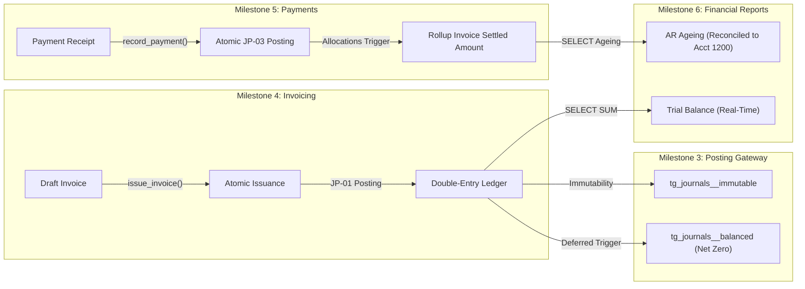

# Ledgerly — Multi-Tenant SaaS Accounting Application
**The Core Accounting Spine (MVP Demonstrator)**

**Ledgerly** is a high-integrity, multi-tenant SaaS accounting engine inspired by Zoho Books. It is engineered with a strict double-entry general ledger, transaction-local PostgreSQL Row-Level Security (RLS), immutable posted journals, snapshot-preserved sales invoicing, atomic payment allocations, and real-time authoritative financial reports (Trial Balance & AR Ageing).

---

## 1. Core Architecture & Financial Invariants

The application follows the architectural rules defined in the system documentation and implemented sequentially across 7 milestones:



### Key Engineering Invariants:
1. **Financial Arithmetic Precision:** Strictly uses Python `decimal.Decimal` and PostgreSQL `Numeric(19, 4)`. Binary floating-point arithmetic is completely prohibited. Half-Up rounding is consistently applied.
2. **Transaction-Local Multi-Tenancy (RLS):** All runtime queries run under application role `ledgerly_app` with `NOBYPASSRLS`. Tenant context is injected per transaction via `set_config('app.current_org_id', :org_id, true)`. Missing or mismatched tenant contexts fail closed.
3. **Atomic Posting Gateway:** An invoice issuance and its JP-01 double-entry posting occur inside a single atomic database transaction. Likewise, a payment and its JP-03 posting occur atomically. If any part fails, the entire transaction rolls back.
4. **Authoritative Ledger Immutability:** Posted journals (`app.journals` and `app.journal_lines`) cannot be edited or deleted through application paths. Modifications must be processed via reversal journals (JP-02 for voided invoices, JP-04 for reversed payments).
5. **Database-Level Double-Entry Balance Trigger:** In addition to domain-level validation, PostgreSQL constraint trigger `tg_journals__balanced` executes at `COMMIT` (`INITIALLY DEFERRED`) to ensure that Total Debits equal Total Credits with zero discrepancy.
6. **Sub-Ledger to General Ledger Reconciliation:** The Accounts Receivable summary derives customer-level balances that reconcile 100% to the balance of the GL Accounts Receivable control account (`1200`).

---

## 2. Directory Structure

```text
.
├── 01_PRD (1).md                           # Product Requirements Document
├── 02_Workflows (1).md                     # Accounting Workflow Specifications
├── 03_Architecture (1).md                  # System & Tenancy Architecture Design
├── 04_Database_Design (1).md               # Schema & Table Specifications
├── docs/
│   ├── IMPLEMENTATION_READINESS_REPORT.md  # Comprehensive Pre-Implementation Audit
│   └── DEMO_ACCEPTANCE_REPORT.md           # Formal Milestone 7 Acceptance Report
├── backend/
│   ├── alembic/                            # Database migrations (0001 through 0005)
│   │   ├── versions/
│   │   │   ├── 0001_initial_bootstrap.py   # Schemas, roles & RLS context functions
│   │   │   ├── 0002_master_data.py         # Users, Orgs, Accounts, TaxRates, Contacts, Items
│   │   │   ├── 0003_ledger_schema.py       # Journals, Journal Lines, Immutability & Balance Triggers
│   │   │   ├── 0004_invoices_schema.py     # Invoices, Lines, Legal Snapshots & Sequence
│   │   │   └── 0005_payments_schema.py     # Payments, Allocations & DB Rollup Triggers
│   ├── app/
│   │   ├── api/
│   │   │   ├── endpoints/
│   │   │   │   ├── accounts.py             # Chart of Accounts API
│   │   │   │   ├── auth.py                 # User authentication & registration
│   │   │   │   ├── contacts.py             # Customers & Vendors API
│   │   │   │   ├── demo.py                 # Live demo seed & cross-tenant attack probe
│   │   │   │   ├── health.py               # Liveness & database connectivity checks
│   │   │   │   ├── invoices.py             # Draft creation, calculation, issuance, voiding
│   │   │   │   ├── items.py                # Goods & Services catalog API
│   │   │   │   ├── ledger.py               # Double-entry journals inspection API
│   │   │   │   ├── organizations.py        # Organization provisioning & settings
│   │   │   │   ├── payments.py             # Payment recording, allocations, reversals
│   │   │   │   ├── reports.py              # Trial Balance & AR Summary reports
│   │   │   │   └── tax_rates.py            # Generic percentage tax rates API
│   │   │   ├── deps.py                     # Tenant and User session injection
│   │   │   └── router.py                   # Central API routing
│   │   ├── core/
│   │   │   ├── config.py                   # Pydantic Settings & CORS rules
│   │   │   ├── database.py                 # AsyncEngine, Session Local, RLS setters
│   │   │   └── security.py                 # Password hashing & verification
│   │   ├── models/                         # SQLAlchemy 2.0 Async Models
│   │   ├── schemas/                        # Pydantic v2 Request & Response schemas
│   │   └── services/
│   │       ├── coa_seed.py                 # Standard 11-account Chart of Accounts seed
│   │       ├── invoice_service.py          # Invoice calculation & issuance engine
│   │       ├── payment_service.py          # Payment receipt & allocation service
│   │       ├── posting_gateway.py          # Pure validation & atomic ledger persistence
│   │       └── report_service.py           # Authoritative Trial Balance & AR Ageing
│   ├── scripts/
│   │   └── seed_demo.py                    # Deterministic demonstration provisioning script
│   └── tests/                              # Comprehensive Automated Test Suite (33 tests)
│       ├── api/
│       ├── e2e/
│       ├── ledger/
│       ├── master_data/
│       ├── receipts/
│       ├── reports/
│       ├── sales/
│       └── spike/
├── frontend/
│   ├── index.html                          # Single-page interactive demonstration UI
│   └── README.md
├── docker-compose.yml                      # PostgreSQL 16 & backend service setup
└── README.md
```

---

## 3. Quick Start & Demonstration

### Prerequisites
- Python 3.11+
- PostgreSQL 16 running on `localhost:5432` with user `postgres` / password `postgres`
- Runtime database user `ledgerly_app` with password `ledgerly_secret` (`NOBYPASSRLS`)

### 1. Database & Migrations Setup
```powershell
cd backend
# Create dev & test databases if not already present
# Run migrations up to latest (0005)
.\.venv\Scripts\alembic.exe upgrade head
```

### 2. Launch the Development Server & Interactive UI
```powershell
cd backend
.\.venv\Scripts\python.exe -m uvicorn app.main:app --host 127.0.0.1 --port 8000
```

Open your browser to:
- 👉 **Demonstration Web Dashboard:** `http://127.0.0.1:8000/`
- 👉 **Interactive API Docs (Swagger):** `http://127.0.0.1:8000/docs`
- 👉 **Health Endpoint:** `http://127.0.0.1:8000/health`

### 3. Run the Demonstration Seed Script (Console)
For automated terminal demonstration output:
```powershell
cd backend
.\.venv\Scripts\python.exe scripts/seed_demo.py
```
This script executes the entire 14-step journey and prints the authoritative Trial Balance and Accounts Receivable reconciliation directly to the terminal.

### 4. Run the Full Automated Test Suite
```powershell
cd backend
.\.venv\Scripts\pytest.exe -v
```
All **33 automated tests** pass against the real local PostgreSQL 16 database.

---

## 4. The 14-Step Non-Negotiable Demonstration Journey

| Step | Action | Endpoint / Service | Financial & Security Outcome |
| :--- | :--- | :--- | :--- |
| **1** | Configure Organization | `POST /api/v1/organizations` | Creates Acme Global Corporation with tenant ID. |
| **2** | Seed Chart of Accounts | `POST /api/v1/accounts/seed` | Provisions 11 standard accounts (`1010` to `5090`). |
| **3** | Create Customers | `POST /api/v1/contacts` | Creates TechWave Enterprises & OmniRetail Partners. |
| **4** | Create Products/Services | `POST /api/v1/items` | Creates Annual Cloud License ($4,800) & Advisory ($250). |
| **5** | Configure Generic Tax | `POST /api/v1/tax-rates` | Configures State Sales Tax (8.25%) linked to Acct 2100. |
| **6** | Create Draft Sales Invoice | `POST /api/v1/invoices` | Line items entered; saved in editable `draft` state. |
| **7** | Calculate Invoice Totals | `InvoiceService` | Deterministic subtotal, tax, and grand total via Half-Up rounding. |
| **8** | Issue Invoice & Post JP-01 | `POST /api/v1/invoices/{id}/issue` | Atomically issues invoice and posts JP-01 double-entry journal. |
| **9** | Record Customer Payment | `POST /api/v1/payments` | Records partial payment ($2,500.00) against issued invoice. |
| **10** | Post Payment Journal (JP-03)| `PaymentService` | Atomically posts JP-03 (Dr Bank, Cr AR) and updates invoice balances. |
| **11** | Recalculate Outstanding AR | DB Allocation Trigger | `tg_payment_allocations__apply` updates remaining balance atomically. |
| **12** | Authoritative Trial Balance | `GET /api/v1/reports/trial-balance` | Real-time journal line query proving Net Zero equality ($8,778.50 == $8,778.50). |
| **13** | Accounts Receivable Report | `GET /api/v1/reports/ar-summary` | Sub-ledger aged receivables ($3,778.50) exactly match GL Acct 1200 ($3,778.50). |
| **14** | Cross-Tenant Isolation | `GET /api/v1/demo/isolation-spike` | Proves Org B cannot read or modify Org A records under RLS. 0 rows leaked. |

---

## 5. Scope Boundaries

In accordance with strict scope control:
- **Included:** Core accounting spine, double-entry general ledger, sales invoicing, payments, receipt allocations, real-time trial balance, accounts receivable ageing, PostgreSQL RLS tenant isolation.
- **Explicitly Deferred:** India GST (CGST/SGST/IGST/HSN), subscription billing recurring engines, opening balance batches, complex approval workflows, multi-currency conversion, external worker clusters (Celery/Redis), and third-party webhooks (n8n).
