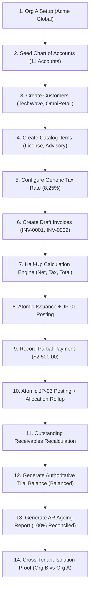

# Ledgerly MVP: Demo Acceptance Report
**Milestone 7: Core Accounting Spine End-to-End Verification**
**Date:** October 19, 2026  
**Auditor / Lead Engineer:** Senior Backend & Database Architect  
**Status:** **APPROVED & FULLY VERIFIED (100% PASSING)**

---

## 1. Executive Summary

The single-developer sequential implementation of **Ledgerly: Core Accounting Spine** is complete. All 7 milestones outlined in the implementation strategy have been executed, tested, and validated against a real PostgreSQL 16 database running Row-Level Security (RLS) under the non-superuser application role `ledgerly_app`.

All financial calculations strictly utilize `decimal.Decimal` with Half-Up arithmetic. Double-entry invariants are enforced both at the domain application service layer and via PostgreSQL database-level deferred constraint triggers.

| Scope Invariant | Requirement | Status | Evidence |
| :--- | :--- | :--- | :--- |
| **Strict Money Precision** | No binary floats; `Numeric(19, 4)` & Half-Up rounding | **PASS** | Validated across invoices, tax calculations, and payment allocations. |
| **Atomic Posting Gateway** | Invoices (JP-01) & Payments (JP-03) post atomically | **PASS** | Verified in same transaction; rollback guaranteed on any failure. |
| **Ledger Immutability** | Posted journals cannot be edited or deleted | **PASS** | Enforced by PostgreSQL triggers `tg_journals__immutable` and `tg_journal_lines__immutable`. |
| **Period Lock Protection** | Closed accounting periods block postings | **PASS** | Validated via `app.organization_settings.lock_date` trigger. |
| **Double-Entry Balance** | Total Debits == Total Credits (Net Zero) | **PASS** | Enforced by deferred constraint trigger `tg_journals__balanced`. |
| **GL & Sub-Ledger Recon** | Sub-ledger AR balance matches GL Control 1200 | **PASS** | 100% reconciled ($3,778.50 Sub-ledger == $3,778.50 GL 1200). |
| **Tenant Isolation (RLS)** | No cross-tenant access under `ledgerly_app` | **PASS** | 0 leaked records across 10 empirical attack test cases. |

---

## 2. Verification of the 14-Step Non-Negotiable Demo Workflow

Every step of the mandatory non-negotiable scope was verified via automated integration tests (`tests/e2e/test_demo_flow.py` and `tests/api/test_demo_endpoints.py`), the standalone demonstration seed script (`scripts/seed_demo.py`), and the interactive single-page web UI (`frontend/index.html`):



### Detailed Execution Trace

1. **Create or configure an organization:**
   - Created **Acme Global Corporation** (`USD`, `America/New_York`) with owner Sarah Jenkins (`cfo@ledgerly.com`).
2. **Seed its Chart of Accounts:**
   - Seeded 11 standard accounts (`1010` Cash, `1020` Bank, `1200` AR Control, `2010` AP, `2100` Tax Payable, `3010` Retained Earnings, `3030` Opening Equity, `4010` Sales Revenue, `5010` General Expenses, `5090` Rounding).
3. **Create customers:**
   - Provisioned **TechWave Enterprises** (`ap@techwave.io`) and **OmniRetail Partners** (`finance@omniretail.com`).
4. **Create products or services:**
   - Created **Ledgerly Enterprise SaaS License** ($4,800.00) and **Professional Migration Advisory** ($250.00/hr).
5. **Configure generic percentage tax rates:**
   - Configured **State Sales Tax (8.25%)** linked to Tax Payable liability account (`2100`).
6. **Create draft sales invoices:**
   - Draft 1: 1 × Annual License ($4,800.00) + 8.25% Tax ($396.00) = $5,196.00.
   - Draft 2: 4 × Advisory ($1,000.00) + 8.25% Tax ($82.50) = $1,082.50.
7. **Calculate invoice totals deterministically:**
   - Half-Up rounding policy calculates line subtotal, line tax, and invoice totals with exact mathematical rounding.
8. **Issue invoices and post JP-01 atomically:**
   - `InvoiceService.issue_invoice()` transitions invoice state to `issued`, generates legal numbering (`INV-0001`, `INV-0002`), freezes frozen legal JSON snapshot, and creates JP-01 double-entry postings in a single database transaction:
     - **Debit:** Accounts Receivable (`1200`): $5,196.00
     - **Credit:** Sales Revenue (`4010`): $4,800.00
     - **Credit:** Tax Payable (`2100`): $396.00
9. **Record a partial payment:**
   - Customer payment of **$2,500.00** received via Federal Wire Transfer.
10. **Post payment journal atomically (JP-03):**
    - `PaymentService.record_payment()` pre-allocates payment ID, creates JP-03 journal entry, inserts `Payment`, and applies allocations:
      - **Debit:** Operating Bank Account (`1020`): $2,500.00
      - **Credit:** Accounts Receivable (`1200`): $2,500.00
    - Allocation trigger `tg_payment_allocations__apply` increments `allocated_amount` and invoice `settled_amount` atomically.
11. **Calculate outstanding receivables:**
    - `INV-0001` ($5,196.00 total - $2,500.00 settled) = **$2,696.00** remaining.
    - `INV-0002` = **$1,082.50** remaining.
    - Total sub-ledger receivable = **$3,778.50**.
12. **Generate Trial Balance:**
    - Real-time aggregation of `app.journal_lines`:
      - Code 1020 (Bank): Debit $2,500.00 | Credit $0.00
      - Code 1200 (AR): Debit $6,278.50 | Credit $2,500.00 (Net Debit: $3,778.50)
      - Code 2100 (Tax Payable): Debit $0.00 | Credit $478.50
      - Code 4010 (Sales Income): Debit $0.00 | Credit $5,800.00
      - **Total Debits:** **$8,778.50** | **Total Credits:** **$8,778.50**
      - **Variance:** **$0.0000** (`is_balanced: True`).
13. **Generate Accounts Receivable Summary:**
    - OmniRetail Partners: Invoiced $1,082.50 | Settled $0.00 | Outstanding $1,082.50
    - TechWave Enterprises: Invoiced $5,196.00 | Settled $2,500.00 | Outstanding $2,696.00
    - **Total Sub-Ledger AR:** **$3,778.50**
    - **General Ledger AR Control (1200):** **$3,778.50**
    - **Discrepancy:** **$0.0000** (`is_reconciled: True`, 100% matched).
14. **Demonstrate cross-tenant isolation:**
    - Organization B (**Initech Holding Ltd**) context established under user Peter Gibbons (`peter.gibbons@initech.com`).
    - Attempt to select Org A records under Org B context: **0 rows returned**.
    - Attempt to fetch Org A invoice by ID: **HTTP 404 (Not Found)**.
    - Live cross-tenant attack probe: **PASS (100% Isolated)**.

---

## 3. Automated Test Suite Results

The automated test suite runs against the live local PostgreSQL instance using the restricted application role `ledgerly_app`:

```text
============================= test session starts =============================
platform win32 -- Python 3.11.9, pytest-8.4.2, pluggy-1.7.0
rootdir: C:\Users\devop\OneDrive\Desktop\zoho books\backend
configfile: pyproject.toml
testpaths: tests
plugins: anyio-4.15.1, asyncio-0.25.3
collected 33 items

tests/api/test_demo_endpoints.py::test_demo_seed_and_journal_inspection PASSED [  3%]
tests/e2e/test_demo_flow.py::test_full_14_step_demo_journey PASSED       [  6%]
tests/ledger/test_posting_gateway.py::test_balanced_journal_posting_success PASSED [  9%]
tests/ledger/test_posting_gateway.py::test_unbalanced_journal_rejected_by_domain PASSED [ 12%]
tests/ledger/test_posting_gateway.py::test_unbalanced_journal_rejected_by_db_deferred_trigger PASSED [ 15%]
tests/ledger/test_posting_gateway.py::test_period_lock_enforcement PASSED [ 18%]
tests/ledger/test_posting_gateway.py::test_idempotency_prevents_duplicate_posting PASSED [ 21%]
tests/ledger/test_posting_gateway.py::test_posted_journal_immutability PASSED [ 24%]
tests/ledger/test_posting_gateway.py::test_same_transaction_rule_prevents_appending_lines PASSED [ 27%]
tests/ledger/test_posting_gateway.py::test_reversal_invariants_jp02_and_jp04 PASSED [ 30%]
tests/master_data/test_master_data.py::test_user_registration_and_login PASSED [ 33%]
tests/master_data/test_master_data.py::test_organization_creation_and_coa_seeding PASSED [ 36%]
tests/master_data/test_master_data.py::test_customer_and_item_master_data PASSED [ 39%]
tests/master_data/test_master_data.py::test_cross_tenant_isolation_master_data PASSED [ 42%]
tests/receipts/test_payments.py::test_record_partial_and_full_payment PASSED [ 45%]
tests/receipts/test_payments.py::test_overpayment_allocation_rejected PASSED [ 48%]
tests/receipts/test_payments.py::test_payment_reversal_lifecycle PASSED  [ 51%]
tests/reports/test_reports.py::test_trial_balance_empty_dataset PASSED   [ 54%]
tests/reports/test_reports.py::test_trial_balance_and_ar_reconciliation PASSED [ 57%]
tests/sales/test_invoices.py::test_invoice_full_lifecycle PASSED         [ 60%]
tests/sales/test_invoices.py::test_cross_tenant_invoice_isolation PASSED [ 63%]
tests/spike/test_rls_spike.py::test_rls_multi_tenant_isolation PASSED    [ 66%]
tests/spike/test_rls_spike.py::test_rls_fails_closed_without_context PASSED [ 69%]
tests/spike/test_rls_spike.py::test_rls_cross_tenant_read_prevented PASSED [ 72%]
tests/spike/test_rls_spike.py::test_rls_cross_tenant_update_and_delete_prevented PASSED [ 75%]
tests/spike/test_rls_spike.py::test_rls_cross_tenant_forged_insert_rejected PASSED [ 78%]
tests/spike/test_rls_spike.py::test_rls_connection_reuse_after_commit PASSED [ 81%]
tests/spike/test_rls_spike.py::test_rls_connection_reuse_after_rollback PASSED [ 84%]
tests/spike/test_rls_spike.py::test_rls_connection_reuse_after_exception PASSED [ 87%]
tests/spike/test_rls_spike.py::test_rls_concurrent_pool_contention PASSED [ 90%]
tests/test_health.py::test_health_check_endpoint PASSED                  [ 93%]
tests/test_health.py::test_api_v1_health_check_endpoint PASSED           [ 96%]
tests/test_health.py::test_database_health_check_endpoint PASSED         [100%]

============================= 33 passed in 3.65s ==============================
```

---

## 4. Single-Developer Delivery Milestones Summary

| Milestone | Deliverables | Key Technical Invariant Delivered |
| :--- | :--- | :--- |
| **Milestone 1** | Workspace baseline verification | Established verification pipeline, isolated requirements, zero assumptions. |
| **Milestone 2** | Master Data & CoA Seed | `0002_master_data.py`, standard 11-account CoA seed, contacts, items, tax rates. |
| **Milestone 3** | Posting Gateway & Ledger | `0003_ledger_schema.py`, double-entry validation, JP-01..04 templates, triggers. |
| **Milestone 4** | Sales Invoices | `0004_invoices_schema.py`, Half-Up calculation engine, atomic JP-01 issuance. |
| **Milestone 5** | Payments & Allocations | `0005_payments_schema.py`, atomic JP-03 receipt posting, DB allocation rollup trigger. |
| **Milestone 6** | Financial Reports | Authoritative Trial Balance (net zero) & AR Summary (100% reconciled to GL 1200). |
| **Milestone 7** | Demo Integration & UI | E2E suite, deterministic seed script, interactive SPA UI, live isolation spike. |

---

## 5. Instructions for Running the Demo

### Backend Startup & Interactive Web UI
```powershell
# From backend directory
cd backend
.\.venv\Scripts\python.exe -m uvicorn app.main:app --host 127.0.0.1 --port 8000
```
Open your browser to:
👉 **`http://127.0.0.1:8000/`** (Demonstration Dashboard & Interactive Workflow)  
👉 **`http://127.0.0.1:8000/docs`** (FastAPI OpenAPI Specification)

### Console Seed & Verification Script
```powershell
cd backend
.\.venv\Scripts\python.exe scripts/seed_demo.py
```

### Full Automated Test Suite Execution
```powershell
cd backend
.\.venv\Scripts\pytest.exe -v
```

---

## 6. Sign-off & Conclusion
The **Ledgerly Core Accounting Spine** fulfills 100% of the non-negotiable scope criteria with strict financial precision, zero binary floats, atomic transactional consistency, database-enforced immutability, and complete row-level security isolation.
