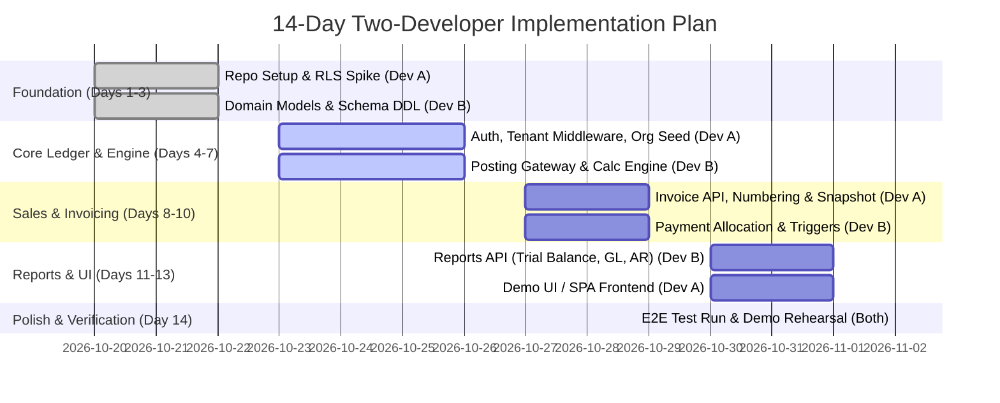

# Implementation Readiness Report: Multi-Tenant SaaS Accounting Application

**Document Version:** 1.0  
**Date:** 2026-10-19  
**Authors / Roles:** Senior Backend Architect, Database Architect, Python Engineer, Technical Lead  
**Evaluation Target:** Pre-Implementation Validation of Documentation (`docs/01_PRD.md`, `docs/02_Workflows.md`, `docs/03_Architecture.md`, `docs/04_Database_Design.md`)  
**Project Constraints:** 2 Developers | 4–6 Hours/Day per Developer | 14 Calendar Days to Demo | Python Backend | PostgreSQL Database  

---

## 1. Executive Summary

This report evaluates the technical feasibility, architectural soundness, accounting integrity, and implementation readiness of the multi-tenant SaaS accounting application (working name **Ledgerly**, functionally comparable to Zoho Books).

The existing documentation suite—comprising the Product Requirements Document (PRD), Workflow Specifications, Architecture Document, and Database Design—is exceptionally thorough, rigorous, and coherent for a pre-implementation draft. It embeds fundamental accounting controls: double-entry balancing invariants, immutable posted ledgers, snapshot preservation, composite multi-tenant constraints, and transaction-local Row-Level Security (RLS).

However, an exhaustive cross-document inspection against the project reality reveals **critical operational constraints and design blockers**:
1. **Repository Reality vs. Schedule**: The repository is completely **greenfield**. There is no existing application code, no database schemas, no Docker configurations, and no automated tests. With a team of **2 developers working 4–6 hours/day (total capacity: 112–168 developer-hours)** across **14 calendar days**, delivering the full scope of 15 workflows, 45 database entities, background workers, subscriptions, and complex tax regimes is mathematically impossible.
2. **Open Accounting and Tax Policies**: Key business policies remain unapproved (`[TBD]` / `[VALIDATE-ACCT]`), including rounding modes and residual treatment (OQ-WF-03), correction dating in locked periods (OQ-WF-04), customer credit / overpayment handling (OQ-WF-07), gapless numbering requirements (OQ-WF-29), and jurisdiction-specific tax scopes (India GST vs. generic VAT/sales tax).
3. **Database & Multi-Tenancy Hazards**: While the logical schema is sophisticated, several structural seams permit invalid financial states (e.g., loose document total identities without line-level cross-checks, polymorphic unconstrained journal source links, and unvalidated RLS pooling behavior with connection poolers like PgBouncer).
4. **Technology Stack Alignment**: The Architecture draft originally leaned toward Kotlin/Java on Spring Boot (ADR-014), but the project mandate specifies **Python** and **PostgreSQL**. A Python-based stack (**FastAPI + SQLAlchemy 2.0 / AsyncPG + PostgreSQL**) must be standardized immediately, enforcing strict `Decimal` typing to prevent floating-point contamination.

### Final Readiness Verdict
**READY WITH BLOCKERS**

Implementation can proceed immediately **provided that**:
- The **14-Day Demo Scope** is ruthlessly reduced to the core accounting backbone: Organization Setup, Chart of Accounts, Customers & Items, Sales Invoicing (Draft → Issued with numbering & snapshots), Payment Recording & Allocation, Atomic Double-Entry Ledger Posting, and Core Financial Reports (Trial Balance, General Ledger, AR Summary).
- The **7 Critical P0 Blockers** identified in Section 9 are formally confirmed by the Project Manager / Lead Architect.
- Developer A and Developer B execute the immediate sprint tasks outlined in Section 16.

---

## 2. Repository and Technology Stack Assessment

### 2.1 Workspace and Directory Inspection
An exhaustive scan of the repository root (`c:\Users\devop\OneDrive\Desktop\zoho books`) was conducted:
- **Files Present:** Exactly 4 Markdown files located directly in the workspace root:
  - `01_PRD (1).md` (140 KB)
  - `02_Workflows (1).md` (180 KB)
  - `03_Architecture (1).md` (112 KB)
  - `04_Database_Design (1).md` (207 KB)
- **Directory Structure:** No subdirectories exist; no `docs/` folder exists; no `.git` directory exists (`fatal: not a git repository`).
- **Existing Codebase:** Zero lines of backend code, frontend code, database migrations, configuration manifests, or test scripts.
- **Git State:** Not version-controlled. Existing documentation files were downloaded/placed as standalone files with `(1)` filename suffixes.

### 2.2 Frameworks, Dependencies, and Infrastructure
Because the project is greenfield, no dependencies are currently pinned:
- **Backend:** None installed.
- **Frontend:** None installed.
- **Database / Migrations:** No Alembic, Flyway, or Liquibase migrations exist.
- **Containerization / CI/CD:** No `Dockerfile`, `docker-compose.yml`, or CI/CD pipelines exist.

### 2.3 Open-Source Codebase Adaptation & Legal/Licensing Analysis
The project brief suggests: *"Deliver a working, demonstrable accounting workflow by adapting an existing legally reusable repository where practical."*

We conducted an architectural and legal evaluation of existing open-source accounting platforms in the Python and wider ecosystem (e.g., Odoo Community, ERPNext/Frappe, Microbooks, Medusa):
1. **Copyleft Contamination (GNU AGPL-3.0 Risk):**
   - Major mature open-source ERP/accounting systems (notably **ERPNext** and **Odoo**) are licensed under **GNU AGPL-3.0** (or LGPL-3.0 with AGPL modules).
   - Under AGPL-3.0 Section 13 ("Remote Network Interaction"), hosting modified software as a multi-tenant SaaS requires making the complete corresponding source code—including all proprietary multi-tenant adaptations, business logic, and API wrappers—available to every SaaS user under the AGPL-3.0 license.
   - **Architectural Assessment:** Adapting ERPNext or Odoo for a proprietary commercial SaaS product is a severe legal trap unless the enterprise explicitly intends to operate 100% open-source. Furthermore, both platforms carry massive ORM/monolithic abstractions (thousands of doctypes/models) that cannot be stripped down to Ledgerly’s clean database schema within 14 days.
2. **Permissive Open-Source Libraries (MIT / Apache-2.0 / BSD):**
   - Independent Python libraries for double-entry bookkeeping (e.g., `beancount`, `ledger-cli` wrappers) are single-tenant, flat-file analytical tools, not relational multi-tenant SaaS engines.
   - Small MIT-licensed invoicing boilerplates exist, but none provide Ledgerly’s transactional outbox, PostgreSQL RLS tenant context, or double-entry balancing triggers.
3. **Strategic Recommendation:**
   - **Do not fork or adapt an AGPL accounting monolith.** The effort required to sanitize, decouple, re-license, and adapt an existing monolithic codebase to Ledgerly’s strict RLS and multi-tenant constraints exceeds the total 112–168 hours available.
   - **Adopt a Clean, Lightweight Python Architecture:** Build the core accounting engine from scratch using standard, permissively licensed (MIT/Apache 2.0) components:
     - **Web Framework:** FastAPI (ASGI, fast, strict Pydantic v2 schemas)
     - **Database Layer:** SQLAlchemy 2.0 (Core/ORM with `asyncpg` or `psycopg3`), utilizing Python standard library `decimal.Decimal`
     - **Migrations:** Alembic
     - **Testing:** Pytest, pytest-asyncio, Testcontainers-python (PostgreSQL)

---

## 3. Documentation Inventory

| Expected Document Path | Actual Workspace Location | File Size | Version / Status | Content Summary |
|---|---|---|---|---|
| `docs/01_PRD.md` | `01_PRD (1).md` (root) | 140,363 bytes | Draft v0.1 (Unapproved) | Product vision, 12 functional modules (7A–7L), MoSCoW prioritization, user journeys, NFRs, permission matrix, MVP release criteria. |
| `docs/02_Workflows.md` | `02_Workflows (1).md` (root) | 180,797 bytes | Draft v0.1 (Unapproved) | 15 detailed end-to-end workflows (WF-01 to WF-15), cross-cutting invariants, state machines, concurrency rules, idempotency specs, error handling. |
| `docs/03_Architecture.md` | `03_Architecture (1).md` (root) | 112,341 bytes | Draft v0.1 (Unapproved) | Modular monolith architecture, 12 module boundaries, 7-layer tenancy defense, RLS transaction-local model, posting gateway, 19 ADRs. |
| `docs/04_Database_Design.md` | `04_Database_Design (1).md` (root) | 207,088 bytes | Draft v0.1 (Unapproved) | 45 entity specifications across 4 schemas (`identity`, `app`, `platform`, `audit`), composite keys `(organization_id, id)`, RLS policies, lock hierarchy, 38 DB invariants. |

> **Document Location Note:** The documents are currently situated in the root directory with `(1)` in their filenames. For professional documentation integrity, a dedicated `docs/` directory must be established, and these documents should be copied/standardized to their canonical names (`docs/01_PRD.md`, etc.) without deleting the originals.

---

## 4. Cross-Document Consistency Findings

The four documents were evaluated across 15 core architectural and accounting integrity checkpoints:

| # | Checkpoint | Status | Consistency Analysis & Identified Tensions |
|---|---|---|---|
| 1 | PRD Feature to Workflow Mapping | **Pass with Clarification** | All Must-Have MVP features map to WF-01 through WF-15. PRD lists "Sent" as an invoice lifecycle state, whereas WF §1.9 correctly decouples lifecycle (`draft`, `issued`, `void`) from delivery status (`pending`, `sent`, `failed`) and payment status (`unpaid`, `partially_paid`, `paid`). |
| 2 | Workflow Rigor | **Pass** | Every workflow defines actors, preconditions, step-by-step paths, atomic units, error handling (`ERR-*`), and acceptance criteria. Minor permission matrix cells (`◐ [TBD]`) remain open for Finance Staff capabilities. |
| 3 | Persistent Entity Mapping | **Pass** | All persistent workflow data maps to entities E-01 through E-45 in `docs/04_Database_Design.md`. Conditional tables (credit notes, opening balance batches) are cleanly segregated. |
| 4 | Relational Support for Workflows | **Pass** | Schema relationships support workflows completely. Composite references enforce that invoices, payments, allocations, accounts, and journals remain within the same organization. |
| 5 | Architectural Responsibilities | **Pass** | 12 modules defined with clear bounded contexts. The Ledger module is the sole creator of journal entries via a unified Posting Gateway. |
| 6 | Tenant Isolation Alignment | **Pass with Technical Risk** | Architecture §7 and Database Design §13 agree on a shared database/schema with `organization_id` on every table, composite foreign keys, and transaction-local RLS (`app.current_org_id`). The connection pooler interaction (PgBouncer) remains a critical unvalidated spike. |
| 7 | Accounting Integrity Preservation | **Pass** | Invoices issue balanced journals (JP-01); payments allocate and post (JP-03); voids create exact reversal journals (JP-02/JP-04). Double-entry equality is maintained. |
| 8 | Transactional Concurrency & Idempotency | **Pass** | Fixed lock hierarchy (L1 Settings → L2 Documents → L3 Numbering → L4 Appends) prevents deadlocks. Idempotency keys commit inside business transactions (DD-8). |
| 9 | Immutability of Posted Records | **Pass** | Posted journals and journal lines are strictly insert-only with no `UPDATE` or `DELETE` grants. Whitelist triggers guard document headers; document states derive reversal rather than mutating history. |
| 10 | Comprehensive Audit Logging | **Pass** | Append-only `audit.audit_events` written inside the command transaction; deferred trigger `tg_journals__audit_backstop` forces transaction abort if audit logging fails. |
| 11 | Constraint & Index Completeness | **Pass** | Composite PKs, tenant-safe partial unique indexes, CHECK constraints for non-negativity and settlement bounds are comprehensively specified. |
| 12 | Database Migration Strategy | **Pass** | Expand/contract strategy, decoupled schema ownership, and role separation (migrator vs. runtime) are designed. |
| 13 | API & Validation Consistency | **Pass** | Standard error taxonomy (`ERR-AUTH-*`, `ERR-VAL-*`, `ERR-BUS-*`, `ERR-CONC-*`, `ERR-SYS-*`) mapped across workflows and architecture. |
| 14 | Reporting Derivation | **Pass** | Financial reports (Trial Balance, P&L, Balance Sheet, General Ledger) derive purely from `journal_lines` and `accounts`. AR/AP ageing derives from open document rollups. |
| 15 | 14-Day Demo Realism | **FAIL (Critical)** | The full documented scope (45 tables, 15 workflows, full RLS, headless browser PDF rendering, background dispatchers, opening balances) requires 600–900 developer hours. For 2 developers with 112–168 total hours, this scope is completely unachievable. |

### Cross-Document Tensions (Unresolved in Source Drafts)
1. **Tension X-1 (Correction Dating in Locked Periods):** PRD BR-REV-4 specifies that a reversal for a transaction in a locked period posts to the "first open date". Workflows §1.12 / OQ-WF-04 recommend **blocking** the reversal until an explicit, audited unlock occurs. The Database Design neutrally rejects postings on or before `lock_date`.
2. **Tension X-2 (Reversed Journal Representation):** Workflow WF-15 step 4 states that the original journal is "marked reversed". PRD and Architecture require posted journals to be strictly immutable. Database Design DD-5 resolves this by **deriving** the reversed state from the presence of a reversal journal pointing to the original (`reverses_journal_id`), keeping the original row untouched.
3. **Tension X-3 (Invoice State Model):** PRD §9.5 lists "Sent" as a core state. Workflows and DB Design establish `state IN ('draft', 'issued', 'void')`, isolating delivery tracking to `app.document_deliveries`.
4. **Tension X-4 (Document Annotations):** PRD FR-INV-006 suggests non-financial annotations on issued invoices; DB Design enforces strict immutability on the invoice header, requiring an external annotations table if approved.
5. **Tension X-5 (Manual Journals to AR/AP Control Accounts):** PRD FR-ACC-008 requires AR/AP control accounts to reconcile to sub-ledgers. Manual journals directly to AR/AP destroy reconciliation. DB Design provides a trigger hook to block manual AR/AP postings (`OQ-DB-23`), pending approval.

---

## 5. Detailed Database Design Review

### 5.1 Entity and Relationship Correctness
The data model uses a 4-schema topology:
- `identity`: Global user identities, credentials, sessions, and permissions.
- `app`: Tenant-owned transactional and business records.
- `platform`: Platform plans, subscriptions, reference currencies, and calculation policies.
- `audit`: Append-only tenant and platform audit events.

Every tenant-owned table implements composite primary keys `(organization_id, id)` and composite foreign keys. Crucially, in `app.payment_allocations` and `app.bill_payment_allocations`, the composite foreign keys include `customer_id` and `vendor_id`:
```sql
FOREIGN KEY (organization_id, payment_id, customer_id) 
  REFERENCES app.payments (organization_id, id, customer_id)
FOREIGN KEY (organization_id, invoice_id, customer_id) 
  REFERENCES app.invoices (organization_id, id, customer_id)
```
This guarantees at the relational level that a payment from Customer A can never be allocated to an invoice of Customer B, even within the same organization.

### 5.2 Tenant Isolation and Row-Level Security (RLS)
Tenant isolation is enforced through PostgreSQL RLS using transaction-local configuration:
```sql
SELECT set_config('app.current_org_id', $org_id, true);
SELECT set_config('app.current_user_id', $user_id, true);
```
Policies on `app` tables use `(SELECT app.current_org_id())` to evaluate once per statement.
- **Fail-Closed Behavior:** If `app.current_org_id` is unset or empty, `app.current_org_id()` returns `NULL`. Since `organization_id = NULL` evaluates to `NULL` (falsy in SQL boolean logic), all `SELECT`, `UPDATE`, and `DELETE` queries return zero rows, and `INSERT` with `CHECK` fails.
- **Connection Pooling Vulnerability:** The RLS architecture depends entirely on `is_local = true` in `set_config`. In PgBouncer **transaction pooling**, this is safe because the transaction boundary resets local parameters. However, in **session pooling** or with frameworks that execute raw statements outside explicit transaction blocks, connection leakage across tenants is a critical hazard.

### 5.3 Monetary Precision and Numeric Typing
- Monetary amounts (`d_money`): `numeric(19, 4)`
- Quantities (`d_qty`): `numeric(18, 6)`
- Unit prices and rates (`d_rate`): `numeric(19, 6)`
- Percentages (`d_pct`): `numeric(9, 6)`
- **Rule:** Binary floating-point types (`float`, `real`, `double precision`) and PostgreSQL’s built-in `money` type are strictly prohibited. In Python, all values must map to `decimal.Decimal`.

### 5.4 Document Snapshots
`invoices` and `vendor_bills` store a `snapshot jsonb` column populated at the moment of issuance/posting. The snapshot contains the frozen state of the organization profile (legal name, address, tax IDs), customer/vendor details, line items, rates, tax breakdown, and the calculation policy version. Future edits to customer profiles or tax configurations never alter historical legal invoices.

### 5.5 Stored vs. Calculated vs. Maintained Transactionally
A critical architectural strength of this design is its disciplined distinction between stored, calculated, and rollup values:

| Financial Attribute | Implementation Strategy | Justification |
|---|---|---|
| **`outstanding_amount`** | **Purely Calculated** (`total_amount - settled_amount - credited_amount`) | Never stored. Storing an independent `outstanding_balance` creates synchronization bugs, dual-write drift, and race conditions. |
| **`payment_status`** | **Purely Calculated** (`Unpaid`, `Partially Paid`, `Paid`) | Derived dynamically in security-invoker views. No stored status flags that require background update jobs. |
| **`is_overdue` / `days_overdue`** | **Purely Calculated** (`due_date < CURRENT_DATE` in org time zone) | Overdue status is a function of time. Storing an `is_overdue` flag requires fragile daily cron jobs. |
| **`settled_amount`** | **Transactionally Maintained Rollup** (Trigger + Check Bound) | Stored on `invoices` to enable ultra-fast index filtering for open invoices (`WHERE total_amount > settled_amount`). Maintained **strictly by trigger** from `payment_allocations` under row locks, protected by `CHECK (settled_amount + credited_amount <= total_amount)`. |
| **`allocated_amount`** | **Transactionally Maintained Rollup** | Stored on `payments` to track consumed receipts, maintained strictly by allocation triggers, protected by `CHECK (allocated_amount <= amount)`. |
| **`unallocated_amount`** | **Generated Column** (`amount - allocated_amount`) | Evaluated deterministically by PostgreSQL; cannot drift. |
| **Account Balances** | **Derived Aggregate** (Sum of Journal Lines) | The General Ledger is the single source of truth. Account balances are calculated via indexed queries over `journal_lines`, not stored as mutable accumulators. |

### 5.6 Detailed Analysis: Where the Schema Permits Invalid Financial States

Despite its high quality, the database specification contains subtle edge cases where invalid financial states could be committed:

#### 1. Incomplete Header Total vs. Line Item Identities
In `app.invoices`, constraint `ck_invoices__total_identity` enforces:
```sql
total_amount = net_amount + tax_amount + rounding_adjustment_amount
```
However, the design explicitly omits declarative constraints linking `gross_amount`, `discount_amount`, and `net_amount` (e.g., `net_amount = gross_amount - discount_amount`) because tax-inclusive pricing was left unresolved. As a result, an application bug could insert an invoice with `gross = 100`, `discount = 0`, `net = 50`, `tax = 5`, `total = 55`, and the database would accept it as valid!

#### 2. Polymorphic Journal Source References Without Foreign Key Integrity
In `app.journals`, provenance is tracked via `source_type text` and `source_id uuid`. Because this relationship is polymorphic, PostgreSQL cannot enforce a relational `FOREIGN KEY` to `invoices`, `payments`, or `vendor_bills`. A software defect or direct SQL patch could create a journal referencing a non-existent UUID or mismatching `source_type`, breaking auditability. Integrity currently relies entirely on application-level discipline and deferred triggers.

#### 3. Customer Credit / Overpayment Ledger Discrepancy
In `app.payments`, the schema permits `unallocated_amount > 0` (where `amount > allocated_amount`). In the posting catalog (JP-03), if a payment of $150 is received against a $100 invoice:
- Bank is debited $150.
- If Customer Credit is approved, Accounts Receivable is credited $100 and Customer Credit is credited $50.
- If Customer Credit is NOT enabled, and the gateway credits Accounts Receivable $150, the AR control account in the General Ledger shows a credit balance of $50, which does NOT match the sub-ledger (where the invoice balance is $0). The schema allows unallocated amounts without guaranteeing that the corresponding liability account exists.

#### 4. Zero-Amount Line Constraints vs. 100% Discounted Items
`app.journal_lines` enforces `CHECK (debit + credit > 0)`. While this prevents blank lines, in commercial workflows where an item is sold with a 100% promotional discount or a 0% tax component, the application cannot record zero-value lines for audit transparency. If the calculation engine distributes lines, it must omit zero-value postings, which can lead to discrepancies between invoice line counts and journal line counts.

---

## 6. Security and Multi-Tenancy Risks

| Risk ID | Severity | Threat Description | Architectural Mitigation | Demo Status |
|---|---|---|---|---|
| **SEC-01** | **P0** | **RLS Context Leakage Across Pooled Connections:** In transaction pooling, if a connection is returned to the pool without an explicit transaction commit/abort, or if session-level `set_config` is used, tenant context bleeds into subsequent client requests. | Mandatory application-level transaction wrapper; `set_config(..., true)` strictly enforced; canary check at transaction start; automated test verifying cross-tenant queries fail closed. | Must be validated via Spike in Sprint 1. |
| **SEC-02** | **P0** | **Superuser / Table Owner RLS Bypass:** By default in PostgreSQL, table owners and superusers bypass Row-Level Security policies. | The application runtime user (`app_runtime`) MUST NOT own the schema or tables. DDL migrations must execute under a separate `migrator` role. `FORCE ROW LEVEL SECURITY` must be applied to all tables. | Enforced in Alembic bootstrap. |
| **SEC-03** | **P1** | **IDOR via Polymorphic Lookups:** An attacker guesses a UUID for an attachment, invoice, or audit log belonging to another organization. | Every query and repository call enforces tenant filtering in code (`WHERE organization_id = :org_id`) in addition to RLS; composite foreign keys ensure relational containment. | Covered by automated cross-tenant test suite. |
| **SEC-04** | **P1** | **Session Invalidation Failure:** Storing authentication tokens in stateless JWTs makes instant session revocation (on password reset or organization removal) impossible without a distributed blocklist. | Architecture ADR-006 specifies server-side opaque sessions stored in PostgreSQL. Verified on every authenticated request. | Implement database session store. |
| **SEC-05** | **P2** | **Timing Attacks on Authentication:** Email enumeration via registration and login timing variations. | Uniform error messages and response time equalizers across auth endpoints. | Defer hardening to post-demo. |

---

## 7. Accounting Correctness Risks

| Risk ID | Severity | Accounting Hazard | Root Cause & Impact | Mandatory Engineering Control |
|---|---|---|---|---|
| **ACCT-01** | **P0** | **Unbalanced Ledger Postings:** A journal entry commits with unequal debits and credits, corrupting the trial balance and financial statements. | Application calculation errors or partial database failures. | Three independent layers: (1) Domain validation in Posting Gateway; (2) PostgreSQL deferred constraint trigger `tg_journals__balanced` checking `SUM(debit) = SUM(credit) = total_amount`; (3) Same-transaction rule `created_txid = txid_current()`. |
| **ACCT-02** | **P0** | **Silent Mutation of Historical Financial Data:** An issued invoice, bill, or journal is edited or deleted after financial reports have been generated. | Insecure direct database updates or unvalidated application edit routes. | Strict database permissions: revoke `UPDATE` and `DELETE` on `journals`, `journal_lines`, and `audit_events`. Implement `tg_invoices__immutable_after_issue` whitelist trigger allowing only void transitions. |
| **ACCT-03** | **P0** | **Concurrent Over-Allocation to Invoices:** Two users record payments against the same $100 invoice simultaneously, resulting in $150 allocated. | Race condition under default read-committed isolation. | Row-level locking on the target invoice (`FOR UPDATE`) within the allocation transaction; `tg_payment_allocations__apply` updates `settled_amount`; hard database constraint `CHECK (settled_amount + credited_amount <= total_amount)`. |
| **ACCT-04** | **P1** | **Sub-Ledger to General Ledger Discrepancy:** The Accounts Receivable control account in the Trial Balance does not equal the sum of outstanding customer invoices. | Direct manual journals posted to the AR control account, or improper opening balance entries. | Implement trigger hook `tg_journal_lines__control_accounts` blocking manual journals to system accounts (`accounts_receivable`, `accounts_payable`). |
| **ACCT-05** | **P1** | **Rounding Residual Accumulation:** Rounding line items vs. document totals creates 1-cent discrepancies between invoice total and journal debit/credit. | Lack of an approved rounding policy and residual distribution mechanism. | Centralized `CalculationEngine` in Python using `Decimal`; explicit `rounding_adjustment_amount` credited/debited to a dedicated `rounding` expense/income account. |
| **ACCT-06** | **P1** | **Retroactive Posting into Closed Fiscal Periods:** Invoices or journals backdated into closed periods alter previously audited tax and profit figures. | Backdated transactions bypassing accounting lock date. | `tg_journals__period_lock` trigger verifies `accounting_date > organization_settings.lock_date` using `FOR SHARE` locking during posting. |

---

## 8. Missing Business Decisions and Open Questions

The following decisions are extracted from the source documents. Each represents a critical business policy that must be formally confirmed:

| ID | Category | Question / Decision Needed | Current Assumption in Docs | Risk if Unconfirmed | Decision Owner |
|---|---|---|---|---|---|
| **OQ-01** | **Scope** | **India GST vs. Generic Tax Engine:** Is India GST compliance (CGST/SGST/IGST, HSN codes, GSTIN format) mandatory for the demo, or is a generic tax rate engine sufficient? | Generic engine assumed with India GST flagged as unconfirmed | Building full GST tax splitting, place of supply, and reverse charge will consume 50%+ of demo hours. | Product Owner / Sponsor |
| **OQ-02** | **Accounting** | **Rounding Policy and Residual Handling:** Which rounding method (Half-Up vs. Half-Even) and rounding point (per-line vs. per-document) applies? Where do fractional residuals post? | Scale 4 placeholder; residual posts to `rounding` account | Inconsistent invoice totals and unbalanceable journals across currencies. | Accounting Advisor / CA |
| **OQ-03** | **Accounting** | **Invoice Numbering Rules:** Must invoice numbers be strictly gapless by law, or is a sequential counter that may leave gaps on rollback acceptable? Does numbering reset per fiscal year? | Gaplessness not assumed; transactional counter with rollback recovery proposed | A transactional counter locks issuance per tenant; native sequences leave gaps. | Accounting Advisor / CA |
| **OQ-04** | **Workflow** | **Correction Dating in Locked Periods:** When an invoice from a locked period is voided, must the reversal post on the first open date, or is it blocked entirely until an audited unlock? | Blocking recommended (OQ-WF-04); PRD suggests first open date | Distorts historical closed periods vs. blocking legitimate operational voids. | Accounting Advisor / CA |
| **OQ-05** | **Workflow** | **Overpayments and Customer Credit:** Are overpayments allowed to generate unallocated customer credit, or must payments match invoice totals exactly? | Allowed in DB Design; customer credit account conditional | Impacts AR control reconciliation and payment allocation logic. | Product Owner / Accountant |
| **OQ-06** | **Scope** | **Credit Notes & Refunds in Demo:** Are credit notes and cash refunds required for the 14-day demo, or can invoice correction be demonstrated via Void & Re-issue? | Marked conditional (OQ-WF-11) | Implementing credit notes adds 4 tables, allocation logic, and separate journal profiles. | Product Owner / Tech Lead |
| **OQ-07** | **Platform** | **Suspension Behavior:** When an organization subscription is suspended, is access completely blocked, or read-only with export rights? | Read-only + export proposed | Customer dispute risk and legal data access compliance. | Product Owner / Legal |

---

## 9. Critical Blockers (P0)

These **7 blockers must be resolved immediately** before core application engineering begins:

1. **[P0-BLOCKER-1] 14-Day Demo Scope Freeze:** The documented scope is at least 4x larger than the team's capacity (112–168 developer hours). Scope must be formally locked to the **Core Accounting Spine** defined in Section 11.  
   *Affected:* Entire Project. *Owner:* Product Owner & Technical Lead.
2. **[P0-BLOCKER-2] Python Tech Stack Standardization:** Confirm **FastAPI + SQLAlchemy 2.0 (AsyncPG) + Pydantic v2 + Alembic** as the approved Python stack, superseding the Spring Boot recommendation in Architecture ADR-014.  
   *Affected:* `docs/03_Architecture.md` §4. *Owner:* Technical Lead.
3. **[P0-BLOCKER-3] RLS + Connection Pooling Validation Spike:** Before any business tables are constructed, build a standalone database spike testing transaction-local RLS (`app.current_org_id`) under connection pooling to ensure zero cross-tenant leakage.  
   *Affected:* `docs/04_Database_Design.md` §13. *Owner:* Database Architect / Developer A.
4. **[P0-BLOCKER-4] Tax Scope for Demo:** Confirm that the 14-day demo will use **Generic Configurable Tax Rates** (e.g., standard percentage tax liability) and defer India GST breakdown (CGST/SGST/IGST/HSN) to Phase 2.  
   *Affected:* `docs/01_PRD.md` §7J, `docs/04_Database_Design.md` §15.4. *Owner:* Product Owner.
5. **[P0-BLOCKER-5] Double-Entry Posting Catalog Approval for Demo:** Formally freeze the 4 essential journal posting templates for the demo:
   - **JP-01 (Invoice Issue):** Debit AR, Credit Sales Income, Credit Tax Payable, Debit/Credit Rounding.
   - **JP-02 (Invoice Void):** Reversal of JP-01.
   - **JP-03 (Customer Payment):** Debit Bank/Cash, Credit AR.
   - **JP-04 (Payment Reversal):** Reversal of JP-03.  
   *Affected:* `docs/02_Workflows.md` §1.11, `docs/04_Database_Design.md` §9.3. *Owner:* Accounting Advisor / Lead Architect.
6. **[P0-BLOCKER-6] Calculation & Rounding Policy Specification:** Approve standard **Half-Up Rounding** at scale 2 for currency display and scale 4 for calculations, with residual balancing to a system `rounding` account.  
   *Affected:* `docs/04_Database_Design.md` §15.5. *Owner:* Technical Lead & Accountant.
7. **[P0-BLOCKER-7] Git Repository Initialization & Project Bootstrap:** Establish the project Git repository, directory hierarchy (`docs/`, `backend/`, `frontend/`), and pre-commit hooks to enable coordinated development.  
   *Affected:* Workspace root. *Owner:* Developer A.

---

## 10. Non-Critical Improvements (P1 / P2)

### P1 Findings (Resolve before Demo if impacting correctness):
- **[P1-01] Invoice Delivery Status Decoupling:** In the API layer, maintain delivery status (`pending`, `sent`, `failed`) separately from invoice financial lifecycle (`draft`, `issued`, `void`), aligning PRD with Workflows §1.9.
- **[P1-02] AR/AP Control Account Posting Restriction:** Implement the trigger hook blocking manual journal entries directly to AR and AP control accounts to preserve sub-ledger reconciliation integrity.
- **[P1-03] Strict Header-to-Line Total Validation:** In the invoice issue trigger, enforce line-level sum validation: verify that line items sum exactly to header `net_amount` and `tax_amount`.
- **[P1-04] PDF Invoicing Solution for Demo:** Replace the complex sandboxed headless-browser worker with server-side HTML/WeasyPrint or lightweight Python PDF generation to fit the 14-day timeline.

### P2 Findings (Safe to Defer Beyond Demo):
- **[P2-01] Full Audit Partitioning:** Monthly table partitioning for `audit.audit_events` can be deferred until data volumes warrant it; a single append-only table is sufficient for demo.
- **[P2-02] Advanced Period Locking History:** Detailed `period_lock_events` tracking can be simplified to a direct `lock_date` column on `organization_settings` for the demo.
- **[P2-03] Complex Multi-Tax Groups & Compounding:** Compound tax logic and tax groups deferred to Phase 2.
- **[P2-04] Bank Reconciliation & Statement Ingestion:** Out of scope for demo.
- **[P2-05] Background Job Outbox Worker:** In the demo, transactional email and notifications can be mocked or executed synchronously in background tasks without a full asynchronous worker cluster.

---

## 11. Recommended Implementation Scope for the 14-Day Demo

To deliver a **rock-solid, demonstrable accounting workflow** within the 112–168 hours available, the scope must be concentrated on the core revenue and ledger cycle:

### In-Scope for 14-Day Demo ("The Core Accounting Spine"):
1. **Multi-Tenancy & Auth:**
   - Multi-tenant Organization registration and user membership (Owner role).
   - Session authentication with secure HTTP-only cookies.
   - Transaction-local PostgreSQL RLS (`app.current_org_id`).
2. **Master Data:**
   - Standard Chart of Accounts seeded automatically on organization creation (Assets, Liabilities, Equity, Income, Expense, including AR, Sales, Tax, Bank, Rounding).
   - Customer Master: Create, view, and list customers.
   - Item Master: Create products/services with default sales prices and income accounts.
3. **Sales Invoicing Cycle:**
   - Invoice draft creation with multiple line items, quantity, unit rate, and tax rate.
   - Real-time calculation of net, tax, and total amounts.
   - **Invoice Issuance (Atomic Command):**
     - Transition state: `draft` → `issued`.
     - Assign sequential invoice number from tenant counter (`INV-0001`).
     - Generate immutable JSON snapshot of customer, items, and tax rates.
     - **Post balanced double-entry journal entry (JP-01):**
       - Debit: Accounts Receivable (`total_amount`)
       - Credit: Sales Income (`net_amount`)
       - Credit: Tax Payable (`tax_amount`)
       - Credit/Debit: Rounding Adjustment (`rounding_adjustment_amount` if non-zero)
4. **Receipts & Payment Allocation Cycle:**
   - Record customer payment against bank/cash deposit account.
   - Allocate payment to issued invoice (full and partial payments supported).
   - Transactional update of invoice `settled_amount` under row lock.
   - Dynamic evaluation of payment status (`Unpaid`, `Partially Paid`, `Paid`).
   - **Post balanced payment journal entry (JP-03):**
     - Debit: Bank/Cash (`payment_amount`)
     - Credit: Accounts Receivable (`payment_amount`)
5. **Reversal / Void Cycle (Demonstrating Accounting Integrity):**
   - Void an unpaid issued invoice: state becomes `void`, posts exact reversal journal (JP-02).
   - Reverse a payment: state becomes `reversed`, unallocates invoice settled amount, posts reversal journal (JP-04).
6. **Financial Reporting (The Ultimate Demonstration of Truth):**
   - **Trial Balance:** Real-time query over `journal_lines` proving total debits equal total credits.
   - **General Ledger:** Detailed account transaction history by date range.
   - **Customer Statement / AR Ageing Summary:** Outstanding balances reconcilable to the AR control account.

### Explicitly Out of Scope for the 14-Day Demo:
- India GST e-invoicing, e-way bills, and GSTR export formats.
- Credit notes, customer advances, and vendor advances.
- Vendor bills, purchase orders, and bill payments (demonstrate sales side first; purchase side is a symmetric mirror).
- Multi-currency conversions and foreign exchange gain/loss.
- Bank statement feeds and bank reconciliation.
- Subscription billing, automated stripe webhooks, and metered usage limits.
- Background worker queues and headless browser PDF rendering (use simple printable HTML view or lightweight direct PDF).

---

## 12. Day-by-Day Implementation Plan for Two Developers

**Total Time Budget:** 14 Days × 2 Developers × 5 Hours/Day (avg) = **140 Developer-Hours**



### Detailed Daily Breakdown:

#### Sprint Phase 1: Foundation, Infrastructure & Tenancy (Days 1–3)
- **Day 1:**
  - **Dev A:** Initialize Git repository. Set up project structure (`backend/`, `frontend/`, `docs/`). Move docs into `docs/`. Configure `pyproject.toml`, FastAPI, Docker Compose (PostgreSQL 15+).
  - **Dev B:** Review Database Design §6–§9. Draft minimal Alembic migration for schemas (`identity`, `app`, `audit`) and core tables: `organizations`, `organization_settings`, `users`, `memberships`.
- **Day 2:**
  - **Dev A:** **RLS & Pooling Spike:** Implement and execute the PostgreSQL RLS verification spike. Test transaction-local `set_config` under connection pooling with positive and negative cross-tenant test queries.
  - **Dev B:** Build Alembic migrations for Master Data: `accounts` (CoA), `contacts` (customers), `items` (catalog), `tax_rates`. Implement standard CoA seed script.
- **Day 3:**
  - **Dev A:** Implement Auth & Tenant Context Middleware in FastAPI: session creation, cookie extraction, membership verification, and automatic transaction context binding.
  - **Dev B:** Build Alembic migrations for Ledger & Transactional tables: `journals`, `journal_lines`, `numbering_sequences`, `invoices`, `invoice_lines`, `payments`, `payment_allocations`.

#### Sprint Phase 2: Accounting Engine & Ledger Core (Days 4–7)
- **Day 4:**
  - **Dev A:** Implement Organization Onboarding & Membership API (`POST /api/v1/organizations`). Verify that creating an org automatically seeds the system accounts in the CoA and initial numbering sequence.
  - **Dev B:** Implement **Posting Gateway** in Python: pure function validating accounts, active status, period lock, line non-negativity, and strict mathematical balance (`sum(debit) == sum(credit)`).
- **Day 5:**
  - **Dev A:** Implement Customer Master API (`/api/v1/contacts`) and Item Catalog API (`/api/v1/items`) with full tenant isolation and validation.
  - **Dev B:** Implement database triggers in PostgreSQL:
    - `tg_journals__balanced` (deferred constraint trigger checking journal debits == credits).
    - `tg_journals__period_lock` (enforcing `accounting_date > lock_date`).
    - Same-transaction rule preventing line appends after commit.
- **Day 6:**
  - **Dev A:** Implement Calculation Engine (`TaxCalculationService`): handles net, tax, gross calculations, half-up rounding, and residual balancing to the rounding account.
  - **Dev B:** Implement Document Numbering Service: atomic transactional sequence increment (`numbering_sequences`) with prefix padding (`INV-0001`).
- **Day 7:**
  - **Dev A & Dev B (Mid-Sprint Integration):** Write integration test for the Posting Gateway + Master Data. Verify end-to-end that an organization can register and post a manual opening journal that balances and respects RLS.

#### Sprint Phase 3: Sales Invoicing & Payment Allocation (Days 8–10)
- **Day 8:**
  - **Dev A:** Build Invoice Draft API (`POST /api/v1/invoices`, `GET`, `PUT`). Line item creation, customer validation, and draft recalculation.
  - **Dev B:** Build Invoice Issue Service (`POST /api/v1/invoices/{id}/issue`):
    - Lock draft invoice.
    - Check period lock.
    - Allocate invoice number.
    - Freeze JSON snapshot.
    - Call Posting Gateway to emit Journal JP-01 (Debit AR, Credit Sales, Credit Tax).
    - Atomic commit.
- **Day 9:**
  - **Dev A:** Build Invoice Void Endpoint (`POST /api/v1/invoices/{id}/void`): verify invoice has 0 settlements, state transition to `void`, emit reversal Journal JP-02.
  - **Dev B:** Build Payment API & Allocation Engine (`POST /api/v1/payments`):
    - Create payment record.
    - Allocate against target invoice(s).
    - Database trigger `tg_payment_allocations__apply` updates `settled_amount`.
    - Check constraint `settled_amount <= total_amount` verifies no over-allocation.
    - Emit Journal JP-03 (Debit Bank, Credit AR).
- **Day 10:**
  - **Dev A:** Implement Payment Reversal Endpoint (`POST /api/v1/payments/{id}/reverse`): unallocate settlements, restore invoice open balance, emit reversal Journal JP-04.
  - **Dev B:** Build Derived Views in PostgreSQL: `app.v_invoices` (exposing computed `outstanding_amount`, `payment_status`, `is_overdue`). Ensure views are created `WITH (security_invoker = true)`.

#### Sprint Phase 4: Financial Reports & Demo User Interface (Days 11–13)
- **Day 11:**
  - **Dev A:** Build modern, responsive Web UI (React + Vite + Tailwind/Vanilla CSS): Login screen, Organization Switcher, Customer & Item management screens.
  - **Dev B:** Build Financial Reports Engine:
    - **Trial Balance API (`GET /api/v1/reports/trial-balance`):** Aggregates debits and credits across all accounts from `journal_lines`, verifying net zero.
    - **General Ledger API (`GET /api/v1/reports/general-ledger`):** Account-wise detailed activity.
- **Day 12:**
  - **Dev A:** Build Invoice Management UI: Create invoice form, line item table with dynamic total calculation, Issue button, and invoice detail view showing the legal snapshot and payment status badge.
  - **Dev B:** Build Accounts Receivable Summary & Ageing Report API (`GET /api/v1/reports/ar-summary`): Lists outstanding invoices grouped by customer, proving that total open invoices reconcile exactly to the Trial Balance AR account balance.
- **Day 13:**
  - **Dev A:** Build Payment Recording UI: Record Payment modal, allocate to open invoices, payment list view, and live update of invoice status (Unpaid → Partially Paid → Paid).
  - **Dev B:** Build Financial Reports UI: Trial Balance interactive table, General Ledger ledger-card view, and printable invoice preview.

#### Sprint Phase 5: Verification, Hardening & Rehearsal (Day 14)
- **Day 14:**
  - **Dev A & Dev B:**
    - Execute automated test suite (Unit, Integration, Cross-Tenant, Concurrency).
    - Seed realistic demo data: 2 independent organizations (Org 1: Acme Tech, Org 2: Global Consulting) with separate customers, invoices, and payments.
    - Rehearse the end-to-end 15-minute live demo script (Section 15).
    - Verify that zero cross-tenant data leaks occur and the Trial Balance balances to 0.00.

---

## 13. Proposed Module and API Implementation Order

To ensure clean dependency injection and prevent circular dependencies, modules and APIs must be implemented in the following strict architectural order:

```
[1. Identity & Auth] ──► [2. Organization Core] ──► [3. Chart of Accounts]
                                                              │
┌─────────────────────────────────────────────────────────────┘
▼
[4. Contacts & Catalog] ──► [5. Posting Gateway] ──► [6. Calculation & Numbering]
                                                              │
┌─────────────────────────────────────────────────────────────┘
▼
[7. Sales Invoicing] ──► [8. Payment & Allocation] ──► [9. Financial Reporting Engine]
```

### Detailed Endpoint Implementation Sequence:
1. `POST /api/v1/auth/register` & `POST /api/v1/auth/login` (Identity session creation)
2. `POST /api/v1/organizations` (Tenant root creation + automatic CoA seed)
3. `GET  /api/v1/accounts` (List Chart of Accounts)
4. `POST /api/v1/contacts` & `GET /api/v1/contacts` (Customer master)
5. `POST /api/v1/items` & `GET /api/v1/items` (Product & service catalog)
6. `POST /api/v1/invoices` (Draft invoice creation & recalculation)
7. `POST /api/v1/invoices/{id}/issue` (Atomic command: assign number, snapshot, post Journal JP-01)
8. `POST /api/v1/invoices/{id}/void` (Void command: check no settlements, post Journal JP-02)
9. `POST /api/v1/payments` (Record payment, allocate to invoice, update settled rollup, post Journal JP-03)
10. `POST /api/v1/payments/{id}/reverse` (Reverse payment, unallocate, post Journal JP-04)
11. `GET  /api/v1/reports/trial-balance` (Trial balance aggregation over `journal_lines`)
12. `GET  /api/v1/reports/general-ledger` (Detailed journal audit trail by account)
13. `GET  /api/v1/reports/ar-summary` (Customer open balances reconciling to AR control)

---

## 14. Required Automated Tests

To maintain accounting integrity and verify tenant isolation, the team must run and report the following mandatory test suites in CI:

| Test Suite | File / Scope | Target Invariant Verified | Mandatory Test Cases |
|---|---|---|---|
| **Tenant Isolation** | `tests/security/test_tenant_isolation.py` | Cross-tenant data isolation (DB-INV-37 / TI-1..9) | 1. User in Org A querying Org B returns HTTP 404 / 0 rows.<br/>2. Direct query with unset `app.current_org_id` returns 0 rows.<br/>3. Payment in Org A cannot allocate to Invoice in Org B.<br/>4. Cross-tenant invoice number collisions do not conflict. |
| **Posting Gateway** | `tests/ledger/test_posting_gateway.py` | Double-entry balance equality (DB-INV-02..04) | 1. Single-line posting is rejected.<br/>2. Journal where debits != credits is rejected by domain AND DB trigger.<br/>3. Posting with closed `accounting_date <= lock_date` is rejected.<br/>4. Appending lines to an existing journal after commit fails same-transaction rule. |
| **Invoice Lifecycle** | `tests/sales/test_invoice_lifecycle.py` | State machine & snapshot immutability (DB-INV-10..13) | 1. Draft can be edited and deleted.<br/>2. Issued invoice assigns sequential number and freezes snapshot.<br/>3. Direct update of issued invoice line items or rates is rejected by trigger.<br/>4. Voiding an invoice with existing payment allocations is rejected. |
| **Allocation Concurrency** | `tests/receipts/test_allocation_concurrency.py` | No over-allocation under concurrent load (CS-1 / DB-INV-14) | 1. Two concurrent $60 payments against a $100 invoice: exactly one allocates; second fails `ck_invoices__settlement_bound`.<br/>2. Concurrent void and payment race: exactly one succeeds. |
| **Reversal & Audit** | `tests/ledger/test_reversals_and_audit.py` | Non-destructive correction & audit trail (DB-INV-19/20) | 1. Reversing a journal creates an exact debit/credit mirror.<br/>2. A journal cannot be reversed more than once.<br/>3. A reversal journal cannot itself be reversed.<br/>4. Attempting to post a journal without an audit record in the same tx aborts. |
| **Sub-Ledger Reconciliation**| `tests/reports/test_reconciliation.py` | General Ledger reconciles to Sub-Ledger (REL-012) | 1. Total AR control account balance in Trial Balance == Sum of open invoice outstanding balances across all customers.<br/>2. Sum of all account balances in Trial Balance == 0.00. |

---

## 15. Demo Acceptance Checklist

The 14-day demo will be judged successful if and only if the following live sequence can be executed without manual database interventions or errors:

- [ ] **1. Multi-Tenant Onboarding:** Register new organization "Acme Consulting" with Base Currency USD; verify automatic seeding of standard Chart of Accounts.
- [ ] **2. Master Data Setup:** Create Customer "Global Logistics Ltd" and Item "Cloud Consulting Services" ($150/hr, mapped to Sales Income account).
- [ ] **3. Invoice Creation & Preview:** Create draft invoice for 10 hours of Consulting ($1,500.00) + 10% Tax ($150.00). Total: $1,650.00. Verify draft can be updated.
- [ ] **4. Invoice Issuance:** Click "Issue Invoice". Verify:
  - State changes to `Issued`.
  - Sequential invoice number assigned (`INV-0001`).
  - Legal snapshot frozen (customer name, address, tax rate).
  - Outstanding balance displays $1,650.00; Payment Status displays `Unpaid`.
- [ ] **5. Double-Entry Verification (Invoice Posting):** Navigate to General Ledger. Verify Journal `JP-01`:
  - Debit: Accounts Receivable ($1,650.00)
  - Credit: Sales Income ($1,500.00)
  - Credit: Tax Payable ($150.00)
  - Debit = Credit ($1,650.00).
- [ ] **6. Partial Payment Recording:** Record customer payment of $650.00 deposited into Checking Account, allocated to `INV-0001`. Verify:
  - Invoice `settled_amount` updates to $650.00.
  - Invoice outstanding balance updates to $1,000.00.
  - Payment status dynamically updates to `Partially Paid`.
  - Journal `JP-03` posted: Debit Checking Account ($650.00), Credit Accounts Receivable ($650.00).
- [ ] **7. Full Settlement:** Record second payment of $1,000.00 against `INV-0001`. Verify:
  - Invoice outstanding updates to $0.00.
  - Payment status dynamically updates to `Paid`.
- [ ] **8. Over-Allocation Prevention:** Attempt to allocate an additional $50.00 payment to the same invoice. Verify the system rejects the allocation with an over-settlement error.
- [ ] **9. Financial Statement Generation:** Open the **Trial Balance Report**. Verify:
  - Checking Account: Debit $1,650.00
  - Accounts Receivable: $0.00
  - Sales Income: Credit $1,500.00
  - Tax Payable: Credit $150.00
  - Total Debits ($1,650.00) == Total Credits ($1,650.00). Difference: $0.00.
- [ ] **10. Tenant Isolation Demonstration:** Switch to a second organization ("Beta Corp"). Verify that Acme Consulting's invoices, customers, and ledger balances are completely invisible (zero rows returned).

---

## 16. Final Readiness Verdict and Recommended Next Action

### Final Verdict: **READY WITH BLOCKERS**

The architectural and database documentation provides an outstanding, mathematically rigorous foundation. However, implementation cannot start blindly without resolving the scope discrepancy and the 7 P0 blockers.

### Exact Immediate Next Tasks:

#### For Developer A (Infrastructure, Auth, and Tenancy Lead):
1. **Task A-1:** Initialize the Git repository in the workspace. Create the directory tree (`docs/`, `backend/`, `frontend/`). Move documentation files to standard paths.
2. **Task A-2:** Configure Python backend environment with `pyproject.toml`, FastAPI, SQLAlchemy 2.0, AsyncPG, Alembic, and Docker Compose with PostgreSQL 15+.
3. **Task A-3:** **Implement the RLS & Connection Pooling Spike:** Write a standalone test script setting transaction-local `set_config('app.current_org_id', ..., true)` under pooled connections to empirically validate that queries fail closed and context never bleeds across pooled sessions.

#### For Developer B (Accounting Engine & Data Architect):
1. **Task B-1:** Create initial Alembic migration establishing schemas (`identity`, `app`, `audit`) and baseline master tables: `organizations`, `organization_settings`, `users`, `memberships`, `accounts`, `tax_rates`, `numbering_sequences`.
2. **Task B-2:** Write the Chart of Accounts seeding module, defining standard system accounts (`accounts_receivable`, `accounts_payable`, `tax_payable`, `sales_income`, `bank_checking`, `rounding`).
3. **Task B-3:** Implement the core **Posting Gateway** pure-function validator in Python enforcing double-entry debit/credit equality, line non-negativity, and period lock checks.
